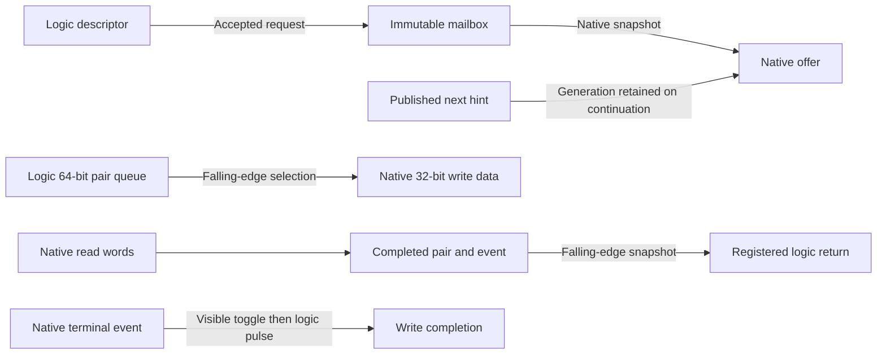

# SDRAM memory controller combination

The vendor crate owns the seven-client arbiter, ordered two-descriptor
`StreamingSdramPort`, related-clock 64/32-bit stream bridge and shared
`SdramController`. CPU/system production and standalone GPU fixtures use this
same stream closure. Dependencies point from IP/system tests into vendor code.

## Export and evidence boundary

`combination::rtl_sources(init_cycles)` exports the current arbiter, endpoint,
bridge, shared controller and pin model. Initialization can be shortened to
1..65535 native cycles for bounded tests; the production value is 21600.
`rtl_sources_with_includes` also binds caller-specific flat Verilog headers,
including GPU `ports.vh`, into `stream-contract.json` before export.
The manifest records the fitted clock/latency/delay/phase profile and each
file's byte count and fingerprint. Python fixtures reject missing, mixed or
modified peers; no old export is selected implicitly. Hashes identify input
bytes, rather than asserting physical qualification.

The target factory exposes only the stream service. Retired raw Controller HS,
word-port, serial/early-grant/four-sector-group selection APIs and their probes
are removed. The shared controller remains reusable; its parameters are not
alternate fitted board configurations.

## Full-system Tang Nano 20K profile

`TangNano20K::cold_boot_hdmi_stream_memory_project` selects the production CPU/GPU/Display
streaming profile: 54 MHz logic, 108 MHz controller, CAS/RCD/RP/capture latency 3 cycles,
RFC 9 cycles and write recovery 2 cycles. The bridge fixes these values for both production and standalone exports; only
initialization duration and coordinated reset versus cold startup are configurable.
The actual PLL `PSDA_SEL` and the SDC generated clock both select 157.5 degrees.
The complete-system target selects placement option 1, routing option 2, I/O
register absorption and routed SDF generation.

The cold-start profile also selects `DQ_INPUT_DELAY_TAPS=32`. Each DQ input
passes through its dedicated Gowin `IODELAY` before the existing capture register;
DQ output data, output enable and command timing do not pass through this delay.
The stream bridge fixes 32 taps with adaptive adjustment disabled. The shared
controller retains its reusable bypass parameter, but the board never selects it. This consumes 32 I/O delay cells and adds no
transaction storage, command cycle or registered-return cycle.

The input budget must include the routed `IOBUF.O -> IODELAY.DI -> DO -> capture.D`
chain for every bit. The cell has an insertion delay as well as a tap-dependent
delay; a nominal delay-per-tap estimate is not a qualification result. Check both
the latest valid arrival and the earliest next-word transition, as well as output
enable withdrawal after the final valid write. Internal Fmax and successful
programming alone do not establish rendering correctness.

The SDRAM reference includes the PLL-to-clock-port route and output buffer:
`set_clock_latency -source -early 3.75` and `-late 6.25` ns. These bounds must be
checked against the final routed SDF after every fit; PLL phase alone does not
include this delay. Input delays remain 2/6 ns, output setup/hold remain 1.5/1 ns,
and the existing input setup/hold multicycle values remain 2/0. Pixel and memory
clock groups remain asynchronous; the controller and logic clocks remain related.

DQM and DQ output-enable state has a local logical owner. Four DQM registers and
32 independent active-low enable registers capture the owner's next value on the
same controller edge. DQM becomes the saved mask at WRITE_LAUNCH, zero at
READ_LAUNCH, and all ones on reset. Output enable asserts at WRITE_LAUNCH and
releases at WRITE_END or reset. Pad-register Q does not feed the owner back.
Preservation attributes prevent physical copies from being merged; this adds no
SDRAM command cycle. Per-pin enable registers do not imply that every register
is absorbed into an I/O tri-state register.

`REGISTER_READ_RETURN=1` captures the complete stable 64-bit pair and valid event
at the 54 MHz edge. Clients consume it one logic cycle later, still at up to one
pair per cycle. The falling-edge event and its acknowledgement retain their
original calendar. Payload samples every logic cycle, including invalid cycles;
only valid qualifies consumption. Keeping the event out of the 64-bit register
enable reduces the fanout of the half-native-cycle control path. The adapter
holds any backpressured response in its own storage. Transport clocks continue
through client pauses.

Valid and payload enables are separate physical timing endpoints. A late
event-derived payload enable can leave selected bits unchanged even when the
valid register captures the new event. Sampling payload unconditionally removes
that failure mode without publishing invalid data or changing the return latency.
With runtime reset enabled,
reset clears registered valid and payload; cold-only operation uses declaration
initial values. `StreamingSdramPort` retains LAST, terminal response and
backpressure ownership; the extra stage does not change native completion or
transaction admission semantics. This profile adds no BSRAM or DSP.

The independent pin oracle supports explicit `CAS_LATENCY=2|3`, checks the loaded
mode, and keeps device launch latency independent of FPGA capture latency. Its
defaults match CL3. Pin qualification uses explicit
conservative reference parameters, not an identification of the board's embedded die.

## Streaming board admission

The streaming board interface uses `TangNano20KBootHdmiStreamInputs/Outputs`.
`sdram_write_done` is only a successful physical write terminal; read framing
belongs to the endpoint's declared descriptor length. The source cannot send a
read completion through the write-completion port. `sdram_request_continuation`
travels with the stable bridge mailbox and permits only the endpoint-proven
same-class/direction overlap. This is the only fitted SDRAM board service.

Each of the three GPU masters has one system-owned descriptor register containing
address, line count, direction and valid. It can capture a future GPU request
while earlier payload/retirement progresses. The register holds its descriptor
unchanged until arbiter acceptance, admits no replacement while full, and is
initialized by the monotonic cold/boot gate. No payload is copied or buffered.
GPU payload and response routes retain their existing ordered owner and lifetime.
The descriptor stage adds one logic edge before arbitration and does not reserve
the SDRAM bus; Display retains strict priority at actual grant decisions.

In the cold-only bridge, native PLL startup reset drives the controller only.
Logic-domain request admission waits for registered initialization; request and
write-data handshakes do not depend combinationally on the native reset. The
transport registers use FPGA initial values. The ordinary runtime-reset profile
still clears and gates transport through its reset input.

Native continuation separates descriptor identity from write supply.
`next_chainable` proves the stable continuation descriptor; `next_write_ready`
checks pair availability only for independent write continuation. READ admission
does not depend on write-pair credit. Legacy `CONTINUE=0` ignores that supply input.
The bridge registers this credit on the native clock. Even-length line writes
end on the logic pop slot, where the preceding native sample equals the pre-pop
credit. A passive boundary assertion checks that calendar; it adds no command
cycle and does not release payload ownership early.

The streaming controller may stage a candidate READ bank/column on NOP or STOP
([EM638325 Table4](https://etron.com/wp-content/uploads/2022/04/EM638325_Rev-3.2.pdf#page=6)),
independently of final continuation credit. These address pins have no command
ownership then. PRE/ACT preparation excludes that staging window; only a real
READ/WRITE commits the column and changes transaction state. Thus write supply
does not gate the wide address-output register. The shared controller command calendar is unchanged. READ and WRITE preparation windows are recorded at launch/boundary
rather than recomputing a length comparison in the address-enable cone.
Refresh-due and write-chain refresh eligibility predict the incremented counter
one native edge early; every counter restart resets the predicates with it.
These registers preserve refresh/chain command edges, checked by a passive
calendar assertion, and add no transaction latency.

The CPU V3 Tang Nano 20K board build uses one PRE/ACT issuer for
both read and write preparation windows. The write window also gates the
remaining payload. An existing beat increment predicts the final write beat
for the next native edge, keeping the index comparison off the continuation
decision. All updates to the SDRAM address pins share one explicit register
enable so Gowin can pack the address registers into the I/O cells. Both
layouts use the same native command and payload calendar.

The successor window opens when one forwarded line descriptor owns an active
physical stream and the second descriptor credit is free. It does not wait for
late read responses: CL3 capture and registered return would otherwise leave too
little time for next-row preparation. This earlier grant is still irrevocable
and bounded to one reserved successor. Cross-class/direction descriptors can be
queued but cannot overlap native payload or responses.

Continuation class is generated from the **arbiter-accepted registered request**,
not from the earlier GPU-to-register handshake. RO, framebuffer write and
framebuffer read use classes1/2/3. CPU D-cache line writes also use class3:
its read direction is exclusively GPU framebuffer refill, while its write
direction is exclusively CPU data. The endpoint requires both class and direction
to match, so those owners cannot overlap. CPU scalar writes and reads, DMA and
Display remain class0. D-cache full clean/invalidate separates its feed and
retirement contexts and can present a successor before the preceding terminal;
no line-count ABI, payload FIFO or BSRAM is added. This does not implement
Display prefetch.
The endpoint keeps its two descriptor credits, independent payload cursors and
real terminal retirement. A GPU abort must drain requests already captured in
the system registers, even if those requests have not reached the controller.

The stream bridge fixes CAS/RCD/RP/capture, DQ input delay and registered-read
return to the fitted profile, with an explicit cold-only setting. The read-stop age is
computed when its descriptor is captured; scalar tail and read-chain stop edges
retain their existing timing. It is not recalculated through the pin-command
selection path each native cycle.

## Native continuation

The unchanged arbiter associates each accepted descriptor with a two-bit
continuation class: GPU RO, GPU framebuffer write, direction-disjoint GPU
framebuffer refill/CPU data-line write, or conservative fallback.
Only the same nonzero class, direction and line transfer can overlap native
commands. CPU reads/scalars, cross-owner, direction changes and backpressured responses
retain serial data ownership. An accepted successor is irrevocable; Display
can arbitrate the next unaccepted request. Neither framebuffer maintenance, CLEAR nor meshlet payload
holds the bus across its entire logical job.

The endpoint is the sole owner of the two descriptor credits, declared read
lengths and ordered response retirement. Request issue, write supply and read
return advance independently. It proves same-owner/direction line overlap once
and sends one continuation-permission bit with the bridge request; the bridge
does not keep another class comparator, read-length array or retirement queue.

The bridge has a request-toggle mailbox, a full-native-edge offer snapshot,
a32-to64-bit read pair and the existing two64-bit write pair slots. Mailbox
release follows snapshot acceptance and does not release an upstream transaction
credit. Native write completion crosses as a write-only event after the final
word commits. Read framing remains entirely in the endpoint. Scalar completion
clears the unused upper write half. The logic-clock read-response register is
retained as a timing boundary and provides the CPU's held LAST/scalar response.
CPU lookahead preparation uses the registered native offer address, without an
address mux on last-cycle chain qualification.

The streaming bridge enables `SdramController(NEXT_TAGGED=1)`. A one-bit
`next_generation` identifies the address behind the registered next-row lookup.
New hint windows and unhinted offers toggle it; an ordered continuation promotes
the same hint without changing it. The endpoint publishes a hint only while its
two-descriptor queue is full, when the hinted descriptor cannot be replaced.
The controller captures row-hit and generation on the same native edge and
qualifies chaining with their one-bit equality. There is no second wide identity
comparison in either the producer or final chain path. Passive assertions verify
hint stability, promotion identity and cached lookup coherence.

Speculative preparation waits for a coherent lookup instead of interpreting a
changed generation as a miss. With `RCD_CYCLES>=2`, `prep_wait` also covers the
registered lookup's ACT update; shorter RCD configurations retain the live
preparation comparison. The default `NEXT_TAGGED=0` keeps full bank/row identity
qualification for independently driven controllers.
This query pipeline does not delay an already qualified column issue or change
data/terminal ownership. A previously unseen late hint may need one lookup edge
before preparation can start.

Write supply uses one4-bit sequential beat cursor and a supplied flag per slot,
not two full beat counters. The next permitted descriptor can feed immediately
after the old payload, before its write acknowledgement. Scalar writes cannot
be accepted ahead of the current transaction and therefore keep one16-bit
payload register. Scalar reads and ordinary line requests keep their normal
two-descriptor admission rules. No payload FIFO, BSRAM or DSP is added.

`SdramController(CONTINUE=1)` accepts individual8/16/32-word successor lengths.
Its read-capture countdown survives arbitrarily long chains without an8-bit
cumulative age wrapping. The normal per-transaction read/write completion and
refresh fallback remain. While CHAIN/READ_CHAIN is enabled, an other-bank
successor can trigger PRE/ACT when its stable descriptor arrives after the first
word, including an open conflicting row. The current bank is never precharged.
READ preparation emits PRE/ACT only before the final column boundary; the
continuation/termination tail owns the command port after that boundary. Bank
state changes therefore always correspond to an emitted physical command. An
unfinished preparation prevents chaining and falls back to ordinary row
resolution instead of treating a pending ACT as an already open row.
A missed readiness/refresh window falls back to normal completion and restart.
With chaining disabled, PREPARE_NEXT still prepares only a closed other bank.

Native writes retire after the old final word is committed; reads retire after
the declared returned words. Write completion events cross at the related-clock
calendar and emit one pulse per transaction; endpoint read framing follows the
returned pairs. Scalar write completion also
releases its unused upper pair half. No BSRAM, DSP or payload FIFO is added.

The streaming bridge stages the selected 32-bit write word and its pair-pop
decision on the controller falling edge. The following controller/logic rising
edge consumes the retained word/index decision before the write-pair head is
replaced. With `REGISTER_READ_RETURN=1`, a 64-bit falling-edge register retains
the completed read pair alongside the visible event; the following logic rising
edge captures both before a coincident native producer update can replace them.
This removes a dependence on same-edge producer clock-to-Q ordering. The bridge
adds 97 flip-flops in that profile: 32 write bits, 64 read bits and one pop bit.
All new paths retain the
related-clock half-cycle setup/hold checks. Transaction latency, response LAST,
acknowledgements, pair credits and the native command calendar stay unchanged.

The controller samples its DQ payload every rising edge, including unowned
cycles, removing the wide state/index-dependent data enable. Command, DQM and
the per-pin output enables still determine which write beats reach SDRAM.
This timing tradeoff adds no command or client wait cycle, BSRAM or DSP; the
extra bridge registers still consume area and routing, so a complete fitted
design must pass its original setup/hold and board gates.

| Transfer | Before the controller falling edge | Falling edge | Following rising edge |
| --- | --- | --- | --- |
| Write | Current pair and native word index select the owned 32-bit word | Retain selected word and pre-pop decision | Controller captures DQ; coincident logic pop may replace the pair head |
| Registered read | Native producer has completed the 64-bit pair and toggled its event | Retain the pair and expose the matching event | Logic captures stable payload/valid before a native producer replacement |

Standalone pin tests and registered-boundary timing do not imply a complete
system fit or physical board qualification.

`tests/streaming_board.rs` exercises held CPU scalar/LAST responses, varied
32-burst GPU read/write continuation and Display contention, followed by the
independent seven-client, periodic-refresh and coordinated-reset checks. Its explicit
skew regression injects a 0.201 ns producer clock-to-Q and relative logic-clock
offsets of 0 and +/-0.35 ns; these are functional counterexamples and hardening
checks, not measured physical skew or proof of a unique board root cause.
Set `STREAM_SDRAM_EVIDENCE` to an external directory when retaining pin traces.

## Host services and independent data reference

`ports::Service` exposes bounded `submit`, `step`, `cycle` and `idle` operations.
Addresses are bytes; beats are little-endian 64-bit values. Queue acceptance is
separate from arbiter/endpoint acceptance. Started, ReadBeat and Complete events
retain one logical ID; a 512-byte host job is segmented into hardware requests,
not admitted as a special physical group. Read sinks reserve all receive space.

`sim::service::Memory` runs the actual Rust arbiter and an independent logical
stream endpoint reference over abstract memory service. `sim::fabric::Fabric`
exposes low-level ready/valid ports, held responses, masks and reset. Logical
edge counts do not model PLL phase, native command timing or pad delays, and
must not be reported as SDRAM performance. Full-burst facade writes require
complete enables; scalar masking is tested through low-level ports.

`sim::oracle::Memory` independently checks bytes and event order using caller
selected synthetic read/write delays and beat intervals. It has no bank/row,
refresh, traffic calibration, chaining policy or physical timing model. The
old controller/calibration/average schedule models are removed. Real contention
is checked with all seven actual RTL clients and the controller/pin fixture.

`OracleImage` and `OracleWord` protect input provenance: constants are const
parameters, host input requires an explicitly named unsafe boundary, and memory
reads preserve memory origin. They are distinct from audited arithmetic values;
host observations never inject an audited intermediate back into hardware.

## Validation boundaries

Bounded `tests/stream_compatibility.py` checks held scalar/LAST responses,
physical read/write continuation, all seven contending clients, committed masked
writes, periodic refresh and coordinated reinitialization. It uses CL3 pin
launches, registered read returns and a portable static IODELAY subset. The
portable delay model is not routed SDF or device/PVT qualification.

Read timing/unknown checks observe the controller's consumed `dq_sample` after
IODELAY, while command and write-data checks remain at the pads. The bounded
`cl3_input_monitor.py` positive/negative probes distinguish raw-pad transitions
from actual capture-input faults. PLL/SDC agreement and uncertainty semantics
are described in the [clock constraint guide](/hardware/vendor/gowin/doc/tang-nano-20k-clock-constraints.md).

GPU fixtures use fresh peer manifests and the actual exported GPU datapath,
with independent output/guard comparisons and real terminal counts. Core/system
co-simulation additionally checks pipeline, cache and handshake behavior. Its
abstract memory peer does not qualify the fitted SDRAM schedule. Production
export and default boot identities are compared separately; no prior PnR or
board result is promoted to a changed image by source normalization.

## Native bridge edge mirror

`cycle::gear::Gear` mirrors the numeric state of the registered-return
`TangNano20KSdramNativeBridge108M54M` profile. It owns no memory and does not
schedule SDRAM commands: callers supply controller feedback explicitly. The
abstract service under `sim` remains a separate interface.

The fitted 2:1 clock relation has four events per logic cycle:

| Event | Native clock | Logic clock | Bridge state sampled |
| --- | --- | --- | --- |
| 0 | Rising | Rising | Mailbox, pair queue, read return and native offer |
| 1 | Falling | High | Write selection/pop, visible events, stable read pair |
| 2 | Rising | Falling | Native offer and controller feedback |
| 3 | Falling | Low | Write selection/pop, visible events, stable read pair |

`clock(Edges, Input, Feedback)` computes all coincident edges from one old
snapshot. Native feedback at event 0 cannot observe that event's new mailbox
or pair push. The forwarded SDRAM clock is a passthrough and owns no bridge
state; no pad timing is inferred from this mirror.

Logic inputs use 21-bit native 32-bit-word addresses, six-bit word counts,
four byte-mask bits (one disables the byte), and 64-bit write pairs. State
captures truncate descriptors to these RTL widths. A scalar consumes its low
word and releases the unused half at write completion. Ordinary write launch
requires two buffered pairs; scalar launch requires one. Continuation credit
is the registered native sample of nonempty supply, independent of descriptor
ownership. Read chaining does not require write credit.

`Gear::default()` selects cold-only transport. Raw reset is still forwarded to
the controller. With cold-only disabled, each edge clears exactly its source
registers: the unconditional falling-edge write selection and stable read-pair
sample continue during reset. Cold-only transport retains its state on raw
reset; this is not an in-flight transaction recovery contract.

The bounded `native_gear` test replays the production bridge body and passive
assertions with a deterministic controller feedback peer. It compares all 21
logic/native-drive fields after each event, including invalid payloads, in both
reset modes and both related-clock divider origins. All sixteen byte masks
are exercised. Directed traffic covers queued descriptors, read/write chaining,
hint promotion, scalar and 8/16/32-word groups, launch credit stalls,
simultaneous pair push/pop, terminal retirement and a mid-read raw reset.
Independent word/pair scoreboards check completed traffic. A test-only DUT
mutation of request readiness must produce a named first-field mismatch.
The peer is not the SDRAM controller, a memory model or MC performance
qualification; this test establishes only the bridge edge contract.

## Native controller and borrowed memory closure

`cycle::controller::Controller` implements only the fitted profile: BANK_BIT5,
CL3, RCD/RP3, RFC9, rising-edge capture latency 3, free-running input capture,
tagged next-row lookup, pipelined request resolution, read/write continuation
and other-bank preparation. Initialization defaults to 21600 native clocks;
`new(init_cycles)` permits a positive 16-bit test duration without changing the
remaining profile. Standalone Verilog defaults and disabled parameter branches
are not alternate runtime modes.

`Controller::output` evaluates current combinational readiness/chain predicates.
`clock` commits one native rising edge from the old snapshot, including command,
pad address/bank/DQM/OE, input/output data capture, row records and refresh
lookahead. Descriptor replacement after request acceptance does not change the
saved row resolution. The public phase and stream statistics retain the RTL
encodings and wrapping widths. Reset has source-specific priority and retains
unreset payload/address registers rather than reconstructing a fresh instance.

`Sample32` carries value and known-bit mask at the consumed DQ boundary. Floating
unowned capture is distinct from a known zero; a newly owned unknown return
stops the composed model. Stable injected DQ is compared in full, including
invalid input-capture payload, by the standalone controller RTL replay.

`cycle::pins::Pins` owns only device bank/column state, two queued read addresses
and pending/visible return values. It borrows the caller's physical `u16` backing
slice for each late SDRAM edge. Native bank/row/column addresses are inverted to
logical word addresses before accessing that same slice. Byte masks preserve
disabled bytes. Writes commit at the pin edge, not request acceptance. The read
address stages and return-value stage reproduce owned samples at the fitted
native rising edges; they do not model arbitrary pad transitions or SDF/PVT.

`cycle::memory::Memory` composes this sequencer with the gear and controller:

`output` is sampled before the logic edge. `clock_logic` advances the four
related-clock events from that input, preserving concurrent old-state behavior.
`clock_half` exposes the same calendar for bounded tests. Every native falling
edge precedes its late SDRAM command sample; queued return values remain stable
until the corresponding consumed capture. `native_cycle` counts actual modeled
native rising edges. No average delay, implicit cache maintenance, background
GPU/Display request or private memory image is introduced.

The standalone controller replay checks all feedback/pin-drive fields against
unchanged production RTL, including real initialization length, row hit/conflict,
preparation, tagged lookup, continuation acceptance/refusal, masks and refresh.
The composed replay uses the actual bridge/controller and existing board-corner
pin fixture, comparing every applied logic input and all registered bridge
outputs. Independent expected physical write address/mask/value records and
final words check data and completion ordering. Intentional DUT readiness and
write-data mutations must fail those comparisons. These component tests do not
qualify a CPU/device composition, software throughput or routed physical timing.

## Native stream endpoint composition

`cycle::port::Port` connects the existing two-descriptor `sim::endpoint::State`
to `cycle::memory::Memory`; its CPU side uses logical 16-bit-word addresses.
Addresses, line count and chain class truncate to the actual 22/2/2-bit ports.
`output` has no side effects. `clock` captures both owners' old logic inputs,
commits the endpoint once, then advances the native edge calendar against the
borrowed backing. Default initialization retains the fitted 21600 native clocks.
Cold-only transport does not support aborting an in-flight transaction by reset.

The bounded `native_port` differential uses the unchanged SharedSdramPort,
native bridge/controller and board-corner pin fixture. Mixed scalar and
32/64/128-byte transactions exercise two descriptor slots, payload credit,
continuation, scalar-response hold and alignment-error retirement. Every
control output and every owned successful response bit is compared each logic
cycle; invalid/error payload has no owner. Applied input rows, physical write
address/mask/value records and final memory words are checked independently.
An injected controller write-data mutation must change physical commits.

`cycle::memory::Memory::clock_half_observing` advances exactly the same half-edge
as `clock_half` and returns passive `Activity`. A native rising-edge old
controller `read_valid` contributes 4 read bytes. A native falling-edge actual
`Pins::clock_observing` write branch contributes 4 write-slot bytes and 0..4
DQM-unmasked bytes. `None` from Pins means no write slot; `Some(0)` is a fully
masked slot. Held DQ and the other half-edge do not transfer another slot.
The model has 32-bit DQ (`Sample32`) and four DQM lanes; these observations do
not divide client64 payload into estimated native16 beats. They measure model
transfers, not electrical or board pin bandwidth. There is no additional clock,
backing copy, write, cache clean or mutable state exposed by observation.

`Pins::clock_journaling` executes that same write branch and returns
`Option<Write>` with `address_bytes`, original 32-bit `data` and four-bit
`unmasked`. `clock_observing` remains a compatibility wrapper returning the
unmasked-byte count. `Activity.write` exposes the exact committed write alongside
the byte counters; it is absent on other edges. All sixteen DQM masks preserve
the original backing update and clock state. Consumers may journal these fields
for historical images without another memory read or pin clock.
