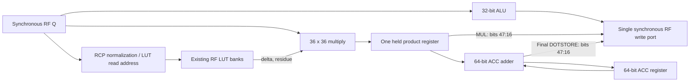

# CPU V3 hardware structure and timing

This document describes the revision 0.9 ISA running on the current Stage 12
microarchitecture, not an intended future pipeline. The maintainable PlantUML source is in
[`cpu_v3_structure.puml`](cpu_v3_structure.puml).

## Execution model

The generic core and benchmark model start at CSEG0:PC0 with data pages
0/1/2/3. `INITIAL_CODE_SEGMENT` permits an explicit board specialization;
the fixed cold-boot system selects CSEG7 while retaining the generic default.
`CpuV3Sim::with_initial_code_segment` constructs the corresponding cold model.
Independent IP reset remains available even when a board ties it inactive.

`CpuV3Core` is precise and in order, with a conservative two-stage frontend rather
than a general pipeline. A single-cycle instruction with sequential control flow
may accept the next queued word in its Execute cycle and remain in Execute, so an
eligible sequence can retire one instruction per cycle. Loads, integer multiply,
FPU instructions, control transfers, device operations, invalid cases, and stores
while the one-entry asynchronous store buffer is busy remain barriers on the
original staged path. At most one instruction retires per cycle. A successful
instruction updates architectural state and retirement exactly once. A fault
updates neither retirement nor a partially computed FPU destination; the
documented four-beat store exception still keeps memory writes acknowledged
before a later beat faults.

The fitted system has two ordinary payload slots and two request-provenance
slots. The I-cache already holds a response and a lookup while backpressured;
those slots and the frontend queue have separate capacity checks. A full queue
can consume its old head and accept its replacement on the same edge. Request
slots likewise drain and refill together. This replaces the aggregate
fetched-plus-outstanding reservation adder/comparison without adding upstream
storage. A system may connect this frontend directly to its sole I-cache;
any additional instruction-source routing belongs to the system.

A redirect or flush clears live request bits before late ordered responses can
enter the new stream; a new request wins if that edge reuses a drained slot.
This remains correct across arbitrarily many redirects. Sequential word addresses
wrap PC without carrying into CSEG. Queued words and direct response bypass can
feed FetchRequest or the Stage 12 pipelineable Execute subset at one word per
cycle. Backpressure propagates to the existing I-cache holding slots.

The I-cache owns a held response independently from its successor lookup.
Accepting a successor must not clear the old error flag. Data/error publish
together and remain stable until consumption; the Rust model uses the same
ownership rule. Independent portable/vendor-DPB fixtures assert fault delivery
after a full frontend queue, including a cold-line continuation error following
two successful target words. The old four-total-credit reservation masked this
held-error case in the composed frontend; the shorter queue needs this repair.

Live queue and request slots store no addresses. Full expected-core-address
matching, FIFO order and current ownership establish the next ordinary word.
The independent downstream head offset and its equality comparator are removed;
BTC replay leaves the ordinary queue in order. Full physical BTC target tags
remain necessary because complete entries survive redirects.

The queue also contains a fully associative resolved-target BTC with exactly
four entries of two 16-bit instruction words (not necessarily two instructions).
It compares the full physical target using a 22-bit tag plus a zero check on the
upper address bits. A restart hit supplies the first word combinationally and
resumes downstream requests at the target's second successor. A replay cursor
advances only when the core accepts a word, independently of downstream readiness.
The ordinary queue may hold later words during replay; BTC consumption never
pops that queue or frees its capacity. A hot two-cycle I-cache continuation can
therefore follow both BTC words without a bubble. Downstream refusal or a miss
can still stall the continuation.

A miss collects only the first two successful core acceptances of that stream;
installation occurs after both words arrive. Redirect, flush or an instruction
error cancels an incomplete fill without evicting a complete entry. Empty slots
are used first, followed by exact LRU replacement; accepting the first BTC word
marks its entry MRU. Reset, halt, fault and global I-cache invalidation clear the
BTC and replay/fill state. Ordinary redirects retain complete entries. The BTC
neither predicts a target nor adds memory traffic to complete a partial entry;
software-controlled instruction coherency applies exactly as to the I-cache.

The ordinary queue and BTC share one asynchronous-read, synchronous-write
16-bit distributed RAM. Resource reservation follows the physical array depth:
16 words (256 bits), including unused physical slots. BTC tags own low physical
pairs through small pointers;
one extra pair holds incomplete fills. The high four words hold the two logical
ordinary slots using modulo-four head/tail pointers. Their low bits index the
two metadata slots; a full FIFO's physical head and tail are two rows apart.
Head and tail are two-bit registers within the same RAM allocation.
The first two live responses after a target miss write the spare pair,
while later responses write their ordinary tail slot. This is the sole payload
writer: CPU acceptance never copies an instruction word into BTC. Ordinary
bypass does not write RAM unless the response also fills a target pair.

A queued word stores one bit selecting its ordinary slot or the current spare.
For a spare reference, the matched core address and stable fill tag identify the
halfword, including PC wrap. Both target references expire by the second core
acceptance, which atomically exchanges the spare/victim pointers and publishes
the complete pair. A later continuation can enqueue on that same edge. Errors
and cancelled fills never replace complete entries. Queue and BTC replay select
an address before the shared RAM read; the ordinary FF bank and wide final
queue/BTC data selector are absent. Memory-response bypass remains direct.
Full pop/push writes a different physical row from the head being consumed;
no valid RAM consumer depends on the old output during a same-address write
edge. Redirects and flushes reset both pointers, while stale responses retain
their existing drain behavior. The official RAM16SDP4 regression checks
full-FIFO pop/push, rejects an effective same-address overwrite, and covers
simultaneous BTC installation/continuation enqueue for the fixed four entries;
inferred and official runs share one
independent address/value fixture.
FPGA configuration initial values and independent reset restore unique pair
ownership; flush retains the pair permutation while
clearing validity and live queue references. Exact LRU keeps relative-order bits
and its original events. The independent cycle model retains rank-based BTC
state and separate queue payloads as its reference representation.

BTC capacity is fixed at four entries in the cycle model and RTL; it has no
environment-variable configuration, hardware port or ISA control.
The tables below count Execute through retirement; fetch waits
are additional when neither the queue, BTC nor bypass can supply the word.

## Core storage and execution resources

| Block | Current implementation | Per-cycle capability |
|---|---|---|
| GPR file | Explicit 16 x 16-bit distributed-RAM leaf with dual asynchronous reads and one synchronous write | One 21-bit valid/address/data publication slot feeds the synchronous RAM write and both independent source-forwarding selects |
| Control state | 16-bit PC, CSEG, four 8-bit DSEG page mappings, one PFX12 prefix, one transient three-way comparison | One instruction decoded; no speculative state |
| Integer ALU | One common operand pair for register/immediate add/sub/logic/compare; the add/subtract lane also forms effective addresses and relative targets; separate shift, CLZ and popcount paths | One non-multiply integer result; sequential PC increment remains independent for overlapped instruction acceptance |
| Integer multiplier | Unsigned 16-bit operands zero-extended into the shared signed 36 x 36 CPU/FPU pipe, with integer-owner tag `0x100` | The blocking core retains `Execute -> MultiplyWait -> MultiplyCommit`; the returned low 32 bits supply the selected 16-bit product window |
| FPU front-end | Two-word instruction latch: word0 exposes `Fa`/`Fb` (or AUX `X`/`Fa`) and drives the RF read addresses immediately; word1 carries `Fd`/subop/len/mode | One `instr_complete` pulse per pair; FPU instructions are fetch barriers and never consume `PFX12` |
| FPR file | Two 512 x 32 SDPB banks giving 2R1W, with broadcast writes and distinct initialized hidden tables; architectural `F0..F63` are addresses `0..63`, hidden tables occupy `64..511` (A: RCP and SINCOS; B: RSQRT even/odd) | One synchronous read per bank and one broadcast write per cycle; a same-cycle write/read returns the old word on both ports |
| FPU scalar/vector ALU | One combinational 32-bit Q16.16 ALU (add/sub/min/max/abs/neg/floor/ceil/round/trunc, all wrapping), using the common FPU lane issuer and commit slot | Scalar operands capture at `T0` and write at `T1`; vector lanes retain II = 1 across 2/3/4 consecutive registers |
| CPU/FPU multiplier | One shared inferred 36 x 36 pipe (four 18 x 18 lanes), two stages, II = 1, with a 9-bit owner/destination tag | Integer multiply, FPU multiply/dot, SINCOS range reduction and all LUT interpolation products time-share it; the core serializes owners |
| FPU operand-port issuer and commit | ALU and product instructions share one lane calendar, two six-bit read cursors and destination context. One next-edge result/address slot serves ALU and final `DOTSTORE`; both physical DSP valid/tag slots retain direct-return ownership, and the returned DOT lane identifies completion | One synchronous RF operand pair per enabled beat; ALU and product vector II = 1, direct MUL/special returns and all existing write beats are retained |
| ACC | Signed 64-bit Q32.32 accumulator | One exact product enters per cycle; accumulation wraps modulo 2^64, and `DOTSTORE` narrows `ACC[47:16]` once |
| Special path | Blocking RCP/RSQRT/SINCOS controller over the hidden BSRAM tables; range reduction and delta/residue interpolation use the shared CPU/FPU pipe, with two LUT-base metadata stages and direct result writeback | RCP/RSQRT `T0..T4`; SINCOS `T0..T7` dual, `T0..T6` single; owns both RF read ports while active |

The GPR result class is selected once across integer operations, immediate forms,
loads/device returns, multiply/AUX completion, link and segment reads. At E0 an
instruction publishes the single 21-bit valid/address/data slot. After E0 either
or both operands of the next instruction can forward from that same slot. At E1
RAM consumes the old slot while the next result may publish, preserving Execute
II=1. Hold retains the entire valid slot; RAM may repeat its idempotent write.
Address/data need not retain an invalid payload after a non-held edge. CMP,
false conditional moves and failed loads publish no GPR write. A global async
store fault suppresses a new publication; a next-instruction fetch error does not
erase the current successful instruction's result. The registered read-B and AUX
read-A selections remain ahead of the asynchronous operand path.

Within the FPU ALU, ADD/SUB, MIN/MAX, CMP and NEG/ABS share one wrapping
32-bit add/subtract path. Signed comparison checks differing operand signs
before using the subtraction sign; CMP equality reduces that same difference
to zero. MIN/MAX select their shared operand result using signed ordering and
the operation direction, without putting equality detection on the wide data
path. Equal operands have identical bits. Comparison flags remain specified
only for CMP. CEIL, half-up ROUND and TRUNC only need the
integer half, so they share one 16-bit increment followed by sixteen zero bits.
No execution or vector-lane stage is added, and the defined wrap boundaries remain.

The accepted `word0` already retains the parked architectural RF addresses. The
common port issuer advances its cursors only for the scheduled vector/product
reads; special-function LUT accesses and idle external accesses select those same
physical ports. A single destination context serves ordinary and special work;
the special leaf receives operation fields and returns only a relative destination.
ALU results and final DOTSTORE values share their mutually exclusive next-edge
commit storage. Ordinary products and special-function results still write the RF
directly on their scheduled return beat. Write events form one mutually exclusive
final bus, with no new queue or arbitration state. Standalone ALU/ProductPath
leaves remain test references and are absent from the production dependency graph.
The independent value model commits the old scalar/vector write registers after
sampling RF reads; new results become eligible on the following edge. Its strict
mixed-owner replay checks RF/ACC after each enabled edge and during clock holds.

All six integer shift forms share one 17-bit signed right-shift barrel.
Register/immediate decode selects the four-bit count before the barrel. Left shift
reverses the 16-bit operand and result using wiring and muxes; logical right shift
uses zero fill, and arithmetic right shift replicates the original sign. The
signed shift is computed in its own assignment before result selection. This
changes neither the single-cycle Execute schedule nor forwarding/retirement.

Integer unsigned comparison uses the shared subtractor's carry; signed comparison
first checks differing operand signs, then uses the difference sign for equal-sign
operands. Negation selects zero as the left operand. Prefix and immediate signedness
are selected before execution, preserving the defined wrapping 16-bit results.

The integer `ASR`/`ASRI` instructions shift `signed(rd)` arithmetically. The RTL computes the
signed barrel result separately, then a statement-based `case` validates the form; it never places `>>>` inside a
conditional expression, because Verilog makes `?:` unsigned when any branch is unsigned and would
silently turn the arithmetic shift into a logical one. `FTOI16` and every other signed FPU result
depend on the same rule for any arithmetic shift in their datapath.

The AUX kind-00 integer bridges (`ILO2F`/`IHI2F`/`I16TOF`/`FLO2I`/`FHI2I`/`FTOI16`) are performed
by the core through the unit's external F read/write ports, since only the core can reach the GPR
file. A scalar `CMP` publishes its registered `flag_lt`/`flag_eq`/`flag_gt` into the core's
transient pending test when the pair retires, so a following conditional branch or conditional
move consumes it exactly like `CMPS`/`CMPU`. The core captures AUX/FLD/FST word0 `X` when it
accepts the pair and holds a registered select across the required beats. The asynchronous GPR
read address therefore does not depend on a live multi-state FPU decode; this preserves the same
cycle schedule while removing that decode from the GPR read/compute/write timing cone.

The scalar B-source address is also captured with each successfully accepted instruction:
LOAD/STORE select field D, while other instructions select field B. FetchRequest bypass,
FetchResponse, and overlapped Execute acceptance update the same four-bit latch. Reset clears
it; hold and fetch errors retain it. The asynchronous GPR read and pending-write forwarding
are unchanged, without an added execute cycle or a state-dependent B-address mux.

The optional fitted system places separate 4 KiB instruction and data caches
around the core. Each cache is two-way set-associative with 64 sets and 16 words per line.
Two true-dual-port BSRAMs split every line strictly by word parity. During lookup,
the two ports of the selected parity bank read the same word from way 0 and way 1;
the parallel tag comparison selects the corresponding registered bank result.
The read-only I-cache can start its next lookup while a resident read resolves,
allowing one ordered hit per cycle without backpressure. The write-back D-cache
serializes acceptance, lookup and response consumption. Stores allocate on a
miss; replacing a dirty victim first writes its complete line.
Each cache uses a third DPB for complete metadata. Both pack tag and valid into
each way's 16-bit word, with the set's victim bit in way zero; D-cache also stores
dirty in that word. Lookup reads both metadata words synchronously alongside
data; stores, refill and maintenance share their update ports. Neither selected
cache has a separate valid/victim RAM or dirty bitmap. During an I-cache sweep,
normal-mode writes hold the pending lookup's old metadata Q. One bit records
when that lookup's set has been cleared, so a backpressured lookup cannot reuse
the old validity after the sweep, including when another invalidate restarts it.
A global invalidate, reset, or memory-error scrub clears one set of both ways per
cycle, and the system holds the CPU for the D-cache sweep.
A read or write-allocate miss issues one aligned line request; the system arbiter
streams four ordered 64-bit beats at 54 MHz. Each beat writes four words directly
through the four BSRAM ports, and tag/valid state commits only on the fourth
error-free beat. Both caches capture a read miss's requested halfword directly into
its final response register when that beat arrives, without another refill-only
16-bit payload slot. Response-valid remains low until the complete error-free
line is committed. A later refill error clears this payload and publishes an
error; write-allocate stores still complete with zero response data, and LCOPY
never publishes a CPU data response. Once valid, the response remains held until
consumed. The victim is invalid throughout refill, so an error or invalidate
cannot expose a partial line. Dirty eviction primes the synchronous DPB outputs,
then streams four ordered 64-bit beats without a private line buffer. The board
gearbox pairs/splits those logical beats against the 32-bit SDRAM controller at
the related 108 MHz clock. The cold-boot loader keeps
single-word transactions. Full D-cache clean and clean-plus-invalidate read one
metadata set per cycle. The scan holds one candidate's identity and metadata,
while separate feed and retirement contexts permit at most two accepted line
writes. A successor descriptor can be offered during the predecessor's data or
terminal wait. The predecessor's fourth accepted beat launches the successor's
beat-zero DPB read; no line payload FIFO or additional BSRAM is required. Dirty
clears only for the matching successful ordered terminal. A metadata write
holds DPB DO, so the scan invalidates and replays its pending read on that edge.
Way zero precedes way one within a set, preventing rediscovery of a line whose
terminal has not arrived. Full invalidate waits for all writes before its
64-set validity sweep. A full-maintenance memory error stops request admission
and holds the cache unavailable until whole-system reset; it cannot cancel an
already accepted successor. Single-line commands keep their existing contract. A
conservative one-bit hint skips scans after a completed full clean; single-line
clean never clears that hint. The CPU is held during full maintenance; there is
no per-line snoop interface. The system-control I-cache invalidation pulse is
registered for one cycle so the compiler's adjacent invalidate-and-JSEG
handoff resolves deterministically.

Logical data offsets select one of four DSEG entries with bits 15:14, then form
the physical word address from that 8-bit page and offset bits 13:0. The legacy
bulk DSEG write still establishes four consecutive pages atomically; individual
page writes support a fixed three-page application arena plus a remappable
fourth window without widening program pointers.

Device-0 channel-1/channel-4 `DEVSEND` is a full-maintenance ordering
boundary. Execute retains the instruction while older asynchronous stores,
early-release FST halfwords remain. Ordinary FPU arithmetic and AUX register
writes have already completed before their instructions retire; they need no
second busy check at this boundary. The remaining FST count and asynchronous
store slot together cover the sole early-release FPU path. New instruction acceptance is
blocked, while old request issue, response/error consumption and FST refill
continue under the existing clock. Only after that core-owned work drains does
the device write retire and SystemControl assert CPU hold. Other device writes
retain their existing schedule. An older store fault wins before this write.

D-cache `maintenance_ready` means Idle with no held CPU response, active
maintenance or metadata sweep. A clean/invalidate request is retained until
`valid && maintenance_ready`; ordinary accesses cannot be accepted on that
edge. SystemControl then waits for the accepted command's `done/error`, ignoring
an earlier owner's completion on the acceptance edge. An empty clean may
complete without a visible busy interval. Reset cancels pending control and
restarts the cache metadata sweep. Neither the arbiter nor memory clock is held.

The extended cache-control selector 7 is reserved. `DWAIT` requires selector 8
and a zero low nibble; reserved variants fault as invalid instructions without
retirement. Canonical `DCLEANL` and `DWAIT` keep their existing scheduling.

`LCOPY` reuses the same lookup/refill and four-beat write-back path. The core
waits for older buffered stores and command acceptance, then retires the
instruction; only later D-cache users wait while the copy remains active, so
integer/FPU computation, instruction fetch, and device accesses may overlap it.
The D-cache latches the destination physical page at acceptance and preserves
the source dirty bit. A cold destination is not allocated. If the destination
line is already resident, its valid and dirty bits are cleared directly before
the complete-line overwrite; stale destination data is neither written back nor
refilled as part of the copy.

`DCLEANL` shares this asynchronous command slot. It writes one dirty hit and
otherwise completes locally. The core can continue
with instructions that do not touch D-cache, while any later D-cache access
waits at its ordinary request handshake. `DWAIT` gives software an explicit
completion/error boundary. The present parity-bank geometry uses all four data
RAM ports during each 64-bit refill/write-back beat, so foreground hits are not
claimed concurrent with an active transfer.

D-cache line-write address acceptance consumes no payload. Each of the four
64-bit beats requires `memory_write_data_ready`, routed by the arbiter to the
accepted owner. During write-back the line remains locked in its data DPBs;
the next synchronous read launches on consumption and stalled outputs stay
stable. There is no first-beat FF copy or downstream complete-line staging.
An error response may terminate the stream before all four beats are consumed.

## Integer instruction latency

| Operation class | Execute-to-retire cycles | Active phases |
|---|---:|---|
| Pipelineable ALU, immediate, compare, major-2 shifts, non-control major-6 operations, non-halting `SIGNAL`, prefix, and store with an empty async buffer | 1 | `Execute`, optionally accepting the next queued instruction in the same cycle |
| Branch/jump, device, `SIGNAL` type 0 (halt), and other single-cycle barriers | 1 | `Execute`, then restart through the fetch path |
| Integer `MUL0`/`MUL8`/`MUL16`/`MULI` | 3 | `Execute -> MultiplyWait -> MultiplyCommit` |
| Integer `LOAD`, minimum | 3 | `Execute -> DataRequest -> DataResponse` |
| Integer `STORE` with an empty async buffer | 1 to retire | The buffered data request/response continues in the background; a later memory operation waits for it |
| `LCOPY`, D-cache ready | 1 to retire | The 16-word copy continues in the D-cache; only a later D-cache operation waits |
| `DCLEANL`, D-cache ready | 1 to retire | The clean continues in the D-cache; only a later D-cache operation or `DWAIT` waits |
| `DWAIT` | 1 after command idle | Raises a data-memory fault if the completed command reported an error |

## FPU v2 scheduling and latency

FPU v2 has no scoreboard, forwarding, or dependency comparison. Each operation
belongs to a fixed timing profile, and the core starts the next FPU instruction
only after the current owner's busy window, outstanding products and writes
have drained. The two-word front-end is a fetch barrier:
word0 is accepted in `Execute`, word1 through the normal instruction port, and
the pair retires as two words.

Scheduling is hardwired: lane/phase counters, valid/tag registers and fixed
result ownership select the ports. There is no scheduling ROM. The hidden
BSRAM ROM regions hold numerical RCP/RSQRT/SINCOS tables. `instr_complete`
means that the frontend has assembled the two-word pair; it does not mean
that its arithmetic or RF writes have finished.

The selected unit uses one compute calendar from the frontend to the final RF
consumer. The standalone scalar/vector/product paths remain independent legacy
references; they are not instantiated by the selected unit.

`T0` is the edge consuming the frontend's registered complete-pair pulse.
Execution windows include both endpoints and exclude frontend transfer, CPU
retirement and memory stalls. `n` is 2, 3 or 4.

| Instruction class | Execution window | Final effect |
|---|---:|---|
| Scalar ADD/SUB/MIN/MAX/ABS/NEG/FLOOR/CEIL/ROUND/TRUNC/MOV | 1 edge | RF write at T0 |
| Scalar CMP | 1 edge | Flags captured at T0; no RF write |
| Scalar MUL | 2 edges | RF write at T1 |
| Vector ADD/SUB/MIN/MAX/ABS/NEG/MOV | n edges | RF writes at T0 through T(n-1) |
| VMUL/VMULS | n + 1 edges | RF writes at T1 through Tn |
| DOT/DOTADD | n + 1 edges | ACC updates at T1 through Tn |
| DOTSTORE | n + 1 edges | Final RF write and ACC clear at Tn |
| RCP/RSQRT | 3 edges | RF write at T2 |
| SINCOS single result | 4 edges | RF write at T3 |
| SINCOS dual result | 5 edges | RF writes at T3 and T4 |

Vector subops 08 through 0B are reserved. FLOOR/CEIL/ROUND/TRUNC are
scalar-only; vector callers apply the scalar operations to individual lanes.
AUX bridges and FLD/FST belong to the core rather than this arithmetic calendar.

- Word1 acceptance installs the source cursors, destination and last-lane index
  before T0. Every ordinary issue, including lane zero, consumes the current RF
  Q and requests the next operands. There is no separate first-lane data or
  destination mux. A advances by one; B advances by zero for VMULS or by the
  one/three/four DOT stride. Addresses retain six-bit architectural wrap.
- An ALU operation writes its final RF location on the issue edge; no redundant
  result/commit register sits between the ALU and RF. The multiplier has one
  product register and II=1. Ordinary products share one return-valid,
  destination and last-item slot. They do not carry per-product owner/address
  tags or a second outstanding/completion counter. Physical multiply
  destinations retain addresses through 66; ALU destinations wrap at F63 as
  before. Instructions remain serialized, while lanes sustain II=1.
- Legal destination/source ranges are exactly base-equal or disjoint, as the
  ISA requires. Partial overlap is outside that contract. VMULS holds RF B's
  existing Q through the final issue using its read CE; writes remain live.
  This protects B0 even when Fd equals Fb, without an extra 32-bit broadcast
  copy. Other same-base operations retain synchronous read-first behavior.
- DOT accumulates complete signed products modulo 2^64, with one final
  Q32.32-to-Q16.16 extraction for DOTSTORE. The last product feeds the ACC
  adder and final RF write on the same edge; ACC clears on that edge. There
  is no intermediate DOTSTORE snapshot. Abort suppresses uncommitted writes
  and ownership; already written RF lanes and the accumulated prefix survive.
- One special-function phase counter owns both RF lookup ports and the shared
  multiplier. RCP/RSQRT normalize the ready source and issue the packed-table
  read at T0, interpolate at T1 and write at T2. Their retained context is
  residue, scale, sign and zero/invalid status, rather than a 32-bit magnitude
  copied into a separate preparation stage.
- SINCOS issues range reduction at T0. The held DSP product supplies phase
  directly for the first LUT read at T1 and first interpolation/second lookup
  at T2. Dual output retains only the second interpolation's eight-bit residue,
  endpoint and sign (ten bits). First RF write/second interpolation occur at
  T3; the second RF write occurs at T4. No separate 18-bit phase register is
  needed. A single 17-bit interval-base slot plus two flags accompanies each
  interpolation; the return consumes the old slot while the next issue
  replaces it. Modes 00/01/10 are dual/sin/cos; mode 11 remains reserved.
- Integer, special and ordinary issue are mutually exclusive under core
  serialization, with that priority at the physical input mux. A single
  delayed integer-owner bit identifies integer returns. The product register
  holds its last value across core hold until MultiplyCommit. The selected
  top ties the generic multiplier tag port to zero, so its tag registers and
  ordinary-pending logic are removed by synthesis.
- Core hold stops new core progress while the FPU continues clocking. Submitted
  word/abort signals clear as one-edge pulses independently of hold; frontend
  completion is retained until the core can retire. A held core therefore
  neither resubmits a word nor loses a completed pair. The cycle model clocks
  the same independent unit during hold.
- FLD/FST use the existing variable-latency core data port. Loads remain
  blocking; stores drain after their early-release source snapshot is captured.

The early-release FST/FSTV snapshot uses a single-write, asynchronous-read
16x32 distributed RAM, with four live rows and eight physical RAM16 cells.
Each enabled capture edge writes one complete F register and requests the next
source. A core hold retains the current source address, since the synchronous
RF read continues clocking while capture is suppressed. The final capture
publishes the pending halfword count; the following edge may refill the
existing async store slot from row zero. Row selection uses the pending
halfword index and bit0 selects the low/high half. The capture and drain
schedule is unchanged.
Hold suppresses capture and drain, and the global store-fault priority is
preserved. RAM contents are not reset: reset clears pending ownership, and a
new snapshot is fully captured before any of its words can be consumed.

The blocking two-word FPU instruction retains the core instruction and its PC
until retirement. Word0, Fa and synchronous fault attribution use that owner
directly rather than private copies. The independent GPR address register is
retained for the read-address timing boundary. An early-release FST still
copies its address and fault PC into the drain context before the core may
accept another instruction. Memory progress uses a three-bit halfword index
and a two-bit last-lane field; the pending count retains four bits to represent
all eight halfwords. After its last halfword the drain index may wrap, but no
consumer owns that index until a new complete snapshot is published.

The shared DSP input forms extension bits after source selection. Ordinary and
range work consume RF A as signed32; interpolation substitutes signed10 delta.
The other operand is ordinary signed32, interpolation unsigned9 residue, or the
positive 36-bit range constant. Integer operands remain zero-extended unsigned16.

Reciprocal normalization finds CLZ and normalized [30:15] in the same staged
16/8/4/2/1 network. After the 8/4/2 steps, [31:8], [31:12] and [31:14] retain
every source bit reachable by the remaining shifts. Zero yields CLZ32 and a zero
window. The seven-bit index and nine-bit residue feed the T0 lookup/capture;
bank A holds reciprocal/SINCOS and bank B the distinct RSQRT tables.

One modulo-2^17 interpolation adder serves both return types. RCP correction is
independently arithmetic-shifted by 9, truncated to signed10, then extended;
SINCOS correction is independently arithmetic-shifted by 8 and consumes low17.
One base metadata slot is consumed and replaced on adjacent interpolation edges
of the single-product DSP. Endpoint-adjusted SINCOS magnitude/sign or scaled/saturated
reciprocal magnitude/sign select before one 32-bit conditional negation. Right
shift precedes negation. Zero and invalid-RSQRT overrides retain priority;
the live SINCOS return ignores stale reciprocal context.

  Reciprocal scaling places the 17-bit interpolated magnitude above sixteen
  zero bits in one 33-bit window. Its registered right-shift position is
  `31 - CLZ` for RCP and `23 - (CLZ >> 1)` for RSQRT; no direction bit or
  bidirectional data selection is retained. RCP's zero-input CLZ of 32 uses
  the existing constant-result override, so its shifted payload is unused.
  Bits 32 and 31 remain available for reciprocal saturation before truncation,
  sign application and the existing RF write edge.

The hidden BSRAM tables are generated from one Rust reference model in the
architecture crate (`fpu_lut`), which also backs the architectural emulator and
the host error test, so the emulator and the initialized RTL cannot disagree.
RCP/RSQRT are measured at 1.38/1.47 result-ulp and SINCOS at 3 LSB over the
whole `i32` input range, inside the frozen 2/2/4-ulp targets.

## Current fitted-system result

The complete `cpu_v3_system` is fitted and routed, including the CPU, boot path,
caches, 54/108-MHz SDRAM gearbox, and display path. The fitted numbers live in
[the system architecture document](../../../systems/cpu-v3-tang-nano-20k/docs/architecture.md),
which owns them and is where they are updated; they are deliberately not repeated
here.

The CPU and controller same-clock setup/hold checks pass at their configured
clocks in the matched current-tool fit. The complete timing report retains the
baseline's external SDRAM-output setup violations; this is not a claim that all
board timing constraints pass. The system document separates these checks from
physical-board validation and from the independently fitted GPU post-quad chain.

The following timing sections are retained as implementation history for the FPU
lane pipeline. They are not the current full-system Stage 12 result.

## Historical pre-FPU-pipeline 54 MHz baseline

These place-and-route measurements precede the lane-pipeline implementation
above and provide the baseline for the required post-change timing audit:

| System | Constraint | Actual Fmax | Worst setup slack | Worst-path class |
|---|---:|---:|---:|---|
| `cpu_v3_system` (full system) | 54 MHz | 54.815 MHz | +0.275 ns | FPU state/address/SSRAM-read/next-state |

The former `cpu_v3_sdram` and `cpu_v3_display` harnesses were folded into
`cpu_v3_system` when the CPU V3 systems were consolidated; this row is the
surviving full-system measurement.

The first critical path is not a DSP path. It runs from an FSM state bit through
prefix/state decode, the FPR read-address mux, a RAM16 asynchronous read, FPU
operand/domain logic, and back into the next-state register. It has 18 logic
levels and roughly equal cell and routing delay. This means the SSRAM write port
is no longer the limiting path, but combinational address selection plus an
asynchronous read is now exposed inside the controller's next-state cone.

The next group starts at `fpu_operand_a` and ends at either
`fpu_rf_write_data` or `fpu_rom_index`. It passes through the shared rounded
variable shifter used by ROM normalization/scaling. The worst member has
0.406 ns slack. The multiplier lanes and BSRAM ROM output are not the present
critical paths.

## Historical post-FPU-pipeline timing results

The final RTL was routed both with the normal 54 MHz system constraint and with
a 60 MHz logic-clock characterization constraint. The latter changes only the
timing constraint used to guide placement; it does not change the checked-in
54 MHz SDRAM PLL or claim that the fitted SDRAM controller has been retimed for
a different physical clock.

| System | Normal 54 MHz Fmax | 60 MHz constrained Fmax | 60 MHz setup violations |
|---|---:|---:|---:|
| `cpu_v3_system` (full system) | 57.217 MHz | 62.878 MHz | 0 |

The consolidated full-system build retains two `MULT18X18` cells and the SSRAM
FPR implementation. The FPR source carries an explicit `distributed_ram`
synthesis attribute so registered issue addresses cannot silently remap it into
two additional BSRAMs. The boot report contains 56 RAM16 cells for the composed
system and passes the existing resource audit.

At 60 MHz the old state/address/SSRAM/domain path is absent. The remaining
worst paths are the registered unary normalization/scale path or ordinary
integer decode/writeback, depending on placement. No DSP path is critical.

A follow-up change registers the unary magnitude in the domain-check phase, so
the shared variable shifter only ever reads registered inputs (the magnitude,
or the ROM output register). With that boundary the display system meets a
64.75 MHz logic-clock constraint (slack +0.313 ns, reported Fmax 66.091 MHz);
65 MHz fails with a single endpoint (Fmax 64.940 MHz, reproducible). The
remaining critical cone is the ROM commit phase itself (input mux, barrel
shifter, saturation into the result register), with the integer
register-to-register writeback path close behind at roughly a 66-68 MHz
equivalent delay.

## Revision 0.7 fix16 lane pipeline (historical)

> This section and the two below describe the **retired** blocking Q8.8 FPU
> pipeline (`FLOAD`/`FMOV`/`FPACK4`/`FUNARY`, 16-bit-vector FPR, 40-bit
> saturating ACC, continuation `k`). The current two-word Q16.16 FPU v2 is
> described in [FPU v2 scheduling and latency](#fpu-v2-scheduling-and-latency).
> The numbers are kept only as timing history.

The add/simple-unary loop overlaps these independent operations:

1. Capture operands for lane `n` from the wide asynchronous FPR reads (both
   read addresses stay parked on Fa/Fb for the whole instruction).
2. In the same cycle, compute and schedule the FPR write for lane `n - 1` from
   the registered operands.
3. Let the synchronous RAM commit the previously scheduled write at the edge.

Lane zero is captured in `FpuExecute`, then four compute/write phases overlap
the remaining captures. This reduces the complete FPU portion of a four-lane
add or simple unary from ten to six cycles without adding an ALU combinational
path. Destination/source aliasing is safe because per-lane write enables update
only the lane just computed while later lanes are still being read.

`DspMulS18` has initiation interval one and two-cycle latency. A two-entry
valid/tag shift register accepts one lane every cycle and associates each
returned product with its destination lane. Vector multiply rounds and
schedules one result per cycle after the fill. DOT consumes the same ordered
product stream through the 40-bit saturating ACC feedback path.

| FPU operation | Before pipelining | Current FPU phases |
|---|---:|---:|
| add/sub/simple unary | 10 | 6 |
| multiply/multiply-scalar/dot | 14 | 7 |

## Revision 0.7 wide vector register file (historical)

The revision-0.7 FPR reorganized from 64 lane words to sixteen 64-bit vectors
with per-lane write enables. Both asynchronous read ports return a whole vec4, so pure
data-movement instructions no longer serialize lanes through the single ALU
port schedule: `FMOV`/`FLOAD` commit one wide write at dispatch, `FPACK4`
reads two source vectors per cycle through both ports, `FUNPACK4` and
`FTRANSPOSE4` snapshot their sources and then commit one wide write per
destination row, `FSINCOS` lands both ROM results in one write, and `FIMPORT4`
commits its assembled buffer with one wide write after the fourth beat.

| FPU operation | Lane-serial phases | Current FPU phases |
|---|---:|---:|
| load/move | 6 | 2 |
| pack4 | 10 | 5 |
| unpack4 | 22 | 6 |
| transpose4 | 20 | 8 |
| sincos | 15 | 9 |
| import4 (minimum) | 14 | 10 |

The lane ALU and multiply pipeline keep their serial schedules. The SINCOS ROM
sequence is the exception: its two independent DPB ports fetch sine and cosine
in parallel. Per-lane write enables preserve the in-place aliasing guarantees
of the remaining serial lane loop.

The wide buses cost routing slack around the scalar register file: the display
system's logic-clock characterization boundary moved from 64.75 MHz to 63 MHz
(63 passes with +0.074 ns slack; 63.5 fails on three integer writeback
endpoints). The 60 MHz operating constraint still passes comfortably, so the
trade is cycle-count savings on data movement for characterization headroom
that the fitted 54 MHz clock never uses.

These counts retain blocking FPU retirement. They improve intra-instruction lane
throughput; an FPU operation remains a Stage 12 frontend barrier and does not
overlap execution of another CPU or FPU instruction.

### Continuation `k`

The architectural `continuation_mask()` calculation exists in the Rust numeric
model and is tested, but neither the RTL nor the Rust hardware FSM uses it to
bound a lane loop. Every vector operation currently executes four lanes.

The present two-read-port SSRAM cannot derive all four lanes' continuation bits
combinationally without extra reads. The appropriate implementation is a
non-architectural 4-bit nonzero mask per FPR. Update one bit whenever the single
FPR write port commits, derive `k` from that mask, and latch the source `k` value
when the instruction starts so overlapping writes cannot change its range.
This is cached derived data, not ABI or spill state, and reset must clear it in
lockstep with the FPR RAM.

The useful bounds are:

| Operation | Lane bound |
|---|---|
| add/sub | `max(k_a, k_b)` |
| multiply and dot | `min(k_a, k_b)` |
| multiply-scalar | `0` if scalar is zero, otherwise `k_a` |
| zero-preserving simple unary | `k_a` |
| move | at least `max(k_source, old_k_destination)` so old destination tails are cleared |
| scalar RCP/RSQRT/SINCOS/FCMP | fixed scalar semantics; do not use `k` to suppress execution |

Continuation-bound execution is deliberately deferred. The current work keeps
the four-lane schedule and adds no `k` metadata or architectural state.

### Timing implementation

1. FPR read addresses are now registered when generic `Execute` dispatches an
   FPU instruction. The wide asynchronous reads then keep the whole vector
   available for the entire operation, so no per-lane address scheduling or
   state mux ever sits in front of RAM16.
2. Domain decisions now use a latched unary operand; that phase captures the
   exponent and the absolute magnitude, so the shared variable shifter only
   ever reads registered inputs. The following phase registers the normalized
   mantissa before endpoint/exponent adjustment. Together these boundaries add
   only one cycle to RCP/RSQRT while removing both observed long combinational
   cones.
3. The ROM scale result is now registered between the shared barrel shifter and
   FPR write-data. This adds the second RCP/RSQRT cycle and does not change
   numerical behavior.
4. No DSP stage was added because none of the post-change reports names a DSP
   input, product, or rounding endpoint as critical.

The lane pipeline is primarily a latency/throughput optimization. Registered
FPR issue addresses and the two unary boundaries are the changes that removed
the original Fmax bottlenecks.
