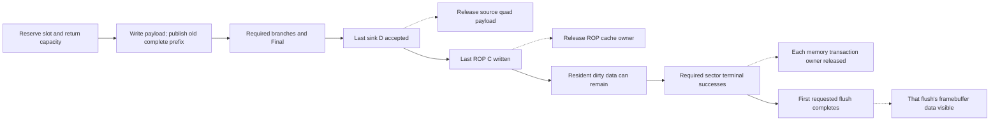

# Execution, storage and ownership

## The object whose lifetime is being tracked

Submission, geometry, branch arithmetic and framebuffer maintenance use different
identities. The host tag is not a per-pixel completion token. Global state has
one live version even though several identity fields travel with work.

| Identity | Scope and use |
| --- | --- |
| Host descriptor tag (8 bits) | Returned unchanged with the loader job completion |
| Input page (1 bit) | Selects payload/metadata and locks the current source page |
| Metadata sequence (7 bits) / generation (4 bits) | T descriptor identity; sequence advances per triangle modulo 128 |
| Draw-bank bit | Copied into each quad header; not a second live global configuration |
| Lighting epoch (16 bits) | Context identity returned with Lighting results |
| Pool physical slot5 | One of 32 result-storage positions, with wrap-aware ordered cursors |
| Producer quad tag (3 bits) | Identifies at most 8 unpublished producers while fixed returns are live |
| Sampling public owner (4 bits) | One of 16 live Sample identities; saved slot bit 4 restores pool identity |
| Lane 2 | Position within the quad, `2*dy+dx` |

No implicit equality or shared fence is defined between these identities.
[Overview](/ip/gpu-v2/docs/overview.md#completion-is-tied-to-an-owner) maps completion to reuse.

## Triangle parameter storage and reads

Each accepted N36/attr32 tail word writes PC once. For source vertex v, normal
uses PC[12+v] and UV/RGB uses PC[8+v], after the old geometry in those rows is
dead. Each row contains three 16-bit lanes: sign-extended N12, zero-extended
RGB8, or U16/V16/zero. Input acceptance completes that write; no later component
write requires the source word to remain held.

For one selected component, the local preparation ROM uses this enabled-edge
calendar. PC has one enabled-edge synchronous read latency:

| Operation | Read request | Old Q and result |
| --- | --- | --- |
| op0 | Vertex 2 | Prime the base read |
| op1 | Vertex 0 | Capture a2 in a 16-bit base register |
| op2 | Vertex 1 | Store d0=a0-a2 in signed17 |
| op3, or op42 for its scheduled final path | None | Form d1=a1-a2 and write the final parameter row |

A single signed17 subtractor serves both differences. The final banks store
51 bits per row: d0[16:0], d1[33:17], base[50:34]. UV16 differences span
-65535..65535; N12 and RGB8 are narrower. DSP input wiring restores each
redundant sign bit, preserving the arithmetic and half-LSB bias.

UV writes PA[1+v] for U and PA[4+v] for V in the same return slots, in vertex
order 2/0/1. Constants have no runtime writer.
There is one shared 16-bit component selector, no PC read-modify-write, and no
SECOND/THIRD input expansion. CE freezes the ROM, Q owners and short operands
together.

PC[4] and PC[6] are zero; PC[7] is 131071. RAM16 configuration initialization
sets these immutable rows in both native and portable realizations. Reset does
not rewrite the bank. Input collection and preparation only write actual data;
there is no constant write at determinant acceptance, component capture or
configuration commit. Configuration commit still writes the depth factor to PB.

### A operand data and constants

One 18-bit BSRAM supplies preparation operands and the two runtime UV anchor
pages through one synchronous read port. Mutable rows retain their four-bit
write address; constant reads use a seven-bit address:

| Rows | Contents |
| --- | --- |
| 0..15 | Geometric magnitudes and UV; runtime anchors reuse 4..7 |
| 32+d, d=0..31 | 131072 shifted right by d for d<=17, otherwise zero |
| 64+8*negative+b, b=0..7 | Signed 32 shifted left by b for b<=4; b>4 uses 32 |
| 80 / 81 | 30 / signed18 -1 |

Data writes are unsigned17, with bit17 fixed zero: geometry magnitudes are below
131072 and UV/anchors are at most 65535. Constants include signed18 values and
are initialized with the image. No inverse-power decoder, PA constant write,
held A read-address register or additional DSP constant bypass is present.
The preparation ROM has 34 live bits; its obsolete A-write field is absent.

The table Q replaces the previous address-register/async-RAM pair. Request an
address on one enabled edge and let the DSP sample Q on the next; CE freezes
both. The C input retains its existing schedule and is not given another register.

| Operation | A read request | Consumer |
| --- | --- | --- |
| op13 | 80 | Existing endpoint calculation |
| op16 | Initial signed bbox step | op17 |
| op19 with another search step | Next signed step, using old search bit and current acceptance | Next op17 |
| Final op19 | None | No unused next step |
| op31 | 32+first exponent difference | op32 |
| op32 / op35 | Current U / V | op35 / op36 |
| op36 | 81 | op37 |
| op38 | 32+next exponent difference | op39 |
| Runtime phi2 | Anchor page/channel, rows4..7 | LOD at phi3 |

Reads and writes are statically scheduled; cross-port same-address access is
forbidden. New triangles and pixel execution still use disjoint lifetimes.

## A quad's storage lifetime

1. Admission reserves a physical slot and capacity for every scheduled return.
   At most 24 slots are active and 8 are unpublished. Old-state capacity decides
   admission; a same-edge release does not fund a full queue's new allocation.
2. R/I write coverage, normal, attributes, depth and LOD directly into their
   final banks. The header is fixed for this allocation.
3. A complete prefix makes the next ordered slot publishable. Readers see old
   publication state; the last payload write cannot bypass into publication.
4. Lighting and Sampling advance their own ordered cursors, skipping branches
   that have a defined bypass. Their results retain the quad/lane identity.
5. Final reads Basic/Light/Sample only when required data are ready. Ordered
   output feeds the sink; empty-mask slots release after preceding Final work.
6. The sink accepts color then depth rows. Last depth acceptance ends source
   ownership. Last color write ends the cache owner. Dirty memory visibility
   waits for [flush](/ip/gpu-v2/docs/framebuffer.md#refill-and-flush).

Sparse lanes skip unused branch reads and do not enter active ROP updates.
Numerically empty slots retain ordering. Neither optimization performs early-Z.
The pool is specialized for complete, fixed-order producers; it is not an
arbitrary missing-return/reordering transport.

## Separate release boundaries

Solid arrows follow work toward external visibility. Dotted arrows name the
resource released at that boundary; they are different owners. C and D mean
color/depth rows here. A tile can contain writes from several quads and remains
resident after a local owner releases. Flush completion covers its full required
writeback set, not merely the first transaction terminal.

## Stored header and payload

The 23-bit header is mask 3:0, draw-bank 4, unlit 5, RGB/untextured 6,
reserved-zero 7, X/2 in15:8 and Y/2 in22:16. Origins are even. Branch descriptors
derive from this header rather than allocating a new quad identity.

| Bank | Physical representation | Reader |
| --- | --- | --- |
| Normal | 512 × 36 BSRAM;32 × 4 rows used | Independent synchronous Lighting port |
| UV | 512 × 36 BSRAM, `{pad2,V16,pad2,U16}` | Independent Sampling port |
| Basic RGB | 512 × 36 BSRAM; three 9-bit columns, low 8 used | Independent Final port |
| Z | 18-bit 1W1R BSRAM carrying Z16 | Sink color acceptance issues read, paired depth phase consumes Q |
| NDC | 320 × 32 read-only BSRAM; two adjacent F14 coordinates/word | Lighting synchronous read |
| Header, masks, LOD | Per-reader distributed RAM | Independent ordered cursor views |

Normal/UV/RGB have fixed data wiring with column write enables. A synchronous
read's Q remains owned through CE and consumer stalls. The geometry record
ports have the same ownership rule but separate banks and identities.

## Fixed return calendar

Here phi0..3 are the four enabled phases of the local interpolation calendar.
Offset 0 is the enabled edge accepting the quad at phi0; offset n is n later
enabled edges, with phase `n mod 4` sampled before each edge. A compute pause
adds wall time without advancing this index. Backend CE is a separate owner.
G denotes geometric-mask return, W one attribute-return word, and L quad LOD or
its RGB bypass pulse. Numerical depth/pass returns have their own event:

| Event | Enabled-edge offset | Phase and payload |
| --- | --- | --- |
| Depth/pass, lane k | 13+4k | phi1, Z16 plus numerical admission bit |
| G | 14 | phi2, geometric quad mask |
| W0, lane k | 14+4k | phi2, normal X/Y |
| W1, lane k | 15+4k | phi3, normal Z plus R or U |
| W2, lane k | 16+4k | phi0, G/B or V |
| L in RGB mode | 15 | phi3, bypass pulse; final W2 completes the quad |
| L in UV mode | 50 | phi2, final LOD; completes after all W words |

Normal writes low 18 at phi2 and high 18 at phi3. UV writes low 18 at phi3 and
high 18 at phi0. Basic RGB writes R at phi3 and G/B at phi0. Depth/pass returns
at phi1. RGB's final W or UV's L advances the six-bit completion prefix. UV LOD
writes at the old completion tail; RGB does not require a LOD bank write.
Mode changes wait until all old returns drain.

## Lighting and Final schedules

Lighting fetches normal/X, captures X and reads Y, offers context, then offers
the pixel, over four enabled phases. Normal Q and NDC Y stay owned until actual
pixel acceptance. The selected core comes from
`dsp_sharing::four_cycle_shared_roms(9)`: arithmetic latency 34 enabled edges,
admission interval 4. These describe the local calendar, not scene throughput.

Normalization reads share four scheduled channels across two true-dual-port
ROM banks. The dot MAC keeps its hard output register. Private core CE advances
under the parent's guaranteed result-bank acceptance; public ACKs and bank
writes commit on common CE, so a pause cannot spend a result twice.

Final's three source banks return after one enabled edge. Its wait phase owns
all Q values until consumed. Two old-state result credits admit arithmetic only
when `qcount+arith_live<2`. A simultaneous output ACK adds no admission credit.
A nonempty queue supplies its old head; a direct arithmetic result can bypass
only an empty queue. Shared multiplier phases and result reservations remain
part of the schedule.

## Texture cache

Sampling reserves public identity on the first sample row, before an early hit
can return. No two live owners share low 4 slot bits. Completion restores the
saved fifth bit and the actual last Color write releases that public owner;
this 16-owner limit does not shrink the 32-slot result pool.

Coordinate admission takes four enabled phases per covered lane. Tile/mip/wrap
seams split groups; misses add variable work. There is no universal 16-clock
quad completion claim. Preparation writes exact coefficients once into the
weight bank; private packets carry nonzero masks and identity. Group work
credits reserve on admission and release on actual ACK.

The cache has 16 sets, four ways and four synchronous 1024 × 16 banks. Keys are
slot/level/tile XY; set=`((tile_y&3)<<2)|(tile_x&3)`. Invalid ways precede
tree-PLRU. Bank=`{y0 XOR x1,x0}`, local=`{y2:0,x2}`; form virtual +1 taps before
bank selection. Only old READY tags hit. Captured reads pin the owner and retain
payload, preventing replacement from altering accepted taps.

A miss reserves one line and presents an aligned 128-byte request. It receives
16 indexed 64-bit beats and a terminal ACK. Last beat alone does not publish
READY; errors cannot publish partial data. Acceptance/first-beat and final-beat/
ACK may coincide where the interface permits them. Refill runs on wall edges.

Color processes two RGB taps per edge with six small multipliers. On common CE,
its accumulator Q writes the final Sample bank directly. The sink consumes old
Q before a same-edge replacement. This parent contract requires no intermediate
Color result FIFO; independent generic Color APIs retain their output credits.

## Pause, fault and reset

| State | Compute CE0 | Fault/abort |
| --- | --- | --- |
| Scheduled arithmetic, phases, tokens and owned Q | Hold together | Stop new computation; suppress invalid result writes |
| Descriptor reception, loader completion and page publication | Continue on wall edges | Stop future job work; report failure and drain owned traffic |
| Cache refill/writeback | Continue on wall edges | Hold presented requests; drain accepted traffic |
| New meshlet admission | No enabled transfer | Blocked |

Local preflight can reject malformed current work. Cross-module faults latch a
sticky stop; independent legal actions on the detecting edge need not roll back.
Reset wins over local CE and validity updates. Recovery coordinates reset with
the externally owned memory chain. [Memory](/ip/gpu-v2/docs/memory.md#errors-and-cancellation)
defines what must drain, while [submission](/ip/gpu-v2/docs/submission.md) defines the observable
whole-GPU boundary.

Implementation anchors: [pool](/ip/gpu-v2/src/system/pixel/vliw_quad_pool.v),
[backend](/ip/gpu-v2/src/system/pixel/vliw_backend.v),
[Final](/ip/gpu-v2/src/system/pixel/vliw_backend_final.v),
[Lighting schedule](/ip/gpu-v2/src/lighting/dsp_sharing.rs),
[texture cache](/ip/gpu-v2/src/texture/rtl/cache.rs).
