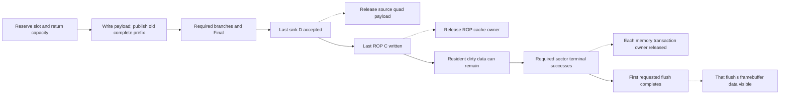

# Execution, storage and ownership

## The object whose lifetime is being tracked

Submission, geometry, branch arithmetic and framebuffer maintenance use different
identities. The host tag is not a per-pixel completion token. Global state has
one live version even though several identity fields travel with work.

| Identity | Scope and use |
| --- | --- |
| Host descriptor tag (8 bits) | Returned unchanged with the loader job completion |
| Input page (1 bit) | Selects payload/metadata and locks the current source page |
| Metadata sequence (7 bits) / generation (4 bits) | T descriptor identity; sequence advances per triangle modulo 128 |
| Draw-bank bit | Copied into each quad header; not a second live global configuration |
| Lighting epoch (16 bits) | Context identity returned with Lighting results |
| Pool physical slot5 | One of 32 result-storage positions, with wrap-aware ordered cursors |
| Producer quad tag (3 bits) | Identifies at most 8 unpublished producers while fixed returns are live |
| Sampling public owner (4 bits) | One of 16 live Sample identities; saved slot bit 4 restores pool identity |
| Lane 2 | Position within the quad, `2*dy+dx` |

No implicit equality or shared fence is defined between these identities.
[Overview](/ip/gpu-v2/docs/overview.md#completion-is-tied-to-an-owner) maps completion to reuse.

## Shared V/T bounds prologue

Only the compact meshlet ROM uses words256..310 for a fixed 55-word bounds
prologue. Words0..6 are the existing bootstrap; a kept meshlet jumps directly to
original V word7 and pays 48 additional enabled edges. Original V words0..127 remain unchanged. T uses the bounded-F16 calendar below.
The bounds prologue is only enabled in the compact composition. Native
BSRAM INIT fields and the portable view are emitted together by
`frontend/vliw/vertex/bounds_program.py`; `--check` verifies regeneration.

| ROM words | Existing ports / work | Lifetime and decision |
| --- | --- | --- |
| 256..262 | Read the original configuration/uniform bootstrap | Initialize origins, shift and RF0 |
| 263..271 | Serial configuration reads through unpacker | Test all origins using signed25 prefix taps |
| 272..281 | Z-row support point into RF1..3; MAC dot | Check signed20 coefficients and signed30 translation |
| 282 | Existing MAC-to-RF writeback into RF10 | Reject nonpositive transformed maximum Z |
| 283..292 | X maximum support dot | Finish X-row eligibility |
| 293..296 | RF10 times the existing F16-one uniform constant | Reject left; retain Z for the final test |
| 297..306 | X minimum support dot through the same ports | No second position or matrix buffer |
| 307..310 | RF10 times minus F16-one, then final decision | Reject right, or toggle epoch and jump to V word7 |

Unpacker kind6 substitutes one ten-bit endpoint from a coefficient sign, then
uses the original position decode and selected axis. It adds no wide shifter
or box-position register bank. RF1..3 hold a support point only until its MAC
consumers; RF10 holds the truncated maximum Z through the two horizontal tests.
A constant sign extension on MAC B supplies minus-one for the last test. ROM
bits43..45 select three fixed taps in the existing sign-prefix tree; bit71
checks eligibility. Bit70 selects minimum/negative-one and marks the final
keep decision. Flow7 branches or retires through the existing V completion.
No additional memory, DSP, FIFO, reservation or dynamically arbitrated port is
introduced.

The prologue and original V control run independently on the same CE. Every
prologue word has no V emit, no vertex-input advance, and no V loop/end flow;
the assembler asserts those conditions. An outer bounds-versus-V mux is not
required. All reads, RF writes, DSP launch/return and decisions freeze together
when CE is low. A reject returns `done_v` with zero published vertices, and the
meshlet controller skips its index/T phase. It neither changes an old queued
T's epoch nor waits for that T to retire. The [numerical contract](/ip/gpu-v2/docs/geometry.md#conservative-meshlet-rejection)
defines the conservative predicates and fallback.

## Shared bounded-F16 triangle calendar

T's62 ROM slots compose reads, arithmetic issue, previous-result capture and
writes on the same edge. Normalization slots repeat only while their magnitude
predicate requires another fixed four-bit or one-bit step. There is no dynamic
port reservation or per-instruction transaction FSM. All state advances on CE.

| Phase | Physical dataflow and lifetime |
| --- | --- |
| Position fill | Position BSRAM reads ahead through Q and unpacker into RF1..9; constants fill unused RF write slots |
| Cross components | Issue two products per component; capture product1 while issuing product2; registered accumulator retires the difference |
| Edge alignment | Three private work rows retain guarded components; one read / one DSP issue / previous write overlap; qmax selects the common exponent |
| Determinant | Three P0*N0 issues reuse RF/work Q; normalization and sign/zero decisions consume registered accumulator |
| Viewport coefficients | The same work Q feeds output Nx/Ny and C MAC; C return launches the next edge's first product |
| Publication | Ten field-major result writes finish before descriptor publication; indexed attributes remain in the original epoch banks |

There are39 MAC issues,18 indexed position reads,18 work writes and21 work reads
per kept triangle. The62-slot calendar is a base, not a fixed triangle latency:
normalization repeats add cycles and early rejection removes the unused tail.
The original V calculation, bounds prologue,16 result slots and downstream
backpressure semantics remain intact.

## Triangle parameter storage and reads

### Geometry reduction and publication

Each edge stores its three signed raw coefficients in private PC[8..10] and
determines their common reduction exponent e. The 48-bit record sign-extends
the original signed47 C or signed36 N; it is not a sign/magnitude conversion.
Exact exponent detection uses the 20 high bits above each retained width,
their sign complement and a low-zero carry. Shared suffix-OR and prefix-AND
chains directly test magnitude thresholds without a 47-bit absolute value.

C acceptance requests Nx immediately; two READ edges request Ny and C. Each
synchronous return feeds a dedicated `MULTALU36X18`. Let k=8*floor(e/8),
r=e mod8, m=2^(7-r), q=floor(raw/2^k), and s denote raw's negative sign.
Three wired signed windows produce q in 36 bits; no variable arithmetic shifter
is added. Sigma selects the signed factor (-1)^sigma*m. The fused DSP result is
`p=(-1)^sigma*q*m+bias` with the following live C operand:

| Sigma | Raw sign | Discarded k-bit tail | Bias |
| --- | --- | --- | --- |
| 0 | Nonnegative | Any | 0 |
| 0 | Negative | Zero / nonzero | 127 / 127+m |
| 1 | Nonnegative | Any | 127 |
| 1 | Negative | Zero / nonzero | 0 / -m |

At k=0 the discarded tail is empty and zero. Signed bits[34:7] equal
`(-1)^sigma*trunc(raw/2^e)` exactly, including negative coefficients and zero
results. PB and R use that canonical result directly. Only PA's N weights take
an unsigned17 absolute value; C has no magnitude consumer. There is no full
input absolute value or 28-bit output sign-restoration datapath.

The private preparation DSP registers A/B and consumes unregistered C on the
following enabled edge. PA supplies the signed power of two from initialized
rows96..111. The exponent selects the raw B window; its low three bits follow
A/B to select the next edge's C bias. Sign, lost-tail predicate and this fraction
freeze with CE. This also permits the next edge's exponent to change while the
previous edge's final C input is sampled.

All sixteen input words can be accepted consecutively. Relative to one C input:

| Edge | PC write / read | DSP launch | Canonical PB write |
| --- | --- | --- | --- |
| 0 | Write C; read Nx | None | None |
| 1 | Write next Nx; read Ny | Nx | None |
| 2 | Write next Ny; read C | Ny | None |
| 3 | Write next C; read next Nx | C | Nx |
| 4 | Write following Nx; read next Ny | Next Nx | Ny |
| 5 | Write following Ny; read next C | Next Ny | C |

Each read and the overlapping next-edge write address differ. The last edge
continues reading while determinant and attributes arrive; N36/attribute PC
rows are not overwritten until their previous geometry reads have completed.
There is no READ or DRAIN input state. An external input gap pauses only that
input instruction; already-issued reads and returns continue on fixed slots.
The final physical write address advances Nx/Ny/C in edge order, using two
two-bit counters rather than tags on every DSP stage.

Private PB rows6+edge,9+edge,12+edge retain canonical Nx,Ny,C. PA receives the
unsigned17 Nx/Ny magnitudes. One private DSP then executes the bounds and LOD
preparation ROM through the same private PA/PB/PC ports. It is not shared with
live pixel Z/LOD. PC's low36 input bits are written directly; only its high12
input bits distinguish signed raw geometry from zero-extended packed attributes.
The ROM supplies the physical input row. Canonical PB returns, core arithmetic
returns and the depth factor use their fixed write phases.

### Overlapping next-triangle preparation

The next header may enter when the private preparer is free, while the previous
R/I executes. Only final values cross to the runtime consumer:

| Storage | Layout and physical ports |
| --- | --- |
| Private PA/PB/PC | PA18 BSRAM, PB36 and PC48 RAM16; each has independent 1W1R preparation ports |
| Runtime B coefficients | 16x36 RAM16: row `{context,field}`, Sx/Sy at fields0/1 and K at field4; 1W1R |
| Runtime C coefficients | 16x36 RAM16: four G/S rows per context; fields4 are immutable zero; 1W1R |
| Attribute pair banks | Existing two 16x51 RAM16 banks; row `{0,context,component}`; 1W1R |
| Quad log offsets | Independent 16x16 RAM16 bank; runtime writer and reader only |
| UV anchors | Independent four-entry unsigned17 values in RAM16, with a synchronous18-bit Q |
| Reciprocal/log and H | One 512x36 BSRAM, synchronous 1W1R; configuration-initialized constant rows0..255, only H rows256..259 writable |

Preparation publishes into the inactive context. Runtime reads only the active
context; its offset and anchor writers cannot compete with preparation writes.
No mirrored read port, request, reservation or dynamic port arbitration is used.
After preparation finishes and old R drains, R starts independently of old I.
The parent snapshots bbox metadata and a one-bit pending-context flag blocks
new R samples. Geometry import, step preparation, traversal and tile loading
can proceed while old I, including LOD, still reads the old active context.
Once old I drains, one configuration commit toggles the active context and
releases new R samples. If I was already idle, start and commit coincide.
A finished empty bbox retires only private preparation: no R start, geometry
replay or active-context switch occurs, and it does not wait for old R/I. Its
bounds-completion event remains visible to diagnostics but is filtered from R.
The next preparer reuses the same inactive page. This switches triangle-local
parameters, not global draw or Lighting state;
global changes still require the whole old work to drain. The preparer holds
its completed context until that commit, so a second prepared context cannot
overwrite the values being handed off.

At R start, private PB geometry rows
are replayed with nine consecutive read/write slots: Nx0,Ny0,C0 through
Nx2,Ny2,C2. Nx/Ny are doubled only at R's input. The first read occurs on the
R-start edge, its R write on the following edge; bbox_done follows the ninth
write. Replay and a following triangle's preparation have disjoint fixed PB
access slots; assertions reject a shared read or same-row overwrite. The
interpolator remains busy through replay. No raw quad FIFO, per-pixel context
tag or full geometry copy is introduced. The pending-context flag changes only
on enabled edges and resets with R/I. R can start only while old R is idle;
I configuration can change only while old I is idle. There is no new memory
port competition or dynamic ownership request.

### Packed attribute parameters

Each accepted N36/attr32 tail word writes PC once. For source vertex v, normal
uses PC[12+v] and UV/RGB uses PC[8+v], after the old geometry in those rows is
dead. PC stores the input low36 bits directly, with its upper12 bits zero:
three contiguous S12 normals, U16/V16, or RGB888 in the low24 bits. There is no
input lane expansion. Collection and tail writes share the input low36 data
wires. Input acceptance completes that write; no later component write requires
the source word to remain held.

For one selected component, the local preparation ROM uses this enabled-edge
calendar. PC has one enabled-edge synchronous read latency:

| Operation | Read request | Old Q and result |
| --- | --- | --- |
| op0 | Vertex 2 | Prime the base read |
| op1 | Vertex 0 | Capture a2 in a 16-bit base register |
| op2 | Vertex 1 | Store d0=a0-a2 in signed17 |
| op3 | None | Form d1=a1-a2 and write the final parameter row |

A single signed17 subtractor serves both differences. The final banks store
51 bits per row: d0[16:0], d1[33:17], base[50:34]. UV16 differences span
-65535..65535; N12 and RGB8 are narrower. DSP input wiring restores each
redundant sign bit, preserving the arithmetic and half-LSB bias.

UV writes PA[1+v] for U and PA[4+v] for V in the same return slots, in vertex
order 2/0/1. Constants have no runtime writer.
The consumer selects normal12 and RGB8 before extending them to16 bits; UV uses
a two-way 16-bit selection. Normal sign extension and attribute zero extension feed
the same signed17 difference unit and existing PA write slots. There is no PC
read-modify-write or later component expansion write. CE freezes the ROM, Q
owners and short operands together.

### Preparation control word

The private preparation ROM remains one synchronous 512x36 block. Its read
address is `{index,axis,next_operation}`. Six FFs capture the low address bits
on exactly the same enabled read edge as the ROM Q; reset clears both owners,
and CE0 holds both. The returned operation is that registered value when bit35
is set, otherwise zero. Zero-filled unused words therefore retain operation0.
The ROM no longer stores a second copy of the operation number.

| Bits | Meaning |
| --- | --- |
| 5:0 | Default next operation |
| 10:6 | PA read code; imported kind also uses bits8:6 |
| 14:11 | PB read row |
| 18:15 | PC read code; imported row uses the same field |
| 22:19 | Direct PA-read, PB-read, PC-read and DSP-issue enables, low to high |
| 23 | DSP A signedness |
| 24 | Attribute parameter publication |
| 25,26,27 | PB write enable, row1 select, and short-result/row15 select |
| 28,32:29,33 | PC write enable, physical write row, and conditional-write flag |
| 34 | Auxiliary-axis issue |
| 35 | Nonempty instruction |

PB's short-result flag selects row15 and the existing sign-extended result
window; otherwise its row is0 or1. PC's physical row needs no destination
decoder. Conditional PC writes still use `aux_pending` at op18 and dual-axis
eligibility elsewhere. The existing dynamic bounds/read gates remain after
the direct controls. PA/PC read codes retain their runtime exponent, search
bit and seed-sign substitutions. This changes control representation only:
read latency, DSP returns, arithmetic windows, write edges and publication
slots remain unchanged. There is no additional data-memory port or wait slot.

PC[4] and PC[6] are zero; PC[7] is 131071. RAM16 configuration initialization
sets these immutable rows in both native and portable realizations. Reset does
not rewrite the bank. Input collection and preparation only write actual data;
there is no constant write at determinant acceptance, component capture or
configuration commit. Configuration commit writes the depth factor to private PB and the inactive runtime B context.

### Interleaved tile bounds

Each adjacent edge pair first executes op0..3 for X and then for Y. These slots
publish two attribute components and test the signs of the orthogonal geometric
coefficients. Both-zero and same-nonzero-sign pairs contribute no constraint.
The arithmetic primary axis is X when eligible, otherwise Y. An eligible second
axis shares the primary axis's otherwise unused pipeline slots.

PB[0+axis] holds signed36 D and PC[0+axis] holds the first product or accumulated
C for that axis. These rows are temporary until bounds publication. The later
analytic-LOD program starts its sums from zero and replaces the rows before
their runtime consumers execute. Packed input rows, geometry rows, port counts
and the DSP input connections are unchanged.

For orthogonal coefficients oi/oj, target coefficients ni/nj and constants
ci/cj, each eligible constraint is `D=abs(oj)*ni+abs(oi)*nj` and
`C=abs(oj)*ci+abs(oi)*cj+seed`. The existing seed is either zero or 131071.
PC physically retains signed48, exposed as signed54, without an additional
rounding step. Endpoint testing evaluates `C+30*D` for positive D and C for
nonpositive D; PA supplies the corresponding constant 30 or zero.

For two eligible axes, the enabled-edge arithmetic calendar is:

| Slot | DSP A/B launch | Read request | Result retirement |
| --- | --- | --- | --- |
| D0, op4 | Primary first product | Secondary first operands; zero C | None |
| D1, op5 | Secondary first product, if eligible | Primary second operands; zero C | None |
| D2, op6 | Primary second product | Secondary second operands; primary feedback C | Primary first product to PC |
| D3, op7 | Secondary second product, if eligible | Secondary feedback C | Secondary first product to PC |
| D4, op8 | None | Primary C-product operands | Primary D to PB |
| C0..C4, op9..13 | Same five-slot pattern for C, using seed and feedback C | Final slot requests primary endpoint operands | C0 also retires secondary D; C4 stores primary C |
| E0, op14 | Primary endpoint | Secondary endpoint operands; primary C | Secondary C |
| E1, op15 | Secondary endpoint, if eligible | Secondary C | None |
| E2, op16 | None | First search operands for a single axis | Primary endpoint and sign decision |
| E3, op17, only for two eligible axes | None | First operands for the selected search primary | Secondary endpoint and sign decision |

A launch at t samples A/B on that edge; the DSP samples its unregistered C on
t+1. The controller can retire the result at t+2. PC read addresses therefore
select the launch's C row on t, while first-product retirement may update that
same row. Independent primary/secondary rows prevent interference. No wide
result bypass, extra operand register, or port arbiter is present.

With only one eligible axis, ROM slots41..46 interleave its D and C products.
The final attribute slot still prefetches the first D operands. The unused
axis's PC row holds C's first product, so D and C have independent feedback
lifetimes without an extra bank or read port:

| Slot | DSP launch | Read / result retirement |
| --- | --- | --- |
| op41 | D first product | Read C first operands and zero C |
| op42 | C first product | Read D second operands and C's seed |
| op43 | D second product | Read C second operands and primary PC; write D first product to primary PC |
| op44 | C second product | Read secondary PC; write C first product there |
| op45 | None | Write final D to primary PB and capture its sign class |
| op46 | None | Write final C to primary PC; read endpoint A/B |
| op14 | Endpoint | Read final C for its following C-sampling edge |
| op15 | None | Fixed DSP latency |
| op16 | None | Retire endpoint and select search or next pair |

The four products launch consecutively. First-product PC writes precede their
DSP C sampling by one enabled edge. The secondary row is scratch for this
single eligible axis; analytic LOD subsequently replaces both rows. No second
numeric approximation, wide bypass or dynamically selected port is introduced.

After endpoint tests, searching uses X as primary when both axes still need a
bound; a single remaining Y constraint uses Y directly. The three-slot loop is:

| Slot | DSP launch | Feedback and next read |
| --- | --- | --- |
| S0, op18 | Primary trial | Retire the preceding secondary trial, if present; read its next signed PA step and PB D; select primary C |
| S1, op19 | Secondary trial, if another one is needed | Select secondary C |
| S2, op20 | None | Retire primary, decide its next sign and request its next PA step/PB D |

Search starts at the highest bit of the current interval's high endpoint,
with zero using bit0. If X and Y both search, the initial primary bit is
`max(high_bit(xhi), high_bit(yhi)+1)`, since Y's first trial is one bit behind
X. The representable final prefix is at least the current high endpoint: a
farther upper bound cannot tighten it, while a farther lower bound still
rejects the interval. Omitting those high trials preserves the exact
intersection with all preceding edge-pair constraints.

A maximum-width dual search covers five X bits and four Y bits in five iterations.
The last S0 retires Y's last trial, the last S1 is inactive, and S2 retires X's
last trial. Single-axis search retains three slots per required bit. The final retirement
also advances the edge-pair index; no separate loop-advance operation remains.
Endpoint or interval rejection publishes empty bounds. Partial attribute rows
from an empty triangle are not consumed. CE freezes the ROM, addresses, DSP,
prefixes and secondary-retirement marker together.

### A operand data and constants

One 18-bit BSRAM supplies private preparation operands through one synchronous
read port. Runtime UV anchors have their own small RAM16 bank. Mutable rows retain their four-bit
write address; constant reads use a seven-bit address:

| Rows | Contents |
| --- | --- |
| 0..15 | Private geometric magnitudes and UV |
| 32+d, d=0..31 | 131072 shifted right by d for d<=17, otherwise zero |
| 64+8*negative+b, b=0..7 | Signed 32 shifted left by b for b<=4; b>4 uses 32 |
| 80 / 81 | 30 / signed18 -1 |
| 96+8*sigma+f, f=0..7 | Signed `(128 >> f)`, negated for sigma=1 |

Data writes are unsigned17, with bit17 fixed zero: geometry magnitudes are below
131072 and UV values are at most 65535. Constants include signed18 values and
are initialized with the image. No inverse-power decoder, PA constant write,
held A read-address register or additional DSP constant bypass is present.
The preparation ROM uses one 512x36 physical BSRAM. Its address concatenates the
two-bit vertex context, one-bit axis context and six-bit operation address.
The context for the next synchronous read follows the same updates as the loop
state. Op3 instead fetches the operand context selected by X eligibility while
its attribute publication retains the current axis. The hard ROM's operation
field is the current phase; no separate hardware PC or input-index register is
required. Slots48..63 accept and validate the sixteen input items; their PA
field encodes input kind and their PC field encodes the input write row.
Slots23/24 commit and finish. R may start once determinant normalization and
old R finish; commit waits for old I to drain and then releases new samples.
No outer legacy state decoder drives the data ports.

| Word bits | Meaning |
| --- | --- |
| 5:0 / 11:6 | Current operation / default next operation |
| 16:12 | PA literal row or dynamic window family |
| 20:17 / 24:21 | PB / PC read row |
| 27:25 | Three-read-enable and DSP-issue pattern |
| 28 / 29 | DSP signed-A mode / attribute publication |
| 31:30 | PB write destination: none, row0, row1, row15 |
| 32 | Reserved zero |
| 35:33 | PC write destination and conditional auxiliary write |

Fixed geometric/UV rows and next-vertex rows are resolved in the ROM image.
PA retains the data-dependent exponent and search windows. PC seed aliases
select zero or131071 from live edge signs; the secondary-only search selects
its PB axis at op17. Compact write codes preserve the physical row constraints.
PB row15 also implies the signed result[34:17] format, so no independent wide
write-format selector crosses the preparation boundary. Branches, early exits,
arithmetic issue/retirement calendars remain fixed.

The table Q replaces the previous address-register/async-RAM pair. Request an
address on one enabled edge and let the DSP sample Q on the next; CE freezes
both. The C input retains its existing schedule and is not given another register.

| Operation | A read request | Consumer |
| --- | --- | --- |
| op13 / op14 | 80 for positive D, otherwise a zero constant row | Primary / secondary endpoint calculation |
| op16 for a single search, or op17 after two endpoint tests | Initial signed bbox step | First op18 |
| op18 with another secondary trial | Next secondary step, using its current acceptance | op19 |
| op20 with another primary trial | Next primary step, using its current acceptance | Next op18 |
| Final op20 | None | No unused next step |
| op31 | 32+first exponent difference | op32 |
| op32 / op35 | Current U / V | op35 / op36 |
| op36 | 81 | op37 |
| op38 | 32+next exponent difference | op39 |
| Runtime phi2, separate anchor RAM16 | Anchor page/channel | LOD at phi3 |

Reads and writes are statically scheduled; cross-port same-address access is
forbidden. New preparation and old pixel execution use independent ports; only
the final context publication waits for the old consumers to drain.

## Raster origin restoration

Geometry import writes final dx/dy step rows32/48 through BSRAM A while B
writes the packed Nx/Ny row62 halves. C import needs only the work RF. There
is no zero row or subsequent zero/dx/dy copy. Both ports are statically free
of walker/scanner reads during import. A single exclusive import/origin/ALU
write word feeds the RF and step store; there is no second wide import mux.

Base preparation follows PCs5/17/18/8/6: `dy-dx`, `2*dy-2*dx`, `3*dx-dy`,
upper support and lower support. Each vector reads edges0/1/2 consecutively
and retires one enabled edge later. Nx/Ny RF rows then become support
accumulators. X/Y doubling and upper support advance at every required level;
lower support stops at level3 because nodes above level4 never consume it.
For support, `s[l]=2*s[l-1]+s[0]=(2^(l+1)-1)*s[0]`, preserving signed30
modular arithmetic. Root bounds cap production at `root_level-1`; an already
issued unneeded vector may finish before the rest is skipped. PC14 restores
the aligned origin before the first node. There is no preparation loop for a
quad diagonal or corner threshold.

Each of the two physical18-bit step lanes provides one half of ordinary30-bit
rows. Packed row `{edge,62}` instead holds signed18 Nx/Ny. After preparation,
A serves the scanner and B serves the walker/origin DSP independently. Import,
preparation writes and scanner reads have disjoint lifetimes. Exact quad
classification has two independent signed18 RAM16 coefficient banks, written
at import and read with the scanner's fixed edge address. No mirror or dynamic
port request is used.

After bounding-box completion, the origin instruction reads the current C
vector from the work RF and the packed N row from the step B port. One fused
`MULTADDALU18X18` computes `C + Nx*(2*x_root) + Ny*(2*y_root)` with registered
operands, C and output. It consumes one physical DSP macro, or two DSP18 slots.
Its low30 result preserves the old sequence of modular 30-bit additions.
The old per-bit X/Y origin loops and intermediate X-origin write are absent.
Both-zero origins bypass this instruction as a whole.

Offsets below are enabled edges, relative to the first origin read. A DSP
issue samples its input registers; the following enabled edge updates its
output register; the next edge writes that old output into the work RF.

| Edge | Read / fixed issue | Retirement / next instruction |
| --- | --- | --- |
| 0 | C0 and packed N0 | None |
| 1 | C1/N1; DSP edge0 | None |
| 2 | C2/N2; DSP edge1 | Prefetch the first node instruction and advance ROM PC |
| 3 | DSP edge2 | Write origin h0; ordinary walker issue held |
| 4 | None | Write origin h1; ordinary walker issue held |
| 5 | Read node h0 and the root-level upper support | Write origin h2 |
| 6 | Read node edge1 | Test node edge0 through the ordinary ALU |

The same-edge origin write and node read address different RF rows. Two
valid bits and delayed edge indices track the fixed DSP latency; reset clears
them and CE freezes them with the DSP and RAM Q. Origin and ordinary RF writes
are mutually exclusive. The import, DSP and ALU write-data sources use their
exclusive write enables rather than a priority chain. Step-bank writes and
scanner reads remain statically disjoint.

## Tile mailbox publication

The two-entry FIFO holds metadata and three h words per tile. At level4 or
below, upper-test retirements write their original work-Q h directly into the
unpublished tail. The producer waits for capacity before the first such read;
no published slot can be overwritten. A successful upper test supplies all
three words before any lower-test decision. Lower retirement publishes metadata
and tail when the region is full or is a partial level2 leaf. A failed lower
test at level2 can publish immediately because the upper test already filled
the whole vector. Rejected candidates leave only unpublished data. No enqueue
copy instruction, zero-add transfer, full flag register or slot tag is needed.

The scanner takes old FIFO metadata and requests h0 on that edge when its
phase is1/2/3. At phase0 it enters LOAD and requests h0 at the following phase1.
Subsequent reads request h1/h2 on consecutive edges. Thus the h2 return is
always phase0/1/2, and all four-bit corner predicates are registered before
ALIGN's phase3 decision. This preserves the existing first-SCAN phase without
a same-edge predicate-to-step-address bypass. The last LOAD return releases
the head. The final-quad PREFETCH path retains its fixed three-word calendar
and releases the head at handoff. All accesses are after the producer wrote
their words; CE freezes both sides and simulation shadows check that ordering.

## A quad's storage lifetime

1. Admission reserves a physical slot and capacity for every scheduled return.
   At most 24 slots are active and 8 are unpublished. Old-state capacity decides
   admission; a same-edge release does not fund a full queue's new allocation.
2. R/I write coverage, normal, attributes, depth and LOD directly into their
   final banks. The header is fixed for this allocation.
3. A complete prefix makes the next ordered slot publishable. Readers see old
   publication state; the last payload write cannot bypass into publication.
4. Lighting and Sampling advance their own ordered cursors, skipping branches
   that have a defined bypass. Their results retain the quad/lane identity.
5. Final reads Basic/Light/Sample only when required data are ready. Ordered
   output feeds the sink; empty-mask slots release after preceding Final work.
6. The sink accepts color then depth rows. Last depth acceptance ends source
   ownership. Last color write ends the cache owner. Dirty memory visibility
   waits for [flush](/ip/gpu-v2/docs/framebuffer.md#refill-and-flush).

Sparse lanes skip unused branch reads and do not enter active ROP updates.
Numerically empty slots retain ordering. Neither optimization performs early-Z.
The pool is specialized for complete, fixed-order producers; it is not an
arbitrary missing-return/reordering transport.

## Separate release boundaries

Solid arrows follow work toward external visibility. Dotted arrows name the
resource released at that boundary; they are different owners. C and D mean
color/depth rows here. A tile can contain writes from several quads and remains
resident after a local owner releases. Flush completion covers its full required
writeback set, not merely the first transaction terminal.

## Stored header and payload

The 23-bit header is mask 3:0, draw-bank 4, unlit 5, RGB/untextured 6,
reserved-zero 7, X/2 in15:8 and Y/2 in22:16. Origins are even. Branch descriptors
derive from this header rather than allocating a new quad identity.

| Bank | Physical representation | Reader |
| --- | --- | --- |
| Normal | One BSRAM, 18-bit writes / 512 × 36-bit reads;32 × 4 rows used | Independent synchronous Lighting port |
| UV | One BSRAM, 18-bit writes / 512 × 36-bit reads, `{pad2,V16,pad2,U16}` | Independent Sampling port |
| Basic RGB | One BSRAM, 18-bit writes / 512 × 36-bit reads; R in low half, G/B in high half | Independent Final port |
| Z | 18-bit 1W1R BSRAM carrying Z16 | Sink color acceptance issues read, paired depth phase consumes Q |
| NDC | 320 × 32 read-only BSRAM; two adjacent F14 coordinates/word | Lighting synchronous read |
| Header, masks, LOD | Per-reader distributed RAM | Independent ordered cursor views |

Native Normal/UV/RGB writes replace one complete 18-bit half at address
`{row,half}`. Normal/UV select the corresponding half of the existing data bus.
Basic stores `{zero10,R8}` in half0 and `{zero2,B8,G8}` in half1; fixed read wiring
restores the original three padded RGB bytes before Final consumes them.
There is no native 36-bit read-modify-write or byte-enable dependency. The
logical portable model retains the existing field-update interface. A synchronous
read's Q remains owned through CE and consumer stalls. Capacities, read latency
and return calendars are unchanged. The geometry record ports have the same
ownership rule but separate banks and identities.

GW2AR native bindings use complete writes rather than assuming the vendor
functional model's partial-write behavior is a physical device guarantee.
In the command composition, the depth bank stores `{alpha8,D16}` as a complete
36-bit word with its upper12 bits zero; it does not mask out unused bits.
`tests/gw2ar_write_contract.rs` checks emitted bindings separately from model
co-simulation. The pool qualification sweeps both half layouts across all512
rows and two epochs, including held synchronous Q.

## Fixed return calendar

Here phi0..3 are the four enabled phases of the local interpolation calendar.
Offset 0 is the enabled edge accepting the quad at phi0; offset n is n later
enabled edges, with phase `n mod 4` sampled before each edge. A compute pause
adds wall time without advancing this index. Backend CE is a separate owner.
G denotes geometric-mask return, W one attribute-return word, and L quad LOD or
its RGB bypass pulse. Numerical depth/pass returns have their own event:

| Event | Enabled-edge offset | Phase and payload |
| --- | --- | --- |
| Depth/pass, lane k | 13+4k | phi1, Z16 plus numerical admission bit |
| G | 14 | phi2, geometric quad mask |
| W0, lane k | 14+4k | phi2, normal X/Y |
| W1, lane k | 15+4k | phi3, normal Z plus R or U |
| W2, lane k | 16+4k | phi0, G/B or V |
| L in RGB mode | 15 | phi3, bypass pulse; final W2 completes the quad |
| L in UV mode | 50 | phi2, final LOD; completes after all W words |

Normal writes low 18 at phi2 and high 18 at phi3. UV writes low 18 at phi3 and
high 18 at phi0. Basic RGB writes R at phi3 and G/B at phi0. Depth/pass returns
at phi1. RGB's final W or UV's L advances the six-bit completion prefix. UV LOD
writes at the old completion tail; RGB does not require a LOD bank write.
Mode changes wait until all old returns drain.

## Lighting and Final schedules

Lighting fetches normal/X, captures X and reads Y, offers context, then offers
the pixel, over four enabled phases. Normal Q and NDC Y stay owned until actual
pixel acceptance. The selected core comes from
`dsp_sharing::four_cycle_shared_roms(9)`: arithmetic latency 34 enabled edges,
admission interval 4. These describe the local calendar, not scene throughput.

Normalization reads share four scheduled channels across two true-dual-port
ROM banks. The dot MAC keeps its hard output register. Private core CE advances
under the parent's guaranteed result-bank acceptance; public ACKs and bank
writes commit on common CE, so a pause cannot spend a result twice.

The Y/Z split-square corrections take their high and low parts from the same
prescaled register Q. Those two registers have explicit synthesis preservation;
kept seven-bit Q nets feed the native DSP B ports directly. Current combinational
D must not replace only one operand half. This changes neither arithmetic nor
latency. `tests/lighting_square_boundary.py --netlist <post-PnR.vo> --output <dir>`
checks that the fourteen low operand bits are driven by registered outputs.

Final's three source banks return after one enabled edge. Its wait phase owns
all Q values until consumed. Two old-state result credits admit arithmetic only
when `qcount+arith_live<2`. A simultaneous output ACK adds no admission credit.
A nonempty queue supplies its old head; a direct arithmetic result can bypass
only an empty queue. Shared multiplier phases and result reservations remain
part of the schedule.

## Texture cache

Sampling reserves public identity on the first sample row, before an early hit
can return. No two live owners share low 4 slot bits. Completion restores the
saved fifth bit and the actual last Color write releases that public owner;
this 16-owner limit does not shrink the 32-slot result pool.

Coordinate admission takes four enabled phases per covered lane. Tile/mip/wrap
seams split groups; misses add variable work. There is no universal 16-clock
quad completion claim. Preparation writes exact coefficients once into the
weight bank; private packets carry nonzero masks and identity. Group work
credits reserve on admission and release on actual ACK.

The cache has 16 sets, four ways and four synchronous 1024 × 16 banks. Keys are
slot/level/tile XY; set=`((tile_y&3)<<2)|(tile_x&3)`. Invalid ways precede
tree-PLRU. Bank=`{y0 XOR x1,x0}`, local=`{y2:0,x2}`; form virtual +1 taps before
bank selection. Only old READY tags hit. Captured reads pin the owner and retain
payload, preventing replacement from altering accepted taps.

Each native tag bank writes one complete 18-bit tag and reads an adjacent pair
as36 bits. The write address includes the way's low bit instead of masking a
36-bit row. Both the runtime and independent component cache use this binding;
tag lookup width, capacity and latency stay unchanged.

A miss reserves one line and presents an aligned 128-byte request. It receives
16 indexed 64-bit beats and a terminal ACK. Last beat alone does not publish
READY; errors cannot publish partial data. Acceptance/first-beat and final-beat/
ACK may coincide where the interface permits them. Refill runs on wall edges.

Color processes two RGB taps per edge with six small multipliers. On common CE,
its accumulator Q writes the final Sample bank directly. The sink consumes old
Q before a same-edge replacement. This parent contract requires no intermediate
Color result FIFO; independent generic Color APIs retain their output credits.

## Pause, fault and reset

The command profile has one live Lighting context. Its production closure omits
draw-bank fields, bank selection and local copies of raw global parameters.
CP FFs own light/ray vectors, intensities, mode/code/epoch and far through the
whole render. Preparation and I borrow far directly. Lighting reads those same
stable global wires and derives its small power-grid selection from the stable
code; it has no configured/loaded-valid flag or context-install transaction.
Reset initializes the one-hot arithmetic calendar, which then advances on the
original compute CE. The quad reader requests X/normal and then Y; the Y return
feeds L_PIXEL directly, without the former context-only wait state. The four-edge
arithmetic initiation interval and every pixel valid/identity remain unchanged.
Global replacement still requires full render drain before CP writes any field.
Mesh uniform RGBA is separate from that live context: it follows retained V/T
attribute epochs, prepares beside the next triangle and switches with the active
I context. Quad allocation copies RGB into a24-bit distributed-RAM issue view.
The depth-event write stores alpha beside D16 in the existing depth BSRAM; the
paired late read delivers both directly to ROP. Final and ROP therefore read
their own owners without a shared-port arbiter or whole-GPU wait between mesh colors.

The command factory removes diagnostic feedback from the independently checked
components below. Its simulation monitors never control CE, writes, ready or
state transitions; synthesis removes only the monitors. Normal backpressure
and explicit abort remain functional. See
[command diagnostics](/ip/gpu-v2/docs/commands.md#diagnostics-cancellation-and-scope).

| State | Compute CE0 | Fault/abort |
| --- | --- | --- |
| Scheduled arithmetic, phases, tokens and owned Q | Hold together | Stop new computation; suppress invalid result writes |
| Descriptor reception, loader completion and page publication | Continue on wall edges | Stop future job work; report failure and drain owned traffic |
| Cache refill/writeback | Continue on wall edges | Hold presented requests; drain accepted traffic |
| New meshlet admission | No enabled transfer | Blocked |

Local preflight can reject malformed current work. Cross-module faults latch a
sticky stop; independent legal actions on the detecting edge need not roll back.
Reset wins over local CE and validity updates. Recovery coordinates reset with
the externally owned memory chain. [Memory](/ip/gpu-v2/docs/memory.md#errors-and-cancellation)
defines what must drain, while [submission](/ip/gpu-v2/docs/submission.md) defines the observable
whole-GPU boundary.

Implementation anchors: [pool](/ip/gpu-v2/src/system/pixel/vliw_quad_pool.v),
[backend](/ip/gpu-v2/src/system/pixel/vliw_backend.v),
[Final](/ip/gpu-v2/src/system/pixel/vliw_backend_final.v),
[Lighting schedule](/ip/gpu-v2/src/lighting/dsp_sharing.rs),
[texture cache](/ip/gpu-v2/src/texture/rtl/cache.rs).
