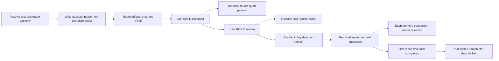

# Execution, storage and ownership

## The object whose lifetime is being tracked

Submission, geometry, branch arithmetic and framebuffer maintenance use different
identities. The host tag is not a per-pixel completion token. Global state has
one live version even though several identity fields travel with work.

| Identity | Scope and use |
| --- | --- |
| Host descriptor tag (8 bits) | Returned unchanged with the loader job completion |
| Input page (1 bit) | Selects payload/metadata and locks the current source page |
| Metadata sequence (7 bits) / generation (4 bits) | T descriptor identity; sequence advances per triangle modulo 128 |
| Draw-bank bit | Reserved zero in command headers; generic installed-context headers retain their bank field |
| Lighting epoch (16 bits) | Context identity returned with Lighting results |
| Pool physical slot5 | One of 32 result-storage positions, with wrap-aware ordered cursors |
| Producer quad tag (3 bits) | Identifies at most 8 unpublished producers while fixed returns are live |
| Sampling public owner (4 bits) | One of 16 live Sample identities; saved slot bit 4 restores pool identity |
| Lane 2 | Position within the quad, `2*dy+dx` |

No implicit equality or shared fence is defined between these identities.
[Overview](/ip/gpu-v2/docs/overview.md#completion-is-tied-to-an-owner) maps completion to reuse.

## Resident matrix preparation

The command Mesh profile can enter matrix preparation at ROM192. The calendar
occupies192..255 and448..479 and uses the existing RF, MAC and input RAM. Its
phase is encoded by PC, with no separate phase register. The original Vertex,
Triangle, bounds and Billboard ROM words remain unchanged.

`vertex/world_program.py` owns compact192..255 and448..511. The Triangle
generator owns compact128..191 and preserves those World pages; its standalone
image retains128..255. All generators support read-only `--check`, including
native INIT data as well as the portable image.

| Storage | Preparation owner | Following consumer |
| --- | --- | --- |
| Uniform20/21 | Read-only World position3x4 and normal3x3 | Retained for later draws |
| Uniform23 | Read-only View position3x4 and normal3x3 | Retained for the view |
| Uniform22 words0..21 | MAC results, then homogeneous one | Original bounds and Vertex operand reads |

Each complete position dot includes the View translation; normal dots multiply
the two3x3 matrices. Results take ACC47:16 with the existing32-bit wrap.
Ordinary Mesh uses97 enabled edges:22 matrix/one writes and two response writes.
The latter reuse the same MAC for `scene_intensity * material_response`.
Their loads occupy the final normal dot's drain; two products follow the
homogeneous-one product at consecutive edges. ACC clear supplies only bit23
for positive half-up Q8 rounding. No extra multiplier or rounding adder is used.

A World Billboard branches after the last position result, skips normal/response
work and copies the shared View basis into derived direction pairs. Its two
10-edge continuations occupy482..491 and498..507; facing selects address bit4.
Total preparation is65 enabled edges and19 stores. It then enters the unchanged
Billboard bootstrap. Ordinary Mesh resumes conservative bounds and Vertex.
There is no added per-vertex calendar.

Only ordinary response stores return9-bit coefficients to the existing CP FFs.
Changing their value requires the previous shading backend to be drained. The
SDK emits WAIT(all) before changing scene lighting or material. Repeated
meshlets may rewrite identical coefficients while older quads finish; simulation
monitors reject a differing value before backend drain.

DMA returns cannot be backpressured. A returning64-bit word writes both original
input banks; a matrix store writes one32-bit bank at the fixed block22 address.
DMA wins any write-port collision. Only a colliding matrix-store instruction
holds: PC, RF, unpacker, MAC and ACC retain their old values, while DMA continues
at wall speed. Non-store arithmetic can overlap DMA. These enabled-edge counts exclude CE and
DMA-conflict stalls. Both source blocks stay immutable until the meshlet ends;
the existing inactive-page prefetch rules remain in force. No RAM, DSP or
64-bit assembly buffer is added.

## Shared V/T bounds prologue

Only the compact meshlet ROM uses words256..310 for a fixed 55-word bounds
prologue. Words0..6 are the existing bootstrap; a kept meshlet jumps directly to
original V word7 and pays 48 additional enabled edges. Original V words0..127 remain unchanged. T uses the bounded-F16 calendar below.
The bounds prologue is only enabled in the compact composition. Native
BSRAM INIT fields and the portable view are emitted together by
`frontend/vliw/vertex/bounds_program.py`; `--check` verifies regeneration.

| ROM words | Existing ports / work | Lifetime and decision |
| --- | --- | --- |
| 256..262 | Read the original configuration/uniform bootstrap | Initialize origins, shift and RF0 |
| 263..271 | Serial configuration reads through unpacker | Test all origins using signed25 prefix taps |
| 272..281 | Z-row support point into RF1..3; MAC dot | Check signed20 coefficients and signed30 translation |
| 282 | Existing MAC-to-RF writeback into RF10 | Reject nonpositive transformed maximum Z |
| 283..292 | X maximum support dot | Finish X-row eligibility |
| 293..296 | RF10 times the existing F16-one uniform constant | Reject left; retain Z for the final test |
| 297..306 | X minimum support dot through the same ports | No second position or matrix buffer |
| 307..310 | RF10 times minus F16-one, then final decision | Reject right, or toggle epoch and jump to V word7 |

Unpacker kind6 substitutes one ten-bit endpoint from a coefficient sign, then
uses the original position decode and selected axis. It adds no wide shifter
or box-position register bank. RF1..3 hold a support point only until its MAC
consumers; RF10 holds the truncated maximum Z through the two horizontal tests.
A constant sign extension on MAC B supplies minus-one for the last test. ROM
bits43..45 select three fixed taps in the existing sign-prefix tree; bit71
checks eligibility. Bit70 selects minimum/negative-one and marks the final
keep decision. Flow7 branches or retires through the existing V completion.
No additional memory, DSP, FIFO, reservation or dynamically arbitrated port is
introduced.

The prologue and original V control run independently on the same CE. Every
prologue word has no V emit, no vertex-input advance, and no V loop/end flow;
the assembler asserts those conditions. An outer bounds-versus-V mux is not
required. All reads, RF writes, DSP launch/return and decisions freeze together
when CE is low. A reject returns `done_v` with zero published vertices, and the
meshlet controller skips its index/T phase. It neither changes an old queued
T's epoch nor waits for that T to retire. The [numerical contract](/ip/gpu-v2/docs/geometry.md#conservative-meshlet-rejection)
defines the conservative predicates and fallback.

## Billboard Vertex calendar

Billboard meshlets use a separate Vertex entry at word320. Its ten-word
bootstrap loads the original config and zero normal, then publishes the new
attribute epoch through the existing keep decision. Words384..441 alternate
the two V96 input alignments and execute 18 MAC issues per vertex. All five
result writes use the ordinary Vertex ports and backpressure. The mode bit adds
no executed slots to normal Mesh or T32. `billboard_program.py --check` verifies
both the portable words and the native BSRAM INIT fields.

## Shared bounded-F16 triangle calendar

T's62 ROM slots compose reads, arithmetic issue, previous-result capture and
writes on the same edge. Normalization slots repeat only while their magnitude
predicate requires another fixed four-bit or one-bit step. There is no dynamic
port reservation or per-instruction transaction FSM. All state advances on CE.

| Phase | Physical dataflow and lifetime |
| --- | --- |
| Position fill | Position BSRAM reads ahead through Q and unpacker into RF1..9; constants fill unused RF write slots |
| Cross components | Issue two products per component; capture product1 while issuing product2; registered accumulator retires the difference |
| Edge alignment | Three private work rows retain guarded components; one read / one DSP issue / previous write overlap; qmax selects the common exponent |
| Determinant | Three P0*N0 issues reuse RF/work Q; normalization and sign/zero decisions consume registered accumulator |
| Viewport coefficients | The same work Q feeds output Nx/Ny and C MAC; C return launches the next edge's first product |
| Publication | Ten field-major result writes finish before descriptor publication; indexed attributes remain in the original epoch banks |

There are39 MAC issues,18 indexed position reads,18 work writes and21 work reads
per kept triangle. The62-slot calendar is a base, not a fixed triangle latency:
normalization repeats add cycles and early rejection removes the unused tail.
The original V calculation, bounds prologue,16 result slots and downstream
backpressure semantics remain intact.

## Triangle parameter storage and reads

### Geometry reduction and publication

Each edge stores its three signed raw coefficients alternately in private
PC[8..10] and PC[12..14], keeping overlapping reads and writes separate, and
determines their common reduction exponent e. The 48-bit record sign-extends
T's signed38 C or signed27 N; it is not a sign/magnitude conversion.
The other PC uses still retain full54-bit math results. Raw geometry reads only
the low38 bits and explicitly sign-extends them at the consumer.
Exact exponent detection uses the eleven high bits above each retained width,
their sign complement and a low-zero carry. Shared suffix-OR and prefix-AND
chains directly test magnitude thresholds without a wide absolute value.
The local reduction exponent is at most 11 and occupies four bits.

C acceptance requests Nx immediately; two READ edges request Ny and C. Each
synchronous return feeds a dedicated `MULTALU36X18`. Let k=8*floor(e/8),
r=e mod8, m=2^(7-r), q=floor(raw/2^k), and s denote raw's negative sign.
Two wired signed windows, shifted by zero or eight bits, produce q in36 bits;
the old sixteen-bit window is unreachable under N27/C38 and is absent. No variable arithmetic shifter
is added. Sigma selects the signed factor (-1)^sigma*m. The fused DSP result is
`p=(-1)^sigma*q*m+bias` with the following live C operand:

| Sigma | Raw sign | Discarded k-bit tail | Bias |
| --- | --- | --- | --- |
| 0 | Nonnegative | Any | 0 |
| 0 | Negative | Zero / nonzero | 127 / 127+m |
| 1 | Nonnegative | Any | 127 |
| 1 | Negative | Zero / nonzero | 0 / -m |

At k=0 the discarded tail is empty and zero. Signed bits[34:7] equal
`(-1)^sigma*trunc(raw/2^e)` exactly, including negative coefficients and zero
results. PB and R use that canonical result directly. Only PA's N weights take
an unsigned17 absolute value; C has no magnitude consumer. There is no full
input absolute value or 28-bit output sign-restoration datapath.

The private preparation DSP registers A/B and consumes unregistered C on the
following enabled edge. PA supplies the signed power of two from initialized
rows96..111. The exponent selects the raw B window; its low three bits follow
A/B to select the next edge's C bias. Sign, lost-tail predicate and this fraction
freeze with CE. This also permits the next edge's exponent to change while the
previous edge's final C input is sampled.

All sixteen input words can be accepted consecutively. Relative to one C input:

| Edge | PC write / read | DSP launch | Canonical PB write |
| --- | --- | --- | --- |
| 0 | Write C; read Nx | None | None |
| 1 | Write next Nx; read Ny | Nx | None |
| 2 | Write next Ny; read C | Ny | None |
| 3 | Write next C; read next Nx | C | Nx |
| 4 | Write following Nx; read next Ny | Next Nx | Ny |
| 5 | Write following Ny; read next C | Next Ny | C |

Each read and the overlapping next-edge write address differ. The last edge
continues reading while determinant and attributes arrive; N36/attribute PC
rows are not overwritten until their previous geometry reads have completed.
There is no READ or DRAIN input state. An external input gap pauses only that
input instruction; already-issued reads and returns continue on fixed slots.
The final physical write address advances Nx/Ny/C in edge order, using two
two-bit counters rather than tags on every DSP stage.

Private PB rows6+edge,9+edge,12+edge retain canonical Nx,Ny,C. PA receives the
unsigned17 Nx/Ny magnitudes. One private DSP then executes the bounds and LOD
preparation ROM through the same private PA/PB/PC ports. It is not shared with
live pixel Z/LOD. PC's low36 input bits are written directly; only its high12
input bits distinguish signed raw geometry from zero-extended packed attributes.
The ROM supplies the physical input row. Canonical PB returns, core arithmetic
returns and the depth factor use their fixed write phases.

### Overlapping next-triangle preparation

The next header may enter when the private preparer is free, while the previous
R/I executes. Only final values cross to the runtime consumer:

| Storage | Layout and physical ports |
| --- | --- |
| Private PA/PB/PC | PA18 BSRAM, PB36 and PC48 RAM16; each has independent 1W1R preparation ports |
| Runtime B coefficients | 16x36 RAM16: row `{context,field}`, Sx/Sy at fields0/1 and K at field4; 1W1R |
| Runtime C coefficients | 16x36 RAM16: four G/S rows per context; fields4 are immutable zero; 1W1R |
| Attribute pair banks | Existing two 16x51 RAM16 banks; row `{0,context,component}`; 1W1R |
| Quad log offsets | Independent 16x16 RAM16 bank; runtime writer and reader only |
| UV anchors | Independent four-entry unsigned17 values in RAM16, with a synchronous18-bit Q |
| Reciprocal/log and H | One 512x36 BSRAM, synchronous 1W1R; configuration-initialized constant rows0..255, only H rows256..259 writable |

Preparation publishes into the inactive context. Runtime reads only the active
context; its offset and anchor writers cannot compete with preparation writes.
No mirrored read port, request, reservation or dynamic port arbitration is used.
After preparation finishes and old R drains, R starts independently of old I.
The parent snapshots bbox metadata and a one-bit pending-context flag blocks
new R samples. Geometry import, step preparation, traversal and tile loading
can proceed while old I, including LOD, still reads the old active context.
Once old I drains, one configuration commit toggles the active context and
releases new R samples. If I was already idle, start and commit coincide.
A finished empty bbox retires only private preparation: no R start, geometry
replay or active-context switch occurs, and it does not wait for old R/I. Its
bounds-completion event remains visible to diagnostics but is filtered from R.
The next preparer reuses the same inactive page. This switches triangle-local
parameters, not global draw or Lighting state;
global changes still require the whole old work to drain. The preparer holds
its completed context until that commit, so a second prepared context cannot
overwrite the values being handed off.

At R start, private PB geometry rows
are replayed with nine consecutive read/write slots: Nx0,Ny0,C0 through
Nx2,Ny2,C2. Nx/Ny are doubled only at R's input. The first read occurs on the
R-start edge, its R write on the following edge; bbox_done follows the ninth
write. Replay and a following triangle's preparation have disjoint fixed PB
access slots; assertions reject a shared read or same-row overwrite. The
interpolator remains busy through replay. No raw quad FIFO, per-pixel context
tag or full geometry copy is introduced. The pending-context flag changes only
on enabled edges and resets with R/I. R can start only while old R is idle;
I configuration can change only while old I is idle. There is no new memory
port competition or dynamic ownership request.

### Packed attribute parameters

Each accepted N36/attr32 tail word writes PC once. For source vertex v, normal
uses PC[12+v] and UV/RGB uses PC[8+v], after the old geometry in those rows is
dead. PC stores the input low36 bits directly, with its upper12 bits zero:
three contiguous S12 normals, U16/V16, or RGB888 in the low24 bits. There is no
input lane expansion. Collection and tail writes share the input low36 data
wires. Input acceptance completes that write; no later component write requires
the source word to remain held.

For one selected component, the local preparation ROM uses this enabled-edge
calendar. PC has one enabled-edge synchronous read latency:

| Operation | Read request | Old Q and result |
| --- | --- | --- |
| op0 | Vertex 2 | Prime the base read |
| op1 | Vertex 0 | Capture a2 in a 16-bit base register |
| op2 | Vertex 1 | Store d0=a0-a2 in signed17 |
| op3 | None | Form d1=a1-a2 and write the final parameter row |

A single signed17 subtractor serves both differences. The final banks store
51 bits per row: d0[16:0], d1[33:17], base[50:34]. UV16 differences span
-65535..65535; N12 and RGB8 are narrower. DSP input wiring restores each
redundant sign bit, preserving the arithmetic and half-LSB bias.

UV writes PA[1+v] for U and PA[4+v] for V in the same return slots, in vertex
order 2/0/1. Constants have no runtime writer.
The consumer selects normal12 and RGB8 before extending them to16 bits; UV uses
a two-way 16-bit selection. Normal sign extension and attribute zero extension feed
the same signed17 difference unit and existing PA write slots. There is no PC
read-modify-write or later component expansion write. CE freezes the ROM, Q
owners and short operands together.

### Preparation control word

The private preparation ROM remains one synchronous 512x36 block. Its read
address is `{index,axis,next_operation}`. Six FFs capture the low address bits
on exactly the same enabled read edge as the ROM Q; reset clears both owners,
and CE0 holds both. The returned operation is that registered value when bit35
is set, otherwise zero. Zero-filled unused words therefore retain operation0.
The ROM no longer stores a second copy of the operation number.

| Bits | Meaning |
| --- | --- |
| 5:0 | Default next operation |
| 10:6 | PA read code; imported kind also uses bits8:6 |
| 14:11 | PB read row |
| 18:15 | PC read code; imported row uses the same field |
| 22:19 | Direct PA-read, PB-read, PC-read and DSP-issue enables, low to high |
| 23 | DSP A signedness |
| 24 | Attribute parameter publication |
| 25,26,27 | PB write enable, row1 select, and short-result/row15 select |
| 28,32:29,33 | PC write enable, physical write row, and conditional-write flag |
| 34 | Auxiliary-axis issue |
| 35 | Nonempty instruction |

PB's short-result flag selects row15 and the existing sign-extended result
window; otherwise its row is0 or1. PC's physical row needs no destination
decoder. Conditional PC writes still use `aux_pending` at op18 and dual-axis
eligibility elsewhere. The existing dynamic bounds/read gates remain after
the direct controls. PA/PC read codes retain their runtime exponent, search
bit and seed-sign substitutions. This changes control representation only:
read latency, DSP returns, arithmetic windows, write edges and publication
slots remain unchanged. There is no additional data-memory port or wait slot.

PC[4] and PC[6] are zero; PC[7] is 131071. RAM16 configuration initialization
sets these immutable rows in both native and portable realizations. Reset does
not rewrite the bank. Input collection and preparation only write actual data;
there is no constant write at determinant acceptance, component capture or
configuration commit. Configuration commit writes the depth factor to private PB and the inactive runtime B context.

### Interleaved tile bounds

Each adjacent edge pair first executes op0..3 for X and then for Y. These slots
publish two attribute components and test the signs of the orthogonal geometric
coefficients. Both-zero and same-nonzero-sign pairs contribute no constraint.
The arithmetic primary axis is X when eligible, otherwise Y. An eligible second
axis shares the primary axis's otherwise unused pipeline slots.

PB[0+axis] holds signed36 D and PC[0+axis] holds the first product or accumulated
C for that axis. These rows are temporary until bounds publication. The later
analytic-LOD program starts its sums from zero and replaces the rows before
their runtime consumers execute. Packed input rows, geometry rows, port counts
and the DSP input connections are unchanged.

For orthogonal coefficients oi/oj, target coefficients ni/nj and constants
ci/cj, each eligible constraint is `D=abs(oj)*ni+abs(oi)*nj` and
`C=abs(oj)*ci+abs(oi)*cj+seed`. The existing seed is either zero or 131071.
PC physically retains signed48, exposed as signed54, without an additional
rounding step. Endpoint testing evaluates `C+30*D` for positive D and C for
nonpositive D; PA supplies the corresponding constant 30 or zero.

For two eligible axes, the enabled-edge arithmetic calendar is:

| Slot | DSP A/B launch | Read request | Result retirement |
| --- | --- | --- | --- |
| D0, op4 | Primary first product | Secondary first operands; zero C | None |
| D1, op5 | Secondary first product, if eligible | Primary second operands; zero C | None |
| D2, op6 | Primary second product | Secondary second operands; primary feedback C | Primary first product to PC |
| D3, op7 | Secondary second product, if eligible | Secondary feedback C | Secondary first product to PC |
| D4, op8 | None | Primary C-product operands | Primary D to PB |
| C0..C4, op9..13 | Same five-slot pattern for C, using seed and feedback C | Final slot requests primary endpoint operands | C0 also retires secondary D; C4 stores primary C |
| E0, op14 | Primary endpoint | Secondary endpoint operands; primary C | Secondary C |
| E1, op15 | Secondary endpoint, if eligible | Secondary C | None |
| E2, op16 | None | First search operands for a single axis | Primary endpoint and sign decision |
| E3, op17, only for two eligible axes | None | First operands for the selected search primary | Secondary endpoint and sign decision |

A launch at t samples A/B on that edge; the DSP samples its unregistered C on
t+1. The controller can retire the result at t+2. PC read addresses therefore
select the launch's C row on t, while first-product retirement may update that
same row. Independent primary/secondary rows prevent interference. No wide
result bypass, extra operand register, or port arbiter is present.

With only one eligible axis, ROM slots41..46 interleave its D and C products.
The final attribute slot still prefetches the first D operands. The unused
axis's PC row holds C's first product, so D and C have independent feedback
lifetimes without an extra bank or read port:

| Slot | DSP launch | Read / result retirement |
| --- | --- | --- |
| op41 | D first product | Read C first operands and zero C |
| op42 | C first product | Read D second operands and C's seed |
| op43 | D second product | Read C second operands and primary PC; write D first product to primary PC |
| op44 | C second product | Read secondary PC; write C first product there |
| op45 | None | Write final D to primary PB and capture its sign class |
| op46 | None | Write final C to primary PC; read endpoint A/B |
| op14 | Endpoint | Read final C for its following C-sampling edge |
| op15 | None | Fixed DSP latency |
| op16 | None | Retire endpoint and select search or next pair |

The four products launch consecutively. First-product PC writes precede their
DSP C sampling by one enabled edge. The secondary row is scratch for this
single eligible axis; analytic LOD subsequently replaces both rows. No second
numeric approximation, wide bypass or dynamically selected port is introduced.

After endpoint tests, searching uses X as primary when both axes still need a
bound; a single remaining Y constraint uses Y directly. The three-slot loop is:

| Slot | DSP launch | Feedback and next read |
| --- | --- | --- |
| S0, op18 | Primary trial | Retire the preceding secondary trial, if present; read its next signed PA step and PB D; select primary C |
| S1, op19 | Secondary trial, if another one is needed | Select secondary C |
| S2, op20 | None | Retire primary, decide its next sign and request its next PA step/PB D |

Search starts at the highest bit of the current interval's high endpoint,
with zero using bit0. If X and Y both search, the initial primary bit is
`max(high_bit(xhi), high_bit(yhi)+1)`, since Y's first trial is one bit behind
X. The representable final prefix is at least the current high endpoint: a
farther upper bound cannot tighten it, while a farther lower bound still
rejects the interval. Omitting those high trials preserves the exact
intersection with all preceding edge-pair constraints.

A maximum-width dual search covers five X bits and four Y bits in five iterations.
The last S0 retires Y's last trial, the last S1 is inactive, and S2 retires X's
last trial. Single-axis search retains three slots per required bit. The final retirement
also advances the edge-pair index; no separate loop-advance operation remains.
Endpoint or interval rejection publishes empty bounds. Partial attribute rows
from an empty triangle are not consumed. CE freezes the ROM, addresses, DSP,
prefixes and secondary-retirement marker together.

### A operand data and constants

One 18-bit BSRAM supplies private preparation operands through one synchronous
read port. Runtime UV anchors have their own small RAM16 bank. Mutable rows retain their four-bit
write address; constant reads use a seven-bit address:

| Rows | Contents |
| --- | --- |
| 0..15 | Private geometric magnitudes and UV |
| 32+d, d=0..31 | 131072 shifted right by d for d<=17, otherwise zero |
| 64+8*negative+b, b=0..7 | Signed 32 shifted left by b for b<=4; b>4 uses 32 |
| 80 / 81 | 30 / signed18 -1 |
| 96+8*sigma+f, f=0..7 | Signed `(128 >> f)`, negated for sigma=1 |

Data writes are unsigned17, with bit17 fixed zero: geometry magnitudes are below
131072 and UV values are at most 65535. Constants include signed18 values and
are initialized with the image. No inverse-power decoder, PA constant write,
held A read-address register or additional DSP constant bypass is present.
The preparation ROM uses one 512x36 physical BSRAM. Its address concatenates the
two-bit vertex context, one-bit axis context and six-bit operation address.
The context for the next synchronous read follows the same updates as the loop
state. Op3 instead fetches the operand context selected by X eligibility while
its attribute publication retains the current axis. The hard ROM's operation
field is the current phase; no separate hardware PC or input-index register is
required. Slots48..63 accept and validate the sixteen input items; their PA
field encodes input kind and their PC field encodes the input write row.
Slots23/24 commit and finish. R may start once determinant normalization and
old R finish; commit waits for old I to drain and then releases new samples.
No outer legacy state decoder drives the data ports.

| Word bits | Meaning |
| --- | --- |
| 5:0 / 11:6 | Current operation / default next operation |
| 16:12 | PA literal row or dynamic window family |
| 20:17 / 24:21 | PB / PC read row |
| 27:25 | Three-read-enable and DSP-issue pattern |
| 28 / 29 | DSP signed-A mode / attribute publication |
| 31:30 | PB write destination: none, row0, row1, row15 |
| 32 | Reserved zero |
| 35:33 | PC write destination and conditional auxiliary write |

Fixed geometric/UV rows and next-vertex rows are resolved in the ROM image.
PA retains the data-dependent exponent and search windows. PC seed aliases
select zero or131071 from live edge signs; the secondary-only search selects
its PB axis at op17. Compact write codes preserve the physical row constraints.
PB row15 also implies the signed result[34:17] format, so no independent wide
write-format selector crosses the preparation boundary. Branches, early exits,
arithmetic issue/retirement calendars remain fixed.

The table Q replaces the previous address-register/async-RAM pair. Request an
address on one enabled edge and let the DSP sample Q on the next; CE freezes
both. The C input retains its existing schedule and is not given another register.

| Operation | A read request | Consumer |
| --- | --- | --- |
| op13 / op14 | 80 for positive D, otherwise a zero constant row | Primary / secondary endpoint calculation |
| op16 for a single search, or op17 after two endpoint tests | Initial signed bbox step | First op18 |
| op18 with another secondary trial | Next secondary step, using its current acceptance | op19 |
| op20 with another primary trial | Next primary step, using its current acceptance | Next op18 |
| Final op20 | None | No unused next step |
| op31 | 32+first exponent difference | op32 |
| op32 / op35 | Current U / V | op35 / op36 |
| op36 | 81 | op37 |
| op38 | 32+next exponent difference | op39 |
| Runtime phi2, separate anchor RAM16 | Anchor page/channel | LOD at phi3 |

Reads and writes are statically scheduled; cross-port same-address access is
forbidden. New preparation and old pixel execution use independent ports; only
the final context publication waits for the old consumers to drain.

## Raster origin restoration

Geometry import writes final dx/dy step rows32/48 through BSRAM A while B
writes the packed Nx/Ny row62 halves. C import needs only the work RF. There
is no zero row or subsequent zero/dx/dy copy. Both ports are statically free
of walker/scanner reads during import. A single exclusive import/origin/ALU
write word feeds the RF and step store; there is no second wide import mux.

Base preparation follows PCs5/17/18/8/6: `dy-dx`, `2*dy-2*dx`, `3*dx-dy`,
upper support and lower support. Each vector reads edges0/1/2 consecutively
and retires one enabled edge later. Nx/Ny RF rows then become support
accumulators. X/Y doubling and upper support advance at every required level;
lower support stops at level3 because nodes above level4 never consume it.
For support, `s[l]=2*s[l-1]+s[0]=(2^(l+1)-1)*s[0]`, preserving signed30
modular arithmetic. Root bounds cap production at `root_level-1`; an already
issued unneeded vector may finish before the rest is skipped. PC14 restores
the aligned origin before the first node. There is no preparation loop for a
quad diagonal or corner threshold.

Each of the two physical18-bit step lanes provides one half of ordinary30-bit
rows. Packed row `{edge,62}` instead holds signed18 Nx/Ny. After preparation,
A serves the scanner and B serves the walker/origin DSP independently. Import,
preparation writes and scanner reads have disjoint lifetimes. Exact quad
classification has two independent signed18 RAM16 coefficient banks, written
at import and read with the scanner's fixed edge address. No mirror or dynamic
port request is used.

After bounding-box completion, the origin instruction reads the current C
vector from the work RF and the packed N row from the step B port. One fused
`MULTADDALU18X18` computes `C + Nx*(2*x_root) + Ny*(2*y_root)` with registered
operands, C and output. It consumes one physical DSP macro, or two DSP18 slots.
Its low30 result preserves the old sequence of modular 30-bit additions.
The old per-bit X/Y origin loops and intermediate X-origin write are absent.
Both-zero origins bypass this instruction as a whole.

Offsets below are enabled edges, relative to the first origin read. A DSP
issue samples its input registers; the following enabled edge updates its
output register; the next edge writes that old output into the work RF.

| Edge | Read / fixed issue | Retirement / next instruction |
| --- | --- | --- |
| 0 | C0 and packed N0 | None |
| 1 | C1/N1; DSP edge0 | None |
| 2 | C2/N2; DSP edge1 | Prefetch the first node instruction and advance ROM PC |
| 3 | DSP edge2 | Write origin h0; ordinary walker issue held |
| 4 | None | Write origin h1; ordinary walker issue held |
| 5 | Read node h0 and the root-level upper support | Write origin h2 |
| 6 | Read node edge1 | Test node edge0 through the ordinary ALU |

The same-edge origin write and node read address different RF rows. Two
valid bits and delayed edge indices track the fixed DSP latency; reset clears
them and CE freezes them with the DSP and RAM Q. Origin and ordinary RF writes
are mutually exclusive. The import, DSP and ALU write-data sources use their
exclusive write enables rather than a priority chain. Step-bank writes and
scanner reads remain statically disjoint.

## Tile mailbox publication

The two-entry FIFO holds metadata and three h words per tile. At level4 or
below, upper-test retirements write their original work-Q h directly into the
unpublished tail. The producer waits for capacity before the first such read;
no published slot can be overwritten. A successful upper test supplies all
three words before any lower-test decision. Lower retirement publishes metadata
and tail when the region is full or is a partial level2 leaf. A failed lower
test at level2 can publish immediately because the upper test already filled
the whole vector. Rejected candidates leave only unpublished data. No enqueue
copy instruction, zero-add transfer, full flag register or slot tag is needed.

The scanner takes old FIFO metadata and requests h0 on that edge when its
phase is1/2/3. At phase0 it enters LOAD and requests h0 at the following phase1.
Subsequent reads request h1/h2 on consecutive edges. Thus the h2 return is
always phase0/1/2, and all four-bit corner predicates are registered before
ALIGN's phase3 decision. This preserves the existing first-SCAN phase without
a same-edge predicate-to-step-address bypass. The last LOAD return releases
the head. The final-quad PREFETCH path retains its fixed three-word calendar
and releases the head at handoff. All accesses are after the producer wrote
their words; CE freezes both sides and simulation shadows check that ordering.

## A quad's storage lifetime

1. Admission reserves a physical slot and capacity for every scheduled return.
   At most 24 slots are active and 8 are unpublished. Old-state capacity decides
   admission; a same-edge release does not fund a full queue's new allocation.
2. R/I write coverage, normal, attributes, depth and LOD directly into their
   final banks. The header is fixed for this allocation.
3. A complete prefix makes the next ordered slot publishable. Readers see old
   publication state; the last payload write cannot bypass into publication.
4. Lighting and Sampling advance their own ordered cursors, skipping branches
   that have a defined bypass. Their results retain the quad/lane identity.
5. Final reads Basic/Light/Sample only when required data are ready. Ordered
   output feeds the sink; empty-mask slots release after preceding Final work.
6. The sink accepts color then depth rows. Last depth acceptance ends source
   ownership. Last color write ends the cache owner. Dirty memory visibility
   waits for [flush](/ip/gpu-v2/docs/framebuffer.md#refill-and-flush).

Sparse lanes skip unused branch reads and do not enter active ROP updates.
Numerically empty slots retain ordering. Neither optimization performs early-Z.
The pool is specialized for complete, fixed-order producers; it is not an
arbitrary missing-return/reordering transport.

The pool source owns both diagnostic policies. Public component factories keep
reset-cleared sticky `fault`; the private command factory clears it on every
wall-clock edge and monitors each original write predicate in simulation.
`GPU_V2_COMMAND_PORTS` and `GPU_V2_LIVE_GLOBALS` select data contracts only.
They do not select diagnostic trust. Neither policy changes the 24 active,
8 unpublished or 32 physical credits, completion prefixes, separate front/backend
CE, retirement ID or safe-empty-skip condition. An invalid retirement retains
its original edge update; this observation policy adds no rejection or recovery.
Pool RAM ports retain their original enables. Their collision diagnostics are
separate from the join result banks' functional read/write collision guards.

### Selected join and paired depth

The production root is the complete
[command backend](/ip/gpu-v2/src/system/command/backend.v).
Its [factory](/ip/gpu-v2/src/system/command/backend.rs) assembles this parent,
Sampling, owned-Q banks, the TDP sink and numerical children at module boundaries.
Each owner supplies its own diagnostics. Public data macros do not grant a
diagnostic policy. The command factory normalizes line endings after assembly;
it does not rewrite a standalone backend or specialize an RTT parent afterward.
The checked standalone backend and historical postquad factories remain
independent references.
The 23-bit active header stays registered; its tile is a combinational projection,
not a second captured header. Existing issue/publication/retirement prefixes own
the ordered progress; there is no separate paid-return ring or occupancy copy.

| Boundary | Payload and ownership |
| --- | --- |
| Covered J_READ edge | Read Basic, Light and Sample together; READ_MODE0 updates their Q after the edge |
| J_WAIT | Hold source Q through CE0/backpressure until Final input acceptance; preserve the existing subsequent arithmetic loan |
| Masked issue lane | Advance its source prefix once, without operand reads or a Final token; retain the masked C/D row calendar |
| Sink C acceptance | Consume the Final result when covered; pay depth Q at `{retire_slot,out_lane}` |
| Paired sink D | Consume that depth Q; final-lane D releases pool/header/depth source ownership |

An empty quad takes the existing safe empty-skip path after prior tokens and
branch cursors have drained. It does not acquire a second retirement owner.
For legal paired-D traffic the unchanged raw retirement proposal identifies D3;
it is not substituted with a similarly named cache/completion signal. Cache
owners and external memory transactions retain their later release boundaries.

Light and Sample use 128-row banks of 18 and 32 bits. Sample stores
`{texture_alpha8,RGB24}` in the existing native SDP36, retaining its128 rows,
ports, owned Q and read calendar. The shared row-store
emitter's private owned-Q route omits return-valid storage; public event-return
banks keep their interface and model. Native SDP36 READ_MODE0 and portable held-Q
behavior are unchanged. Same-address collision suppresses both reading and
writing, including builds with diagnostics removed. The sink's existing `phase`
and `expected_lane` directly supply `depth_phase` and `active_lane`.

The root's private command policy keeps diagnostics passive and explicit abort
sticky on wall edges, including CE0. The checked entry remains the default;
public command ports do not select policy. The private scope and abort process
are inside the module before the legacy transport tail, so the independent
three-port adapter preserves them when replacing that tail.

## Separate release boundaries

Solid arrows follow work toward external visibility. Dotted arrows name the
resource released at that boundary; they are different owners. C and D mean
color/depth rows here. A tile can contain writes from several quads and remains
resident after a local owner releases. Flush completion covers its full required
writeback set, not merely the first transaction terminal.

## Stored header and payload

The 23-bit header is mask 3:0, draw-bank 4, unlit 5, RGB/untextured 6,
reserved-zero 7, X/2 in15:8 and Y/2 in22:16. Origins are even. Branch descriptors
derive from this header rather than allocating a new quad identity.

| Bank | Physical representation | Reader |
| --- | --- | --- |
| Normal | One BSRAM, 18-bit writes / 512 × 36-bit reads;32 × 4 rows used | Independent synchronous Lighting port |
| UV | One BSRAM, 18-bit writes / 512 × 36-bit reads, `{pad2,V16,pad2,U16}` | Independent Sampling port |
| Basic RGB | One BSRAM, 18-bit writes / 512 × 36-bit reads; R in low half, G/B in high half | Independent Final port |
| Z | 18-bit 1W1R BSRAM carrying Z16 | Sink color acceptance issues read, paired depth phase consumes Q |
| NDC | 320 × 32 read-only BSRAM; two adjacent F14 coordinates/word | Lighting synchronous read |
| Header, masks, LOD | Per-reader distributed RAM | Independent ordered cursor views |

Native Normal/UV/RGB writes replace one complete 18-bit half at address
`{row,half}`. Normal/UV select the corresponding half of the existing data bus.
Basic stores `{zero10,R8}` in half0 and `{zero2,B8,G8}` in half1; fixed read wiring
restores the original three padded RGB bytes before Final consumes them.
There is no native 36-bit read-modify-write or byte-enable dependency. The
logical portable model retains the existing field-update interface. A synchronous
read's Q remains owned through CE and consumer stalls. Capacities, read latency
and return calendars are unchanged. The geometry record ports have the same
ownership rule but separate banks and identities.

GW2AR native bindings use complete writes rather than assuming the vendor
functional model's partial-write behavior is a physical device guarantee.
In the command composition, the depth bank stores `{alpha8,D16}` as a complete
36-bit word with its upper12 bits zero; it does not mask out unused bits.
`tests/gw2ar_write_contract.rs` checks emitted bindings separately from model
co-simulation. The pool qualification sweeps both half layouts across all512
rows and two epochs, including held synchronous Q.

## Fixed return calendar

The native frontend localizes Raster's phase loads in `vliw/raster.v`;
`vliw/compute.v` owns the preserved `rc_compute.phase` producer. Only Raster's
internal consumers use a preserved two-bit `raster_phase` register. On the common
rising edge, reset sets both to zero, otherwise common frontend CE makes both capture
the pre-edge producer phase plus one modulo four, otherwise both hold. The
replica captures the producer's next state, so it adds no pipeline edge. Raster,
interpolator and compute retain the same clock/reset/CE connections; abort stops
them through the existing frontend CE gate. Other phase consumers and the public
Raster phase port retain their existing bindings. Preservation attributes request
separate physical registers; their retention and routing require a fitted-netlist
check rather than an inference from RTL names. `frontend/vliw.rs` includes both
modules for portable/native frontend and production command exports; no later
source injection supplies this behavior. A standalone Raster caller must supply
the same reset/CE-qualified modulo-four phase as the interpolator producer.

Here phi0..3 are the four enabled phases of the local interpolation calendar.
Offset 0 is the enabled edge accepting the quad at phi0; offset n is n later
enabled edges, with phase `n mod 4` sampled before each edge. A compute pause
adds wall time without advancing this index. Backend CE is a separate owner.
G denotes geometric-mask return, W one attribute-return word, and L quad LOD or
its RGB bypass pulse. Numerical depth/pass returns have their own event:

| Event | Enabled-edge offset | Phase and payload |
| --- | --- | --- |
| Depth/pass, lane k | 13+4k | phi1, Z16 plus numerical admission bit |
| G | 14 | phi2, geometric quad mask |
| W0, lane k | 14+4k | phi2, normal X/Y |
| W1, lane k | 15+4k | phi3, normal Z plus R or U |
| W2, lane k | 16+4k | phi0, G/B or V |
| L in RGB mode | 15 | phi3, bypass pulse; final W2 completes the quad |
| L in UV mode | 50 | phi2, final LOD; completes after all W words |

Normal writes low 18 at phi2 and high 18 at phi3. UV writes low 18 at phi3 and
high 18 at phi0. Basic RGB writes R at phi3 and G/B at phi0. Depth/pass returns
at phi1. RGB's final W or UV's L advances the six-bit completion prefix. UV LOD
writes at the old completion tail; RGB does not require a LOD bank write.
Mode changes wait until all old returns drain.

## Lighting and Final schedules

Installed-context Lighting fetches normal/X, captures X and reads Y, offers
context, then offers the pixel, over four enabled phases. The command profile
borrows live CP globals and omits that context-install transaction. Normal Q and NDC Y stay owned until actual
pixel acceptance. The selected core comes from
`dsp_sharing::four_cycle_shared_roms(9)`: arithmetic latency 34 enabled edges,
admission interval 4. These describe the local calendar, not scene throughput.

Normalization reads share four scheduled channels across two true-dual-port
ROM banks. The dot MAC keeps its hard output register. Private core CE advances
under the parent's guaranteed result-bank acceptance; public ACKs and bank
writes commit on common CE, so a pause cannot spend a result twice.

The Y/Z split-square corrections take their high and low parts from the same
prescaled register Q. Those two registers have explicit synthesis preservation;
kept seven-bit Q nets feed the native DSP B ports directly. Current combinational
D must not replace only one operand half. This changes neither arithmetic nor
latency. The Lighting emitter owns these boundaries through the private II4
factory, including the MAC's `OUT_REG(1)` and direct wire result without a second
fabric tail register. Both existing II4 ROM configurations use this factory;
public standalone Lighting generators retain their original physical defaults.

The two generator choices are independent:

| Route | Live globals | II4 physical boundaries |
| --- | --- | --- |
| Public standalone/default or explicit schedule | No | No |
| Installed II4, widths 7 through 11, either ROM configuration | No | Yes |
| Final command II4 | Yes | Yes |
| Internal H9 schedule generation only, no final factory caller | Yes | No |

The internal H9 schedule accepts all four pairs. Live generation still requires
Fast, smooth H9, unified lighting and explicit plans; missing plans or any other
profile returns an error. This does not add a public profile switch or permit
unsupported live configurations. Public retained-token RAM remains supported.

`tests/lighting_square_boundary.py --netlist <post-PnR.vo> --output <dir>` checks
the selected mapped shape: both preserved 16-bit register owners, high/sign and
low operand provenance, the hard MAC output register, and common DSP clock/CE.
Kept low-bit aliases may rename the Q nets; the preserved FF instance still
identifies their producer. The source replay separately checks CE0 Q hold. Adding `--qualify` to the mapped
check also rejects wrong registered low/high owners and an unregistered MAC.
`--rtl <command.v> --qualify --output <dir>` keeps the bounded 12-token native
and fabric replay together with MAC-register and Y/Z current-D negative controls.
The Y port-age assertion also catches wrong inputs whose rounded final value
happens to match. Local postquad timing wrappers must define
`GPU_V2_GOWIN_DSP` before the first module to qualify the native Lighting path;
a later macro definition does not qualify earlier modules. These local mapped
checks do not establish whole-system timing or board behavior.

Final's three source banks return after one enabled edge. Its wait phase owns
all Q values until consumed. Two old-state result credits admit arithmetic only
when `qcount+arith_live<2`. A simultaneous output ACK adds no admission credit.
A nonempty queue supplies its old head; a direct arithmetic result can bypass
only an empty queue. Shared multiplier phases and result reservations remain
part of the schedule.

The selected Final source owns its diagnostic policy. Public selected factories
retain checked preflight rejection and sticky failure. The private command entry
selects a complete Final owner with passive, simulation-only checks on the same
proposal edges; those checks do not gate advance. Explicit abort remains a real
sticky stop on wall-clock edges, including CE0, until reset. This private choice
is independent of live globals and command-port shape. Its local source profile
is closed before the next module, so later generic factories remain checked.
The arithmetic, two reserved result slots, source-Q loans and shared DSP calendar
are identical in the checked and command routes.

## Texture cache

Sampling reserves public identity on the first covered sample lane, before an early hit
can return. No two live owners share low 4 slot bits. Completion restores the
saved fifth bit and the actual last Color write releases that public owner;
this 16-owner limit does not shrink the 32-slot result pool.

The producer pool enumerates only lanes in the final numerical mask, in natural
lane order. Helpers pay neither UV reads nor coordinate issues. The registered
descriptor's bit10 marks the first covered lane; it can be lane1,2 or3. The
last-covered-lane handshake advances the sample cursor. Empty and RGB quads
bypass this reader entirely. UV Q and its descriptor remain stable through the
V sampling edge after acceptance; that edge's successor read replaces Q only
after the current calculation has sampled it.

The selected path supplies these actual lane IDs directly to the coordinate
kernel; it has no independent four-row adapter or four-phase inlet counter.
An accepted U edge is followed by the V edge, which also reads the next UV.
The next U edge consumes that UV and retires the old complete coordinates into
the existing queue. Coordinate admission takes two enabled phases per covered
lane. Coefficients, membership, cache and Color sustain II2 for a one-mip hit;
fractional two-mip filtering still requires four clocks per pixel. Tile/mip/wrap
seams split groups; misses add variable work. There is no universal 16-clock
quad completion claim. Preparation writes exact coefficients once into the
weight bank; private packets carry nonzero masks and identity. Group work
credits reserve on admission and release on actual ACK.

The fine-coordinate kernel receives the physical mip exponent directly. It
does not construct side/shift fields and decode them back into a range. Its V
calculation borrows the producer's UV and descriptor Q through the next enabled
edge; a successor fetch changes those Qs only after that edge. There is no
second V-input/configuration register bank. Simulation monitors this lifetime.

The coordinate owner emits command sampling-input normalization and its native
POT/RTT kernel. Repeat POT views wrap the low16 UV bits and use the physical
mip exponent. POT ClampToEdge and fixed400x240 normalize signed18 UV to0..65535
in the sampling scope; the kernel selects POT or400/240 scaling on the U/V phase
and shares the signed19 half-texel subtractor. Nearest subtracts zero;
filtered sampling subtracts128 before the endpoint clamp. Clamp POT retains
logical exponent0 for1x1; Repeat retains the minimum physical2x2 footprint.
Two coarse-edge flags in the existing coefficient stage zero each clipped
coarse fraction. Lower-edge metadata suppresses the half-step borrow at base0,
so coarse coordinates match an independent clamp of that mip. Virtual adjacent
taps, raw16 cache data, the weight bank and the enabled-edge calendar are
unchanged. Original UV differences still drive LOD. The
coordinate output shares the masked index across Repeat and Clamp. A negative
Clamp coordinate clears index and fraction; an upper endpoint only clears the
fraction. POT endpoint detection reduces the active index bits against the
existing size mask, avoiding a variable full-width endpoint comparator. The
fixed endpoints399 (0x18f) and239 (0x0ef) share all bits except8,6,5; their
comparison shares the common bits and uses the existing U/V phase for the rest.
No endpoint state or enabled edge is added. The
command DirectLOD source owns its installed descriptor pins; the CP still
installs and checks fixed-view descriptors and freezes them until whole drain.
The checked standalone and generic source-Q factories retain their own inputs
and diagnostic feedback.

Completed coordinates enter the existing six-row queue: physical owner24 and
result36 storage reconstruct the unchanged owner38 output. `proposal_ce`
observes old-state admission/return/consume legality; `commit_allow` gates RAM
writes, pointer updates and both counts. There is no same-edge credit bypass:
a full queue cannot issue using a concurrent consume, a return requires an old
outstanding item, and consumption requires an old completed item. U/V phase,
result state and queue storage hold when their effective CE is disabled. The
command coordinate, DirectLOD and queue own passive diagnostics at those same
edges; outer exporters select complete leaves without numerical-body patches.

The command coefficient owner is emitted by
`texture/rtl/compact_coefficient.rs` with the same arithmetic and metadata pipeline
as the checked generic coefficient. The final command selection installs this
complete direct-weight producer together with Membership, Work16, Packet and
the two producer wrappers directly from `system/texture_membership16x8.v`, `texture_work16.v`,
`texture_packet16x8.v`, `texture_packet_backend.v` and `texture_runtime_backend.v`.
The selected Group owner is `system/texture_group_q.v`. Generic sampler factories
retain their independent checked sources; command selection does not rewrite
their payload widths, packing or diagnostic assignments.

Membership publishes Member76 after two enabled edges. Its low36 bits carry
nonzero coefficient masks; emit is39:36 and metadata is75:40. Work16 retains
only metadata36 (immutable slot bits cleared) in distributed RAM and emit/cursor
in two small heads. Exact weights stay in the existing direct-weight bank.
Packet captures member/tap/base on one enabled edge and publishes Group35 on the
next. Group35 packs H14:0, local X18:15, local Y21:19, owner29:22, mip parity30
and coverage34:31. H15 names a256-byte line. POT layers use complete16x16 macro
tiles; the fixed400x240 view uses16 macro rows per column. Its descriptor and
mode remain stable through drain. Packet monitors the original alignment,
active-tap and RTT visible-column/half-row bounds on their original edges.

The direct-weight write port is the only producer of the existing 128x36 weight
bank. The runtime wrapper and sampling parent pass its write, address and value
without another write enable or payload copy. Starting at accepted edge E0, the
advancing-edge calendar is:

| Edge | Effect |
| --- | --- |
| E0 | Capture input and key0, including original mip parity/minimum-level flag |
| E2 | Transfer the old key0 to key1 |
| E3 | Write the fine `returning_corners` word and capture its nonzero mask |
| E4 | Write coarse unless the original fine level is zero; capture both masks |
| E5 | Publish the ready row and synchronous metadata head |

The seven-bit bank address is `{key1[5:0],key1[6]^(v4&&!key1[7])}`. A
same-edge next admission or key transfer cannot replace the old key1 for coarse
writeback. A zero parent or zero mask does not suppress an otherwise scheduled
write; bank-write count is distinct from the number of reserved Work entries.
The two ready rows retain eight mask bits, exposed as zero/one values in the
original nine-bit coefficient lanes. The exact 36-bit weight words stay in the
sole bank. Disabled advance holds arithmetic and key ages; a full ready queue
may consume under CE but cannot use that same edge as new arithmetic credit.
Metadata collision monitors observe the original read/write edge.

Non-command II4 factories keep the checked direct-weight, weight-order and
unique-weight adapters. Command construction still passes through that scaffold
before replacing the final complete owners; those intermediate build dependencies
are distinct from the final producer and have not been eliminated.

These seven command owners implement passive diagnostic policy in their source.
Leaf fault registers clear on every wall-clock edge, including CE0; wrapper
terminal/stopped registers retain only explicit abort until reset. Readiness,
commit and backpressure calendars are unchanged when monitors are removed.

The command Group queue is one48-entry FIFO in64 physical RAM rows. Packet
capture acquires a FIFO credit; its fixed two-edge write advances the published
prefix. Reads use only that prefix, never a same-edge producer write. The former
Producer16/Group32 transfer stage and separate tier counters are absent. Total
occupancy includes unwritten entries, RAM entries, the in-flight read and both visible heads; the
fixed write pipeline has at most two unwritten entries. Retirement releases a
credit only when the cache consumes the current Group. Pointer observations
derive from these prefixes rather than adding functional counter state.

One35-bit copied current head precedes the native RAM's registered output Q,
which holds the next entry. The BSRAM uses `READ_MODE=1`. A prefix read fills its
internal first stage; the following enabled edge updates Q through OCE and
marks it valid. One pending bit tracks this read. A Q promotion may issue the
successor read, but never updates Q on that edge. The next key and copied head
therefore consume a value that stays stable across their sampling edge. The
48-entry bound retains the in-flight row and both live rows through retirement.
There is no second copied head or external wide read-return register.

Q promotion and Q return are mutually exclusive. CE pauses freeze the read
calendar, OCE, validity and copied head together. The return edge is followed by
a promotion/read edge, allowing steady Group II2 without relying on bypass Q's
old value while a successor read changes that output. Registering the BSRAM
output changes queue startup, not the cache's saturated two-clock cadence.

On a consumption edge, the next key is already visible on registered Q. The
cache reads that key's tag while the queue promotes Q and reads its successor's
first stage. Tags are available on the following edge: a hit retains Group II2,
and a miss can start its descriptor without an extra tag-read bubble. A missing
next entry clears current-head valid and uses the ordinary two-edge prefix-read
startup followed by promotion.

The cache also borrows the copied head's registered sector for the refill
request address. The queue cannot consume that head before the descriptor
drains and its texel read issues, so no separate descriptor-address register is
required. Simulation checks address stability across descriptor lifetime,
including proposal CE pauses. The standalone generic component factories retain
their separately tested interfaces and calendars.

The cache has 16 sets, four ways and four synchronous 1024 × 16 banks. Keys are
slot/level/tile XY; set=`((tile_y&3)<<2)|(tile_x&3)`. Invalid ways precede
tree-PLRU. Bank=`{y0 XOR x1,x0}`, local=`{y2:0,x2}`; form virtual +1 taps before
bank selection. Only old READY tags hit. Captured reads pin the owner and retain
payload, preventing replacement from altering accepted taps.

The command closure issues texel reads from the saved paid payload and line,
not from a new tag result. On admission it saves the Group35 address and starts
the existing weight read. On the next wall edge it reads the four texel banks,
captures the weight Q, and publishes the synchronous texel Q directly. There
is no separate 64-bit texel copy. The paid-address slot and the held result are
independent: a free paid slot can accept the next address while Color consumes
the old result's first pair. Its texel read waits until the old result's final
consume edge. The consumer samples old DO on that edge, and RAM updates DO after
the edge. This gives Group II2, or four clocks per eight-tap trilinear pixel,
when hits and continuous input allow it. Startup latency remains two edges.

[Sampling throughput](/ip/gpu-v2/docs/sampling-throughput.md) distinguishes
Group II, pixel/quad rates, first-result latency, cache misses and whole-GPU
wall time. Four clocks per two-mip pixel is a resident interior capacity, not a
universal bound across tile seams or sparse coverage.

One pin protects the newest paid line through its read. Once an older result
has reached native DO, it no longer needs the original memory line protected;
the new pending address can take over the pin. A pending return holds its
address and weight Q until the result slot is free or consumed. Backpressure
therefore holds DO, metadata and weights together. Refill returns still run on
wall edges during CE pauses; they cannot overwrite an occupied result. Generic
standalone cache exporters retain their original pipeline.

The raw texture dimensions, mip limit and bias are driven directly from the
immutable command-global context. They change only after a full drain; the
calculated LOD bias retains its existing preparation register.

Each native tag bank writes one complete 18-bit tag and reads an adjacent pair
as36 bits. The write address includes the way's low bit instead of masking a
36-bit row. Both the runtime and independent component cache use this binding;
tag lookup width, capacity and latency stay unchanged.

A miss reserves one line and presents an aligned 128-byte request. It receives
16 indexed 64-bit beats and a terminal ACK. Last beat alone does not publish
READY; errors cannot publish partial data. Acceptance/first-beat and final-beat/
ACK may coincide where the interface permits them. Refill runs on wall edges.

The command closure selects `system/texture_cache16x8.v` as its cache owner.
Its 15-bit physical line key, eight sets/four ways, two child transactions and
paid-address/held-DO calendar are native to that source; generic factories keep
their checked interfaces. The first successful child keeps the parent FILLING.
Only the second successful terminal publishes READY. A failed child terminal
invalidates the parent and ends that descriptor while explicit abort preserves
the existing presented-request drain. Return framing monitors remain passive;
monitor removal does not remove terminal-success qualification. There is no
added sticky failure, retry prohibition or source-lifetime change.

Color processes two RGB taps per edge with six small multipliers. RGBA4444
alpha shares the existing ALU54 accumulation; its13-bit pair register captures
on the same edge as those RGB products. On common CE,
its accumulator Q writes the final Sample bank directly. The sink consumes old
Q before a same-edge replacement. This parent contract requires no intermediate
Color result FIFO; independent generic Color APIs retain their output credits.

The selected Color sources own their diagnostic policy. An explicit private
command selector, scoped around the reachable backend modules, removes only
wrapper `terminal`/`preflight_fault` feedback and the direct leaf's diagnostic
`fault` lifetime. Original predicates remain simulation monitors. Public data
port/global macros select no trust; public buffered and reserved factories keep
their checked defaults. Reserved publication still uses `publish_bad=0`, while
old-state `publish_ready` and `publish_fire` remain functional.

The raw selected direct component retains `packet_bad`, `preflight_bad`,
`advance && !packet_bad` and its bad-versus-update branch in either policy.
The complete command's physical Group35 adapter has no level field and retains
its existing constant-zero level detector; this separate format specialization
is not diagnostic removal. Reset, busy/done/Q ages, RGB565 numerical behavior, product
rounding and old accumulator-Q consumption are unchanged.

`result_fire` writes Sample at `{saved_pool_bit4,out_key}`. Only that write with
`quad_last` releases the low-four-bit public ID, where the stored highest
covered lane defines the last result. No same-edge pop can fund an aliasing
publication. The source pool/header/depth slot remains owned until D3. Closed
Color still requires its parent to accept every completion; this policy adds
no output queue or recovery for a refused result-bank write.

## Pause, fault and reset

The command profile has one live Lighting context. Its production closure omits
draw-bank fields, bank selection and local copies of raw global parameters.
CP FFs own light/ray vectors, intensities, mode/code/epoch and far through the
whole render. Preparation and I borrow far directly. Lighting reads those same
stable global wires and derives its small power-grid selection from the stable
code; it has no configured/loaded-valid flag or context-install transaction.
Reset initializes the one-hot arithmetic calendar, which then advances on the
original compute CE. The quad reader requests X/normal and then Y; the Y return
feeds L_PIXEL directly, without the former context-only wait state. The four-edge
arithmetic initiation interval and every pixel valid/identity remain unchanged.
Global replacement still requires full render drain before CP writes any field.
`SET_GLOBAL` itself does not wait for that drain: the command stream must first
issue `WAIT` for the outstanding DMA and compute owners. Its existing state
command monitor rejects replacement without the required fence. CP's
`render_idle` input is compute-idle, including backend cache/output/sink drain;
it is distinct from the outer pipeline-idle predicate that also covers memory,
DMA, clear and serial work. No implicit wait or recovery is added.

The crate-private command factory carries this ownership choice from the system
through the frontend, source-Q backend and Lighting generator. Frontend and
backend templates select their ports/state through scoped
`GPU_V2_LIVE_GLOBALS`; Lighting emits its live aliases, reset-only token/identity
state and free-running calendar directly. Global replacement does not restart
the calendar, phase or identities. Computed LOD bias, packed widths/reserved bits,
ROP retirement, empty-quad skip and sink drain remain in their existing owners.
The final state binder handles target bases; the command texture factory
selects native Packet/Group owners separately. Neither rewrites global/context
registers after export.

Public generic factories retain installed-context ports and capture semantics.
An installation requires CE and an empty token pipeline; external field changes
without an accepted installation do not replace the old context. Their
configured flag and context-triggered calendar/token reset remain local to that
profile. The private live-global define is closed before another factory's RTL.

Mesh uniform RGBA is separate from that live context: it follows retained V/T
attribute epochs, prepares beside the next triangle and switches with the active
I context. Quad allocation copies RGB into a24-bit distributed-RAM issue view.
The depth-event write stores alpha beside D16 in the existing depth BSRAM; the
paired late read delivers both directly to ROP. Final and ROP therefore read
their own owners without a shared-port arbiter or whole-GPU wait between mesh colors.

The owning frontend, interpolator, quad pool and selected framebuffer sources
use the existing static `GPU_V2_COMMAND_PORTS` boundary for this color path;
generic exports retain their ports. Under CE, the legal header's CHECK edge
captures `epoch_color[!vertex_epoch]`. A bounds reject does not advance the
epoch. T words 10/11 carry its 18/14 color bits; word 15 acceptance releases the
descriptor. Accepted raw words fill `prepared_color`, and `cfg_apply` installs
`pool_color` with the active I context. RGB remains owned by the descriptor slot
until Final reads it; alpha remains paired with depth until late ROP acceptance.

Texture coefficient metadata stays in its admission BSRAM row until retirement.
Publication reads the current head; consumption reads a successor only when an
already-ready row remains, or when that row publishes on the same edge. Popping
the sole ready result holds the native output Q until publication. It never
speculatively reads the unpublished admission row, so metadata read and write
ports cannot overlap at the same address. No bypass, extra owner state or
pipeline bubble is required. This contract also applies to the independent
generic and compact execution models.

The framebuffer TDP source owns its command diagnostic policy together with
runtime-target/UI/MEMCPY maintenance. The command factory selects the private
`GPU_V2_COMMAND_MAINTENANCE` profile only for that closure; generic factories
retain fixed targets and their original checked behavior. No final scanner
specializes this owner's completion-error, source-error or fault-register
statements. Request/data/retire counters, held native Q, CE-independent service,
UI half-completions and the final write response retain their existing owners.
The [UI contract](/ip/gpu-v2/docs/ui.md#native-command-maintenance-ownership)
describes the forwarding and bank-port boundary.

The command factory removes diagnostic feedback from the independently checked
components below. Its simulation monitors never control CE, writes, ready or
state transitions; synthesis removes only the monitors. Normal backpressure
and explicit abort remain functional. See
[command diagnostics](/ip/gpu-v2/docs/commands.md#diagnostics-cancellation-and-scope).

The command DMA and memory router also own their passive policy in their
Verilog sources. Their private factory scope preserves the same request/return
state machines, two DMA job/return slots, two ordered RO tags and two
same-direction framebuffer descriptors. It changes neither credits nor
arbitration. Offered requests survive pause and stop until acceptance;
accepted owners drain through actual LAST. Final write data and terminal ACK
remain separate. The router factory selects its source without a module-tail
string cut. See [memory ownership](/ip/gpu-v2/docs/memory.md#request-data-and-terminal-ownership).

The `rc_raster`, `rc_lod` and `rc_compute` leaves own their command-profile
observation policy behind `GPU_V2_COMMAND_PORTS`. Raster has three diagnostic
write sites (bits 1/2/3), LOD one (bit 0), and Compute four (bits 0/3/1/2).
Their original predicates report simulation failures on the same sampled edge.
Command `error`/`compute_error` remain registers cleared by a nonblocking
assignment on every posedge, independent of reset and CE; they are not
combinational zero signals. Generic checked exports retain the original
reset/start clears and diagnostic bit writes. No error observation changes
ready, arithmetic, phase, payload or FIFO progression.

| State | Compute CE0 | Fault/abort |
| --- | --- | --- |
| Scheduled arithmetic, phases, tokens and owned Q | Hold together | Stop new computation; suppress invalid result writes |
| Descriptor reception, loader completion and page publication | Continue on wall edges | Stop future job work; report failure and drain owned traffic |
| Cache refill/writeback | Continue on wall edges | Hold presented requests; drain accepted traffic |
| New meshlet admission | No enabled transfer | Blocked |

Local preflight can reject malformed current work. Cross-module faults latch a
sticky stop; independent legal actions on the detecting edge need not roll back.
Reset wins over local CE and validity updates. Recovery coordinates reset with
the externally owned memory chain. [Memory](/ip/gpu-v2/docs/memory.md#errors-and-cancellation)
defines what must drain, while [submission](/ip/gpu-v2/docs/submission.md) defines the observable
whole-GPU boundary.

Implementation anchors: [pool](/ip/gpu-v2/src/system/pixel/vliw_quad_pool.v),
[backend](/ip/gpu-v2/src/system/pixel/vliw_backend.v),
[Final](/ip/gpu-v2/src/system/pixel/vliw_backend_final.v),
[Lighting schedule](/ip/gpu-v2/src/lighting/dsp_sharing.rs),
[texture cache](/ip/gpu-v2/src/texture/rtl/cache.rs).

## Frontend control profiles

The native `shared_meshlet`, `shared_frontend` and `rp_prepare` sources own their
checked-component and trusted-command control policies. The command factory
explicitly selects the private `GPU_V2_TRUSTED_FRONTEND` profile; the frontend
factory undefines it after the last owner. `GPU_V2_COMMAND_PORTS` selects ports
and does not select these three modules' error policy. A standalone frontend
with command ports therefore retains checked behavior.

Checked meshlets reject malformed metadata and exhausted index cursors on the
original enabled CHECK/INDEX edges. Checked vertex/triangle launch preserves
compact-address, vertex-capacity and published-reference rejection. CE0 holds
these decisions. `rp_prepare.error[3]` (start while busy) and `error[0]` (unexpected
input index) remain sticky functional latches: either deasserts `in_ready` and
disables the arithmetic core CE. Its numeric error bit retains its original
independent lifetime. Reset and a legal new start retain their existing roles.

The trusted command composition keeps its existing constant detectors, disabled
rejection branches and zero-valued error outputs. Simulation observes the
original predicates and error-write events on their original edges; `SYNTHESIS`
removes these monitors without selecting another datapath. This profile adds no
new malformed-input recovery policy. The source includes both policies before
export; no final text scanner rewrites these owners' detectors or error writes.
