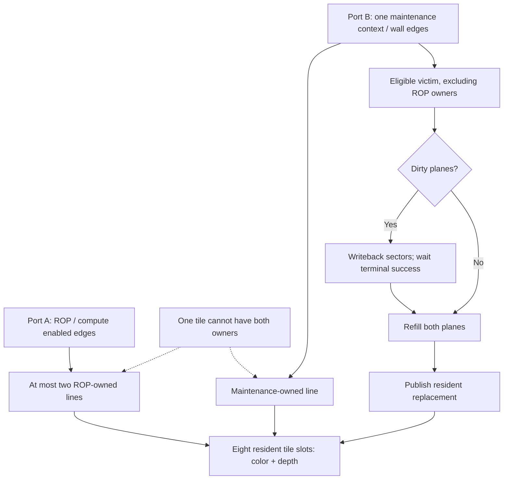

# Updating and publishing the framebuffer

## Surface layout

The GPU materializes disjoint RGB565 color and unsigned D16 depth planes in
external memory. Each plane is tile-linear, with 16 × 16 pixels and 512 bytes
per tile. Generic surface dimensions are width 16..512 and height 16..256, both
multiples of 16; the selected GPU factory fixes 400 × 240. Plane bases are
512-byte aligned. Their full allocations must be disjoint and fit actual memory.

```text
tile = (y>>4)*(width/16) + (x>>4)
byte_offset = tile*512 + (y&15)*32 + (x&15)*2
color_address = color_base + byte_offset
depth_address = depth_base + byte_offset
```

Each plane tile transfers as four ordered 128-byte sectors. The
[memory wrapper](/ip/gpu-v2/docs/memory.md) converts these byte addresses to halfwords. It does
not request an implicit indivisible512-byte controller group. The surface has
no destination alpha or lazy-clear metadata; the stored plane bytes are the
color/depth contents seen by refills and later readers.

## Pixel update

A fragment reaches ROP after [Final RGBA](/ip/gpu-v2/docs/fragment-math.md#final-rgba), with its
interpolated D16. Depth encodings 0..7 are NEVER, LESS, EQUAL, LESS_EQUAL,
GREATER, NOT_EQUAL, GREATER_EQUAL, ALWAYS. A covered passing fragment writes
color and optionally depth. Zero alpha does not disable a passing depth write.
The depth test occurs here, after shading.

With blending enabled, quantize source alpha to `a=floor((alpha8+2)/4)` in0..64.
Without blending use a=64. Expand destination RGB565 to RGB888, then per channel:

```text
blended8 = floor((64*dst8 + (src8-dst8)*a + 32)/64)
R5 = nearest(blended_R*31/255)
G6 = nearest(blended_G*63/255)
B5 = nearest(blended_B*31/255)
```

The packer implements those nearest values using bounded head/low-bit
corrections. The selected source-over rule is Q6 alpha; the generic framebuffer
oracle's ideal alpha/255 is a separate numerical profile.

## Resident tiles and row ownership

Eight resident tiles hold color/depth in four 1024 × 16 true-dual-port DPB banks.
Port A serves ROP on enabled edges. Port B refills/writes back on wall edges.
A maintenance-owned line cannot become a ROP owner; a ROP-owned line cannot be
a maintenance victim. At most two distinct ROP lines are owned. After invalid
checking, demand examines three consecutive round-robin candidates.

The sink presents a color row C, then its paired depth row D, for each lane.
C acceptance reserves the corresponding cache tail until D acceptance. This
pairing also owns the [result-pool depth Q](/ip/gpu-v2/docs/execution.md#stored-header-and-payload).
The lane LSB selects the bank-group LSB, so A read/write groups are opposite
in each phase. Relative to a lane's actual C acceptance:

| Enabled-edge offset | Action |
| --- | --- |
| 0 | Accept C; read old color if blending needs it |
| 1 | Consume old C; accept D; read old depth if needed |
| 2 | Consume old D and compare; another C may be accepted |
| 3 | Issue the shared ROP product |
| 4 | Blend, quantize and pack |
| 5 | Capture the fixed arithmetic return |
| 6 | Write passing, enabled D; mark dirty on actual write |
| 7 | Write passing C; mark dirty on actual write |

Compute CE freezes the whole A/shared-arithmetic calendar. B keeps advancing.
Last D acceptance releases source payload; last C write retires the quad's
cache owner. B's held native Q is its one-beat buffer: consume that beat before
reading another. None of these local releases means dirty data reached memory.

## Two ports, exclusive tile owners



The arrows express physical ownership and a replacement sequence, not simultaneous
access to one tile. Port B keeps its held return/data state during A's compute
pause. The edge table above remains the authoritative local ROP calendar.

## Refill and flush

One maintenance context serializes a victim's dirty writeback and replacement
refill. It reserves a complete return destination before admission. Request and
write data hold through stalls. Both color/depth planes must complete before a
replacement becomes resident. Dirty state clears only after all required sector
terminal-success responses; a last beat alone is insufficient.

A flush stops hint speculation, waits for ROP owners and writes required dirty
tiles. It remains active between sectors and transactions. The caller stops
new submissions and waits for `flush_complete` as described in
[submission](/ip/gpu-v2/docs/submission.md#finish-the-render-or-change-configuration). Changing
uniforms alone does not require a full writeback. The completion flag
has the [single-flush lifetime](/ip/gpu-v2/docs/submission.md#finish-the-render-or-change-configuration)
defined by the host interface. Display/present synchronization
belongs to board integration, not this cache protocol.

Abort or fault clears hints but preserves presented/accepted memory ownership
through the terminal boundary. Partial external writes are not rolled back.

## Optional tile hints

A nonzero geometric-mask event emits a 9-bit raw `{Ytile[3:0],Xtile[4:0]}` hint
without ready. This occurs at geometry's G14 return; a later numerical rejection
can still make the quad empty. Hints never reserve a result-pool or ROP owner.

A two-entry wall-clock queue can accept during compute CE0. Old-state full drops
a new hint even with a simultaneous dequeue. Queue, resident and active targets
deduplicate; service checks residence again. Demand wins over speculation.

Speculation reuses the demand candidate instead of scanning every victim.
Offered rows, ROP owners and unused prefetched lines are protected. Unsafe hints
drop. Successful replacement or an unsafe nonresident drop advances the
round-robin cursor once. Dirty replacement uses the same maintenance context.
Only B converts raw tile XY into the external linear tile number.

Implementation anchors: [surface validation](/ip/gpu-v2/src/framebuffer/ports.rs),
[ROP](/ip/gpu-v2/src/system/pixel/framebuffer_tdp_leaf.v),
[sink](/ip/gpu-v2/src/system/pixel/framebuffer_tdp.v),
[cache](/ip/gpu-v2/src/system/pixel/framebuffer_tdp_cache.v),
[banks](/ip/gpu-v2/src/system/pixel/framebuffer_tdp_bank.v).
