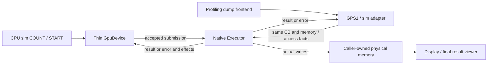

# Native GPU simulator

In this project, **sim** gives fast command-buffer final results for software and
game development. **Emu** would reproduce RTL effects at module boundaries on
every cycle; that is a separate requirement. This implementation is a sim.

`system::functional::Executor` executes the current native 32-bit command stream
against a mutable physical halfword slice. It uses the same `DeviceSubmission`
and command/object encoders as the production command GPU. There is no in-band
version, alternate asset ABI, cycle scheduler or pipeline model.

## Core and thin adapters

The core exposes these synchronous calls:

```rust,ignore
Executor::execute(&mut [u16], DeviceSubmission) -> Result<Report, ExecutionError>
Executor::execute_captured(&mut [u16], &mut [u8], DeviceSubmission)
    -> Result<Report, ExecutionError>
```

The caller owns physical halfword memory; GPU byte addresses are bounded to
8 MiB. `DeviceSubmission` supplies the current CB base/count, including canonical
alignment, a finite valid extent and final END/fences. The core has no CPU/MMIO,
Display, viewer or profiling dependency. It runs until END or the first error,
writing color, depth and raw-copy outputs directly into that memory.

Captured mode takes one access byte per physical byte: bit0 means known, bit1
means writable. Reads of unknown bytes and writes outside declared ranges fail;
successful writes make bytes known for following commands. UI grid reads check
only the addressed byte; atlas and texture validity checks cover actual reads,
so a capture need not invent a whole atlas. Both modes use one execution body.

Both `Report` and `ExecutionError` carry `Effects`:

| Field | Meaning and consumer |
| --- | --- |
| `written_bytes` | Optional conservative physical byte envelope `[first,end)` of completed writes. Gaps can be unchanged; the shared memory is authoritative. The thin device retains it as completion/dirty metadata. |
| `target` | Last successfully bound `[color_base,depth_base]` byte addresses, without a new ID or copied framebuffer. The device retains the bound target identity. |

On error, earlier writes remain visible and effects describe those partial
writes. An error does not certify a completed frame. There is no rollback or
second framebuffer repository. Core return is the notification boundary: the
device records `last_effects`/`last_error`, then calls its existing `complete`
ownership boundary to clear BUSY and retain any error. STATUS reads do not
acknowledge completion or presentation. Display reads the same physical memory
using its independent active target, format and explicit vblank state.



Arrows are synchronous calls, writes and returns. Device completion follows the
actual memory writes. The independent dump adapter constructs no CPU/device;
the CPU adapter imports no profiling UI.

The CLI adapter exports the same completion target/write envelope beside its
physical-memory image, on both success and core failure. The snapshot adapter
checks the core's final target against the captured target before publishing
`result.json`. A failure retains partial memory/access/completion files for
diagnosis and publishes no successful frame or result viewer.

| Entry | Existing path and implementation |
| --- | --- |
| Whole machine | `CpuV3SystemSim::with_functional_gpu` installs the thin Device4 adapter. COUNT/START, `take_submission`, shared memory execution and `complete` retain their existing ownership checks. |
| Independent dump | Existing `gpu_profiler/replay.py --backend sim` decodes/preflights the same GPS1 snapshot, calls `gpu-v2-sim` with captured-byte access facts, and exports final color/depth and every writable range, including no-target/multiple-target streams. |
| Board-dump frontend | `snapshot_cli.py receive --backend sim` selects that same backend after ordinary capture decoding. It does not resume the board or change capture ownership. |
| Final display | The existing offline viewer accepts a distinct `digitaldesign.gpu-result` document. It shows final image/raw buffers and identities, without fabricated cycles, tracks, queue statistics or an empty profiling session. |

## Implemented coverage

| Command | Functional effect |
| --- | --- |
| NOP | Retire a canonical zero word |
| DMA_LOCAL | Copy aligned 32/64/128-byte inputs into the current submission's local storage |
| DMA_MESHLET | Decode the selected page's native metadata, V96 vertices and packed triangle indices |
| DRAW_MESHLET | Execute the bound native geometry and fragment arithmetic against physical memory |
| WAIT | Observe completed synchronous work; retain the explicit render-wait boundary |
| FLUSH | Establish the explicit publication boundary after completed writes |
| SET_TARGET | Install validated, disjoint column16 color/depth planes |
| SET_GLOBAL | Bind validated NativeGlobal64 Lighting and projection context |
| SET_RENDER | Bind validated NativeRender32 texture, Final and ROP state |
| CLEAR | Fill all 204800 physical bytes of the selected plane, including padding |
| TEX_INVALIDATE | Check the render boundary; there are no retained Sampling cache lines |
| UI_GRID | Full/ranged cells, native odd-row atlas ordering, binary alpha and RGB555-to-RGB565 conversion |
| MEMCPY | Validated nonoverlapping512-byte-aligned raw physical copy |
| END | Finish only at the last valid instruction, after the explicit fences |

Reserved opcodes and encodings, unavailable local objects, memory
extent violations, missing fences and exhausted work bounds also fail. Errors
include the relative byte PC, instruction word and reason. Earlier completed
writes are not rolled back; an error never certifies a completed frame.

Each call resets its local validity and binding state. The work bound counts
commands and memory work rather than elapsed GPU cycles. `Report` exposes completion effects; the work counter is an internal bound,
not a profiling result. A successful return proves all output writes
have reached the supplied memory. It proves no asynchronous lifetime or timing
property.

## Integer execution

The executor implements the native contracts in [formats](/ip/gpu-v2/docs/formats.md),
[geometry](/ip/gpu-v2/docs/geometry.md), [fragment arithmetic](/ip/gpu-v2/docs/fragment-math.md) and
[framebuffer](/ip/gpu-v2/docs/framebuffer.md). Its runtime does not call a generic renderer or
component oracle. It shares immutable production reciprocal/log constants and
the selected compact Q13 RSQRT ROM, rather than a second hand-maintained table.

| Stage | Retained numerical behavior |
| --- | --- |
| V | Unsigned delta10 and signed normal10 decode; F16 origin and matrix MAC; explicit signed32 truncation of the retained position result; normal16/normal18 packing followed by ties-to-even `/64` and S12F10 saturation |
| Triangle | Signed cross products reduced to 27 bits toward zero, canonical edges and exponents, determinant/cull rejection; no XYW clipping or generated near-plane fan |
| Raster/interpolation | Native half-pixel centers and 2x2 lanes, aligned 29-bit edge domain, shared reciprocal approximation, conserved F16 weights and half-up attributes; native D16 validity and analytic U5F3 LOD |
| Sampling | Column texture addressing, smallest-first complete mip chains, repeated small-level padding, periodic POT UV or fixed400x240 framebuffer view; conserved 511 tap weights, per-tap half-up rounding and low8 wrap |
| Lighting | Signed floor prescale, compact Q13 RSQRT decode/interpolation, native normalization and dot quantization, ties-to-even intensity products and selected H9 interpolation with the `+32` tail |
| Final | Exact nearest `/255` uniform RGB modulation, separate floor diffuse/specular `/256`, then 8-bit saturation |
| ROP | All eight D16 comparisons, independent depth writes, carry-preserving `Q6=(A8+2)>>2`, half-up `/64` blend and rounded RGB565 packing |

Wide software accumulators prevent host overflow; each retained hardware field
is explicitly narrowed, shifted or saturated at its native boundary. Unsupported
numerical domains fail with the command diagnostic. There is no mesh alpha-test:
an alpha-zero fragment can still write depth when its depth test passes. UI's
binary atlas alpha is a separate operation and leaves depth untouched.

The former six-file `system::oracle` whole renderer and its optional Rayon
composition are retired. Independent compact Lighting, continuous Triangle,
Sampling, framebuffer and direct-ROP references remain available for component
verification. Raster adapter input types belong to `system::pixel::raster_input`.

## System adapter and verification

The system's default `GpuDevice` remains control-only. `GpuDevice::functional()`
takes the accepted descriptor and runs this executor synchronously inside START,
then calls the same `complete` ownership boundary. Failure sets sticky transport
error and retains the diagnostic in `last_error`; status reads never acknowledge
or clear it. `CpuV3SystemSim::with_functional_gpu` selects that backend before
running an application. The debugger uses it on construction and reset, and the
display runner selects it after boot. Prepared capture retains the executor-free
default and its earlier-submission detection.

In `PauseOnFrameIndexWait` mode, a pending Display swap also yields to the host.
This covers present's status-poll path before it reads FrameIndex. A vblank still
requires an explicit host event; neither status reads nor GPU completion
acknowledge a swap. Display state reports that combined wait condition so the
debugger can offer or schedule the host event.

The bounded public RCC clear/replay test exercises both driver configurations,
actual two-SEND submissions, `wait`, CB reuse, physical planes and allocation-tail
guards. A separate ignored test sends the exact same pre-submit memory and CB
through the functional executor and production GPU RTL, compares physical memory
before allowing the RCC application to continue, and checks real RTL completion.
Public RCC UI tests run three explicit host vblanks and A/B/A swaps in both
Display color formats, checking the same stored RGB565 word and each format's
scanout value separately. Bounded independent vectors in
`tests/functional_replay.py` compare identical pre-memory and native commands
against cold production GPU plus memory-controller RTL, including both physical
planes, padding, raw-copy ranges and other-memory guards. They record input,
executable and RTL source identities; frozen RTL outputs may be reused only after
those input/source checks. These fixtures are explicitly distinct from captured
CPU frames and physical-board or historical full-scene acceptance.

Raw output remains linear RGB565/D16 in the documented column layout. Display's
selected color interpretation and scanout are separate from these stored bytes.
The independent v6/XYW/ideal-alpha rendering APIs are not this executor's native
command implementation or a bit-exact golden for it.
