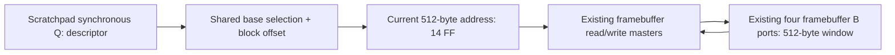

# Aligned raw DRAM copy

`MEMCPY` is a blocking command in the existing GPU command stream. It copies
bytes without interpreting pixels, changing formats, blending, or supporting
overlap. It needs no installed render target. There is no second submission or
background copy scheduler.

## Command and descriptor

Opcode12 uses bits6:0 for a32-byte local staging slot66..79; bits27:7 are zero.
The32-byte object has one meaningful little-endian qword:

| Bits | Meaning |
| --- | --- |
| 13:0 | Source byte address/512 |
| 27:14 | Destination byte address/512 |
| 38:28 | Length/512 minus1 |
| 63:39 and remaining object bytes | Zero |

Both addresses and length are512-byte aligned. Length is512 bytes through1 MiB.
Both complete extents lie below8 MiB and must not overlap; adjacent intervals
are legal. The driver also protects active command buffers, input allocations,
CPU-owned data and Display-owned planes. A copy cannot modify its own descriptor
or command stream. Copies between differing framebuffer layouts do not convert
their physical organization.

`Command::memcpy(qword)` and `memcpy_params(source,destination,bytes)` provide
host encoding. RCC's `gpu_memcpy_valid` and `gpu_encode_memcpy` use128-byte sector
units, so addresses/count are multiples of four sectors and count is4..8192.
`gpu_encode_memcpy_command` writes one command naming a local32-byte slot.
These are low-level encoders; they do not add a Pass API, allocator or automatic
capture publication.

## Ownership and visibility

The caller performs CPU cache clean before GPU reads, retains all allocations
until completion, and invalidates CPU cache before consuming GPU-written bytes.
It supplies explicit `WAIT(all)` and `FLUSH` before copying: this drains rendering,
writes dirty framebuffer data, and invalidates the framebuffer directory.
`MEMCPY` does not imply those operations. A later Sampling consumer needs explicit
`TEX_INVALIDATE` if its cache can contain the destination's old bytes.

A minimal stream is:

```text
WAIT(all)
FLUSH
DMA_LOCAL descriptor -> staging slot
WAIT(dma)
MEMCPY staging slot
END
```

DMA/descriptor preparation may precede the fence when its existing lifetime
rules permit. Consecutive copies need no redundant framebuffer flush: each
leaves that directory invalid. END still obeys the normal explicit-fence and
physical-drain contract. Global/render/target bindings, uniforms and meshlet
input pages remain unchanged.

## Storage, ports and fixed schedule



The command processor reads the descriptor once and holds the scratchpad Q.
Its existing command bits27:17 hold the block cursor, sharing CLEAR's increment
expression. Existing object-index bits encode the read-half/write phase. Only
the current14-bit block address is additionally registered; no source, destination,
length or payload register copies are created. Command prefetch can continue:
its RAM writes target command pages, not the descriptor, and Q's read enable is off.

| Phase | Work and retirement |
| --- | --- |
| Read address | Select source base, add shared block cursor, register address |
| Read request | Start existing512-byte maintenance, four128-byte requests |
| Read halves | Consume two256-byte completion pulses; the second proves the whole block resident |
| Write address | Select destination base, add the same cursor, register address |
| Write request | Drain the same B-port window through four128-byte write requests |
| Write retirement | Final write response completes the block; increment or finish |

The two address-preparation cycles per512 bytes cut the RAM-Q-to-memory-request
path. Physical phase progression, held B-port write data and retirement continue
with CE0. Only normal instruction advancement waits for CE. Accepted work retains
its mode/address through terminal responses during abort; no completed write is
rolled back. An accepted maintenance phase owns all four of its bursts. Abort
does not launch a subsequent phase or block.

Normal UI keeps its original9-bit tile input. Copy has a separate14-bit address
input, avoiding a wide mux before UI tile conversion. Its physical-address bypass
ignores target bases and geometry layout. The existing bank permutation on refill
and inverse permutation on writeback preserve all64 payload bits. Pixel overlays
and tag publication are disabled for the copy. The existing maintenance request
lookahead is reused; there is no new DMA queue, BSRAM, SSRAM or DSP.

## Verification boundaries

`tests/memcpy.py` runs production GPU/native MC/pin-model byte and guard checks,
including chained copies, the8 MiB tail, page crossing, CE pauses and abort drains.
`tests/memcpy_counter.py` separately exercises all2048 blocks of a1 MiB command
without a long payload simulation. Its scope is address/control, not byte transport.
The profiler's native-ABI3 cold replay checks mutable-buffer and framebuffer
outputs. These offline tests do not qualify physical SDRAM timing or a board image.
