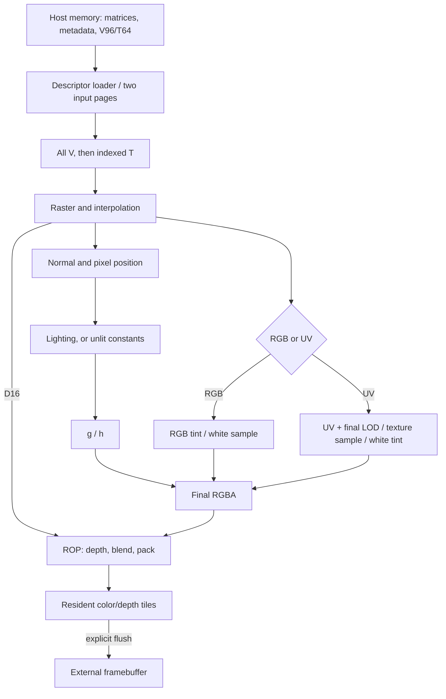

# What GPU v2 does

## The delivered unit

The standalone GPU consumes one explicitly addressed meshlet at a time. It
transforms all its vertices, visits its indexed triangles, generates fragments,
shades them, and updates cached color/depth tiles. An explicit flush makes dirty
tiles visible in external memory. The selected viewport is 400 × 240.

The host supplies already suitable geometry: this path performs no near-plane
clipping. The application domain has `far < 200` and each world-coordinate
component inside `(-200, 200)`. These bounds do not constrain the result of an
arbitrary matrix; the actual integer limits still apply at each stage.

The IP owns the loader, geometry and fragment processing, caches and three
memory masters. The vendor owns the shared arbiter, bridge, physical SDRAM
controller and pins. A board system owns CPU submission, memory allocation,
Display and clocks. The current CPU system's GPU leaf is a placeholder; the
standalone host interface is the implemented submission boundary.

## Follow one meshlet

Arrows show data dependencies. They do not imply simultaneous admission or equal
branch latency; the ordered pool retains copied values between these steps.

Triangles execute in submission order. A triangle's geometry returns drain
before its working state is replaced. Quads already copied into result storage
can continue through shading while the next triangle runs. Loading the inactive
input page can overlap this work. Global configuration has one live version:
changing it waits for the whole old GPU and its memory ownership to drain.

RGB and UV share one vertex attribute word. RGB supplies tint and bypasses
Sampling; UV supplies texture coordinates and uses white tint. The separate
unlit control bypasses Lighting. Both routes join at Final before ROP.

## Terms used throughout the specification

| Term | Meaning |
| --- | --- |
| Meshlet | Up to 64 source vertices and 96 indexed triangles, with separate metadata |
| Input page | One local payload/metadata allocation, selected by page 0 or 1 |
| V / T / R / I | Vertex transform, Triangle setup, Raster traversal, Interpolation |
| Quad / lane | An even-origin 2 × 2 pixel group; lane `2*dy+dx`, from 0 to 3 |
| Coverage mask | Four geometric inclusion bits; later numerical rejection can clear lanes |
| Fragment | A covered lane's attributes and depth before framebuffer depth testing |
| Result pool | Ordered storage that holds a quad's copied attributes and branch results |
| Publication | Making a fully written object eligible for its readers |
| ROP | Raster operations: depth comparison, depth write, blend and RGB565 packing |
| Enabled edge | An edge on which the relevant compute CE permits its state to advance |
| Wall edge | A clock edge seen by memory/maintenance regardless of compute CE |
| Q owner | The consumer entitled to a synchronous RAM's current registered read result |
| Old-state credit | Admission capacity computed before this edge's releases |

Arithmetic notation: `S12F10` means a signed 12-bit integer code scaled by
`2^-10`; `U5F3` is an unsigned 8-bit code with 3 fractional bits. Width-only
names such as h30, D32 and R18 identify integer containers, not extra floating
point types. `RNE` rounds to nearest with ties to even. Arithmetic right shift
rounds a signed value toward negative infinity; truncation toward zero is named
explicitly. `signed_b(x)` interprets the low b bits as two's complement.

## Completion is tied to an owner

| Event or condition | What may now be reused or observed |
| --- | --- |
| Loader publishes a page | Its new payload and metadata may be started |
| Host accepts loader completion | The loader completion/job owner is released |
| `frontend_idle` | The old input page may be overwritten; copied quads can still be live |
| Last depth-row acceptance for a quad | The source quad payload is no longer needed by ROP |
| Last color write for a quad | Its ROP cache owner is released; the tile can remain dirty |
| `pipeline_idle` at the memory wrapper | Compute, accepted memory work and the loader job are drained |
| First `flush_complete` after reset | That flush's dirty framebuffer writebacks have completed |

A frontend-done pulse, a pixel commit and a flush completion serve different
owners. Use the [submission sequence](/ip/gpu-v2/docs/submission.md) to select the boundary
needed by the caller. Display/present ownership is outside this interface.

## How the implementation is organized

The GPU combines local arithmetic schedules with independently owned storage,
queues, cache maintenance and memory transactions. Some local operations share
a ROM-controlled parallel schedule, including V/T and interpolation preparation.
VLIW describes that local technique. The overall architecture is called GPU v2;
existing `vliw_*` source identifiers identify implementation modules.

R/I write final result banks directly, avoiding an intermediate quad export and
recollection. Admission reserves return capacity first. Synchronous read owners
hold their data through stalls. Static calendars share arithmetic and RAM ports;
wall-clock maintenance preserves accepted external work while compute is paused.

The selected factory is `system::vliw_sdram::verilog`, emitting
`gpu_v2_vliw_sdram`. The lower-level `system::vliw::verilog` emits
`gpu_v2_vliw` with raw local DMA writes and a byte-addressed backend memory port.
The following chapters use the descriptor/three-master factory unless stated.

Implementation anchors: [standalone wrapper](/ip/gpu-v2/src/system/vliw_sdram.v),
[composition](/ip/gpu-v2/src/system/vliw.rs),
[CPU integration boundary](/systems/cpu-v3-tang-nano-20k/src/hardware/gpu/mod.rs).
