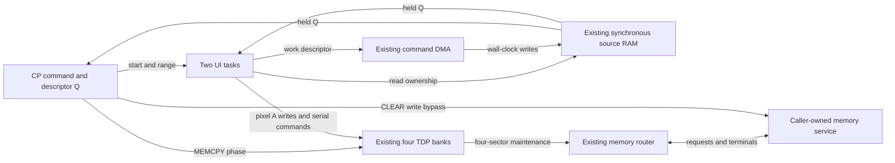

# Complete command GPU cycle composition

`Processor::with_all_commands`, `Control::with_all_commands` and
`draw::Gpu::with_all_commands(Profile)` select all production command opcodes,
including CLEAR, UI_GRID/range and MEMCPY. Default command-control and
`with_draws` constructors retain their explicit subset boundaries. Rendering
uses the existing indexed frontend, Lighting, Sampling, Final/ROP and TDP banks;
no functional renderer supplies results or completion times.

The caller owns RAM backing, physical feedback and all memory clocks. Consume
`draw::Output::physical` and `write_data`: these are the root physical pins,
including CLEAR. `control.transport.router` remains the router observation.

Every participant observes old state before committing one wall edge. DMA and
physical terminals progress independently of compute CE. Admission, payload
transfer and terminal retirement remain distinct events.

## CP and CLEAR

CLEAR borrows command bits 27:17 as its cursor and retains a two-bit flight
count and presented-offer flag. Each plane has 1600 sectors, including physical
padding: 204800 bytes. Each accepted write is 128 bytes of the repeated 16-bit
value. Addressing follows the installed target's physical page mapping. At most
two writes are outstanding. Stop prevents new unpresented offers; presented and
accepted writes drain with CE0. CLEAR does not establish stored state; streams
must FLUSH explicitly before later UI, MEMCPY or END.

The root masks CLEAR write feedback from the router and framebuffer feedback
from the cache. Device 4 still observes raw transport errors. The original
overlap monitor rejects simultaneous CLEAR and compute/cache work.

MEMCPY reads one descriptor into the existing synchronous CP Q. Source,
destination and length stay there through physical drain, including stop.
A passive simulation monitor checks that loan. The shared command cursor
counts up to 2048 blocks; the existing object index distinguishes two read-half
completions and the write phase. Only the current 14-bit block address needs a
separate payload register. Each read phase drains four sectors, with completions
after sectors two and four. A write completes at the fourth terminal. Stop drains
an accepted phase and starts no later phase or block. Original descriptor checks
enforce reserved bits, extent bounds and disjoint source/destination.

## UI and bank reuse

UI start consumes grid/atlas configuration from CP Q. The range stays in the CP
command; full-grid selects cells 0..749. UI suppresses new command prefetch and
takes the existing source read and DMA work ports. Grid sectors occupy qwords
0..95; atlas halves occupy 128..255. The atlas read address is the actual
eight-bit concatenation zero-extended to nine bits. There is no second grid,
atlas or framebuffer image.

Two task slots retain tile/character metadata and loaded/valid ownership. A slot
is released at its final framebuffer write terminal. Range endpoints mask
excluded cells to FF; FF halves issue no atlas reads. The single synchronous Q
has explicit read/consume stages. Pixel output uses that live Q with CE-controlled
half/word metadata. Done is sticky until reset or start, so CP can observe it on
an enabled UI_WAIT edge.

Serial maintenance reuses four 1024x16 framebuffer banks at words 0..63. UI A
writes expand opaque RGBA5551 to RGB565 and preserve transparent background.
B reads/writes retain wall-clock operation and held Q. UI tiles convert from row
order to physical columns; MEMCPY overrides geometry/base with its raw block
address. Serial fills publish no resident tags. Lower readiness gates both the
third write-sector offer and upper-half B pre-read. Original collision and
readiness-withdrawal monitors protect overlap; abort drains remaining background.

## Qualification

`vliw_cycle_aux_control`, `vliw_cycle_aux_ui` and `vliw_cycle_aux_tdp` compare
actual production modules, internal registers, held Q and known bits. They cover
full CLEAR counts, the 2048-block control limit, range endpoints/cross-sector
scans, empty grids, both tasks, all 64 serial words, CE0 and phase drain.
Compiled mutations and exact original-monitor failures check sensitivity.

`vliw_cycle_aux_native` checks whole 8-MiB backing after no-ACK resubmission,
both complete planes, range UI and three-block copies reaching the DRAM end.
It checks CE0 abort during CLEAR, copy read/write and UI write.
`vliw_cycle_draw_uv` mixes CLEAR, RGB/UV/lit DRAW, full-grid UI and MEMCPY in two
native CBs. Integer pixels/atlas references and byte copies are independent of
cycle scheduling. Maximum copy length is control/count qualification, not a
claim of a one-MiB payload replay.

Whole-root replays compile the actual complete command GPU with exact native
feedback. They cover full CLEAR, UI/copy, mixed DRAW/UI/copy and stop/drain, plus
root ownership-mux mutations. Unoffered physical request addresses project to
zero; write payload is observed when the native port requests it. Accepted and
held requests remain fully compared. Leaf benches have finite cycle bounds and
30-second processes; whole-root VVP has a 60-second watchdog. Native auxiliary
CBs have 200000-native-cycle limits; multi-CB runs also have wall/time bounds.

One native service includes the production arbiter, endpoint, gear, MC and pin
model. Visibility observations retain accepted owners through their terminals;
full backing checks still cover every guard and unchanged byte. CPU and Display
are idle. This qualifies GPU commands, not joint-system C4, live RTL SDRAM,
board execution, physical timing or frame performance. Production RTL, command
encodings, profiling records and capture layouts are unchanged.
