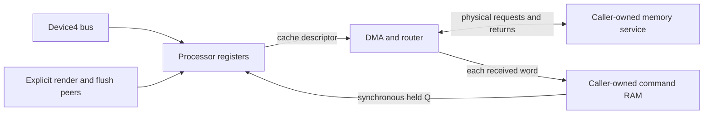

# Production command-control cycle subset

`system::vliw_cycle::command` implements the production command processor's
NOP, WAIT, FLUSH and END control path and Device4 COUNT/START/STATUS binding.
It composes the existing command-profile DMA/router without allocating a
command payload buffer or owning physical clocks, RAM or MC. Other legal
opcodes return `UnsupportedOpcode`; invalid selected encodings return the
corresponding production `ContractError`. No functional renderer fallback is
used. This is a command-control subset, not the complete production GPU.

These boundaries describe the default constructors. Explicit
`with_all_commands` constructors select the implemented
[complete command composition](/ip/gpu-v2/docs/references/cycle-auxiliary.md).

## Device and ownership

| Interface | Implemented contract |
| --- | --- |
| Device selection | Index 4; unrelated writes are ignored |
| COUNT, channel 0 write | Wall-clock event, including CE0; count-minus-one in bits 13:0, upper two bits zero |
| START, channel 1 write | Wall-clock event, including CE0; unsigned 16-bit address in 128-byte units; requires a preceding COUNT and submit-ready |
| STATUS, channel 2 read | Bit 0 BUSY, bit 1 reset-only raw transport-error sticky; other bits zero |
| Other reads | Zero; reads have no state changes or acknowledgment effect |
| Resubmission | A new COUNT/START pair is accepted once BUSY clears; no ACK command |

COUNT sets the diagnostic byte limit to `(count + 1) * 4` and fetch length to
`(count >> 5) + 1` cache sectors. START requires base plus fetch length at most
65536 sectors. Writes while busy, reserved COUNT bits and a missing COUNT are
production simulation-contract violations, not silent clamps or retries.

`Processor` contains the production control registers and diagnostic limits.
`Control` composes it with `Transport` and `Device4` using one old-state
snapshot. Both expose pure outputs and a single-edge `clock` operation. The
caller samples every participant before committing any participant. Invalid
runs terminate at a monitor/unsupported boundary; recovery on that edge is
not specified and preceding legal side effects remain real.

The caller supplies render-idle/fault, flush-complete and command RAM
ready/Q. These are explicit peers until the corresponding production
frontend/backend is implemented. `Control` exposes every DMA RAM write and
the CP read port; it does not inject decoded commands or execute a whole CB
at START. Work/texture/framebuffer producers are idle in this subset.



Every arrow is sampled from old state. The caller commits RAM and the memory
service once at the same wall edge; neither control participant advances them.

## Cache, RAM and completion

Two 128-byte cache pages occupy RAM rows 448..463 and 464..479, with 32
32-bit commands in each page. One command-cache fetch may be in flight.
The DMA's actual final return publishes its bank; a request acceptance alone
does not make a page readable. The page remains owned until its 32nd command
advances. The 6-bit PC wraps across both banks; the separate 17-bit diagnostic
PC enforces the submitted command count and exact END position.

| Edge | Production read/consume behavior |
| --- | --- |
| FETCH | Assert read for a published page; CE and RAM-ready accept the synchronous read and enter LATCH |
| LATCH | Next enabled edge consumes the held old 64-bit Q, selecting low/high 32 bits with PC bit 0 |
| EXEC | An enabled edge executes the selected command |
| CE0 | CP execution and source read hold; physical DMA returns and RAM writes continue |

The fixture uses the original portable `iz_ram36` pair, retaining both
32-bit lanes of the actual 36-bit banks. Read takes old storage before a
write, Q holds without a read, reset clears Q but does not initialize cells,
and cross-port same-address access is rejected. Production frontend
availability/mux ownership remains an explicit peer rather than a claim
that the complete frontend has been modeled.

WAIT checks its selected DMA/render domains; a render fence sets all-fence.
FLUSH requires that fence and legal drained inputs, then holds its request
until an enabled edge observes the peer's flush-complete. END requires the
exact submitted position plus stored/all-fence state. ENDING clears BUSY on
a wall edge, including CE0, only after render-idle, DMA-idle and router-idle.
The peer's chosen delay is not a prediction of real cache/flush timing.

Abort sets the production failed/stop state and leaves BUSY set. Presented
and accepted physical work drains through the existing transport. A
coordinated reset restores submission; no fabricated completion or automatic
retry is produced. The isolated Device4 sticky derives only from valid raw
RO/FB-read/FB-write error pins, independently of CE or device selection.
CP abort/failure is not substituted for that sticky bit. Because the
production transport monitors reject raw errors, sticky qualification is
reported separately from a successful command/transport run.

## Bounded qualification

```powershell
cargo test --release -p gpu-v2 --test vliw_cycle_command -- --include-ignored --nocapture --test-threads=1
```

The explicit ignored checks require `IVERILOG_EXE` and `VVP_EXE`. The small
DUT contains unchanged production command processor, command-profile
DMA/router and portable RAM leaves. Device4 wiring is extracted from the
production command binding. It does not substitute a reduced backend and
then claim a complete GPU DUT. Every sampled exposed pin, RAM Q and CP
phase/PC/page-valid probe is compared; initial undefined values and invalid
DMA offer address/count are excluded from defined-data checks.

Native fixtures use one existing production arbiter/endpoint/gear/MC/pin
service and explicitly preloaded backing. RTL replays that service's exact
feedback and must reproduce all requests, RAM writes and control outputs.
CPU/Display requesters are idle and board GPU request-slot stages are absent.
Render/flush/source availability are controlled peers. This does not qualify
a real CPU submission path, live RTL SDRAM or board/frame timing.

The finite cases cover two CE0 COUNT/START pairs without ACK, STATUS,
unselected writes, cache-bank reuse and PC wrap, RAM/CE/flush/ending stalls,
CE0 BUSY retirement, abort/drain/reset, selected encoding/count/base/END
contract violations and isolated sticky status. Six actual compiled DUT
mutations must cause differences; compilation failure is not detection.
Independent backing/row checks verify every command-cache DMA beat.

Each native fixture has a 200000-logic-edge bound. Each external process has
a 30-second timeout and each RTL testbench has a watchdog. Unique evidence
directories under this worktree's `target/gpu-cycle-command` retain source,
vectors, compile/run output, metrics and verdicts. Abort metrics describe the
final reset epoch; its trace/cycle totals retain the aborted prefix.
Finite host samples include initialization, settling, scheduling, assertions
and in-memory traces; build, RTL and export are excluded. Host contention is
uncontrolled and RSS unmeasured. Samples measure fixture cost, not GPU/frame
throughput, a speedup or hardware-cycle equivalence.

## Passive committed command observation

`Processor::clock_observing` and `Control::clock_observing` return a
`CommandEdge` after the same original transition commits. Accepted submit
records the byte base/count; latch records the actual RAM word and relative byte
PC. Enabled Exec observation, accepted issue and CP release are separate edges.
Release carries the PC: CLEAR/MEMCPY mutate their live control word as a progress
counter, so observers retain the original RAM latch instead of mislabelling that
counter as an instruction. END drain, abort, reset and committed SET_TARGET are
explicit. A busy fall after failure is not a successful drain.

The ordinary clock path delegates to the same transition and adds no state.
`Gpu::clock_observing` optionally gathers pure connected old-state signals from
the command/DMA, producer, frontend, T storage, post-quad and sink/cache layers.
Its `trace::Trace` contains load samples, control/cache state and sparse ownership
events; it does not allocate DUT ownership or change scheduling. Consumer-side
slot generations and CB/meshlet/quad identities correlate actual transfers.
Accepted submit/reset target validity loss is observable even when target
registers retain their old addresses. No child is clocked twice and no memory
request is inserted by observation. Bounded on/off fixtures compare every
original output, final state and full native backing, including CE stalls,
PC wrap, UV publication wrap, mixed command progress and abort/reset.
