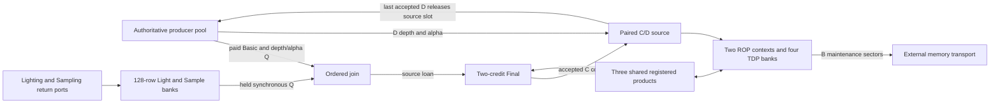

# Selected Final, framebuffer TDP and RGB composition

`vliw_cycle::pixel_math` models the selected two-credit Final, scalar TDP ROP
and their shared multiplier outputs. `tdp::Cache` owns the physical framebuffer
banks and maintenance state; `tdp::Sink` supplies paired color/depth rows.
`postquad::Join` connects paid Basic/Light/Sample Q to Final and the sink.
`render::Renderer::with_triangles(profile)` connects that join to the actual
[producer](/ip/gpu-v2/docs/references/cycle-draw-producer.md).

The lower join exposes source-ready, publication, return and drained ports
for numerical consumers. RGB/unlit uses the real bypasses. The installed
composition connects the selected Lighting owner described below.
Framebuffer sectors remain caller-owned transport ports. These APIs neither
clock a memory controller nor obtain answers from a functional renderer.

All `outputs` methods observe old state. Each `clock` consumes one wall edge;
compute CE controls arithmetic and A accesses, while B maintenance continues.

## Final and shared arithmetic

The old occupied capacity is queued results plus the arithmetic token, at
most two. An output ACK supplies no same-edge admission credit. With no queued
result, BASE may bypass directly to the consumer; otherwise the older head
wins and BASE appends. CE0 preserves arithmetic, queue order and source loans.

| Enabled phase | Arithmetic and ownership |
| --- | --- |
| Phase0 admission | Register three tint/texture products and shared H/specular products |
| Phase1 SPEC | Fold tint/texture through the exact divide-by-255 correction, register G/base products, capture eight specular bits |
| Following phase0 BASE | Truncate the diffuse product, add the separately truncated specular term, saturate and consume or queue |

G, H and specular remain the parent's live loan; they are not copied into an
extra token record. Local products, specular terms, result payload and shared
products have no reset assignment. Shared ROP and specular views project the
same three 18-bit Qs. ROP selects signed nine-bit deltas; specular selects an
unsigned nine-bit H. The bank prioritizes ROP if both enables are presented;
the selected calendar supplies mutually exclusive legal offers.

ROP captures old color at D, compares the live following old-depth Q, and
returns after four enabled edges. Its alpha weight is `(alpha+2)>>2`, with
64 for replacement. The channel sum rounds at Q6 before exact nearest RGB565
quantization. Color and depth write gates remain separate. The implementation
retains the selected arithmetic's slices and wrapping widths.

## Join and source lifetime

J_READ pays the Basic/Light/Sample synchronous reads. J_WAIT owns their Q
through CE0 and Final refusal, and through the Final arithmetic's last use.
Masked lanes advance the ordered issue prefix without reading unwritten banks.
The issue cursor may enter the next quad but cannot cross its final lane before
the current retirement head advances. Empty heads retire only after prior
source/Final tokens drain; their original source cursors must also be ready.

The Light and Sample banks have 128 payload rows. Their Q reset differs by
profile: portable owned-Q retains Q, while native SDP36 resets its hard output.
Both retain payload cells. The explicit `postquad::Profile` selects this
behavior. The Sample public-upper map retains its unreset per-ID bits.

A color ACK pays the depth/alpha read and keeps the sink tail reserved for D.
Last D releases the producer source/header/depth slot. The final color write
releases the corresponding ROP cache owner, independently of source retirement.

## Physical framebuffer storage and maintenance

There are four independent 1024x16 dual-port banks. Addresses retain the fixed
zero padding bit, separate color/depth planes, eight resident 16x8 half-tile
lines and the selected row/bank permutation. Reads update only their own held
Q; reset clears Q and control ownership while preserving bank cells.

Two ROP contexts pin one-hot resident line masks. A belongs to the static
compute calendar; B belongs to wall maintenance. Free-line search and the
three-candidate victim rule exclude pinned owners. The two-entry lossy hint
queue uses old capacity, rechecks residency and protects a completed speculative
line until demand consumes it. The selected profile enables dirty prefetch.

Maintenance retains one request/payload/terminal context. Each sector is 128
bytes and has sixteen 64-bit beats. B Q itself holds the write beat through
refusal. Runtime bases are in 512-byte units with the command ABI's 64-KiB
alignment. Column16 addressing is `tile_x*16+tile_y`, with ordinary row order
inside each 16x16 tile; each 400x240 plane occupies 204800 bytes, including
12800 bytes of padding tiles.

Dirty color/depth bits clear only on the respective second-sector terminal.
FLUSH waits for maintenance, both ROP owners and all dirty lines, then
invalidates residency. A prefetch abort cancels only descriptors not yet
presented; held offers and accepted sectors drain. Partial writes remain
visible and an incomplete speculative line is not published. Invalid peers
stop at the original command-profile monitors; no recovery behavior is added.

## Qualification boundary

The bounded pixel arithmetic and TDP fixtures compare actual selected production
modules, known/unknown bits, original monitors and compiled DUT mutations.
Independent integer references check separate Final truncation, Q6 ROP and
complete memory contents. TDP cases cover compute stalls, both planes,
color-only/depth-only maintenance, held speculative cancellation and warm reset.

The small RGB composition compares an actual current command GPU compute root,
including its real frontend/backend wiring, against an independently covered
constant-color triangle and the entire supplied 8-MiB backing. CP commands,
DMA loading and framebuffer sector service are explicit peers in this fixture.
Native profile here describes bank behavior; it is not native-MC, whole-system,
board timing or device qualification.

## Installed command and native memory composition

`vliw_cycle::draw::Gpu::with_draws(profile)` connects the installed command
processor and DMA/source RAM to this renderer. CP pays the actual synchronous
command and configuration reads, starts the selected meshlet slot, and observes
the renderer's real idle, fault and flush completion. Runtime configuration
supplies target bases, projection, texture dimensions, tint and ROP controls.
The same router owns DMA, texture and framebuffer physical requests. The
default subset constructor is unchanged. The installed constructor selects the
[Lighting owner](/ip/gpu-v2/docs/references/cycle-draw-lighting.md) and closed
[Sampling/Color owners](/ip/gpu-v2/docs/references/cycle-draw-sampling.md).
There are no numerical consumer peers on this installed GPU entry point.
The lower join and `with_triangles` interfaces retain external consumer ports
for isolated fixtures.

The finite native RGB fixture drives Device4 COUNT and START, DMA-loads objects,
uniforms and meshlets, and executes WAIT/FLUSH/END for two command buffers.
The second submission requires no ACK or reset and reinstalls configuration
validity. A single native arbiter/controller/pins model clocks four half edges
per GPU logic edge against one backing store. Writes become visible on native
falling WRITE/DQM edges, before sector terminal; no accepted descriptor copies
an entire sector atomically. Each completed buffer checks the entire 8-MiB
store against independent coverage/color and unchanged depth/guard contents.

An actual command GPU RTL root, including CP through router, is compared with
that native feedback tape. Its MC is external to the RTL DUT. This qualifies
the RGB/unlit command path, source loading and physical framebuffer retirement;
it does not qualify numerical Lighting/Sampling, UV/lit DRAW or a board root.
`physical_drained` observes DMA, router and cache maintenance owners rather
than waiting for stopped logical pool/ROP tokens. It includes the Sampling
cache's descriptor drain. Invalid-peer behavior remains
the original monitor boundary, without recovery or rollback.

The native UV/lit fixture executes RGB/unlit then a partially overlapping
UV/lit triangle within each of two Device4 command buffers. Real installed
objects, uniform and meshlet DMA feed the actual front end. Nonidentity light
produces nonzero H9; a bilinear footprint crosses four physical texture lines,
requiring eight child sectors per buffer. The UV pass blends with Q6 alpha and
writes depth. WAIT(all), FLUSH and END finish each buffer; the second START
reinstalls validity without ACK/reset. Independent coverage, vertex constants,
integer texture layout/tap sums, quantized Lighting stages with mathematically
regenerated H9, Final and ROP check every output and all 8 MiB after each END.
This includes both 204800-byte planes, padding, tail, guard and untouched data.

Repeated UV draws cross the public fifth bit and the 31-to-0 source-slot wrap.
Independent sequential blending checks the same whole backing. A separate
CE0 abort during an accepted texture sector drains physical owners while
logical pool tokens remain stopped; a finite post-drain window observes any
unpaid successor request. No framebuffer write had been accepted at that stop
point, and the whole backing remains unchanged.

Each complete command GPU RTL DUT includes the actual CP-to-router wiring;
native memory feedback is external to that DUT. Leaf processes have a
30-second limit; selected whole-DRAW processes have a separate 60-second limit
and bounded edge watchdog. These fixtures do not qualify a CPU/Display/board
root or hardware timing.
