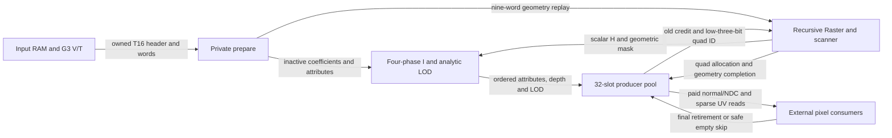

# Recursive Raster and authoritative producer pool

`vliw_cycle::frontend::Frontend::with_triangles()` connects the existing indexed
T16 engine to private preparation, actual Raster and interpolation.
`producer::Producer::with_triangles()` adds the production command pool.
Their defaults retain the inherited V-only explicit T boundary. The pixel
consumers, Final/ROP, framebuffer and physical memory service remain external.

## Frontend and context wiring

The packet window accepts one lookahead header only after preparation is free.
T words use the existing synchronous export and actual preparation readiness.
No intermediate triangle list or functional rendering result feeds the models.
DMA still writes the input RAM on wall edges independently of compute CE.

The frontend captures live Raster bounds on Raster start. Later preparation
may change its private bounds while the old Raster is running. Geometry replay
and I context switching follow the [preparation contract](/ip/gpu-v2/docs/references/cycle-draw-interpolation.md).
The new Raster can import before old I drains, but its new samples wait for the
actual context switch. Empty preparation retires without starting Raster.

Each owner samples one old-state connection and clocks once. A child contract
error does not suppress clocking of the other connected owners. No recovery
behavior is defined after the rejected edge.

## Physical Raster schedule

The Raster model reads the sole production 128x36 program. It retains the
16x30 synchronous work RF, 8x30 two-vector mailbox, 16x30 scanner RF and 256x36
step table. Step writes and scanner A reads have their original exclusion;
walker B reads and packed Nx/Ny import retain their separate ownership.
Reset clears Q and control, retaining the cells.

The recursive walker preserves speculative branch epochs, early predicate
retirement and the two-edge fused origin MAC. Upper tests write unpublished
mailbox rows; lower retirement publishes the completed vector. Old full credit
cannot borrow the same-edge scanner release.

The scanner preserves LOAD/ALIGN/CHECK/SCAN, full-tile row vectors, partial-tile
ping-pong vectors, exact 2x2 feasibility masks and tail-quad prefetch. Predicate
branches consume the registered prior result. A whole-vector clear followed by
a same-edge lane write preserves the clear of all other lanes. Sample H is the
actual synchronous RF Q, with the selected 30-bit arithmetic and top-left rule.
Viewport limits remain 400x240. The phase replica follows the actual producer's
old phase and enabled next state.

## Pool capacity and publication

The pool has 32 physical **quad** slots. Six-bit ordered pointers provide
24 active and eight unpublished credits. The producer receives the low three
bits of allocation; the fixed return calendar reconstructs the full physical
slot from the ordered attribute/depth cursors. Metadata and public pool views
retain all five physical-slot bits.

Allocation stores coordinates, RGB/unlit mode and material RGB. Three attribute
writes per pixel assemble Normal36, UV36 and Basic24 through the original
column enables. Depth has an independent Alpha8/Z16 bank and synchronous read.
Geometry completion and numerical depth masks remain separate. All four depth
events and all twelve attribute words are required even for a numerical-empty
quad. Empty slots remain dense ordered tombstones.

RGB completion follows its last attribute word after old LOD completion; UV
completion follows its later LOD event after all attributes. Publication uses
the old completed prefix. Admission uses old active/unpublished credits, so
same-edge publication or retirement does not make a full pool ready.
The original shadow-prefix and ordering monitors remain checks, not additional
functional completion state.

## Independent consumer ports

Lighting reads each nonempty lit quad's four normal rows and pays separate X
and Y NDC table reads. The 320 NDC words come from the existing generator.
Normal Q, NDC Q and descriptor stay owned through acceptance. Sampling reads
only live UV lanes in increasing lane order; its first-row flag is independent
of whether the first live lane is zero. RGB and numerical-empty slots skip
this consumer without a UV read.

Basic and Alpha/Z each pay their own synchronous read, independent of the
normal/UV ports. Illegal cross-port collisions retain their original monitor.
All replicated metadata read views remain independent and simultaneous.
Retirement waits for both consumer cursors to pass the ordered head. Empty skip
requires the same safe-prefix condition and does not allocate a payload loan.

## Qualification boundary

Raster qualification compares all sampled ports, control registers and RAM/DSP
Q against actual portable RTL. Its integer reference independently checks the
entire viewport coverage set and every emitted H word. Profiles include full
and partial tiles, mailbox pressure, nonzero origin restoration, viewport clips,
warm reset and an actually empty viewport.

Pool qualification uses real I-model returns as producer stimulus and controlled
consumer/read/retire peers. The two mixed-mode RTL profiles cover numerical
empty and sparse masks, active/unpublished full conditions, same-edge credit
restrictions, five-bit slot reuse, six-bit pointer wrap, material/mode snapshots,
normal/NDC and UV delivery, and Basic/Alpha-Z read loans. Compiled DUT mutations
and exact original monitors qualify the temporal boundaries.

The live G3-to-pool Rust composition additionally executes real indexed exports,
preparation, Raster, I and pool feedback under credit pressure. This is separate
from a complete-DRAW RTL run. Its controlled accept/retire events do not execute
Lighting, Sampling, Final, ROP or physical framebuffer writes. Each fixture has
an explicit limit of at most 100000 wall edges; short RTL processes have a
30-second limit and independent watchdog.
