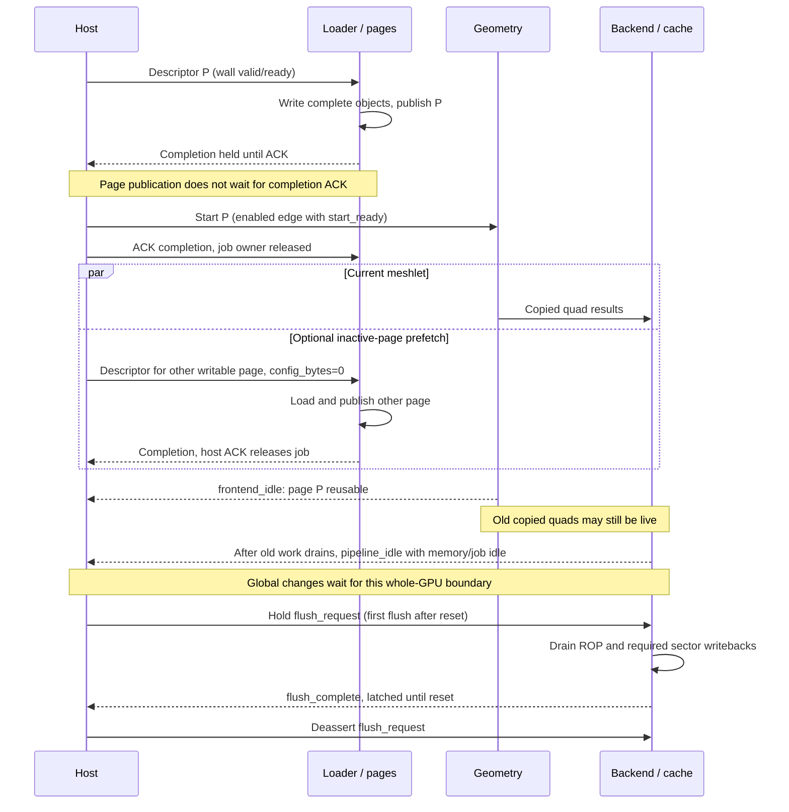

# Submitting, completing and flushing work

## Prepare the GPU

The texture slot table and framebuffer surface are supplied when the standalone
hardware is emitted. Slots describe physical texture assets; the surface fixes
color/depth bases and dimensions. Runtime draw pins select how work uses them.
The selected factory requires a 400 × 240 surface.

After a coordinated reset, allow enabled edges until the initialization port is
ready. Load all 256 numerical-table words through
`ce && table_valid && table_ready`; hold index/data until that transfer. The
[table encoding](/ip/gpu-v2/docs/formats.md#interpolation-table) includes reciprocal seeds,
slopes and logarithms. Its RAM is not a reset-provided numerical constant.

Choose global draw and Lighting configuration, then keep it stable while old
work can read it. At a drained boundary, pulse `draw_rebind` for one enabled edge to invalidate
the cached Lighting binding tagged bank 0. It has no separate ready/ACK pin;
use `pipeline_idle` as its precondition. The selected top wires this retirement
to bank 0, so keep `draw_bank=0` when using this same-bank rebind sequence.
Table loading and configuration changes wait for `pipeline_idle` and their local
ready conditions. An ordinary T-local drain is insufficient.

| Runtime configuration | Width and meaning |
| --- | --- |
| `cfg_far_z` | u32 F16 far depth; depth admission compares bits 23:8 |
| `cfg_tex_w_log2`, `cfg_tex_h_log2`, `cfg_max_mip` | Three 5-bit exponents/limit used in analytic LOD |
| `cfg_lod_bias` | Signed 8-bit F4 bias applied by geometry |
| `draw_bank`, `draw_unlit` | One-bit draw identity; independent Lighting bypass |
| `draw_config` | 27-bit Sampling configuration, encoded below |
| `specular`, `alpha` | RGB888 specular color; 8-bit output alpha |
| `depth_func`, `depth_write`, `blend` | Three-bit comparison, depth write enable, source-over enable |
| `context_epoch`, `context_mode`, `context_code` | 16-bit Lighting identity, 2-bit mode, 5-bit shininess code |
| `light_x/y/z`, `ray_x/y/k` | Signed 16-bit Q14 Lighting direction/projection-ray parameters |
| `ambient`, `directional` | Unsigned 9-bit F8 intensities in 0..256 |

`draw_config` fields are bias15:0, texture slot19:16, max-size 23:20,
full-mip 24 and filter 26:25 at the reusable row boundary. The selected path uses
geometry's already biased/clamped LOD; it does not add the low 16-bit bias again.
Physical textures are square POT even though LOD has separate U/V dimensions.
Filter codes are 0=nearest, 1=bilinear, 2=trilinear; code 3 faults at Sampling
preflight. Context modes are 0=unlit, 1=ambient-only, 2=diffuse, 3=diffuse plus
specular. The lit queue rejects mode 0; use `draw_unlit` for the parent bypass.
Mode 2 returns h=0. Shininess codes 0..16 are valid. Lighting and filtering
arithmetic are defined in [fragment arithmetic](/ip/gpu-v2/docs/fragment-math.md).

## Load one input page

Prepare three little-endian objects in host memory: optional matrix/config data,
32-byte metadata, and optional packed vertex/index payload. Their encodings and
local destinations are in [data formats](/ip/gpu-v2/docs/formats.md). The host chooses sources;
the loader fixes destinations. Zero-length segments leave existing local bytes
unchanged; they neither clear storage nor validate that later reads are covered.
The caller supplies every byte needed by the new metadata, or intentionally
reuses suitable retained bytes.

| Descriptor field | Representation |
| --- | --- |
| `config_source`, `metadata_source`, `payload_source` | 22-bit halfword addresses; byte address divided by 2 |
| `config_bytes` | 0 skips config, otherwise a multiple of 8 up to 512 bytes |
| `payload_bytes` | 0 skips payload, otherwise a multiple of 8 up to 1024 bytes |
| `descriptor_page` | Target page 0 or 1 |
| `descriptor_tag` | Opaque 8-bit host completion identity |

Config/metadata sources are 32-byte aligned; payload source is 128-byte aligned.
The final physical read can extend to the next 32-byte boundary. That padding
must be accessible even though only valid bytes write local storage.

Present a stable descriptor until `descriptor_valid && descriptor_ready` on a
wall edge. The target must be writable for the whole job. Acceptance invalidates
that page and reserves the job; the loader copies config, metadata, then payload.
A nonzero config load requires whole-GPU drain because it can replace matrices
used by either page. A pending config descriptor also blocks conflicting starts.

On success, `completion_valid && completion_publish` publishes the page on a
wall edge, including during CE0. Publication does not wait for
`completion_ready`. Completion holds page, tag and 4-bit error until the host
accepts it; this ACK releases the loader job. A failed page refresh cannot be
started. A failed config job invalidates both pages.

## Start and overlap the next load

Select `slot` and transfer `ce && start && start_ready` on an enabled edge.
Ready requires a valid page, frontend readiness, no fault or table loading, and
no conflicting offered descriptor. An offered conflicting descriptor takes
priority over start, even before its acceptance. Deassert `start` after transfer.

Keep `output_ready` asserted for ordinary operation; lowering it can stall
frontend publication. Continue servicing all three memory masters and accepting
loader completions, including while compute CE is low.

Another page's payload/metadata can prefetch while the current meshlet runs.
Leave `config_bytes=0` for that overlap. Wait for `frontend_idle` before reusing
the active input page. `meshlet_done` reports meshlet-controller progress;
frontend idle is the page-reuse condition after remaining R/I work drains.
Quads copied to the pool can continue shading after that point.

## Finish the render or change configuration

Stop offering new work. Accept any outstanding loader completion and wait for
`pipeline_idle` before changing global pins, matrix/config data or initialization
tables. In the selected wrapper this condition includes frontend/backend idle,
no memory transaction owner and no loader job. The loader's config gate checks
the same compute/memory/job ownership, plus its own descriptor readiness.

Resident dirty framebuffer tiles can survive a uniform change. For external
visibility, assert the level input `flush_request` with new work stopped and
hold it until `flush_complete`. There is no flush-ready pin. The request reaches
the backend after frontend drain and is forwarded at a whole-quad boundary;
cache maintenance latches it on a wall edge and continues during CE0. Deassert
the request after completion. Completion includes dirty writeback terminal
responses, including the gaps between sectors.

In the current selected cache, `flush_complete` stays set until reset. A second
request does not rearm it, and later ROP writes do not clear it. Thus this is a
single flush-completion indication per reset interval, not a reusable per-frame
fence. Another independent flush requires coordinated reset/reinitialization;
normal rendering alone does not establish another completion boundary.
A gap in request-valid is insufficient.
This interface supplies no implicit CPU fence or Display present protocol.

## Addressing example

The following byte addresses are an illustrative nonoverlapping host allocation
within 8 MiB; they are not reserved addresses. Emit the GPU with valid, disjoint
framebuffer planes and use RGB/unlit mode to avoid texture and Lighting inputs
for the example. Initialize the numerical table as above.

| Object | Host byte address | Descriptor halfword address | Length | Local qword destination |
| --- | --- | --- | --- | --- |
| One matrix block | `0x1000` | `0x0800` | 128 bytes | 320..335 |
| Page-0 metadata | `0x1080` | `0x0840` | 32 bytes | 256..259 |
| Three V96 vertices plus one T64 word | `0x1100` | `0x0880` | 48 bytes | 0..5 |

Encode metadata with V=3, T=1, uniform base=20 and T offset=5. The nine vertex
u32 words occupy qwords 0..4 with one zero padding u32; qword 5 contains triangle
indices `(0,1,2)` in its low 18 bits. Supply valid source vertices and matrices in range,
choose RGB mode, bank 0, `draw_unlit=1`, `blend=0` and `depth_func=7` (ALWAYS),
and hold the configuration. Submit page0, tag 7; wait for a
successful completion, ACK it, then start slot0. Keep servicing memory. Reuse
page0 after frontend idle, or stop and flush to observe the framebuffer in memory.

This is an allocation/ownership example rather than a complete scene fixture;
[geometry](/ip/gpu-v2/docs/geometry.md)
defines the matrix, scale and coverage rules that determine which pixels appear.

## Submission and reuse at a glance

This shows one legal ordering, not a requirement to ACK completion before
starting a published page. The overlapping descriptor must satisfy the page and
configuration restrictions above. A later global change waits for any prefetched
job's completion ACK too. The diagram ends at one flush; it does not imply a
reusable frame loop in the current cache.

## Fault and recovery

Descriptor error bits are OR-composable: bit 0 invalid descriptor, bit 1 abort,
bit 2 memory terminal error, bit 3 malformed/unexpected response. A descriptor
can be accepted and report failure; acceptance is not validation success.

Compute or memory faults stop new meshlets. Abort stops computation and future
loader work while presented requests remain stable and accepted traffic drains.
Earlier local writes and framebuffer writes are not rolled back. Reset takes
priority over local state updates and must be coordinated with the external
memory chain; resetting only the GPU does not cancel another owner's burst.
[Memory interface](/ip/gpu-v2/docs/memory.md) specifies the terminal boundary.

Implementation anchors: [host wrapper](/ip/gpu-v2/src/system/vliw_sdram.v),
[loader](/ip/gpu-v2/src/frontend/vliw_dma.v), [global controls](/ip/gpu-v2/src/system/vliw.v).
