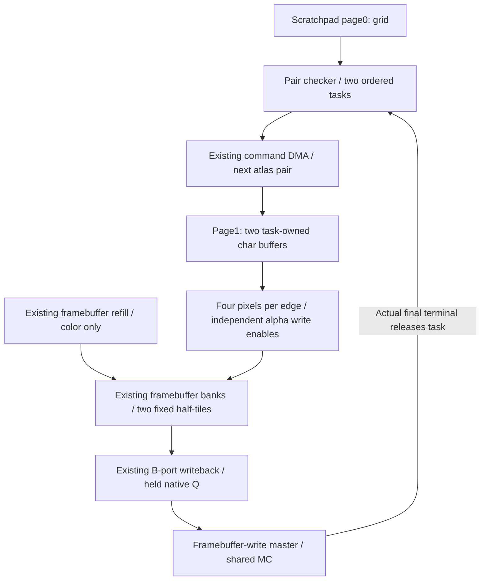

# Fixed-grid UI drawing

UI_GRID draws a400x240 RGB565 color plane as50x15 cells of8x16 pixels.
Each cell names one char (text or icon); IDs0..254 are valid and FF skips
the cell. Alpha is binary: zero preserves the destination and one replaces it.
There is no depth access, filtering, scaling, lighting or fractional blending.

## Assets and command

The driver provides a750-byte row-major ID array, with readable padding to768
bytes and a128-byte-aligned base. The atlas is64-KiB aligned and allocated as
256 entries of256 bytes; entry255 is never read. Both assets must remain stable
and disjoint from the target throughout execution, within the8-MiB GPU range.

Each char contains128 little-endian RGBA5551 words: R15:11, G10:6, B5:1, A0.
Rows are16 bytes. Within each group of four pixels, odd rows store logical
pixels2,3,0,1 instead of0,1,2,3. This offline ordering directly matches the four
framebuffer banks. `ui_char` converts ordinary row-major pixels; hardware needs
no pixel permutation. RGB565 green is `{G5,G5[4]}`; red and blue retain five bits.

UI_GRID is opcode11 with the same staging-slot operand as SET_TARGET. It reads
one qword from a32-byte object: grid byte base/128 in bits15:0, atlas byte
base/65536 in bits22:16, and zero reserved bits. The remaining object bytes are
zero padding. `ui_params` checks extents and alignment; `Command::ui_grid`
encodes the command. The canvas is the color base installed by SET_TARGET.

`Command::ui_grid_range(qword, first, end)` selects a nonempty row-major interval
`[first, end)` within0..750. The same32-bit instruction carries bit27=1,
first in16:7, inclusive last (`end-1`) in26:17, and the descriptor slot in6:0.
Bit27=0 retains the original full-grid encoding with26:7 zero. These fields
remain in the existing CP instruction register until the UI call completes;
there is no separately installed UI range or saved cursor. A rectangle can be
expressed as one interval per character row. Empty intervals are omitted by
the producer.

The Rust helper takes the descriptor's local64-bit qword index, like
`Command::ui_grid`: qword276 encodes slot69 in command bits6:0. The descriptor
layout is unchanged. For example, `Command::ui_grid_range(276, 1, 4)` draws
cells1,2,3 using the descriptor at local qword276.

The grid allocation and alignment remain unchanged. Only the selected bytes
need meaningful IDs for a range call: DMA reads the intersecting128-byte grid
sectors into their original scratchpad positions, and the checker starts at the
first selected pair. It reads that pair's qword and selects one of its four
fixed16-bit slices into a single pair register. Later pairs may reread the same
qword; there is no64-bit shifting window or window-remaining counter. The pair
register also holds the grid DMA base before scanning starts. Edge masks force out-of-range IDs to FF,
including either half of a shared tile; they cause no atlas read or pixel write.
No variable shift, packed-grid relocation or per-row address conversion is used.
Compared with retaining eight IDs at once, a complete empty-grid scan pays562
additional enabled edges for281 extra synchronous reads. Atlas traffic and
framebuffer writes retain their schedules; their stalls can hide these reads.

The driver explicitly WAITs for all rendering and data DMA, then FLUSHes the
framebuffer cache before UI_GRID. The command is serial and completes only
after all its framebuffer write terminals. It does not change global/render
bindings or depth. Both meshlet input pages become invalid and must be reloaded
before later DRAW commands. Uniform, metadata and command-page storage survive.
No automatic present, clear or texture invalidation is performed.

Consecutive UI calls need no intervening WAIT, FLUSH or UI-state maintenance:
each call reloads its own selected grid sectors and atlas entries, starts a new
checker, and retires its final physical writes before the next call executes.
The initial transition from3D still needs the explicit WAIT/FLUSH above. A
masked-out neighbor in a shared16x16 tile is preserved by the background read.

The RCC path separates setting data from drawing intervals. Snapshot APIs
`gpu_pass_set_ui_grid` / `gpu_pass_set_ui_grid_range` install one private grid;
in-place begin/write construction finishes with `gpu_pass_ui_set` instead.
`gpu_pass_draw_ui_range(pass, first, end)` reuses that descriptor and appends
one UI_GRID instruction. Consecutive range draws need no descriptor DMA,
WAIT or FLUSH between them. A 3D draw preserves the descriptor but restores
WAIT(all)/FLUSH before the next UI draw. No additional hardware state is needed.
The original full-grid snapshot and begin/write/end convenience APIs remain
compatible. See the [driver](/systems/cpu-v3-tang-nano-20k/docs/gpu-driver.md#in-place-ui-construction).

## Destination tile addresses

Each UI tile covers two horizontally adjacent 8x16 character cells. Logical
tile indices remain row-major: `t=0..374`, with 25 tile columns and 15 rows.
Framebuffer maintenance maps this index to the
[column-ordered surface](/ip/gpu-v2/docs/framebuffer.md#surface-layout):

```text
tile_x = t % 25
tile_y = t / 25                 // integer division
physical_macro = (tile_x << 4) | tile_y
```

`column_ui_tile` implements the quotient/remainder using conditional
subtractions of 200, 100, 50 and 25. Indices 0, 24, 25 and 374 map to macros 0,
384, 1 and 398. The padding macro at row 15 of each column has no logical UI index.
This conversion applies to framebuffer destinations; grid ID order and atlas
encoding retain the formats above.

## Storage and pipeline

The input scratchpad is reused without extra BSRAM: page0 holds the768-byte
grid, while page1 holds two512-byte char-pair buffers. Two ordered task slots
hold `{tile_index9,left_ID8,right_ID8}` and validity/readiness; each slot retains
its associated buffer until the task's final write terminal. Initialization's
grid-base field shares the later 16-bit ID-pair register because their lifetimes
do not overlap.

The checker retains one 16-bit ID pair, selected from a synchronous 64-bit read
by a fixed slice indexed by `scan[1:0]`. An enabled `scan_step` consumes the pair
when the next task slot is free and clears `pair_valid`; the next pair needs
another read, which can reread the same qword. FF/FF pairs produce no task or
framebuffer traffic. The two tasks cover the current and next tile. Atlas reads
use the existing command DMA: two128-byte bursts per non-FF char, directly into
the selected task's final buffer. If the next task is already queued or is
being pushed by the checker, its atlas loading finishes before the current
background read starts. This groups atlas and framebuffer reads into separate
same-master runs rather than alternating them through the shared arbiter.
Without a known next task, the current task proceeds immediately; the final
task never waits for a nonexistent successor. Slots release only at final write
retirement, so the following atlas group cannot overwrite either live buffer.
Command prefetch pauses during UI; the checker and char consumer share the
source read port in fixed phases, with no port-request arbiter.



Each background read is one four-sector maintenance operation for the entire
16x16 color tile. All four requests advance through the existing issue cursor
without an upper/lower command handoff. The second actual read terminal starts
A's upper overlay, four pixels per enabled edge, while B fills the disjoint
lower half. The fourth terminal releases read maintenance. Once the upper
overlay's final pixel Q is consumed, a single four-sector writeback begins,
overlapping A's lower overlay with B's upper writeback.

The lower half's write requests and B reads are gated until its overlay is
complete. This readiness is stable after publication and ignores checker Qs;
only a tagged pixel Q can extend a pixel's lifetime. An arbitrary CE pause can
therefore delay the lower-half requests without stalling an already accepted
write burst. B's valid bit clears if its old beat is consumed without a next
read, and reloads when production resumes. Abort opens the lower gate so all
accepted work drains using existing background data where necessary.

UI uses the ordinary four-sector issue/data/retire counters, but maps both
sector-index halves to the installed color base and contiguous UI bank words.
Depth addressing is disabled for UI. There is no extra RAM, payload queue,
upper/lower command pair or second output-sector buffer. Native B Q holds
through write-data stalls and advances only after acceptance.
UI temporary lines are never published as normal cache residents. Depth is not
refilled or written. Accepted memory work drains independently of compute CE;
completion remains visible until the decoder consumes it. Explicit abort drains
accepted DMA/maintenance work without reporting successful CB completion.
Each alpha bit gates an entire independent 16-bit bank write. Transparency does
not use a partial native BSRAM write or require a read-modify-write of a pixel.

## Native command maintenance ownership

The command factory scopes `GPU_V2_COMMAND_MAINTENANCE` around its numerical
closure and undefines it before emitting the remaining control modules. The
top and selected postquad wrapper declare the runtime color/depth and serial
UI/copy ports; the TDP sink forwards them to the cache source. The source owns
`column_ui_tile`, color-only UI addressing, the raw-copy bypass, alpha/RGB565
bank writes, lower-half gating and temporary-line nonpublication. These paths
are declarations of the existing owners, with one shared maintenance FSM.
No command-source text pass inserts or rewrites their ports or statements.

This private profile is independent of the public color-port profile.
Standalone checked factories retain fixed target parameters and functional
error latches, even when their caller selects command color ports. In the
command profile, failed memory ACKs and malformed source events are passive
simulation obligations; their zero-valued diagnostic registers continue to
update on every clock edge. Disabling monitors adds no recovery protocol.
Presented/accepted transport and explicit abort retain their drain boundaries.

## Focused verification

`tests/ui_grid.py` compares the entire color plane to independent screen-space
glyph equations and verifies unchanged depth using the real native GPU, shared
MC and SDRAM pin model. It covers sparse/dense/empty grids, ID0/254, one-sided
FF, binary transparency, edge cells, CE pauses, repeated UI commands and abort.
Mode3 holds CE low for80 edges after the first write request, exercising the
lower-half publication and data gate. `--ranges first:end ...` runs consecutive
independent range calls, comparing
the entire color plane including excluded neighbors and checking the exact
number of grid/atlas read requests and framebuffer requests. Ranges can cross
character-table sectors; empty-content ranges emit no framebuffer work.
`--rcc-records path` instead loads exact compiled-CPU command/object bytes
exported by the RCC UI test with `GPU_RCC_UI_RANGE_FIXTURE=path`. That fixture
omits only the pass's two initial CLEAR commands to retain a patterned surface;
all range, descriptor DMA and fence bytes come from the production RCC builder.
It compares all color pixels and depth words, including unselected neighbors
with valid glyph IDs in the same tiles and grid sectors.
The `GPU_RCC_UI_BATCH_FIXTURE=path` variant installs one immutable grid and draws
three disjoint ranges. The replay counts actual CP DMA accepts and UI starts,
rejects any DMA/WAIT/FLUSH between these range instructions, and checks that
every framebuffer read/write request addresses the color plane. Its two local
DMAs are the initial Target and the single UI descriptor installation; glyph
and grid-sector reads are separate, necessary UI execution traffic.
The bounded runner records exact DUT/peer hashes. Its standalone MC profile and
cycles are separate from full-system CL3 timing and physical-board qualification.

`tests/ui_draw_transition.py` executes DRAW, WAIT/FLUSH, UI_GRID, a fresh
DMA_MESHLET, another DRAW, WAIT/FLUSH and END in one DRAM command buffer. It
checks retained 3D pixels before/after UI, binary transparency, the later draw,
and actual write terminals. Pin-write guards forbid writes outside the target;
full depth and immutable command/asset comparisons run at each checkpoint.
Separate disjoint layouts exercise the highest grid extent and atlas base.
Abort cases interrupt an in-flight UI write and the last output burst: accepted
work must drain while busy/fault remain asserted, without reaching the later
draw or reporting normal command-buffer completion.

`tests/ui_showcase.py` additionally takes an external WenQuanYi Bitmap Song font
zip, builds a shared atlas of ASCII, colored static icons and CJK halves, then
submits two command buffers without reset. Each CJK character occupies two
cells; Unicode and font rasterization exist only in the offline producer.
The second frame uses a different cell table and A/B target, verifies both
materialized color planes and unchanged depth, and exports PNGs from actual
SDRAM words. The producer reads WenQuanYi's original 100-unit bitmap grid
directly into 16x16 pixels (its 18px EM is not a 16px raster scale). ASCII uses
the shared [project font](/assets/fonts/README.md), read as native 8x16 binary
row masks. Neither path resizes, antialiases or thresholds a vector-font
rendering. Python Pillow, fontTools and the external CJK zip are test
prerequisites; there is no OS font dependency. Font binaries and rendered
images remain generated artifacts.

`tests/maintenance_profiles.py` compares the complete ordered preprocessed
factory token streams with a supplied frozen baseline, with native/portable
arithmetic and monitors on/off. Its bounded diagnostic probes distinguish
command failed-ACK/source/readiness assertions from generic sticky rejection.
The UI, transition and MEMCPY pin fixtures accept `--trace` to observe every
command/TDP/router request, payload, terminal, descriptor-Q and bank-port edge;
`--no-monitors` selects the same datapath without simulation assertions.
`--trace-pair BASE CANDIDATE` on the profile checker compares the saved traces
byte for byte. These are bounded interface/transport checks, not new physical
SDRAM, Display, full-scene or board qualifications.
