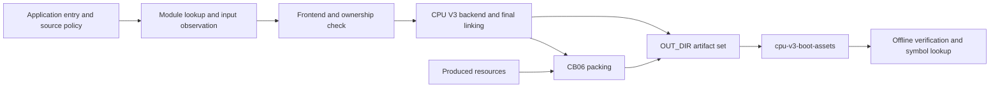

# Same-build application artifacts

The system build compiles the selected application once and retains the backend's
code, listing and final debug locations. `cpu-v3-boot-assets` materializes the
exact files embedded from that build's Cargo `OUT_DIR`. Metadata and input
snapshots are host artifacts; they are not added to the CB06 image or fitted RTL.



Observation records the source text actually returned by lookup. It does not
alter approved library roots, local-override identity or private-domain checks.
Application preparation explicitly selects the entry, ordinary module roots,
capture policy and specialization. Compilation does not infer these dependencies
from Bloxorz or RTT directory suffixes.

## Exported files

| File | Meaning |
| --- | --- |
| `application.v3bin` | Linked little-endian instruction words |
| `application.static-words` | Frontend's exclusive static word extent |
| `cpu-v3-boot.bin` | Exact generated CB06 COPY/ZERO image |
| `cpu-v3-boot.map`, `boot_resources.rs` | Existing boot map and generated constants |
| `application.dbg` | RCC debug v2, with final function/global/line locations |
| `application.asm` | Listing returned by the same backend invocation |
| `application.build.json` | Versioned application, file, source and resource identities |
| `application.inputs/<sha256>` | Content snapshots not already present in another exported file |

Application-specific resource files and repack configurations remain exported.
The old unconsumed `boot-assets.manifest` FNV inventory is retired and removed
when materializing into an older export directory.
Snapshots reuse any already-exported identical content. Debug presentation sorts
globals, constants, types and locals; addresses, lexical scopes and file IDs are
retained. This avoids changing artifact identity merely because a hash table
enumerated metadata in another order.

The descriptor's schema is `digitaldesign.application-build`, version 1.
All JSON object keys are sorted when calculating its `artifact_id`: remove that
field, encode compact UTF-8 JSON without ASCII escaping, then take SHA256. There
are no floating-point fields. Each entry in `files` binds a relative locator to
its byte length and SHA256. The descriptor itself is excluded from `files`.

| Descriptor field | Contract |
| --- | --- |
| `application` | Original entry file, selected entry, frontend, ordinary source roots, capture policy and specialization |
| `target` | CPU V3 code segment/base, initial DSEG pages, static extent, stack, heap and effective GPU debug mode |
| `compiler_options` | Audit description of the actual backend options; an opaque string, not a configuration input |
| `code`, `package`, `debug`, `listing` | Locators into `files` |
| `source_map` | Every debug filename mapped to exact effective source bytes and optional original-file identity |
| `declared_inputs` | Snapshots of declared producer/configuration files and resolved file inputs |
| `resources` | Actual COPY/ZERO addresses, byte extents and COPY data locators used by the packer |

The main source snapshot includes selected-entry rewriting. Its original file
also remains identified. Other modules with filesystem origins must match the
observed file contents; a mismatched origin fails the build. Generated modules
have no filesystem origin. Standard-library snapshots come from RCC's embedded
`std_sources`, not from another source tree found on the machine.

Origins describe original locations under the repository root, under the build's
`OUT_DIR`, or outside those roots. They are provenance, not locators that offline
readers must open, and do not assert a Git commit or grant library authority.
The declared-input list covers explicit preparation dependencies, not an inferred
closure of every Python import. Produced resource bytes are independently bound
as actual packer inputs. File inputs are rechecked before descriptor publication
to reject edits during the build. Cargo watches existing directories for missing
fallback candidates rather than perpetually watching nonexistent files.

## Offline use

Build through the [application command](/systems/cpu-v3-tang-nano-20k/docs/application-workflow.md).
The exporter requires a fresh or empty directory and publishes the descriptor
after the payloads. Reusing a nonempty directory is rejected without modifying it.

```powershell
python -B systems/cpu-v3-tang-nano-20k/tools/application_artifact.py check target/app
python -B systems/cpu-v3-tang-nano-20k/tools/application_artifact.py symbol target/app main
python -B systems/cpu-v3-tang-nano-20k/tools/application_artifact.py symbol target/app GAME --kind global
```

The reader checks descriptor/file identities, complete source mapping, linked
symbol ranges, static extent and the package's agreement with the described
code/resources. It reads only the exported directory; moving that directory
does not require the original checkout, Cargo or an asset producer. Missing or
duplicate symbols and escaping file locators are rejected.

Function results contain the logical PC, CSEG and physical word address:
`physical_word = (CSEG << 16) | PC`. Global results contain the logical word,
DSEG index and initial page: `physical_word = (page << 14) | (logical & 0x3fff)`.
These are initial boot mappings; they do not observe later runtime page changes.
Every query includes the artifact ID. Constants are queried with `--kind constant`.

The descriptor binds a specific exported build; it is not a signature or a claim
of algorithmically independent compilation. CB06 reconstruction, CPU execution
and RTL qualifications keep their separate validation boundaries.
