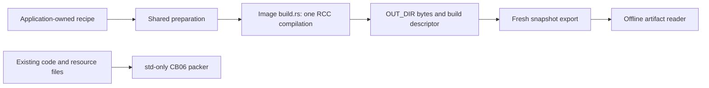

# Application builds and existing artifacts

An application build explicitly selects one application and produces one
self-contained snapshot. Consuming existing bytes does not compile an application.
Cargo `OUT_DIR` remains the sole authority for executable and CB06 bytes.

## Commands

```powershell
cargo run --release -p cpu-v3-tools --bin cpu-v3-app -- list
cargo run --release -p cpu-v3-tools --bin cpu-v3-app -- build bloxorz --help
cargo run --release -p cpu-v3-tools --bin cpu-v3-app -- build bloxorz --out target/bloxorz-build
```

The PowerShell front door runs the same command with a Cargo summary:

```powershell
& systems/cpu-v3-tang-nano-20k/tools/build-application.ps1 bloxorz target/bloxorz-build
```

Choose one build entry and a fresh output directory. `--out` is required by the
Rust command. `--gpu-debug 0|1` selects the compiler option; `--manifest FILE`
binds an approved GPU capture build declaration. The diagnostic `gpu-profiler`
application requires that declaration when its capture hook is enabled;
`--hook 0` preserves its uninstrumented mode. Application options come from the same
description as the build, for example `gpu-bench --scene micro|full`.
`bloxorz --start-level 1..33` selects the initial level; the default is level 1.
`--start-phase entry|play` selects animated entry or a resting start; default
`entry` preserves normal gameplay, while `play` supports bounded warm-scene qualification.
Help, list, invalid requests and nonempty-output rejection run before starting
Cargo or Python. Child-process environment selects the application; the caller's
environment is not changed. Legacy `CPU_V3_BOOT_EXAMPLE` names remain valid aliases.
The `default` entry reads `boot-applications.conf`; other entries explicitly own
their source, frontend, entry point, ordinary modules and asset recipe.

## Preview and run

```powershell
cargo run --release -p cpu-v3-tools --bin cpu-v3-app -- preview core-demo --page 5
cargo run --release -p cpu-v3-tools --bin cpu-v3-app -- run core-demo
cargo run --release -p cpu-v3-tools --bin cpu-v3-app -- preview core-demo --snapshot target/core-demo/app
```

Both commands use the same application build and canonical artifact checker as
`build`. Without `--snapshot`, they allocate a fresh immutable snapshot beneath
repository-root `target/apps/<application>/snapshots/<id>`. Each run gets a
separate `runs/<id>` directory. `--out NEW-RUN-DIRECTORY` changes the run directory,
not the snapshot destination. No previous outputs are pruned or overwritten.
`--snapshot` consumes a verified export with the requested application's source
and entry point; application build options cannot accompany it.

| Default | `preview` | `run` |
| --- | --- | --- |
| Backend | Instruction CPU + functional GPU/Display | Same |
| Window/input | Headless, no controller | Window, realtime, Windows XInput slot 0 |
| Requested presents | 2 | None |
| Host samples | 120 | 3600 |
| CPU instruction budget | 8,000,000 | 100,000,000 |
| Runner wall deadline | 120 seconds | 120 seconds |

Use `--headless` or `--window`, `--presents N`, `--samples N`, `--max-steps N`,
`--seconds N` (1..7200) and `--xinput-slot 0..3` to override these defaults.
All counts must be positive. Explicit XInput also enables realtime sampling in
headless mode. An unmet present target fails after saving outputs.
Host samples and instruction steps establish bounded functional execution;
they are not measurements of hardware frame time. Use the
[profiling workflow](/systems/cpu-v3-tang-nano-20k/docs/application-profiling.md)
for CPU/GPU timing.

The host builds the existing `cpu-v3-display-sim` executable independently and
uses Cargo's reported executable path, including a custom Cargo target directory.
Window mode enables its `display-window` feature. Application/runner build
subprocesses have 600-second deadlines; artifact checks have 60 seconds.
On Windows, a timeout terminates the spawned process tree; on other hosts it
terminates the immediate child. The caller's environment is unchanged.

Each run saves full subprocess stdout/stderr, command arguments and exit/timeout
results under `logs/`; execution outputs go under `output/`. The final `run.json`
binds their file hashes, configuration, runner identity, actual consumed package
and artifact ID. Preparation failures also leave a sealed receipt and available
logs. A timeout can leave partial simulator outputs. The snapshot's location is
provenance; checking a moved run directory does not need that original path:

```powershell
python -X utf8 -B systems/cpu-v3-tang-nano-20k/tools/application_artifact.py check-run target/example-run
```

This verifies the receipt and its recorded files, including failed runs; it is
not a signature or a claim that unrecorded files were produced by the simulator.

## Build diagnostics

Source/frontend failures retain their original filename, line and column through
the image build boundary. `cpu-v3-app` prints the primary diagnostic once and the
log directory. That directory retains the complete Cargo stdout/stderr and a
versioned `diagnostic.json` when a typed source/entry/relocation/backend error is
available. Unexpected producer or tool failures retain the original logs and a
short stderr tail rather than a guessed classification.

When the Rustc ownership gate runs, its projection, source map, JSON diagnostics
and compiler identity are stored under the build log's `rustc/`. A cached
successful image does not rerun the gate merely to populate logs. These host
diagnostics are outside the application snapshot and do not change CB06 bytes.
Standalone `build` logs live under `target/apps/<application>/builds/<id>`.

Runtime source/fault interpretation is described in the
[artifact specification](/systems/cpu-v3-tang-nano-20k/docs/application-build-artifact.md#runtime-diagnostics).

## Application declarations

Each application owns an `application.rs` recipe. Register that file once in
`application_catalog!` under `applications/build/mod.rs`; the catalog supplies
module loading and enumeration in declaration order. It does not scan directories
or grant application code driver privileges.

`BuildOption::integer_constant(flag, name, default, minimum, maximum)` declares a
`u16` startup constant. The host CLI and image preparation share validation;
preparation watches its environment variable and emits the constant even when
its default is used. CLI help shows the range and default. `environment` options
carry producer choices or input files without emitting RCC constants. Custom
configuration remains with the owning recipe. The normal image build runs its
recursive compiler passes on a 16-MiB host worker stack, avoiding the Windows
main-thread stack limit; this does not change the target stack or compiler budgets.

## Ownership and dependency direction

| Owner | Responsibility |
| --- | --- |
| `boot-format` / `cpu-v3-boot-format` | std-only CB06/project encoding, decoding, validation and functional installation; existing-input `cpu-v3-pack` binary |
| `tools/boot` / `cpu-v3-tools` | host application descriptions, output policy and `cpu-v3-app` command; no normal/build dependency on RCC, CPU or complete System |
| `examples/*/application.rs` | application source/modes, asset producer, source dependencies and any diagnostic preparation |
| `applications/build` | catalog aggregation and shared preparation mechanism, without an application-name condition tree |
| `applications/rendering/rcc` | ordinary shared scene/asset factories; no private driver authority |
| `build_support/applications.rs` | exact input tracking and compilation of the prepared application through the approved RCC loader |
| `applications/image` / `cpu-v3-application` | sole application build script, generated-byte library and `cpu-v3-boot-assets` materializer |
| Complete System package | models and existing-image runners; no application build script in its normal dependency graph |



Arrows describe data production. Only the explicit build command starts the
application-image Cargo subprocess. The tools package is also a small library dependency
of the image build script; it never depends back on the complete composition.
The format package shares the canonical `rcc/gpu_layout.rs`; there is no second
hand-maintained memory map or boot instruction array.

Recipes distinguish source entry, capture policy and diagnostic specialization.
The compiler does not infer those policies from source-directory suffixes.
The benchmark owns scene-dependent inputs; the diagnostic profiler owns its
manifest-selected RTT/MEMCPY preparation. Shared mechanisms only execute the
declared producer, read its actual manifest and assemble resources/constants.
The selected recipe and common preparation source are tracked inputs.

## Snapshot publication

`cpu-v3-boot-assets` accepts a nonexistent or empty output directory. A nonempty
directory is rejected before any file is changed, including an older application's
snapshot or an unrelated user note. Files are created with `create_new`; the
exporter does not delete fixed legacy names or prune unknown files.

All payloads are written before `application.build.json`. The final offline
validation establishes completeness and identity; a failed write can leave an
incomplete new directory and must not be treated as a valid snapshot. A later
build uses another fresh directory. The [artifact specification](/systems/cpu-v3-tang-nano-20k/docs/application-build-artifact.md)
owns file/SHA identities, debug and source/resource snapshots.

The normal build validates its exported snapshot and does not produce a second
`independent.bin` or export gateware. DS2/DS2UI adapters expose `-ExportHardware`
as an explicit separate action. RTT/Bloxorz adapters retain their own software
receipt and explicit hardware-binding options. `rtt400_board/build.ps1` remains
the separate hardware export/build/audit entry; it is not an application build.
The normal hardware binary is `cpu-v3-system`; existing-artifact consumers use
`hardware.py` and the standalone vendor tool. [Profiling](/systems/cpu-v3-tang-nano-20k/docs/application-profiling.md)
consumes this verified application snapshot directly.

## Existing-input packing and qualification

```powershell
cargo run --release -p cpu-v3-boot-format --bin cpu-v3-pack -- target/bloxorz-build/application.v3bin --project target/bloxorz-build/renderer-repack.conf -o target/bloxorz-repacked.bin
```

This command's normal/build dependency graph contains only the std-only format
package. It does not execute the System build script, RCC or an asset producer,
even with a new Cargo cache. The binary name remains `cpu-v3-pack`; its owning
package changed. Adjacent `application.static-words` or explicit `--static-words`
retains the static-allocation contract. Configuration/complete-Flash composition
options retain their existing byte layout and perform no programming.

Reconstruction calls the same encoder as the build script. It checks exported
inputs, not algorithmic independence. Explicit boot/column qualifications retain
byte comparisons; independent decoding and CPU/RTL execution cover other facts.
Normal application builds need only the exact export and offline identity/layout
check. Historical raw captures and already exported artifacts remain readable.

The pure-format unit tests and pack CLI fixture moved with their implementation;
CPU execution tests retain the same shared RCC fixture in the System. Tool tests
exercise help/list and invalid requests with Cargo/Python absent from PATH.
The workspace layer check and its script contracts reject cross-system and
support-to-composition dependencies while permitting same-system support packages.

`cpu-v3-display-sim` requires `--package EXISTING-CB06` instead of embedding a
selected application at compile time. The System model library and ordinary
binaries no longer have an application build script. Its dev dependency on the
image package retains exact board/application test fixtures; hardware example
export/audit and testbench preparation remain their separate workflow.

Source-declared external bytes and compile-time descriptions use the same build
and pack flow; see [static assets](/systems/cpu-v3-tang-nano-20k/docs/static-assets.md).
The export includes application.static-data and the complete application.repack.conf.
