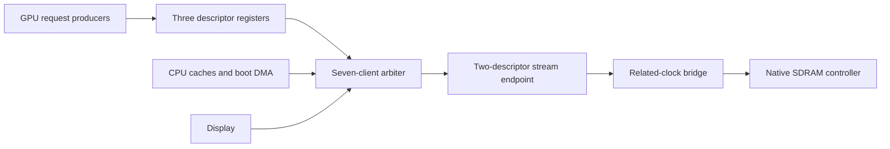
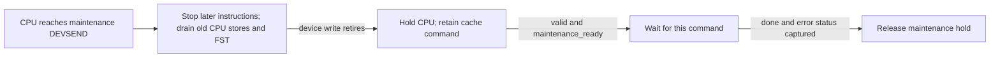

# CPU V3 Tang Nano 20K system architecture

This document records the Stage 12 CPU system and its offline fitting evidence. GPU resource,
timing, raster, and framebuffer results from the former implementation below are historical,
not measurements of the current GPU integration leaf. Device4 now binds the
single-CB GPU command closure from `ip/gpu-v2` to the three system memory masters.
The old GPU ABI is not supported. `src/hardware/gpu/sim/` remains historical.
The current Device4 protocol and completion boundary are specified in
[GPU commands](/ip/gpu-v2/docs/commands.md). Bounded interface/RTL tests do not
qualify a new full-board image. Historical Stage 12 timing tables below predate
this binding; the current complete-system profile is specified under Clock domains.

The 2026-10-02 development baseline passes workspace regression, strict lint,
core/system co-simulation, generated Flash boot checks and whole-system Gowin
build/audit with the reusable vendor SDRAM service. The production system enables one reserved
successor grant and other-bank preparation; indivisible four-sector chaining remains an opt-in
probe/model candidate. Current full-system artifacts are generated by
`cpu_v3_system --build`; historical resource/performance records remain in the
user's backup and are not maintained as live project ledgers. This offline
qualification covers the retired GPU shell, not the area or throughput of a
complete GPU v2, and does not replace physical cold-start validation.

It is the companion to the
concise [`cpu-v3-optimization.md`](cpu-v3-optimization.md) index; long-form historical evidence lives
in [`cpu-v3-optimization-record.md`](cpu-v3-optimization-record.md). Reusable processor details belong to the
[`CPU V3 IP documentation`](../../../ip/cpu-v3/docs/README.md).

## Composition boundary

`CpuV3System` is the final composition boundary for the Tang Nano 20K target. It connects:

- the revision 0.9 `CpuV3Core` at the Stage 12 microarchitecture level;
- a two-slot instruction payload queue with two request slots and a four-entry, two-word resolved-target BTC;
- separate 4-KiB I-cache and D-cache with initialized invalid metadata;
- the seven-owner CPU V3 memory arbiter, fixed boot loader, and reserved GPU ports;
- the related-clock SDRAM/display port and native controller boundary;
- SPI-Flash fixed boot loader, system-control, and framebuffer devices;
- Device5 autonomous latest-only DS2 snapshots, with fixed Display-phase polling and CPU-side coherent reads;
- fixed-loader status, UART, LEDs, and the HDMI output path (compile-time
  display mode from `display::ACTIVE_DISPLAY_CONFIG`).

The system owns concrete memory layout, device indices and channels, board clocks, boot packaging,
firmware, display scheduling, and physical validation. The CPU IP sees only physical instruction and
data word ports plus the narrow device port.

The full-system board uses the [DS2 left-port profile](/systems/cpu-v3-tang-nano-20k/docs/dualshock2.md),
with CLK/CMD/DAT/ATT on pins17/20/19/18 and only LED0/1 on pins15/16.
Legacy six-LED target profiles remain available for other applications.

The [eight-DPB C16/Z16 storage and quad owner](framebuffer-cache.md) describes the
retired GPU implementation. The current leaf instead uses the production GPU framebuffer cache described in
[GPU memory](/ip/gpu-v2/docs/memory.md).

## Streaming memory admission

The complete board uses the typed streaming SDRAM endpoint and bridge, with
CL3 timing and the existing logic-clock read return register. The detailed
contract is in [the vendor service](/hardware/vendor/gowin/doc/sdram-memory-controller.md#streaming-board-admission).
Three system-side GPU descriptor registers cut the address-computation path
before arbitration; they hold only address, length and direction. The actual
arbiter grant identifies continuation class. GPU payload/response ownership
continues until real completion, including abort drain. CPU D-cache line writes
can use the same ordered streaming service during clean/invalidate. CPU reads,
scalar writes, boot DMA and Display keep conservative admission and response
backpressure. Direction matching separates CPU line writes from GPU framebuffer
reads even though they share a two-bit continuation-class value.

Arrows carry descriptor admission; payload and returns keep their existing
ordered direct routes. Register admission does not complete GPU work or reserve
the SDRAM bus. Only real terminal responses release in-flight GPU resources.

## Processor and instruction path

The core is precise and in order. Stage 12 adds a conservative two-stage frontend: eligible
single-cycle sequential integer instructions accept the next queued word during Execute and can
retire at one instruction per cycle. Loads, multiply, FPU, control transfers, device operations,
invalid cases, and stores while the one-entry asynchronous store buffer is busy remain barriers.
The full rules are in [`hardware-architecture.md`](../../../ip/cpu-v3/docs/hardware-architecture.md).

The instruction path has two frontend payload slots and two request-provenance slots.
Its independent capacity checks use the I-cache's existing response/lookup holding slots;
same-edge dequeue/enqueue and response/request slot reuse preserve direct throughput.
The instruction path has no boot overlay or source router. Per-slot current bits
discard late responses across any number of redirects. A four-entry,
two-word resolved-target BTC can deliver a target immediately while the queue requests its
second successor. Redirects retain complete BTC entries; fault, halt, reset and global I-cache
invalidation clear them together with pending replay/fill state. Sequential fetch wraps the
16-bit PC without carrying into `CSEG`. Replacement and handshake details are specified in
[hardware-architecture.md](../../../ip/cpu-v3/docs/hardware-architecture.md).

All instruction addresses use the SDRAM-backed I-cache; Boot BSRAM and its
source-selection path are absent. The I-cache is read-only and serves demand
fetches only (the Stage 6 next-line prefetch was removed after measurement); redirects and
software-controlled invalidation preserve precise handoff semantics.
The I-cache may hold one response and a successor lookup independently. Its
response data/error stay stable through backpressure even when that successor
is accepted; only publishing a new response may replace those fields.

## Cache and memory path

The I-cache and D-cache are independently instantiated 4-KiB, two-way caches with 64 sets and 16
16-bit words per line. Each cache uses two 1024x16 true-dual-port data BSRAMs split strictly by word
parity. Way zero and way one occupy the lower and upper halves of both parity banks. Each cache
also uses one 1024x16 DPB for its two 64x12 tag arrays; both caches' valid and victim
metadata, plus D-cache dirty, occupy spare bits in that same DPB. Both metadata reads launch alongside the data
reads in the existing lookup stage. Normal-mode metadata writes hold the selected port's output.
D-cache write-back assembles its address in the existing capture stage after the tag read.
The I-cache accepts one resident read per cycle without backpressure. The D-cache serializes
request acceptance, lookup and response consumption, accepting a resident request every three
cycles with a continuously ready sink. Both caches synchronously read and update
complete metadata words through their two DPB ports, with the victim bit in way
zero. I-cache sweep writes hold old Q; one pending-lookup bit records that its set
has been cleared, preserving invalidation under response backpressure. The
registered pending way is invalidated when its line request starts.
Because the metadata RAM cannot clear in one cycle, a global invalidate or reset clears one set of both ways
per cycle and blocks lookups for the 64-set sweep. The D-cache additionally drives a hold so the core
does not issue requests while its reset or error-scrub sweep runs.

The D-cache is write-back and write-allocate. Stores dirty resident or newly allocated lines. A dirty
victim is written back before replacement. Full clean preserves valid lines; full invalidate first
writes dirty lines and then clears validity. Maintenance scans the synchronous metadata one
set per cycle. One pending metadata candidate overlaps the scan with write-back.
A separate completed-source retirement context allows a successor request and
its data before the old terminal, with at most two accepted line writes. The
existing data RAM directly supplies four ready-qualified beats per line; the
last beat launches the next line's first read. Metadata clears only for its
successful ordered terminal, and scan reads interrupted by metadata writes are
replayed. Full invalidate waits for all terminals before the 64-set sweep.
Full-maintenance memory errors enter fail-stop until whole-system reset; an
accepted successor is not cancelled. There is no full dirty bitmap or added
payload RAM. A conservative dirty hint skips repeated
empty full cleans; single-line clean leaves the hint set. The system-control device holds the CPU
internally until full maintenance reports success or failure. `DCLEANL` and `DWAIT` support
explicit single-line ownership handoff; there is no hardware snoop or range-maintenance interface.

One cache line crosses the CPU-side memory interface as four ordered 64-bit beats at 54 MHz. Refill
and write-back transfer those beats directly through the parity-bank ports; neither cache retains a
private complete-line buffer. The related-clock bridge converts a line to eight ordered 32-bit
native controller beats at 108 MHz. The bridge holds at most two 64-bit write pairs, independently
of burst length; the cache retains the rest. Its clocks are an exact 2:1 PLL pair.

D-cache write-back retains the locked line in its data DPBs. Request acceptance consumes only
the address; all four data beats, including beat zero, require `memory_write_data_ready`.
The DPB read address advances on that consume edge and holds during stalls, allowing consecutive
64-bit transfers without a first-beat FF copy. The arbiter forwards ready only to its accepted
owner. A held error response can terminate a partially streamed write; dirty/maintenance completion
still waits for the response. The adapter has no duplicate 256-bit fixed-line write buffer.

The fitted SDRAM is 8 MiB: 23 byte-address bits or 22 CPU word-address bits. The system rejects
larger architectural physical addresses instead of truncating or aliasing them.

`CpuV3MemoryArbiter` serializes display, fixed boot loader, I-cache, D-cache, GPU command reads, GPU
framebuffer reads, and GPU framebuffer writes onto the CPU-side memory port. Display has strict
priority at transaction boundaries. The other six owners use round-robin selection with one
three-bit cursor; no age or score arrays remain. An accepted owner remains selected through its
last response or error. GPU framebuffer reads and writes are both active cache traffic. The I-cache,
D-cache, and display paths transfer fixed 4x64-bit lines; fixed boot loader retains its narrow-word mode.
The three GPU ports use `line_count_minus_one` to request 32, 64 or 128 bytes; encoding 2 is
reserved and the adapter rejects it. Each burst is naturally aligned. Reads return 4, 8 or 16
unstallable 64-bit beats. All line writes advance their cache source only when the bridge accepts
each beat. `SharedSdramPort` translates this contract to one native descriptor: one 32-bit word
for a masked 16-bit access, or 8, 16 or 32 words for a line burst. It does not issue ACT, PRE or
refresh. The native controller handles those operations, tracks open rows in all four banks, and
performs a 128-byte bank permutation (`BANK_BIT=5`) internally. Halfword-to-native address
conversion drops only the halfword lane bit, so the permutation is applied exactly once.

The bridge preloads two 64-bit write pairs, then replaces the consumed head as the controller
samples its high half. A write begins on the CPU falling edge; the following rising edge both
consumes the old high half and may accept the next pair. Reads group two native return words into
one ordered 64-bit pair at 108 MHz. Its stable Q and pre-edge related-clock toggle event
feed the adapter's existing final 54-MHz capture directly; the duplicate bridge payload/valid
register stage is removed. Scalar lane selection, LAST holding and done ownership remain
in the adapter. Same-edge production changes Q only after the adapter consumes the old
pair. Transaction completion releases the bridge's ownership token; FPGA
configuration initializes its cold-only production transport state.
Command and tile-list fetches remain one line, while framebuffer cache refill and clean use four
line transactions. Near the end of an active line transfer, the arbiter may grant one successor
before the current response completes. That grant fixes the next owner and descriptor; the current
owner retains its write payload and all responses until its accepted final response. Display has
priority while the successor slot is open, but cannot displace an already granted request. The
adapter forwards the reserved address to the bridge, which may prepare a different bank while
the current stream runs. The next request can enter the bridge when the current final response is
accepted; ordinary requests do not claim gap-free physical DQ chaining. The optional indivisible
four-sector group is a separate protocol and remains disabled in the CPU V3 system.

## Clock domains

- CPU core, fetch queue, caches, arbiter, fixed boot loader, devices, and the CPU side of the SDRAM bridge run
  at 54 MHz.
- The native controller and physical 32-bit SDRAM beat side run at the related 108-MHz clock.
  The SDRAM output clock is shifted by 157.5 degrees from the controller clock.
- HDMI scanout uses separate pixel and serialization clocks. The display path owns the explicit
  crossings and line buffering; CPU IP does not depend on video clocks.

The production cold-start target selects CL3/RCD3/RP3, capture latency 3,
RFC9/WR2, routing option 2 and registered 64-bit read return. DQM and each DQ
enable have physical output registers driven by local owner state without an
extra SDRAM protocol cycle. The read pair and valid cross into a complete
54 MHz register stage, adding one logic cycle before client consumption.
The [vendor memory contract](/hardware/vendor/gowin/doc/sdram-memory-controller.md#full-system-tang-nano-20k-profile)
defines the parameters and return/terminal ownership.

The SDRAM generated-clock reference includes 3.75/6.25 ns early/late forwarded
clock latency. Every complete fit must preserve the GPU and all clients, pass
global setup and hold checks, and verify this envelope against its routed SDF.
The emitted SDF is part of this audit; passing an internal-domain Fmax alone is
insufficient. Physical boot and visible animation have been demonstrated with
this configuration, but the observed texture speckles and green surface rings
remain unresolved. Successful programming and timing closure do not establish
rendering correctness.

A clock enable is not treated as a timing exception or as a replacement for an explicit pipeline or
clock-domain boundary.

## Boot chain

The cold hardware loader executes the [CB06 COPY/ZERO stream](boot-image-format.md)
through the existing narrow DMA arbiter client, holding one word and waiting for
each successful write response. The host packer inserts a ZERO for the actual
compiler-allocated static prefix (within the protected 16-KiB arena),
code COPY at physical word `0x70000`, optional resources and END. A/B and Depth
remain untouched; software initializes a target before its first present.
The FPGA checks only small command/range constraints; there is no checksum or
second metadata pass. Depth remains reserved for GPU Pass Clear.
END and the completed Flash/memory transactions produce `load_done`, enabling
Display black-group publication. After both initial markers are available, Display starts at a
full frame boundary and returns `started_ack`. That event and cache cold-ready
permit `boot_done` and CPU release at CSEG7:PC0, data pages 0/1/2/3; RCC initializes
SP=0xc000 and nonzero statics. GPU readiness does not delay CPU release.
There is no Boot ROM, overlay, selection latch or DMA MMIO.
Declared FPGA initial state and cache metadata initialization replace production
global reset distribution. The local SDRAM controller cold reset is released only
after PLL readiness; CPU release additionally waits for loader success. Generic IP
reset ports remain available to independent tests. Runtime buttons cannot restart
the machine. See [cold-start workflow](flash-layout.md) for update and error behavior.

## Devices and ownership transfer

The fitted device allocation is:

| Device | Owner | Purpose |
| ---: | --- | --- |
| 0 | System control | I-cache invalidation, blocking D-cache maintenance, LEDs, and UART TX |
| 1 | Unassigned | Former Boot selection removed |
| 2 | Unassigned | Former programmable DMA removed |
| 3 | Display | Framebuffer configuration and scanout control |
| 4 | GPU | Single-CB Device4, explicit DMA/meshlet commands, production V/T/R/I and framebuffer cache |

Device 0 channel 0 emits the registered one-cycle-delayed whole-I-cache invalidation pulse. Channel
1 starts blocking D-cache clean-plus-invalidate, channel 4 starts blocking D-cache clean, and channel
5 returns final maintenance status. Channel 2 writes the six logical LEDs. Channel 3 transmits one
UART byte and reports transmitter busy on reads. Channels 6 and 7 implement a generic device-value
watch: software writes `{channel[3:0], device[2:0]}` to channel 6, then writes the value it most
recently observed to channel 7. The second write holds only CPU retirement while a registered probe
continues reading the selected device; the first unequal value releases the CPU. A change between
the software read and arm is therefore detected by the first probe rather than lost. Display, loader,
GPU, caches, and SDRAM remain clocked throughout the wait. Cache-maintenance and watch holds have
independent state so neither completion source can release the other.

Device0 channel11 reads a saturating 16-bit microsecond interval. A write
with bit0 set clears its count and prescaler, with clear taking priority over
a tick. Reads and watch probes are passive. The main-clock timer runs during
CPU holds and saturates at65535us; the application owns interval clear.
Channel10 retains the independent millisecond clock for long deadlines.
The complete edge, range and software contract is in
[wall clock](/systems/cpu-v3-tang-nano-20k/docs/wall-clock.md).

UART TX shifts a ten-bit 8N1 frame toward its output bit. The stop bit is the
last nonzero bit, so no separate bit index is required. A registered busy bit
keeps the frame reduction off the CPU device-read path and clears after the
complete stop-bit interval. The stop bit remains in the shift register after
completion, and TX is driven directly from that registered output bit. Reset
initializes the same bit high; no busy-to-idle output mux is required. Writes while busy, including the edge ending that interval, are
dropped; reset aborts transmission and drives idle high. The baud divider
uses only the bits required by the configured clocks per bit.

The board integration adds Device0 read channel8: bits1:0 return the two raw
buttons after two main-clock synchronizer stages (bit0 is pin88); other bits
are zero. This board mux also participates in device watch queries. Buttons
have no reset function. The generic SystemControl IP has no button input;
software owns debounce and application actions.

Global D-cache maintenance is ordered in hardware. The core retains the
channel-1/channel-4 `DEVSEND` in Execute until older asynchronous stores and
FST tails have drained; their requests and responses continue progressing.
Ordinary FPU work finishes before later instructions execute. The maintenance
device write then retires, and SystemControl holds subsequent CPU execution.
The cache, arbiter and memory remain clocked. No software pre-drain sequence
or instruction adjacency is required.

SystemControl retains one clean/invalidate command until D-cache
`maintenance_ready` acknowledges acceptance. Ready includes ordinary miss,
held-response and metadata-sweep ownership; `maintenance_busy` describes an
already accepted operation and is not a ready signal. After acceptance only
that command's subsequent completion releases the maintenance hold and records
status (zero on success, `0x8000` on failure). A completion from an earlier
cache command on the acceptance edge is ignored. The cache's sweep hold still
prevents CPU restart during error cleanup. Reset cancels pending maintenance;
repeated writes while held do not overwrite its command.

The first boundary belongs to the CPU; cache acceptance and completion are
separate edges. Other masters keep running through every phase. The
[diagnostic](/systems/cpu-v3-tang-nano-20k/docs/system-display-test.md) retains a
conservative explicit drain, but it is not the general interface's correctness
condition.

Device indices 1 and 2 are unassigned in this system; the former selection and
programmable DMA register banks are absent. The selected application is the
[CPU-only Display diagnostic](/systems/cpu-v3-tang-nano-20k/docs/system-display-test.md),
`rcc/system-display-test.rs`. `rcc/device_abi.rs` names the two-SEND ABI;
the [RCC driver](/systems/cpu-v3-tang-nano-20k/docs/gpu-driver.md) provides one
opaque command buffer, high-memory storage, scoped DSEG3 access and a complete
Clear/Store Pass with ordered multi-Mesh/Instance recording, immutable high-memory
asset directories, state snapshots and affine/Camera helpers. It is verified by
separately compiled fixtures, not selected as the default boot application.
Display ownership and present use actual active/pending/format confirmation: GPU completion
leaves color Ready, and only a confirmed Display switch releases the old Front.
The real scanout/arbiter fixture is a memory-port protocol qualification; new
board and SDRAM-pin qualification remain separate work.

Device4 accepts two16-bit SENDs: channel0 stages the u32 instruction count
minus1 (14 bits), and channel1 takes byte base/128 and starts execution. Base is
128-byte aligned, a CB is at most64KiB, and the padded allocation fits below8MiB.
RECV channel2 returns busy in bit0 and a reset-only sticky transport error in
bit1. There is no hardware submission queue, token counter, result receipt or
ACK. Software retains the CB and all indirect allocations while busy. A new CB
can be launched immediately after true completion; final END follows explicit
WAIT(all) and FLUSH. Configuration changes remain explicitly fenced commands.
The GPU keeps its command/data DMA overlap and meshlet pingpong inside one CB.

Software reserves physical bytes [0x400000,0x800000) for the GPU, including
fixed Color A/B and Depth. General memory allocations exclude that entire
domain. The driver owns command [0x490000,0x4a0000) and object
[0x4a0000,0x4b0000) storage; immutable assets start at 0x4b0000. This allocation
changes no RTL address decoder or timing configuration. Boot resource packing
rejects overlap with the whole command/object arena. The driver changes only
DSEG3 while accessing it; DSEG0..2 and the stack remain mapped throughout.

The target leaf connects the real GPU's RO, framebuffer-read and framebuffer-
write masters to the existing system ports. Its execution CE is always enabled;
CPU device strobes are accepted in wall time. Read masters drive write=false;
the write master drives write=true and supplies data independently of request
acceptance and terminal response. There is no per-device shadow base/count bank.

The production top initializes GPU state while the existing monotonic
`cold_ready` gate is low. The GPU relies on synchronous reset for its control
and pipeline state; tying its reset to the global constant-zero runtime reset
does not initialize it. The gate releases once SDRAM is ready and never reasserts
on buttons or later lock loss. CPU, boot and Display retain their existing cold
contracts, and CPU device writes remain blocked until boot completes.
The fixed native GPU leaf declares its 36 BSRAMs, 257 RAM16 cells and 38 aggregate
18x18 multiplier lanes in the target resource model. The CPU contributes four
more multiplier lanes; the complete system plans 46 BSRAMs. The audit counts
MULTALU36X18 as two multiplier lanes and retains ALU54D as a recognized cell
without multiplier lanes. These aggregate reservations do not describe spare
compatible DSP macro placements. The existing
physical-resource audit can then reject a build whose GPU was swept, rather
than treating the CPU/Display-only claim as the complete board allocation.

The host `GpuDevice` models only this control-plane ownership. A host executor
must take the accepted descriptor and call `complete` after actual memory drain;
without such an executor busy remains asserted. The Rust circuit emulator has
no GPU executor and explicitly fails on GPU launch, rather than reporting false
rendering success. The production rendering reference remains the bounded RTL
harness (`vliw_command.py --system-leaf`) and the full GPU/MC replay.

`CpuV3Gpu` registers an explicit Device4 testbench for the standard project
dependency validator. The bounded native-model fixture fetches two valid
NOP/WAIT/FLUSH/END buffers, checks request backpressure, byte-to-word addressing,
busy through the final read response, and immediate resubmission without ACK.
Run it with `cargo test -p cpu-v3-tang-nano-20k --test gpu_device_rtl -- --ignored`
and `IVERILOG_EXE`, `VVP_EXE`, `GOWIN_HOME` set. It checks the control binding;
rendering correctness remains covered by the GPU/MC replay.

The example's ignored `extended_cold_boot_cpu_submits_gpu_commands_in_verilog` test boots
a compiled CPU program through the production top and Flash loader, then submits
and waits for a real Device4 command buffer. It checks defined GPU state during
cold start and no runtime reset reassertion. The bounded
`current_state_command.py --native --production-cold` fixture additionally uses
the production top's cold gate and GPU reset binding to render and flush real
triangles. Neither fixture injects a manual GPU reset pulse.

CPU, DMA, display, and GPU clients share physical SDRAM without hardware snooping. Software
transfers ownership explicitly: CPU-produced data becomes visible after blocking D-cache clean;
device-produced data becomes safely CPU-readable only after completion and blocking D-cache
invalidation. Segment changes do not provide coherence because cache tags contain physical word
addresses.

## Display and diagnostics

The application framebuffer is 400x240 RGB565 in SDRAM, arranged as 25x15 consecutive 16x16
tiles. Slots A and B begin at word addresses `0x0020_0000` and `0x0021_8000`; each reserves
`0x18000` words, including padding after the 96,000-word pixel payload. The display path issues
6,000 fixed 32-byte segment reads per source frame, fetching each tile's adjacent two source rows
consecutively as two separate transactions. Every 64-bit response beat writes two dual-clock
512x32 BSRAM banks directly, with no response capture buffer or eight-cycle drain. Four rows
occupy qword addresses 0..399 in two groups of two. Publication toggles cross through two-stage
synchronizers; group metadata is stable until release. The consumer releases a group only after
the second row's final vertical repeat. An unavailable row is black and sets sticky underflow;
an error or malformed LAST stops filling without publishing the incomplete group. The standalone IP reset clears faults and ownership; production recovery
requires FPGA reconfiguration.

The two existing banks also hold complete color-to-TMDS transition-minimized
precodes. Addresses 416..447 contain the 32 encoded R/B expansions; addresses
448..511 pack the linear six-bit table and encoded six-bit G table in one word.
The nine-bit precode contains q_m and its XOR/XNOR flag. Linear transfer values
still evaluate sRGB at `i/63`, rounded to nearest byte. Encoded R/B and G retain
their distinct five-bit and six-bit expansion rules. Pixel data stays at 0..399;
400..415 remain unused. No additional RAM or read port is required.

Device 3 channel 4 stages the format (`0`: encoded RGB565, the reset default;
`1`: linear RGB565) and reads the active bit. NEXT_SWAP snapshots format and
address together. The host display model and renderer follow the same selection.

The display has one fixed 800x480@60, 2x mode with no side border.
RTL, host rendering, testbench timing and the 33.3-MHz pixel PLL share
`ACTIVE_DISPLAY_CONFIG`. There is no alternate display Cargo feature or
runtime mode switch. The cold loader owns LEDs until CPU release, then
system-control software owns them.

The published row's readiness is sampled before output. A fixed pixel calendar
reads source Q four clocks before its first pixel, then R/G/B precodes using
the synchronous RAM's old Q at each edge. Conversion starts every four clocks; the next source read overlaps the previous
blue capture. A completed pair feeds its first pixel directly and one 54-bit
register retains the pair for its remaining repeats. There is no completed-pair
FIFO, occupancy, reservation or independent repeat counter. Dynamic SDRAM
latency is absorbed by the published row groups before this calendar starts.

The output pipe carries three precodes, including valid black and border
constants. Three per-color TMDS formatters still count q_m bits and update
running disparity on every output pixel, including repeats. Repeating a cached
ten-bit symbol would be incorrect. Serializer and sync alignment are preserved.

Display retains strict priority. A caught-up refill is 50 segments per two source rows;
initial fill is at most 100 segments. The conditional ideal scheduling estimate and its
refresh/contention limitations are in the upgrade comparison (archived work-1 report).

Cold `boot_enable` gates row-group publication until the image writes complete.
Before the first applied NEXT_SWAP, groups carry a black marker and generate
neither framebuffer requests nor line-buffer data writes. A=Front remains
virtual black while the frame index and normal swap interface are usable.
The first applied present, including A to A, enables real framebuffer reads.
Per-group validity follows the existing stable-metadata publication boundary.
Both real initial groups must be available at a frame origin before real video
starts; until then they are retained and output stays black without underflow.
Before pixel scanout starts, HDMI still emits valid black active video, with no
row-group consumption, underflow or framebuffer frame-index advancement. Both
published initial groups and the synchronized enable are required at a complete
frame boundary. Sticky `started_ack` returns through two logic-domain stages;
`startup_error` combines the logic-domain memory fault and synchronized underflow.
`boot_failed` stops new requests and crosses to the pixel domain to blank output.
After CPU release, ordinary Display faults do not restart boot.

On a cold-loader failure, the CPU stays held and LEDs show `11xxxx`, where the
low nibble identifies header, length, Flash, memory or timeout failure. There
is no software loader or automatic boot-failure UART frame. The application
retains its own system-control UART reporting after successful release.

## Current fitted result and validation boundary

The CB06 loader, Display cold gate and ordered CPU/cache maintenance use
Gowin 1.9.11.03 Education, GW2AR-LV18QN88C8/I7 version C. The default
SPI divider is 2, with CPU/controller/pixel clocks at 54/108/33.3 MHz.
The GPU remains an inactive shell.

| Complete-system offline fit | Default SPI divider 2 |
| --- | ---: |
| Nominal active SCK | 13.5 MHz |
| Logic | 6,899 |
| Total register / logic FF / I/O FF | 2,732 / 2,650 / 82 |
| RAM16 / BSRAM / MULT36X36 | 12 / 10 / 1 |
| CLS | 4,384 |
| CPU / controller / pixel Fmax | 55.247 / 119.114 / 116.439 MHz |
| Overall setup / hold violated endpoints | 63 / 0 |

This build produces a bitstream, but strict timing audit fails. Violating paths
include external SDRAM DQM/DQ outputs and controller-falling to CPU-rising
read-toggle/bridge response paths. Same-clock Fmax does not establish global
timing closure. No constraints, waiver or suppression were added; no successful
strict build manifest or new board result is asserted. The optional SPI divider
1 has not been requalified against this maintenance implementation. This fit
does not represent a complete independent GPU composition.

## Earlier storage and product-issuer checkpoint

The 2026-10-11 CPU storage/execution review uses exact development base `9ae1f27`
and matched Gowin 1.9.11.03 Education builds. The D-cache reuses its final CPU
response register during refill; response publication still waits for a complete
error-free line. The CPU-side memory port remains 16-bit. ProductPath unifies MUL/DOT lane
issuance and replaces lane-times-stride address generation with existing-register
cursors. ACC64, operand precision, aliasing, abort and enabled-edge schedules remain.
The inferred DSP instance removed by the cursor change is identified under
ProductPath; the shared arithmetic multiplier and special-function lane remain.

| Matched complete CPU-system fit | Base `9ae1f27` | D-cache final response slot | + ProductPath cursors |
| --- | ---: | ---: | ---: |
| Logic / LUT / ALU | 8,385 / 7,102 / 1,091 | 8,301 / 7,017 / 1,092 | 8,296 / 7,036 / 1,068 |
| RAM16 / total Register / Logic FF / CLS | 32 / 3,401 / 3,316 / 5,522 | 32 / 3,386 / 3,301 / 5,500 | 32 / 3,363 / 3,279 / 5,499 |
| BSRAM: SDPB / DPB / pROM | 4 / 6 / 1 | 4 / 6 / 1 | 4 / 6 / 1 |
| Physical DSP blocks / 18x18 planning lanes | 4 / 8 | 4 / 8 | 3 / 6 |
| DSP: MULT18X18 / MULT36X36 / MULTADDALU18X18 | 2 / 1 / 1 | 2 / 1 / 1 | 2 / 1 / 0 |
| CPU / controller / pixel fitted Fmax | 57.975 / 127.656 / 84.723 MHz | 55.858 / 133.371 / 97.249 MHz | 57.511 / 116.945 / 87.791 MHz |
| Overall setup / hold violated endpoints | 53 / 0 | 53 / 0 | 53 / 0 |

The builds use identical generated CST/SDC and placement/routing options on
GW2AR-LV18QN88C8/I7 version C; runtime clocks remain 54/108 MHz. CPU and controller
same-clock setup/hold checks pass. The overall report retains the baseline's
external SDRAM-output setup violations, so global timing is not declared clean.
These results cover CPU, caches, boot, display/HDMI, control and the inactive GPU
shell; they do not include the current GPU post-quad chain. They are a current-tool
comparison, not a numerical delta against the older-tool table below.

Bounded independent emu/RTL comparisons preserve response holds, refill errors,
LCOPY ownership, ISA results and enabled-edge schedules. CPU and system co-simulation
qualify the implementation; there is no new board or frozen-suite performance claim.
Detailed historical source/report records remain in the user's backup and are
not a current document-navigation entry point.

## Earlier shared-shift and scalar-storage fit

The 2026-10-09 integration starts from development base `8717eb7`. It shares the
core's six shift forms through one signed right-shift barrel with reversible bit
order, and captures scalar SDRAM reads directly in the final response register.
Scalar writes retain one unshifted halfword. Request, response, retirement,
lookahead, burst and clock schedules remain unchanged. Scalar payload can update
while response-valid is low; the successful qualified response is identical.

| Matched local Gowin 1.9.8.11 Education fit | Baseline | Shared shift and scalar storage |
| --- | ---: | ---: |
| Logic / LUT / ALU | 8,605 / 7,304 / 1,109 | 8,445 / 7,144 / 1,109 |
| RAM16 / total Register / Logic FF / CLS | 32 / 3,444 / 3,359 / 5,718 | 32 / 3,396 / 3,311 / 5,530 |
| BSRAM: SDPB / DPB / pROM | 4 / 6 / 1 | 4 / 6 / 1 |
| DSP: MULT18X18 / MULT36X36 / MULTADDALU18X18 | 2 / 1 / 1 | 2 / 1 / 1 |
| CPU / controller / pixel fitted Fmax | 58.897 / 116.251 / 87.911 MHz | 58.686 / 128.731 / 78.882 MHz |
| Overall worst setup slack / setup / hold violated endpoints | 0.657 ns / 0 / 0 | 0.720 ns / 0 / 0 |

Both fits use GW2AR-LV18QN88C8/I7 version C, identical generated constraints,
timing-driven placement/routing, and the default 2x display. Runtime CPU/controller
clocks remain 54/108 MHz. Local setup and hold analysis passes, and both generated
images pass the repository's `--check-existing` artifact audit. Source comparison
finds exactly two changed generated modules, the core and scalar adapter, among
41 files. Full-system counts include HDMI, boot, control and the inactive GPU shell.
The [optimization record](cpu-v3-optimization-record.md#2026-10-09--shared-integer-shifter-and-scalar-memory-storage)
preserves functional verification, the original cloud tool comparison and the
post-commit resource/performance evidence. Physical-board validation is a separate stage.

## Earlier two-stage multiplier fit

The 2026-10-07 FPU multiplier change is measured on development base `e583cfa`,
with the inactive GPU shell swept from both builds. It removes the shared
multiplier's third stage and retains SINCOS timing with an 18-bit phase register.
The runtime clocks remain 54/108 MHz; fitted Fmax is timing margin, not a clock
change. The matching before/after fits use Gowin 1.9.8.11 Education on GW2AR-18C.

| Development fit | Before: three stages | After: two stages |
| --- | ---: | ---: |
| Logic / LUT / ALU | 8,556 / 7,255 / 1,109 | 8,605 / 7,304 / 1,109 |
| RAM16 / Logic FF / CLS | 32 / 3,401 / 5,650 | 32 / 3,359 / 5,718 |
| BSRAM: SDPB / DPB / pROM | 4 / 6 / 1 | 4 / 6 / 1 |
| DSP: MULT18X18 / MULT36X36 / MULTADDALU18X18 | 2 / 1 / 1 | 2 / 1 / 1 |
| CPU fitted Fmax / CPU worst setup slack | 54.861 MHz / 0.291 ns | 58.897 MHz / 1.540 ns |
| Controller fitted Fmax | 122.876 MHz | 116.251 MHz |
| Pixel fitted Fmax | 83.294 MHz | 87.911 MHz |
| Overall worst setup slack | 0.291 ns | 0.657 ns |
| Setup / hold violated endpoints | 0 / 0 | 0 / 0 |

After the change, the tightest overall setup path is inside the SDRAM
controller; the tightest CPU path runs from the PC register to an I-cache data
bank address. The before CPU path runs from system-control cache-clean state
to core state. Neither CPU critical path is the multiplier, so the changed
whole-system placement does not establish a multiplier critical-path repair.
Offline verification and the unchanged-workload benchmark comparison are in
the [multiplier record](cpu-v3-optimization-record.md#2026-10-07--two-stage-fpu-multiplier).
These fits include no complete GPU v2 and have no new physical-board evidence.

## Historical production fits before the GPU v2 reset

The default 2x four-line display/sRGB system retains the eight-DPB framebuffer and
quad owner. The CPU/cache architecture consolidation fit is the baseline for the
native SDRAM integration below.

| Production fit | Logic | LUT | ALU | RAM16 | Logic FF | BSRAM | CPU fitted fmax | Worst setup slack |
| --- | ---: | ---: | ---: | ---: | ---: | ---: | ---: | ---: |
| Display work-1, four color cache DPBs | 13,986 | 11,182 | 2,144 | 110 | 5,618 | 14 | 57.469 MHz | 1.118 ns |
| Display + eight-DPB C/Z quad owner | 14,152 | 11,317 | 2,175 | 110 | 5,620 | 18 | 54.260 MHz | 0.089 ns |
| Same GPU + fetch/arbiter/cache-tag optimization | 13,478 | 10,963 | 2,143 | 62 | 5,493 | 20 | 56.218 MHz | 0.730 ns |
| Same system + source-held D-cache writeback | 13,380 | 10,866 | 2,142 | 62 | 5,174 | 20 | 58.403 MHz | 1.396 ns |
| CPU/cache architecture consolidation | 12,093 | 9,833 | 1,960 | 50 | 4,896 | 20 | 58.800 MHz | 1.512 ns |
| **Native SDRAM, 54/108-MHz bridge** | **12,304** | **10,005** | **1,999** | **50** | **4,979** | **20** | **55.547 MHz** | **0.516 ns** |

The previous consolidation shares scalar/vector FPU lane control and ALU commitment, integer
operands/arithmetic, ordered fetch position and D-cache metadata, and replaces age
scores with a six-client round-robin cursor. It removes 1,287 Logic without adding RAM
or DSP. The native-controller fit uses 8,006 CLS, five SDPB, fourteen DPB, one pROM, two `MULT18X18`,
one `MULT36X36` and five `MULTADDALU18X18`: sixteen 18x18-equivalent multiplier lanes,
reported as 34% DSP utilization. GPU storage is eight cache DPBs plus one raster
FIFO SDPB; command/list and tags share 18 RAM16 cells. Real shader/depth/blend and depth
surface traffic are outside this fit; the reserved Z DPBs are included.

The native fit adds 211 Logic against that baseline and keeps the 54/108-MHz runtime clocks.
The fitted controller clock limit is 136.790 MHz; the CPU limit is 55.547 MHz. Both setup
and hold have zero violated endpoints and zero TNS; the tightest setup path is in the CPU
core, with 0.516 ns slack. The full-system bitstream passed its generated-source audit.
The previous consolidation retained all 22 frozen benchmark execution cycles; its
benchmark and source evidence is archived in local record
`cpu-v3-architecture-logic-2026-09-28`. The native fit is offline evidence until the
integrated image is checked on the board. The 108-MHz CL2 clock is 9.259 ns, below the
10-ns CL2 minimum in the [EM638325 -6 reference](https://etron.com/wp-content/uploads/2022/04/EM638325_Rev-3.2.pdf);
board success at this point is empirical overclock evidence, not a PVT guarantee.

## Verification and physical evidence

The focused `cold_boot_cpu_submits_gpu_commands_in_verilog` fixture checks real
SPI code/static loading, cold cache/core release, Device4 submission and the
production native GPU. It executes the production packer's complete stream;
both framebuffer slots retain poisoned memory under virtual-black startup.
The independent video clock runs before the logic clock, selecting a bounded
startup phase without forcing Display state or acknowledgement. Display must
publish both groups and reach its natural frame origin. This short fixture is
not full-scene or physical-pin evidence; the native controller/pad and full
Display pixel/fault tests qualify their separate boundaries.

The system-level emulator-vs-RTL co-simulation `tests/system_cosim.rs` drives the composed RTL
(core, fetch queue, I-cache, D-cache, memory arbiter, and a behavioral SDRAM word port) in Icarus
against the cycle-accurate Rust system model shared with the fetch/checkpoint regressions, comparing the core
ports cycle by cycle and the post-flush SDRAM contents exactly. It is ignored by default; run it
with `cargo test -p cpu-v3-tang-nano-20k --test system_cosim -- --ignored --test-threads=1`.
Differential equality is not treated as a semantic oracle by itself: cache-command scenarios also
check explicit destination values, and GPU memory-effect tests start from nonzero sentinels, require
known nonzero output pixels, and retain an unchanged guard word outside the framebuffer payload.
GPU raster tests compare a four-tile crop and 26 complete 400x240 RGB565 scenes against an
independent integer pixel-center/top-left oracle. They check exact pixel/ACK conservation, stalled
ports, alias eviction, LOAD/CLEAR preservation, guards, and terminal errors at all 36 read/write
beat positions. The reproducible scene and throughput suite is `tests/gpu_trace_cosim.rs`.
The earlier tile-display path and cold boot are user-confirmed. The triangle-only application passes
full-frame Flash RTL checks for both slots, including nonzero initial sentinels and payload guards.
For this display upgrade, 727 workspace tests, strict Clippy, five display RTL tests, both
video-mode PnR/audits, 26 CPU and two system co-sims pass. Both complete Flash RTL tests and
four top-level resource tests also pass; this upgrade has no new physical-board evidence.
The previous `11729ac` image passed cold-boot UART/HDMI validation. The Logic closure
image at `6149698` passed audited SRAM loading, then complete Flash Program/Verify
at `0x000000` (boot package at `0x100000`) and another SRAM load. Each UART capture
passes 499 strict S2 `0x0b` success frames with zero errors; BL616 recovery was unnecessary.
K=1 and blocking refill/clean remain; geometry and varying interpolation are not implemented.

This result is implementation evidence, not a substitute for board validation. Changes to clocks,
memory geometry, cache policy, SDRAM protocol, CDC, display scheduling, or resource composition must
run the corresponding hardware validation and update both this current-state document and
`cpu-v3-optimization.md`.
