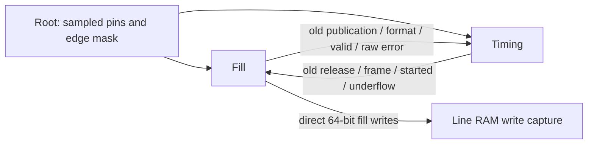

# Display cycle components

The `hardware::display_cycle` module provides edge-driven Rust mirrors of the production
`DisplayLineBuffer`, logic-domain fill/Device3, pixel timing control and the source/color
read calendar. It owns no root clock,
backing memory, MC, or device callbacks.
The existing functional Display and Verilog-only hardware wrapper retain their behavior.

## Line RAM

`LineBuffer::clock(Edges, &LineBufferInput)` commits one scheduler instant. Logic rises write
both 32-bit banks from one 64-bit beat; pixel rises register independent read addresses.
Coincident reads observe the old array before the write. Addresses truncate to nine bits.
With no pixel rise, Q holds even if addresses or storage change. Repeated `outputs()` and
passive `peek()` calls have no side effects.

There are two 512-word banks. Q starts at zero. Only cells 416..511 are initialized from the
same authoritative precode packing functions and linear-color table used by the RTL exporter.
Data cells 0..399 and unused cells 400..415 start unknown in this behavioral model. The numeric
placeholder in an unknown `RamWord` is not a defined read value. There is no RAM reset port;
a Display reset does not clear storage or regenerate the tables.

`RamWord::known` records behavioral definedness. The read-address sidebands
`read_address_known` and `read_address_tainted` default to `[true; 2]` and `[false; 2]`;
ordinary calls retain their original meaning. An unknown address produces unknown Q,
even when its numeric placeholder indexes an initialized table cell. `collision` marks
a same-address write/read on coincident edges, a possible collision at an unknown address,
or taint propagated through the address. Numeric values still describe behavioral old Q. The flag does not promise a silicon read-during-write value.
A valid consumer must independently exclude unknown or collision-tainted effective operands.
These diagnostics do not stall reads, alter publication, or provide a whole-Display safety claim.

## Bounded qualification

`tests/display_cycle_ram.rs` compares each registered read against the production
`DisplayLineBuffer::verilog_source()`, including unknown values, all table addresses, Q holds,
two relative clock phases, and simultaneous read/write edges. Test copies with a wrong bank
write and a combinational read replace the real DUT behavior; both must fail at a RAM-Q oracle.
Each external process has a 30-second watchdog and the fixture has a 4096-row cap.
Commands, observed outputs, coverage, and Git object hashes are written under
`target/display-cycle-ram`.

```powershell
& scripts/run-cargo.ps1 -Subcommand test -Label display-cycle-ram -CargoArgs @(
  '-p','cpu-v3-tang-nano-20k','--test','display_cycle_ram',
  '--','--include-ignored','--nocapture','--test-threads=1')
```

This qualifies behavioral RAM port ordering. It does not qualify the complete Display,
physical CDC/metastability, collision consumption safety, TMDS, or system memory competition.

## Logic-domain fill and Device3

`Fill::outputs(&FillInput)` reads old state without side effects;
`Fill::clock(&FillInput)` commits exactly one logic rise. The root must pre-sample
MC, device and pixel feedback before committing any coincident owner. Pixel feedback
is `released`, `frame_toggle`, `pixel_underflow` and `pixel_started`; this leaf
does not advance that consumer or an MC.

Outputs include the fixed read request/address, direct 64-bit line-RAM write,
publication/format/valid metadata, Device3 read data and health/start/frame events.
Addresses are 22-bit 16-bit-word addresses. One request is 32 bytes/four 64-bit beats.
The root ties Display response-ready high as in the production composition.
Before the first applied NEXT_SWAP, two-row groups are virtual black markers with no
DRAM requests or data writes. A group is reused only after release crosses two logic
synchronizer stages. A complete real two-row group requires 50 segments.

Fill uses the production Column16 tile/pair traversal, exact LAST/error handling,
sticky error state, frame-complete gate, shadow descriptor checks and staged format.
Its address limit is `0x3e7000`, based on the physical plane span rather than only
the live-pixel payload. Same-edge frame handling applies the old pending descriptor;
a new MMIO NEXT_SWAP remains pending for the next eligible frame event.
Runtime reset preserves the unreset release/started synchronizers and RAM storage,
matching the RTL; it clears the logic registers that have explicit reset assignments.

`tests/display_cycle_fill.rs` uses the unmodified production pixel timing/ownership
domain as a controlled consumer, with exact 54/33.3-MHz edge ratio and two pixel phases.
At each logic edge, before production NBA commits, it compares the boundary ports;
run-length encoding compresses the recording, never skips emulated edges.
All 400 data addresses in both RAM banks are checked at termination.
Cases cover a complete real frame, retained single group, exhausted prefills/underflow,
beat errors, malformed LAST, reset to black startup and terminal error without valid.
DUT copies shorten the release CDC, reverse frame/MMIO assignment priority, or ignore
memory error. A port divergence is required; a mutant timeout alone is not a detection.

Each process has a 90-second watchdog; each case has 4-frame/4000000-logic-edge limits
and the trace has a 150000-row cap. Sources, traces and exact commands remain under
`target/display-cycle-fill`.

```powershell
& scripts/run-cargo.ps1 -Subcommand test -Label display-cycle-fill -CargoArgs @(
  '-p','cpu-v3-tang-nano-20k','--test','display_cycle_fill',
  '--','--include-ignored','--nocapture','--test-threads=1')
```

This qualifies the logic-domain leaf with a real RTL consumer and controlled memory
response peer. It does not qualify a Rust pixel consumer, color/TMDS conversion,
native MC competition, actual bootloader-end equivalence, or a complete system.
## Pixel timing and Display control cone

`Timing` owns the production pixel-domain counters, ownership and crossings.
Its inputs are reset/lock/boot flags and old logic-domain publication/format/valid
metadata plus the raw sticky memory error. Its outputs include raw H/V timing,
release/frame/started/underflow feedback, line readiness/format and diagnostic
synchronizer registers. These are control signals, not converted pixel colors.

The pixel reset uses the old third synchronizer bit. Publication, enable/failure
and reset chains advance independently of the reset branch. Timing starts only
at a complete frame origin after both groups are available; real content has a
separate two-real-group gate. Readiness and format latch at H=0 for the whole row.
Two vertical repeats and the second source row complete a group release.
Underflow is sticky; it does not itself enter the failure synchronizer.
The failure input is `boot_failed | memory_error_sticky`, with two pixel stages.
`startup_error` also contains synchronized underflow and is a different signal.

`DisplayControl` combines Fill, Timing and captured RAM writes. `ControlInput`
contains external boot/lock/reset, MC and Device3 pins; `outputs()` is pure.
`clock(Edges, &ControlInput)` samples both domains before committing either.
A simultaneous logic/pixel rise therefore sees old publication, release and raw
memory error even if a logic error becomes sticky at that instant.
The raw getter is read-only and creates no second error latch.



The root owns time, MC progression and backing. This component clocks its RAM
write side; scanout color reads, the source/R/G/B calendar and TMDS are outside
the control-cone implementation. `line_word()` is a passive diagnostic of
captured writes. The separate LineBuffer read API and its old-Q contract remain
available independently.

## Timing qualification and replay provenance

`tests/display_cycle_timing.rs` runs fresh production RTL for 1200 pixel edges
at two phases and compares every logic/pixel event, including counters and all
crossing registers. Real DUT copies release pixel reset early, shorten publication
CDC, or feed a raw error pin on a coincident edge instead of the old sticky flag;
all must be rejected. A second short fixture extracts the production failure
crossing always block verbatim: boot/raw error delays and exclusion of an
underflow-only input are checked, and actually OR-ing underflow into that DUT
must fail. External processes have a 30-second watchdog.

The eight qualified Fill pin tapes are independent RTL evidence captured before
Timing was implemented. The replay importer validates their manifests and any
sealed SHA256s, copies only required inputs to this tree's target and records new
bindings without writing the source directory. Current generated production RTL
and RAM source must equal the saved sources; imported blob hashes are checked.
Replay starts from declaration cold state, applies pins at their original logic
falling edges and executes every logic/pixel rise, including coincidences.
No warm state or checkpoint is injected. Ports, all returned pixel feedback and
RAM contents are compared, with the original 4000000-logic-edge cap per tape.

From the legal underflow prefix, a bounded continuation keeps the real 54/33.3
clock ratio: underflow-only leaves failure_sync clear, boot failure enters after
two pixel stages, and a terminal error for an accepted pending request becomes
sticky on a coincident logic/pixel rise while the pixel still samples the old
flag. These are controlled feedback assertions, not additional full-system RTL.

Run the qualified Fill producer first if its evidence bundle is unavailable,
then point the explicit replay test at that bundle. Python 3.10+ is needed for
hash-checked import:

```powershell
$env:DISPLAY_CYCLE_FILL_EVIDENCE = '<qualified-fill-tree>/target/display-cycle-fill'
& scripts/run-cargo.ps1 -Subcommand test -Label display-cycle-timing -CargoArgs @(
  '-p','cpu-v3-tang-nano-20k','--test','display_cycle_timing',
  '--','--include-ignored','--nocapture','--test-threads=1')
```

The artifacts live under `target/display-cycle-timing`. This is a digital
control-cone qualification with controlled memory responses. It does not establish
color/TMDS output, native shared-MC contention, full-peripheral coverage,
bootloader-end equivalence or silicon/PVT behavior.

## Source and color read calendar

`PixelRead` consumes old `PixelReadInput` Timing signals and old registered RAM Q.
It owns no H/V counter, synchronizer, row-readiness latch, RAM, or MC. `outputs()` is
pure; `clock()` commits one pixel rise. Both RAM read ports clock on every pixel
rise, including blanking and unused lookahead. There is no read-enable port.

The caller evaluates `PixelRead::outputs` before committing either the calendar or
RAM, forwards its addresses/knownness/taint to the same `LineBuffer`, and commits both
from the old snapshot. The address base is `slot*200 + second*100`. Source pairs alternate
bank A/B at each issue; their address advances every two pairs. Red/blue linear indices
replicate the original five-bit MSB: `(q<<1)|(q>>4)`. Encoded red/blue use cells 416..447;
linear RGB use low-nine-bit codes in 448..511, while encoded green uses their high-nine-bit codes.
No immediate color conversion bypasses these physical read ports.

| Old phase | RAM address | Calendar capture at this rise |
| --- | --- | --- |
| 0 | Source qword | Lock source bank and advance pair cursor when issuing; consume old B Q when emitting |
| 1 | Red lookup from old selected source Q | Capture that source Q in raw-pair |
| 2 | Green lookup from raw-pair | Capture old red Q |
| 3 | Blue lookup from raw-pair | Capture old green Q |

The first source issue is four pixel rises before the active window. At its completion,
red/green registers and old blue Q form one completed pair; its first pixel bypasses the
holding register. Phases 0/1 select the first pixel and 2/3 the second. Final source issue
is at `active_end-8`, final completion at `active_end-4`; raw/R/G captures are guarded
at and after the latter. Default reads can subsequently reach unused cell 400 and produce
unknown lookup indices. Such unused reads do not invalidate the completed output pair.

Power-up initializes calendar data registers to zero. Pixel reset and H=0 clear only phase
and fetch cursor: bank/raw/R/G/completed-pair retain their values and provenance. Unknownness
and collision origin follow raw words, lookup addresses, codes and pair holding state;
lookup in a known ROM cell cannot remove address taint. These flags are diagnostics and do
not change scheduling. This component exposes selected precodes, not a registered visible
RGB/sync or TMDS output. Timing ownership/deadline safety remains a separate contract.

`tests/display_cycle_pixels.rs` projects the actual production declaration/address/capture
body into a leaf with controlled Timing boundary inputs and the production line RAM. It
retains source hashes, generated RTL, vectors, observations, commands and first differences
under `target/display-cycle-pixels/c1-v2`. Bounds are 32768 total fixture instants and a
30-second external-process watchdog. Complete rows cover both formats, both source banks,
horizontal repeats and repeated source rows, first/last pairs, unused unknown lookahead and reset at each
phase. An independent absolute-coordinate RGB oracle checks defined source pixels.
A deliberate collision-poison profile checks propagation to the four affected output
samples, rather than claiming that the controlled producer satisfies ownership safety.
Real DUT copies reverse the source bank, skip old RAM Q, change the repeat phase, use the
wrong packed green code, or clear a retained register; each must produce a finite port/data
divergence. No full-machine checkpoint, native MC traffic, pixel/sync register pipeline,
or digital/serialized TMDS qualification is implied.
