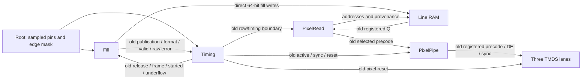

# Display cycle components

The `hardware::display_cycle` module provides edge-driven Rust mirrors of the production
`DisplayLineBuffer`, logic-domain fill/Device3, pixel timing control and the source/color
read calendar/pixel register stage and three digital TMDS encoders. It owns no root clock,
backing memory, MC, or device callbacks.
The existing functional Display and Verilog-only hardware wrapper retain their behavior.

## Line RAM

`LineBuffer::clock(Edges, &LineBufferInput)` commits one scheduler instant. Logic rises write
both 32-bit banks from one 64-bit beat; pixel rises register independent read addresses.
Coincident reads observe the old array before the write. Addresses truncate to nine bits.
With no pixel rise, Q holds even if addresses or storage change. Repeated `outputs()` and
passive `peek()` calls have no side effects.

There are two 512-word banks. Q starts at zero. Only cells 416..511 are initialized from the
same authoritative precode packing functions and linear-color table used by the RTL exporter.
Data cells 0..399 and unused cells 400..415 start unknown in this behavioral model. The numeric
placeholder in an unknown `RamWord` is not a defined read value. There is no RAM reset port;
a Display reset does not clear storage or regenerate the tables.

`RamWord::known` records behavioral definedness. The read-address sidebands
`read_address_known` and `read_address_tainted` default to `[true; 2]` and `[false; 2]`;
ordinary calls retain their original meaning. An unknown address produces unknown Q,
even when its numeric placeholder indexes an initialized table cell. `collision` marks
a same-address write/read on coincident edges, a possible collision at an unknown address,
or taint propagated through the address. Numeric values still describe behavioral old Q. The flag does not promise a silicon read-during-write value.
A valid consumer must independently exclude unknown or collision-tainted effective operands.
These diagnostics do not stall reads, alter publication, or provide a whole-Display safety claim.

## Bounded qualification

`tests/display/display_cycle_ram.rs` compares each registered read against the production
`DisplayLineBuffer::verilog_source()`, including unknown values, all table addresses, Q holds,
two relative clock phases, and simultaneous read/write edges. Test copies with a wrong bank
write and a combinational read replace the real DUT behavior; both must fail at a RAM-Q oracle.
Each external process has a 30-second watchdog and the fixture has a 4096-row cap.
Commands, observed outputs, coverage, and Git object hashes are written under
`target/display-cycle-ram`.

```powershell
& scripts/run-cargo.ps1 -Subcommand test -Label display-cycle-ram -CargoArgs @(
  '-p','cpu-v3-tang-nano-20k','--test','display_cycle_ram',
  '--','--include-ignored','--nocapture','--test-threads=1')
```

This qualifies behavioral RAM port ordering. It does not qualify the complete Display,
physical CDC/metastability, collision consumption safety, TMDS, or system memory competition.

## Logic-domain fill and Device3

`Fill::outputs(&FillInput)` reads old state without side effects;
`Fill::clock(&FillInput)` commits exactly one logic rise. The root must pre-sample
MC, device and pixel feedback before committing any coincident owner. Pixel feedback
is `released`, `frame_toggle`, `pixel_underflow` and `pixel_started`; this leaf
does not advance that consumer or an MC.

Outputs include the fixed read request/address, direct 64-bit line-RAM write,
publication/format/valid metadata, Device3 read data and health/start/frame events.
Addresses are 22-bit 16-bit-word addresses. One request is 32 bytes/four 64-bit beats.
The root ties Display response-ready high as in the production composition.
Before the first applied NEXT_SWAP, two-row groups are virtual black markers with no
DRAM requests or data writes. A group is reused only after release crosses two logic
synchronizer stages. A complete real two-row group requires 50 segments.

Fill uses the production Column16 tile/pair traversal, exact LAST/error handling,
sticky error state, frame-complete gate, shadow descriptor checks and staged format.
Its address limit is `0x3e7000`, based on the physical plane span rather than only
the live-pixel payload. Same-edge frame handling applies the old pending descriptor;
a new MMIO NEXT_SWAP remains pending for the next eligible frame event.
Runtime reset preserves the unreset release/started synchronizers and RAM storage,
matching the RTL; it clears the logic registers that have explicit reset assignments.

`tests/display/display_cycle_fill.rs` uses the unmodified production pixel timing/ownership
domain as a controlled consumer, with exact 54/33.3-MHz edge ratio and two pixel phases.
At each logic edge, before production NBA commits, it compares the boundary ports;
run-length encoding compresses the recording, never skips emulated edges.
All 400 data addresses in both RAM banks are checked at termination.
Cases cover a complete real frame, retained single group, exhausted prefills/underflow,
beat errors, malformed LAST, reset to black startup and terminal error without valid.
DUT copies shorten the release CDC, reverse frame/MMIO assignment priority, or ignore
memory error. A port divergence is required; a mutant timeout alone is not a detection.

Each process has a 90-second watchdog; each case has 4-frame/4000000-logic-edge limits
and the trace has a 150000-row cap. Sources, traces and exact commands remain in
the fresh directory printed by the test under the selected output root.

```powershell
& scripts/run-cargo.ps1 -Subcommand test -Label display-cycle-fill -CargoArgs @(
  '-p','cpu-v3-tang-nano-20k','--test','display_cycle_fill',
  '--','--include-ignored','--nocapture','--test-threads=1')
```

This qualifies the logic-domain leaf with a real RTL consumer and controlled memory
response peer. It does not qualify a Rust pixel consumer, color/TMDS conversion,
native MC competition, actual bootloader-end equivalence, or a complete system.
## Pixel timing and Display control cone

`Timing` owns the production pixel-domain counters, ownership and crossings.
Its inputs are reset/lock/boot flags and old logic-domain publication/format/valid
metadata plus the raw sticky memory error. Its outputs include raw H/V timing,
release/frame/started/underflow feedback, line readiness/format and diagnostic
synchronizer registers. These are control signals, not converted pixel colors.

The pixel reset uses the old third synchronizer bit. Publication, enable/failure
and reset chains advance independently of the reset branch. Timing starts only
at a complete frame origin after both groups are available; real content has a
separate two-real-group gate. Readiness and format latch at H=0 for the whole row.
Two vertical repeats and the second source row complete a group release.
Underflow is sticky; it does not itself enter the failure synchronizer.
The failure input is `boot_failed | memory_error_sticky`, with two pixel stages.
`startup_error` also contains synchronized underflow and is a different signal.

`DisplayControl` combines Fill, Timing, one line RAM, the read calendar and pixel register stage. `ControlInput`
contains external boot/lock/reset, MC and Device3 pins; `outputs()` is pure.
`clock(Edges, &ControlInput)` samples both domains before committing either.
A simultaneous logic/pixel rise therefore sees old publication, release and raw
memory error even if a logic error becomes sticky at that instant.
The raw getter is read-only and creates no second error latch.



The root owns time, MC progression and backing. Both RAM ports now clock from the
same instant's old Fill/Timing/read-cone snapshot. `line_word()` passively observes
storage; `line_read_q()` and `read_ports()` expose registered Q and current addresses
without advancing them. `.logic` and `.pixel` retain their control contracts;
`.video` is the current registered precode/RGB/sync observation; `.tmds` is the three-lane registered symbol/disparity observation.

## Timing qualification and replay provenance

`tests/display/display_cycle_timing.rs` runs fresh production RTL for 1200 pixel edges
at two phases and compares every logic/pixel event, including counters and all
crossing registers. Real DUT copies release pixel reset early, shorten publication
CDC, or feed a raw error pin on a coincident edge instead of the old sticky flag;
all must be rejected. A second short fixture extracts the production failure
crossing always block verbatim: boot/raw error delays and exclusion of an
underflow-only input are checked, and actually OR-ing underflow into that DUT
must fail. External processes have a 30-second watchdog.

The cold-control replay first generates its eight Fill pin tapes from the tracked
production RTL and single tracked Fill testbench. Fill and Timing tests share the
same bounded generator and per-edge Fill oracle; the Timing replay then compares
its own model against the resulting RTL pins and RAM. Generation must pass all
eight original cases, including both clock phases, memory errors and underflow.
Current generated production RTL and RAM sources are checked, and input blob
hashes are recorded. No historical target, imported tape or manual copy is needed.
Replay starts from declaration cold state, applies pins at their original logic
falling edges and executes every logic/pixel rise, including coincidences.
No warm state or checkpoint is injected. Ports, all returned pixel feedback and
RAM contents are compared, with the original 4000000-logic-edge cap per tape.

From the legal underflow prefix, a bounded continuation keeps the real 54/33.3
clock ratio: underflow-only leaves failure_sync clear, boot failure enters after
two pixel stages, and a terminal error for an accepted pending request becomes
sticky on a coincident logic/pixel rise while the pixel still samples the old
flag. These are controlled feedback assertions, not additional full-system RTL.

With Icarus installed (`IVERILOG_EXE` and `VVP_EXE` may select the binaries), run
the producer and replay together:

```powershell
Remove-Item Env:DISPLAY_CYCLE_FILL_EVIDENCE -ErrorAction SilentlyContinue
& scripts/run-cargo.ps1 -Subcommand test -Label display-cycle-timing -CargoArgs @(
  '-p','cpu-v3-tang-nano-20k','--test','display_cycle_timing',
  '--','--include-ignored','--nocapture','--test-threads=1')
```

Each test prints its fresh artifact directory under `target` (or
`DISPLAY_CYCLE_OUTPUT_ROOT`). Cold-control artifacts contain `producer/`,
`fresh-inputs.json` and `replay-manifest.json`. This is a digital
control-cone qualification with controlled memory responses. It does not establish
color/TMDS output, native shared-MC contention, full-peripheral coverage,
bootloader-end equivalence or silicon/PVT behavior.

## Source and color read calendar

`PixelRead` consumes old `PixelReadInput` Timing signals and old registered RAM Q.
It owns no H/V counter, synchronizer, row-readiness latch, RAM, or MC. `outputs()` is
pure; `clock()` commits one pixel rise. Both RAM read ports clock on every pixel
rise, including blanking and unused lookahead. There is no read-enable port.

The caller evaluates `PixelRead::outputs` before committing either the calendar or
RAM, forwards its addresses/knownness/taint to the same `LineBuffer`, and commits both
from the old snapshot. The address base is `slot*200 + second*100`. Source pairs alternate
bank A/B at each issue; their address advances every two pairs. Red/blue linear indices
replicate the original five-bit MSB: `(q<<1)|(q>>4)`. Encoded red/blue use cells 416..447;
linear RGB use low-nine-bit codes in 448..511, while encoded green uses their high-nine-bit codes.
No immediate color conversion bypasses these physical read ports.

| Old phase | RAM address | Calendar capture at this rise |
| --- | --- | --- |
| 0 | Source qword | Lock source bank and advance pair cursor when issuing; consume old B Q when emitting |
| 1 | Red lookup from old selected source Q | Capture that source Q in raw-pair |
| 2 | Green lookup from raw-pair | Capture old red Q |
| 3 | Blue lookup from raw-pair | Capture old green Q |

The first source issue is four pixel rises before the active window. At its completion,
red/green registers and old blue Q form one completed pair; its first pixel bypasses the
holding register. Phases 0/1 select the first pixel and 2/3 the second. Final source issue
is at `active_end-8`, final completion at `active_end-4`; raw/R/G captures are guarded
at and after the latter. Default reads can subsequently reach unused cell 400 and produce
unknown lookup indices. Such unused reads do not invalidate the completed output pair.

Power-up initializes calendar data registers to zero. Pixel reset and H=0 clear only phase
and fetch cursor: bank/raw/R/G/completed-pair retain their values and provenance. Unknownness
and collision origin follow raw words, lookup addresses, codes and pair holding state;
lookup in a known ROM cell cannot remove address taint. These flags are diagnostics and do
not change scheduling. This component exposes selected precodes, not a registered visible
RGB/sync or TMDS output. Timing ownership/deadline safety remains a separate contract.

The integrated bounded pixel qualification below retains the actual production
read-cone projection, independent coordinate/color checks, both banks/formats,
unused X lookahead, reset retention and finite read-cone DUT mutations. Its deliberate
collision profile tests propagation/diagnostic visibility, not collision-free ownership
safety. Timing ownership and native memory service remain separate contracts.

## Registered pixel and sync stage

`PixelPipe` consumes the old `TimingOutput` and old `PixelReadOutput::selected` on
one pixel rise. The Timing-to-read adapter maps the existing slot/row/format/ready
signals; enabled is `started && !(failure_sync & 2)`. It owns no new timing counter,
row latch, storage, memory peer or root clock. RGB888 is a pure inverse of the
nine-bit channel precodes, not a second color pipeline or immediate framebuffer read.
The precode channel metadata defines whether its numeric RGB placeholder is usable.

Registered DE is the raw active window, independently of enabled/valid/readiness.
The framebuffer-region flag is enabled && scan_valid && active in the fixed profile;
it also omits line readiness. Only enabled && active && scan_valid && scan_line_ready
selects a real source precode. Otherwise the registered color is known black, including
active black before startup or during an unavailable row. `effective_source` records
that selection predicate for diagnostics and never changes control behavior.
HS/VS follow the raw old Timing syncs. Pixel reset restores black and clears these
flags/syncs; it does not reset retained read-cone registers or RAM storage.

At a coincident logic/pixel instant `DisplayControl` captures old Fill ports, old
Timing, old RAM Q, old read outputs and old registered video before any commit. The pipe, read calendar,
Timing, Fill and RAM commit once from that snapshot. The TMDS encoders
consume the old `.video` at that instant; post-edge `.video` belongs to the following
encoder input stage. Post-edge `.tmds` therefore represents the previous pipe stage.
No serializer is implemented by this component.

The pixel fixture adds actual production precode/visible/framebuffer/HS/VS registers
to the source/read projection and compares 40 pre/post-edge fields. Four physical
source rows repeat at successive V coordinates, both formats have an independent
absolute-coordinate pattern/color oracle, and first/last samples, reset phases,
active black, invalid/unready rows and V/H blanking are included. Collision poison
propagates through registered codes and RGB while black/control outputs remain known.
Real DUT copies additionally gate DE with readiness, advance HS, remove the first-pair
bypass or retain color through blanking; all must fail at a finite first difference.
Artifacts are under `target/display-cycle-pixels/c2-v3`, with the 32768-instant and
30-second per-process limits. The ordinary cold Control test checks old-Timing
DE/sync and known black over 40000 pixel rises with real coincident edge instants.

A separate fresh production Display-only test uses the existing bounded Fill peer
from declaration cold state. Fixed H/V windows on the first two active rows include
pre/postroll and startup black, without selecting samples by pixel value/readiness.
The new pin tape is replayed through actual Rust `DisplayControl`, checking old
registered precodes, decoded RGB, DE/framebuffer/HS/VS at the same absolute pixel
instants as the real RTL, plus every prior logic edge/feedback and final RAM cells.
It has four-frame/4000000-logic-edge and 90-second process caps; no warm state is
injected. Data travels through MC response pins, Fill and the sole line RAM.
Artifacts are under `target/display-cycle-pipeline-cold-v2` for the pixel checkpoint; the extended
TMDS fixture prints its fresh `display-cycle-pipeline-cold-*` directory under the
selected output root. This is a controlled
response peer, not the native MC/root assembly or functional GPU/framebuffer shortcut.

The eight generated Fill cases qualify the control contracts without video fields;
they do not provide additional color evidence. Historical pre-candidate tapes remain
optional source-bound evidence. The newly captured video window provides
that direct composition evidence. The original pixel-only observations do not qualify TMDS or physical CDC;
the extended digital-symbol observations are described below.

## Digital TMDS symbols

`Tmds::clock(&TmdsInput)` commits one pixel rise; `outputs()` is pure. Logical lane
order is R/G/B, matching `ColorPrecode`. Control supplies the old pixel reset and
old registered video before advancing any owner. All lanes use old DE and their
own old disparity; blue uses control `(VS<<1)|HS`, while red/green use 00. Raw active
black is still DE=1 and is encoded as pixel data. Physical pin/serializer ordering
is separate from this logical lane order.

Reset is synchronous (`always @(posedge clk)`), with reset before blank/data.
There is no asynchronous setter or reset edge in the model. Each RTL symbol register
has no initializer: its numeric placeholder starts undefined; each signed6 disparity
register starts at known zero. Known reset writes symbol 0x354/d=0. With reset known
false and DE known false, disparity becomes zero and control00/01/10/11 selects
0x354/0x0ab/0x154/0x2ab. Neither reset nor blank consumes color data.

The active profile uses nine-bit precodes. The production 13-bit optimization is not
qualified here. For qm=precode[8:0], popcount n of qm[7:0] has four bits and
`delta=$signed({1'b0,n,1'b0})-6'sd8` is assigned to signed6.

| Old condition | Symbol | New signed disparity |
| --- | --- | --- |
| d=0 or n=4 | {~qm8,qm8,qm8?qm[7:0]:~qm[7:0]} | qm8 ? d+delta : d-delta |
| (d>0 and n>4) or (d<0 and n<4) | {1,qm8,~qm[7:0]} | d-delta+(qm8?2:0) |
| Otherwise | {0,qm8,qm[7:0]} | d+delta-(qm8?0:2) |

The first branch is a six-bit add/sub assignment. The other two expressions widen
to signed32 through the unsized decimal zero, including their nested add/subtract,
then truncate on assignment to signed6. The Rust model uses wide signed arithmetic
and final six-bit truncation/sign extension, which preserves these results. It does
not use unsigned comparisons or saturation. From d=0, updates remain even; the
branch ranges keep valid d within [-8,8], so signed6 overflow boundaries are not
naturally reached and are not claimed as forced-state coverage.

### Definedness and collision origin

`TmdsInput` explicitly represents unknown reset/DE/HS/VS with `Option<bool>`.
`TmdsLaneOutput` carries numeric symbol, symbol_defined, disparity,
disparity_defined and tainted per lane. Definedness is the guaranteed integer-model
contract, not a full Verilog four-state bit mask. Numeric equivalence tests require
concrete valid inputs and compare every bit/state, including the actual initial all-X
symbol and known reset recovery. Invalid-input tests are diagnostic rejection tests;
they do not become numeric passes by enlarging a mask.

- Known reset true overrides even unknown DE/control/color and restores all lanes.
- Unknown reset, or unknown DE with reset known false, makes every lane's symbol and
  disparity undefined. A low DE with unknown reset does not restore trust.
- Only reset known false plus DE known false takes the blank recovery path. All
  disparities become known zero and collision origin clears. Unknown HS/VS affects
  only blue's current control symbol; red/green remain known 00 symbols.
- Known active with an unknown precode invalidates that lane only. Undefined
  disparity history stays undefined on later active data until known blank/reset.
  A collision tag preserves the behavioral numeric old-data result but accumulates
  in that lane's history until blank/reset. HS/VS are ignored while active.

These flags never stall a clock, alter DE, change ownership or issue memory work.
An effective consumer must reject undefined or collision-tainted symbols. Verilog
`if` with unknown operands can produce known or partly known bits; an undefined
integer-model result does not assert that every corresponding RTL bit is X.

### Bounded symbol qualification

`tests/display/display_cycle_tmds.rs` extracts the actual production encoder and three lane
connections. A registered controlled producer uses C2's old-pipe boundary; an
independent `DisplayTmdsReference` recomputes precodes/running disparity from original
RGB bytes. A settle event initializes the reference combinational producer before
any clock; it does not initialize the DUT symbol. Tests compare pre/post symbols,
disparities and sampled old inputs. All 256 byte values per lane, both qm8 values,
positive/zero/negative d, n=4 and all three branches occur from natural legal prefixes.
DUT coverage records each count and observed d range; no internal disparity is forced.
Real DUT copies initialize the symbol, use asynchronous reset, reverse reset priority,
retain blank disparity, alter qm8/delta/signed comparison, swap blue sync or R/B,
or consume new precode/DE. Each must fail at a finite symbol/state/interface oracle;
timeout is not detection. Bounds are 32768 instants, 200000ns and 30 seconds/process.

The extended fresh Display-only cold fixture records actual three-lane symbols and
disparities at the same absolute instants as the pixel windows, while Rust Control
executes every earlier and intervening logic/pixel edge. New production/RAM sources,
pin tape and old video observations are byte-equal to the independently preserved
pixel checkpoint anchors; the new symbol observations are separate C3 evidence.
The four-frame/4000000-logic-edge/90-second bounds remain. This qualifies a digital
Display cone with a controlled memory peer, not native shared MC, a whole frame of
checked symbols, serializer/electrical/PLL/physical CDC or board behavior.

### Replay input and output storage

`DISPLAY_CYCLE_OUTPUT_ROOT` selects the fixture artifact root; the default is this
tree's `target`. Every Fill, Timing and TMDS RTL invocation creates its own directory with a
process ID and nonce, so parallel tests cannot overwrite one another's sources or
traces. Cold-control replay always generates its inputs in that fresh directory;
`DISPLAY_CYCLE_FILL_EVIDENCE` does not select normal regression inputs.

For explicit historical evidence maintenance, the optional Python 3.10+ tool
`tests/display_cycle_timing_import.py --source <bundle> --out <new-directory>`
validates source manifests, binding hashes and case lists and records provenance.
It is separate from normal qualification. Keep preserved checkpoint materials
separate from regenerable test outputs and build caches.
