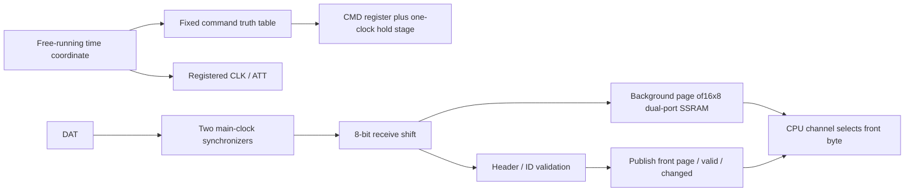
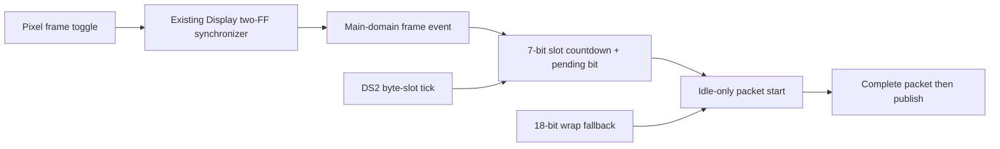

# DualShock 2 input

Device5 is a fixed-schedule autonomous receiver. Hardware polls, enters analog
mode and recovers after disconnect without CPU service. CPU reads only the
latest complete input through `rcc/dualshock2.rs`; it never starts, consumes or
aborts a serial transaction. This snapshot ABI is incompatible with the earlier
packet/byte engines and requires matching gateware and application software.

## Device5 and final storage

| Channel | RECV | SEND |
|---|---|---|
|0,1|left X, left Y, one raw byte in low8|Ignored|
|2,3|reply ID, marker5A|Ignored|
|4,5|active-low button byte0, byte1|Ignored|
|6,7|right X, right Y|Ignored|
|8,13..15|bit0 valid, bit1 sticky read-changed; other bits zero|Begin a snapshot read: clear read-changed; data ignored|
|9,10,11|Background page bytes at addresses1,2,3: failed prefix, ID, marker|Begin a snapshot read; diagnostic readers use RECV only|
|12|Live wire monitor, layout below|Begin a snapshot read; diagnostic readers use RECV only|

Unselected devices read zero. RECV/watch is side-effect free; raw-byte upper8
bits and reserved status bits are zero. Sample bytes are unspecified while invalid. Low-channel SEND has no
effect. A high-channel SEND cannot change acquisition or connection state.

The receiver stores wire bytes1..8 (ID, marker, buttons and four axes) directly
into a16x8 distributed RAM: two independent-address RAM16SDP4 cells,128 bits,
no BSRAM or DSP. Write address is `{!front, serial_slot[2:0]}`; read address is
`{front ^ device_channel[3], device_channel[2:0]}` (high diagnostic channels
select the background page; ordinary input always selects front). Wire bytes1..8 occupy channels2,3,4,5,6,7,0,1.
There is no byte-pair register, CPU cursor, snapshot copy or dynamic arbitration.
The complete79 tail is clocked but pressure bytes are not retained.

Success switches pages and sets valid only after the complete transaction.
Bad headers or unknown IDs invalidate the last sample without publishing the
partly written page. CPU reading never prevents writes to the background page.
Successful configuration commands retain the previous input without publishing
configuration data. A poll reporting F3 invalidates input and schedules exit.

## Failed-wire diagnostics without extra storage

The existing background page also receives the first three bytes of every
transaction. For a valid input poll, slot9 later overwrites the temporary
prefix at address1 with LY before page publication. F3 polls and configuration
commands retain only the three header bytes, and never publish input. Bad
headers terminate after three bytes, leaving raw prefix/ID/marker at background
addresses1/2/3. This adds no header FFs, memory blocks or receive queue.

Channels9..11 expose those addresses. They are diagnostic observations, not
coherent input: while valid they may belong to an old packet, and during ATT
low they may be partly updated. A reader wanting the last failure first checks
invalid status, ATT high and slot>=3, reads all three, then checks invalid,
ATT high and the same slot again. This is best effort without a version counter;
a long CPU stall can miss packets. It must never promote raw diagnostic bytes
to the normal connected input state.

Channel12 directly selects existing wire state, adding no monitor registers:

| Bits | Meaning |
|---|---|
|15..11|Current byte slot0..31|
|10..5|Half-period phase0..63|
|4..3|Operation:0 poll,1 enter43,2 mode44,3 exit43|
|2|Current cumulative FF/ID/5A header-good predicate|
|1|Two-FF synchronized DAT level|
|0|ATT pin;1 means no active transaction|

The monitor changes with wire progress. It is not a latched failure record;
operation may already describe the next command when ATT is high. Diagnostic
reads do not acknowledge `read_changed`, stall sampling or alter serial pins.

## Fixed main-clock schedule

All state uses the54MHz main clock, with no derived internal clock. An18-bit
time coordinate supplies low7 divider bits, six half-period phases and
five byte slots. CPU timers, sleep, watch, cache stalls and stopped retirement
cannot change serial progress. Simulation can reduce `DIV_BITS` to at least2;
production uses7 and has no runtime divider programming.

| Boundary | Action |
|---|---|
|Counter zero / slot0, unless a near-frame poll is pending|Assert ATT and clear header predicates; setup slot|
|Slots1..N, phases0,2,..14|Register the next command bit; output stage follows one main clock later|
|Odd phases1,3,..15|Registered CLK low; controller drives DAT|
|Even phases2,4,..16|Sample synchronized DAT before registered CLK rises; last bit completes the received byte|
|Byte completion, header slots1..3 and input poll slots4..9|Write received8 directly to background RAM; F3/config keeps only header|
|Remaining byte-slot phases|CLK high; no receive work|
|Last slot, phase32|Release ATT, validate/publish or advance configuration step|
|Next18-bit wrap|Start fallback transaction, independent of CPU|

Half-period is128 main clocks (2.3703704us), SCLK210.9375kHz. The final rise
of a byte to the next first fall is49 half-periods (116.1481us). CMD has127 main
clocks of setup before a fall and at least one main clock of hold after a rise.
CLK, CMD and ATT are registered outputs; DAT uses two preserved synchronizers.
The last receive bit is included in the RAM write on that same edge.

Poll42 sends9 bytes, including digital41; pressure79 sends21. Entry43 sends5,
analog+lock44 and exit43 each send9. Unknown IDs and bad FF/5A headers release
after3 bytes. Fallback polling period is262144 clocks (4.854519ms). The last phase32
release is77824 clocks for9 bytes and176128 clocks for21 bytes, measured from
ATT assertion; these are transaction lengths, not the fixed polling period.
There is no ACK handshake. Longer guard/slower SCLK still require board testing
with the actual controller/adapter; local RTL tests are not electrical evidence.

Hardware starts with poll. Good digital41 schedules entry43(arg1), mode44
(arg1,lock03), exit43(arg0,5A fill), then poll. Analog73/79 stays in poll; F3
poll schedules exit. Bad configuration/header returns to poll. Digital-only
controllers continue reporting buttons while hardware retries configuration.
Recognized IDs are exact41,73,79,F3; other IDs are unsupported. No4F pressure
configuration or4D vibration configuration is sent.

## Display phase scheduling

The Display exports its existing main-clock pulse `frame_sync != frame_seen`,
after the pixel-domain toggle crosses two synchronizing FFs. The event occurs
at the end of the final visible line, before present can complete its old-read
drain; it is not the end of vertical blank. Display ownership and present
semantics are unchanged. DS2 has one additional synchronous `frame_event` input.
An isolated engine ties it low and remains fully autonomous.

At54/33.3MHz, the1056x525 scan period is899027.027 main clocks,
or109.74451 DS2 byte slots. Each slot is8192 clocks. A9-byte poll takes9.5
slots and a21-byte poll takes21.5. A frame event loads99 slots for ordinary
poll/configuration or87 for the last observed pressure mode. The first slot
tick decrements the counter; a subsequent tick seeing zero starts the packet.
With a stable observed mode, publication is2003..10195 main clocks
(37.1..188.8us) before the next synchronized event. Slot quantization supplies
the safety margin; there is no wide frame timer, runtime division or software
phase prediction. CPU consumption is later by its present-drain/read overhead.
Button/axis acquisition precedes publication by the remaining wire transfer,
so this publication age must not be reported as the age of every sampled bit.

Fallback starts are suppressed during the final32 slots before the scheduled
start, leaving enough time for the longest complete packet. An active packet
is never reset, shortened or overwritten by a frame event. After the scheduled
start, pending clears and fallback resumes. Missing events therefore cannot
stop acquisition; recovery schedules only the following frame. With no events,
the original fixed wrap cadence is exact.

The previous reply determines the predicted length. An unannounced9-to21-byte
change can finish the first affected packet up to1.784ms after the predicted
frame event; a21-to9 change can publish up to2.010ms early. The following
prediction uses the new ID. Configuration transactions do not publish input,
and malformed/disconnected replies invalidate it; freshness near every frame
is a steady-state property, not a promise during reconnect or mode changes.
All21 pressure bytes are still received before publication.

## Coherent latest-only CPU service

1. Read status. If invalid, publish a disconnected software state. If unchanged
   and already connected, return false without reading payload.
2. SEND to channel8, clearing read-changed, then read all eight raw bytes.
3. Read status again. If invalid, disconnect; if changed, discard this attempt
   and return false. Otherwise publish the software input and return true.

Publication and valid-to-invalid transitions set sticky read-changed, winning
against a simultaneous begin-read. Multiple publications cannot cancel it.
No locks, unread backpressure, read cursor or wide version counter exist. A
single CPU consumer owns begin-read; watch cannot acknowledge it. A slow CPU may
miss intermediate button transitions: this is latest input, not a packet queue.
Each service call makes one bounded attempt with no serial wait or retry loop.

The caller provides state[10] and rx[9]. State0..2 are connected, ID and
active-high buttons;3..6 are raw rightX/Y,leftX/Y;7..9 are previous, pressed and
released buttons. rx contains reconstructedFF followed by the eight retained
wire bytes; no pressure tail is exposed. Digital41 axes are absent and ignored,
so software returns128 for all four. Invalid input clears connection, buttons
and events and centers axes. Reconnect establishes a fresh button baseline.
Events describe changes between CPU-observed snapshots and last one service call.

## Validation and limits

Bounded independent peers check complete command bytes, setup/hold/guard,
41/73/79/F3, invalid prefix/marker/ID, reset, disconnect, CPU absence, pressure
tail, page publication and same-edge sticky-bit races. Native RAM models and
default divider checks cover the production memory and timing geometry. The
actual CPU/cache fixture checks autonomous configuration, timer clears, latest
reads, raw axes, button edges and continued reception during CPU/cache pauses.
A separate native-RAM test runs the production Display at real54/33.3MHz
noninteger clocks, including its actual toggle synchronizer, and checks phase,
complete9/21-byte publication, beacon loss/recovery, reconnect and slow reads.
UI control peers exercise rendering/present waits separately from wire timing.

There is no CRC: arbitrary payload corruption, or disappearance after a valid
header, can look like legitimate data. Detection then depends on a later bad
header. Only the most recent complete input is retained. Physical routing and
controller compatibility require separate full-board qualification.

Examples: [UART diagnostic](/systems/cpu-v3-tang-nano-20k/examples/dualshock2/README.md),
[GPU UI](/systems/cpu-v3-tang-nano-20k/examples/dualshock2_ui/README.md),
[stick processing](/systems/cpu-v3-tang-nano-20k/docs/input-sticks.md).
