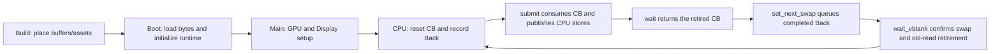

# Using the GPU resource API

Start here to read application code. The current public entry is `rcc/gpu_api.rs`;
`gpu_legacy.rs` is a separate diagnostic interface. A resource body owns a CPU
registration; a `Desc` is a construction value; a Copy `Ptr` is a nonowning,
generation-checked reference. None of these owns the external asset/pixel bytes.

A drawable model is an application type. Hello GPU groups its `Transform`,
`Mesh` and `Material` in a local `Model`. The SDK exposes those resources
independently. `Pass` and `PreparedPart` draw methods take the three handles
in `transform, mesh, material` order. Textured draws then borrow a `&TextureView`.

## Reading route

| Question | Read next | What to look for |
| --- | --- | --- |
| What does the smallest application do? | [Hello GPU main](/systems/cpu-v3-tang-nano-20k/examples/sample_hello_gpu/rcc/main.rs), then [Scene](/systems/cpu-v3-tang-nano-20k/examples/sample_hello_gpu/rcc/scene.rs) | Main owns frame handoff; Scene owns a Model, Camera and RenderState. |
| Where do the mesh and font come from? | [Hello producer](/systems/cpu-v3-tang-nano-20k/examples/sample_hello_gpu/tools/assets.py), [recipe](/systems/cpu-v3-tang-nano-20k/examples/sample_hello_gpu/application.rs), [static assets](/systems/cpu-v3-tang-nano-20k/docs/static-assets.md) | Source geometry/font becomes encoded payload and a placed description; addresses are build outputs. |
| How do I write colors, poses and buffers? | [SDK values](/systems/cpu-v3-tang-nano-20k/docs/sdk-values.md) | Constructors and units before raw native fields. |
| When are my changes visible? | [Sampling and lifetime](#sampling-and-lifetime) | Setter snapshots, draw snapshots and live external bytes are different. |
| Which kind of reuse fits my scene? | [Choosing reuse](#choosing-reuse) | Decide which inputs may change before reading the replay implementation. |
| What does recording actually emit? | [Command-buffer walkthrough](/systems/cpu-v3-tang-nano-20k/docs/gpu-command-recording.md) | CPU metadata, external instructions, immutable push data and GPU consumption. |
| How are the internals represented? | [Resource/recording core](/systems/cpu-v3-tang-nano-20k/docs/gpu-api-storage.md), [scene conversion](/systems/cpu-v3-tang-nano-20k/docs/gpu-api-scene-values.md), [native formats](/ip/gpu-v2/docs/formats.md) | Lookup storage/encoding after understanding the public contract. |

[Current callers](/systems/cpu-v3-tang-nano-20k/docs/gpu-explicit-examples.md)
maps the larger applications to these operations. Internal names such as Global,
Instance and group persist in storage code; the public concepts are scene/View,
World and prepared part. They do not denote additional public resource owners.

## One frame and its startup boundary

The normal application build places static working buffers and assets. The
compiler-generated entry initializes the CPU runtime/heap before application
`main`; GPU arena allocation therefore does not belong in a Rust static
initializer. The [boot contract](/systems/cpu-v3-tang-nano-20k/docs/boot-image-format.md)
starts with A as virtual-black Front, B free and no pending swap. This explains
why Hello records B first; it is not a universal rule for attaching to an
arbitrary already-running display.

`Gpu::init(config)` configures command/push slots and the CPU arena. It does not
initialize the heap, wait for old GPU work, choose Front or open Display.
`Display::open()` observes a valid presentation interface and selects the default
format for future requests; it does not clear pixels or present a framebuffer.
Applications must use one GPU context and one Display controller at a time.
Before reinitialization, retire GPU work and dispose of all old resources, CBs
and the old Gpu controller. Initialization enforces those ownership boundaries
before resetting any slots. Display likewise rejects a second live controller;
Drop releases controller admission without waiting or forgetting a pending swap.
Reopening requires hardware retirement and validates any retained request.



Recording writes external command/push bytes; it does not execute them. Dropping
the `Pass` closes its recorded work. `submit` consumes the CB; `wait` or a
successful `try_wait` returns that same slot. Submission seals the stream,
checks Device4 status/count/DSEG3, publishes CPU stores, and sends COUNT/START.
It does not scan allocation facts to prove all external aliases or check ordinary
Pass targets against Display Front. Correct backing placement and producer/
consumer ordering remain application obligations.

`set_next_swap` does not wait for GPU completion. A frame-index change alone is
not sufficient to reuse the old Front: a queued swap must finish old external
reads. `wait_vblank` with a queued request waits for that retirement. Without a
request it waits for a frame edge. `try_wait_swap` with no request reports idle
immediately. CPU recording may overlap one GPU submission by using the other CB;
two configured slots do not create two hardware queues.

### Submit an ordered command list

Build a `CommandList` with its final
descriptor count (1–32). Add a recorded `CommandBuffer` with `push`. It is
sealed and consumed, and its commands must fit in a single 8 KiB span. Raw
command slices can also be added with unsafe `push_slice(memory, first, length)`
using 32-bit instruction units. A raw slice may start inside a sector and cover
up to 64 sectors. The caller provides its required entry state, dependencies
and backing lifetime. The last slice must include the terminal fence and END.

```rust
let mut list = CommandList::new(2);
list.push(first);
list.push(second);
gpu.submit_list(list);
// CPU work may overlap the GPU here.
gpu.wait_list();
```

The builder writes descriptors directly to a 128 B aligned SDRAM sector.
Submission publishes the CPU writes and sends that sector address without
copying the table or commands. `wait_list` or a successful `try_wait_list`
releases the list allocation and makes any consumed CB slots available
through `command_buffer()` with fresh recorder state. Dropping an unsubmitted
list releases the same allocations. Use the existing `submit` and `wait`
pair for a flat CB.

#### Select a prepared range

Call `PreparedPart::mark_slice()` at each independently selectable draw group
boundary and at the end of the recording. It returns the offset in 32-bit
instructions and makes the next nonempty draw emit its World and material
setup. Pass a pair of marks to select `[first, end)`.

```rust
let first = part.mark_slice();
part.draw_colored(transform.ptr(), mesh.ptr(), material.ptr());
let end = part.mark_slice();
part.finish();
// First add a recorded CB that installs Target and View.
list.push_prepared_range(prepared.ptr(), first, end);
```

`push_prepared_range` checks the finished part, marked range, and the scene
installed by the preceding recorded CB. It references the original commands
and prevents changes to the Prepared registration while the list holds it.
The last segment supplies the terminal fence and END. Preserve the external
command, push, and input storage through retirement. See the examples in
[GPU command lists](/systems/cpu-v3-tang-nano-20k/docs/gpu-command-lists.md).

## Sampling and lifetime

| Value/storage | When it is sampled | What can change afterwards? |
| --- | --- | --- |
| `CameraPtr` passed to `set_camera` | At the setter call: Camera source values are copied into desired Pass state. | Mutating or dropping the Camera cannot change that captured value; call the setter again to install an edit. |
| `RenderStatePtr` passed to `set_state` | At the setter call, including light, depth/blend and filter choices. | Later resource edits need another setter. |
| Transform, Material and TextureView used by draw | During draw recording. | Later descriptor edits do not rewrite earlier command/push snapshots. |
| Mesh directory | At Mesh registration/refresh, into an owned CPU directory; draw emits commands from it. | Refresh affects future recordings. It does not change earlier CBs or previously created subset directories. |
| Mesh vertex/index/metadata bytes and sampled texture bytes | During GPU execution at encoded external addresses. | Keep input storage and contents unchanged through every recorded use; discard referring CBs before updating or reusing it. |
| UI Grid cells and Atlas pixels | During GPU execution. Only the descriptor/ranges are recorded. | Keep recorded inputs unchanged; retire executions and discard referring CBs before editing them. |
| Command and push backing | Recording writes it; GPU reads it after submission. | Keep sealed contents unchanged through execution/replay. Retire before reset/re-record/free; preserve prepared push data while any consuming CB remains reusable. |
| Color/depth pixels | At the ordered GPU operation; displayed color also has a Display consumer. | GPU retirement ends GPU use; swap retirement separately ends old-Front reads. |

The owner must remain alive until the last CPU use of its `Ptr`. Recording keeps
encoded descriptions and allocation facts, not owning references to source
descriptors. A recorded descriptor may therefore outlive its CPU owner, provided
the external allocation stays valid. A copied Ptr itself never keeps the body
alive: stale generations fail-stop in both profiles.

Recorded external inputs follow a caller-owned immutability contract: do not
modify, free or reuse them until executions complete and every referring CB is
reset, dropped or permanently discarded. No reference locks or automatic
lifetime tracking enforce this rule. Immutable storage may be shared by both
CBs. CPU values already copied into command/push snapshots do not freeze their
source objects. Ordered GPU writes to color/depth, copies and RTT targets remain
legal; GPU ordering, texture invalidation and Display retirement still apply.

For example, these operations are deliberately not equivalent:

```rust
pass.set_camera(camera.ptr());       // capture the current camera
camera.set_pose(new_eye, new_angles);
pass.draw_colored(transform.ptr(), mesh.ptr(), material.ptr()); // previous camera
pass.set_camera(camera.ptr());       // capture the edit
pass.draw_colored(transform.ptr(), mesh.ptr(), material.ptr()); // edited camera
```

Changing a Transform or Material before the second draw is different: draw reads
those values at that second call. Neither pattern makes it safe to modify a
texture or UI grid while the GPU is reading its external bytes.

### Costs visible at the API boundary

| Operation | Kind of work |
| --- | --- |
| Copy a Desc or Ptr | Copy a small value; no registration or asset copy. |
| Resource construction / `Texture::view()` | Arena registration and preparation of the corresponding CPU description. |
| `Mesh::from_native` / refresh | Validate and cache two CPU words per meshlet in heap storage; no vertex traversal. |
| `Mesh::subset` | New registration plus an independently allocated/copied directory; it is not a borrowed slice. Prefer creating fixed subsets during setup. |
| `MeshPtr::slice(first, count)` | Nonowning directory range, with no allocation/copy; valid only while the same Mesh owner is live. Accepted by ordinary and prepared draws. |
| Unsafe `GpuMemory::read_words` / `write_words` | A bounded CPU-owned external transfer, at most 128 u16 words. No implicit GPU/Display wait or texture invalidation. |
| Camera/Transform pose update | Fixed-point matrix preparation and source revision update. |
| Draw recording | Resource resolution, changed-state encoding, command/push writes and allocation-fact bookkeeping. No GPU rendering yet. |
| `draw_prepared` | Metadata/fact checks, possible Pass View install and aligned command copy; no CPU re-encoding of each stored draw. |

These are work categories, not measured cycle estimates. A source-level draw
may expand to multiple native meshlet DRAWs; geometry preparation runs per
native DRAW even when World/View transfers are reused.

## Choosing reuse

| Route | Inputs that remain fixed | Inputs supplied/changed later | Main limits |
| --- | --- | --- | --- |
| Reset and record ordinary draws | External asset layout unless explicitly updated | Target, draw order, Camera, state, Transform and Material | General route; CPU records every frame. |
| Record `PreparedDraws`, then `Pass::draw_prepared(ptr)` | Stored draw order, World/model, material, texture/raster/filter | Current Pass Camera and light direction/intensities; enclosing target | Mesh/Billboard only. Not an RTT framebuffer cache. Application-owned command/push capacities. |
| Submit a returned sealed CB again | Encoded commands, snapshots and external input contents | Ordered GPU target contents; the limited retarget operation below | CPU input changes require discarding the old recording. Replay does not resample Camera. |
| `target_binding` / `retarget_target` | Camera, World/material, commands and optional copy source | Color/depth targets; optional leading copy destination | One target block, no UI, at most one eligible leading color copy. |

A prepared part is command/push storage, not a pre-rendered image. Its Camera
comes from the Pass at append; its raster/filter comes from recording. After
append, the Pass still retains its desired Camera/state for the next ordinary
draw. Frame reset clears its own metadata without touching independent parts or
walking references. The caller invalidates/re-records a part only after retiring
all executions and discarding every referring CB. Changing a stored Transform/Material
resource alone does not refresh a finished part.

For a static object with a moving camera, prefer a prepared part appended into a
new frame stream. For a fixed-camera background rendered repeatedly to A/B,
target-only replay preserves the entire sealed stream. Bloxorz uses both:
target-only replay for its static level stream and prepared parts in the dynamic
CB. See [storage and binding limits](/systems/cpu-v3-tang-nano-20k/docs/gpu-api-storage.md).

## Coordinates, numeric limits and failure diagnosis

Source-world Camera uses a rigid view; zero-angle pose looks down -Z with +Y up.
Euler angles are radians with Rz*Ry*Rx composition. Transforms and focal length
use Q16.16; focal length is in pixels. Projection uses the fixed 400x240 viewport.
`from_focal_pixels` requires positive far below 200 and focal at least 100, then
also checks both quantized Q14 rays within +/-12288 (+/-0.75). The focal lower
bound alone is not sufficient. Roughly, rayX=-100/focal and rayY=-60/focal.
A 90-degree vertical FOV gives focal around 120 and fails the horizontal ray
limit. FOV constructors enforce the same final limits, in addition to their
angle/representability checks. See [numeric conversion](/systems/cpu-v3-tang-nano-20k/docs/gpu-api-scene-values.md).

For RTT, explicitly choose Nearest or Bilinear for a fixed framebuffer view;
the opaque/transparent default Trilinear is not supported for that shape.
Record producer work, enforce producer-to-consumer completion/order, invalidate
the texture cache after changing sampled pixels, then record the consumer.
The current RTT example uses two serial submissions; that is its example
schedule, not a claim that every RTT implementation needs a CPU wait per Pass.

For transparent Billboard, choose facing independently from Material alpha,
SrcOver blending, depth-write policy and application sorting. Facing only expands
geometry. A typical transparent state uses depth test, no depth writes and
SrcOver; it does not provide order-independent transparency.

Invalid pure value construction asserts (dynamic signal `0xffff`); it does not
write a GPU fault packet. GPU resource/recording/execution faults emit the
first `0xfa17` UART record then halt with `0xe001`, without unwind/recovery.
Use the matching build's [diagnostics and fault decoder](/systems/cpu-v3-tang-nano-20k/docs/application-build-artifact.md#runtime-diagnostics).
