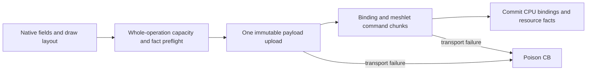
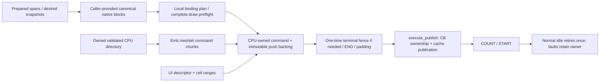

# GPU resource and recording internals

For the application-facing reading route, startup/frame boundaries, sampling,
lifetimes and reuse choices, start with [Using the GPU resource API](/systems/cpu-v3-tang-nano-20k/docs/gpu-api-guide.md).
This chapter specifies the backing representation and private implementation.

The approved `gpu_api` root connects resource preparation, recording, submission,
retirement and Display to the CPU V3 storage core. Prepared scene adapters call
`gpu_scene_*` and `gpu_ui_grid`; offline profiling observes the recorded inputs;
The retired renderer is available only in explicit test-owned fixtures; no production
loader or boot project selects it.
Native commands, vertex arithmetic and hardware precision are unchanged.

## Named CPU state and word-oriented buffers

Fixed control records use `repr(C)` structs with u16 fields in their existing
word order. Field reads/writes address the original global storage directly;
they do not copy a state object to the stack. Nested buffers represent genuine
indexed sets, such as the small/large free lists and Global/Render validity.

| Owning source | State type | Words | Role |
| --- | --- | ---: | --- |
| `gpu_arena.rs` | `GpuArenaControl`, `GpuObjectGeneration` | 9 + 2 | Backing, capacity, free lists and monotonic allocation serial |
| `gpu_execute.rs` | `GpuExecutionState` | 10 | Controller admission, issued slots and in-flight submission, including the owned list allocation |
| `gpu_present.rs` | `GpuPresentState` | 8 | Independent dynamic presentation request and first error |
| `gpu_api_fault.rs` | `GpuFaultRecord` | 16 | Stable UART first-fault wire record, including reserved words |
| `gpu_builder.rs` | `GpuBuildState` | 9 | Legacy recorder ownership, staging and binding validity |
| `gpu_device.rs`, `gpu_display.rs` | `GpuDriverState`, `GpuDisplayState` | 2 + 8 | Legacy fixed-plane execution and presentation |
| `gpu_ui_builder.rs` | `GpuUiPosition` | 3 | Native UI object and active cell interval |

Word views remain at bulk reset, serialization and compatibility boundaries.
Native command/push encodings, aligned scratch, two-slot recording tables,
resource facts, per-slot ownership and multiword counters remain indexed buffers.
Changing a source type can relocate global addresses because RCC places scalar
buffers and aggregates in separate passes; the per-record field offsets and
total storage above do not change.

Execution records use one-word `ExecutionPhase` and `ExecutionError` fields.
Presentation keeps `DisplayFormat` and a first error in its CPU record. Snapshot,
retirement polling, and passive observation have distinct result types.
The enums preserve diagnostic numbers and the existing word offsets. Format
codes convert to integers at the Device3 register boundary. Hardware snapshots
validate the raw format before accepting it.

Arena allocate, resolve, and free share `GpuObjectKind`. Debug tags and fault
records retain their numeric representation. The word-oriented CB and prepared
metadata still store numeric `RecordPhase`, `PreparedState`, and
`ResourceFactKind` discriminants. Read/write flags remain composable masks.

## Configuration and public recording resources

`Mesh`, `Transform`, `Camera`, `Material`, `RenderState`, `Texture`,
`UiAtlas`, `UiGrid`, `ColorBuffer` and `DepthBuffer` are resource bodies. Each
owns its arena registration, supports consuming `release()`, and drops that
registration at scope exit. External asset, pixel and working-storage bytes
remain caller-owned. There is no separate `OwnedMesh` layer. Keeping a body
alive for the application's whole run avoids ordinary frame-scope destruction;
runtime registration is not a Rust static initializer.

Each body exposes `ptr()` returning its matching `*Ptr`, an opaque
`Copy`/`Clone` handle with a slot and a 32-bit generation (three target words).
`MeshPtr` additionally carries a first/count range (five target words total).
These nonowning references support object reads and updates. Draw, pass-target
and Display methods accept them by value. Resource bodies access their owned
slot directly and share the implementation with the handle methods. Creating
a pointer snapshots the live slot's
generation. Copying a pointer does not allocate or extend its lifetime. Release
clears the slot generation, and reuse assigns a new one. Both profiles compare
the generation before dereferencing; GPU debug also checks the resource kind.
The allocation serial persists across GPU initialization and refuses to wrap.
Creation/static `*Desc` values remain plain copyable values.

`TextureView` stores its six words directly. `Pass`, `PreparedPart` and
`UnlitBank::add` borrow it only while recording or registering a binding.
The recorded binding retains the physical extent and sampling fields.
The existing flags word also holds the two-bit mip minimum/fixed-grid exponent;
no additional arena words or recorded payload are allocated for it.

For example, `let mesh = Mesh::from_native(desc); let mesh_ptr = mesh.ptr();`
creates one owner and a copyable reference. Calls to `pass.draw(transform_ptr, mesh_ptr, ...)`
reuse the reference; `mesh.release()` consumes the owner after its last use.
`Gpu`, `Display`, `CommandBuffer` and `Pass` retain their existing ownership and
borrowing protocols. In particular, submit still consumes the command buffer.

`CommandMemory` and `GpuConfig` are pure public values in `gpu_api_values`, outside
the private helper domain. This also places generated `Option<CommandMemory>`
constructors in a public value module. The module contains no device access or
mutable driver state. `gpu_config` remains a private helper of the approved
`gpu_api` root; its raw initialization/take/drop functions are not application APIs.
The System `compile_explicit_gpu_program_checked` host entry selects only this
root and the fixed column layout. It reads the canonical shared source directory
directly, retaining actual file origins, dependency tracking, resource validation
and the rustc check. Local overrides gain no approved-library identity. Legacy renderer entry points
still approve only `gpu_pipeline`; approving both requires loading both domains
and is incompatible with their distinct resource definitions.

Initialization accepts a nonzero arena capacity, a multiple of 32 bytes up to
8 KiB, one command/push pair and an optional second pair. Each extent holds
1..512 sectors; all configured command/push extents are mutually disjoint.
Validation precedes driver/arena mutation. Initialization checks GPU idle and
does not read Display, wait for work, or recover from an active/faulted context.
Normal reinitialization requires the caller to finish prior use. Initialization
rejects a context with live object registrations before resetting driver state.
It also rejects a live public Gpu controller, a driver-held submission, or any issued CB
whose record has not been dropped. These checks precede arena/record mutation.
Dropping Gpu releases only controller admission and keeps any outstanding submission. Once
all old owners exit, normal reinitialization may reuse the configured slots;
no context check is added to individual draw calls.

`Gpu::command_buffer` hands out available configured slots in A/B order.
Dropping a CPU-owned CB disables its record. Flat completion returns its CB
directly. When a list is dropped before submission or retires normally, each
CB consumed by the list is reset and marked available for reacquisition.
Execution metadata words 6 and 7 hold the configured count and issued mask.

A `CommandList` is an owning heap handle. Four CPU words store its planned
count, written count, consumed CB mask and the slot that establishes Target
and View. The table occupies 64 CPU words starting at the next 128-byte
boundary after that metadata. Its 32-bit descriptors are written at their
final offsets. One CPU-only word per segment follows the table and tracks its
Prepared reference. The GPU fetches only the table sector. During execution,
the driver keeps the heap allocation in word 9 of `GpuExecutionState` through
retirement.

`ColorBuffer` and `DepthBuffer` use 16-word arena descriptors. Their registered
extent must be 64-KiB aligned and contain at least the 1,600-sector physical
plane. Descriptor Drop returns only its arena slot; it does not release pixels.
`CommandBuffer::pass` consumes copyable pointers for the call and copies
their target addresses into immutable push storage. The returned `Pass` retains
the exclusive CB parent. Pass Drop records the already-reserved closing fence.
Descriptor reuse therefore cannot change an earlier recording. Reset clears
CPU cursors/cache metadata and leaves external backing bytes untouched. Independent
prepared allocations keep their own metadata and push data across frame resets.

`Mesh::from_native` captures and validates the compact directory into CPU heap
storage. `MeshDesc::subset` selects a range before registration; `Mesh::subset`
copies the selected entries into a separately owned directory. Each live Mesh
uses two u16 words per meshlet plus allocator overhead, with a small kind5 arena
descriptor. Child subsets survive parent Drop. `refresh_directory` replaces the
snapshot only after all new entries validate, preserving the old one on failure.
Registration/refresh never traverses vertex/index payload. Mesh Drop frees its
CPU directory and arena slot; it does not free external package storage.

`let all = mesh.ptr(); let part = all.slice(first, count);` selects a nonowning range of the cached
directory, without allocation, directory copy or an additional arena slot.
Bind intermediate Ptr values to locals when making nested calls in RCC.
Nested slices are relative to the current range. Their owner must remain live
until recording; both profiles validate generation and range before reading
entries. Draw and prepared recording accept the same MeshPtr and emit the same
native stream as an owning subset. Empty ranges emit nothing. `Mesh::subset`
remains the independent-owning option when the child must survive parent Drop.

`ColorLoad` and `DepthLoad` carry `LoadOp` and a scalar clear value. The target
`Rgb565` value has one named `raw: u16` field and `from_raw`, rather than tuple
struct syntax. `Display` wraps the independent presentation protocol below;
`set_next_swap` copies the color address and does not retain its descriptor.
Its caller still owns the external pixel-allocation lifetime.
`set_next_swap_with_format(color, format)` stages the pixel interpretation with
that same request. It requires the previous swap to have retired; a rejected
second request cannot change the pending request's format. The chosen format
also becomes the default for subsequent `set_next_swap` calls. Both methods
publish only after application-owned GPU completion; they do not wait for it.

`UiGrid::write_text(x, y, glyphs)` writes one row with its width derived from
the byte slice; it neither wraps nor clears trailing cells. `write_glyph`
replaces one cell, preserving the neighbouring packed byte. They retain the
ordinary grid/glyph debug checks and external-memory publication contract.

### Prepared command parts

| Representation | Target storage |
| --- | --- |
| `PreparedMemory` | Four Copy words: command first sector/count, push first sector/count |
| `PreparedDraws` / `PreparedPool` owner | One word holding an arena registration |
| `PreparedDrawsPtr` | Three Copy words: slot plus two generation words |
| Prepared arena payload | 16 words: command base/capacity0..1, push base/capacity2..3, metadata pointer4, state5 (empty0/recording1/ready2), pool owner/next6..7, slice bitmap pointer8, live list reference count9, backing list link and kind10..11, debug slice responses12 |
| Pool arena payload | 16 words: external first sector0, capacity1, sorted child head2, backing list link and kind10..11 |
| Transient recorder | 160 record words plus 256 fact words, heap-owned only during recording |

Payload capacities above use CPU u16 words; external bases/counts use 128-byte
sectors. Each small arena registration also has the ordinary generation/type
metadata. No persistent per-part record or duplicated matrices are retained.

Prepared storage belongs to the application, independently of either frame CB.
`PreparedMemory::allocate(command_bytes, push_bytes)` under `#[static_buffer]`
requests two 128-byte-aligned allocations. `PreparedDraws::new(memory)` owns
the CPU registration; `record()` returns a mesh-only recorder. There is no fixed
part count, special part ID, layout enum or reservation inside a frame CB.
Each command and push extent may contain 1..512 sectors (up to 64 KiB).

The driver checks physical sector overlaps when a standalone part or pool is
created. Standalone parts claim their command and push extents. A pool claims
its whole extent and assigns disjoint subranges to its children. These claims
must be disjoint from one another and from the configured frame CB backing.
Record and invalidate keep the claim. Dropping the owner releases it.

`PreparedPool::new(memory)` supports runtime allocation from an application-owned
external span. `allocate(command_bytes, push_bytes)` rounds each nonzero u16 byte
request up to 128 bytes; 65535 requests the full 64 KiB. First-fit walks a sorted
CPU list of live allocations. `free(ptr)` recycles the span and registration;
stale Ptrs fail the release/debug generation check. The pool owns its children
and releases them on Drop. Exhaustion fail-stops without implicit waits or a
global GPU heap. The application preserves the supplied backing allocation.

`PreparedDrawsPtr` is a three-word generational reference. `record()` enters the
recording state and uses one transient CPU recorder/fact table allocated from the
ordinary heap, sharing the normal draw encoder. Only one prepared recorder may
be open at a time. `finish()` publishes aligned commands and immutable push data;
Drop of an unfinished recorder leaves the part invalid. Both release the
transient context. `ready()` observes completion; `invalidate()` discards it.

Part commands capture World, material, raster/filter and asset addresses. They
contain no View upload or scene install. `Pass::draw_prepared(ptr)` installs the
current Pass View/light if needed and copies the aligned commands. The same-page
route uses direct LCOPY while each span fits one page; a span crossing a
page boundary uses bounded aligned CPU staging.
World/texture backing is not copied on append. Desired Pass Camera/state remains
unchanged. Both ordinary Mesh and unlit Billboard use the same encoder here.

The caller keeps recorded external inputs unchanged and allocated until all
consuming executions finish and every referring CB is reset, dropped or otherwise
permanently discarded. Completion alone does not end this obligation if the CB
will replay. Multiple CBs may read the same immutable part. Ordinary CB append
and reset leave the part's reference state alone. Generation checks validate
CPU Ptr uses, and the application preserves externally supplied storage.

`mark_slice()` lazily allocates a bitmap with one bit per command slot and a
bit for the endpoint of a full command buffer. An in-place list slice starts
and ends at explicitly marked offsets. The last whole CB must have published
Target and View before the slice, and the list reserves a later segment for
termination. Re-record, invalidate, free and owner Drop reject an open recording or a live list
reference before mutation. Pool Drop checks all children before releasing
any. List retirement and unsubmitted list Drop release their references.

Heap metadata stores padded command length in CPU words, fact count, and the
unpadded 32-bit instruction count in header word 2. Header word 3 identifies
ordinary recording, shared material and response, or shared material alone.
Metadata also holds the 12-word final material snapshot,
four-word lighting-response snapshot and four-word resource facts. Debug tracks response maxima
for the whole part and for each nonempty marked group. A range validates only
its selected groups against the installed scene light. Nonempty append includes the part's persistent push
extent in the frame facts, so target-only relocation cannot overlap it. Commands
contain no END. A failed transport poisons the destination before submission.

`PreparedPart::share_state()` and `share_material()` reuse transient terminal
word 14 in the Prepared recorder. The low bits select the sharing mode and
bit 2 records that the first draw established the snapshot. Both modes check
material and omit its SET. Material-only sharing retains response drains and
invalidates the response proof at marked entries and after linking. Both modes
invalidate World residency at a mark. The existing list proof word tracks
material and response validity separately.

Standalone appends compute one aligned payload offset and preflight their extent.
Mesh/binding operations preflight their complete layout once. They write one
contiguous native payload span, assemble binding and meshlet commands together
in scratch160..223, and append command chunks of at most64 words. Only successful
writes commit canonical CPU bindings; any partial transport failure poisons the CB.
Private reserved appends consume the complete reservation without intervening
external appends. Target debug builds recheck each reserved span.

World and View are separate immutable128-byte push allocations, each aligned
to64 CPU words. Their DMA commands share a final WAIT(data). Material is included
in World's final24 bytes; SET_RENDER's extended form reads it there. The public encoder has no precomposed-layout branch.
Scene16 and raw light intensities live in View's final32 bytes. Camera changes
publish a fresh complete View; light/far/ray-only changes publish only its tail,
including unchanged Billboard basis values. Earlier A/B/A payloads are never
rewritten. Changed scene/material state retains the whole-render WAIT boundary.

A matching Transform revision, Material24 and raw material responses prove World
residency while valid bit2 is set. A prepared append clears this proof.
Camera/State setters compare their captured source values and invalidate the
affected encoding directly: matrix/focal changes mark View and Scene dirty and
invalidate Q14 light; far/ray changes mark only Scene dirty; light-direction
changes invalidate Q14 light, while intensity-only changes reuse it. Raster and
filter changes do not invalidate Scene. No second light/source-revision mirror
is retained. View needs upload if no View allocation exists or bit7 is dirty.
Successful publication clears dirty flags and establishes the encoded-light
proof. Several changed Camera setters without a draw coalesce to one fresh View,
even when the final Camera returns to an earlier value; avoiding a separate
resident revision history trades that uncommon extra upload for simpler state.

Every public Mesh and Billboard uses World/View preparation. Ordinary geometry
composes matrices and material/light responses in97 enabled edges; Billboard
skips normal/response work and copies a shared View basis in65. The original
per-vertex arithmetic is unchanged. See [formats](/ip/gpu-v2/docs/formats.md#resident-viewworld-blocks).

The draw encoder reads only the owned validated CPU directory. It plans the
complete operation, publishes changed bindings once, then emits meshlet commands
in bounded chunks. No per-draw external-directory read or second validation pass
is performed. Directory mutation becomes visible only after explicit refresh.

The arrows describe sequential CPU recording while the CB is CPU-owned. They do
not submit GPU work. Capacity rejection precedes external writes; successful
recording remains subject to the later submission publication boundary.
CPU-owned binding and prepared metadata copies transfer complete eight-word
chunks through vector registers as raw bits. A scalar tail handles shorter
ranges, and copies with a destination inside the source at a higher address
keep forward word order.

Native World preparation writes each coefficient only when the Transform binding
changes. Material fields are encoded directly at native scratch116..127, the
final World tail, rather than copied from a separate Render span. Only defined
padding and the homogeneous constant are explicitly initialized.

Public matrix operations retain value arguments and their isolated snapshots.
Scene scalar and three-component reads and writes use exact two- and six-word
FPU transfers for the existing low-word-first layout.
Euler rotation prepares three padded Q16.16 rows using vector stores. Camera
pose reads the columns of that scratch matrix; Transform pose reads the rows.
Ordinary and prepared draw headers share the view-light encoder. It
reads each complete camera row with a vector load and transforms the light
direction with its first three components, using the Pass Camera and State.
Internal camera/model writers borrow those snapshots through typed CPU views:
three vec4 imports/exports copy a 24-word world/view matrix, and two vec4 pairs
plus two scalar word copies write exactly eighteen normal-matrix words. No row
value snapshots, arithmetic, rounding or overread are introduced. Transform padding
initialization and source validation remain part of the operation.

The private same-page copy helper rejects misalignment, overlap and window overflow
before remapping. It saves/restores DSEG3 and waits around LCOPY and mapping changes,
reads the newest dirty source line, and discards obsolete dirty destination aliases.
It does not remap stack/global segments. Submit still publishes scalar writes.
GPU commands, capture decoding and replay ABI are unchanged: only command-stream
start and valid length differ.

### Color and depth plane copies

`CommandBuffer::copy_color(source: ColorBufferPtr, destination: ColorBufferPtr)`
records native MEMCPY between two color allocations, only between Passes. It copies
exactly the 1,600-sector physical 400x256 RGB565 plane, including the 16 padded
rows, without copying allocation tails. Source and destination keep the surface
alignment/capacity contract above; their registered allocations must not overlap.
Neither copied span may overlap this CB's command or push storage. Invalid
phase, range or capacity is rejected before record/fact/backing mutation.

`CommandBuffer::copy_depth(source: DepthBufferPtr, destination: DepthBufferPtr)`
copies the same physical extent without converting stored depth
values. Both typed calls share the allocation preflight and native plane-copy
encoder. Depth copies declare Depth source-read/destination-write facts; color
copies declare Color facts. A depth allocation is never cast to a color surface.
Callers retain completed, compatible source contents until the recorded reads
retire. Copying does not create an implicit clear or a separate validity owner.

The CB retains a source-read and destination-write allocation fact. The normal
submit publication and application-owned Display/retirement ordering apply;
the call neither submits nor releases ownership. The source must remain stable
until retirement. Native WAIT/FLUSH precedes the source read, then DMA_LOCAL,
transfer wait and MEMCPY use one shared descriptor encoder with the raw native
interface. The next Pass or CB seal supplies the completion fence. A partial
backing transport failure poisons the CB under the existing append contract.
Texture invalidation remains explicit when a copied destination is sampled.

For background restoration, copy into the actual chosen Back or offscreen color,
then begin its Pass with `ColorLoad::load()` and an independent depth clear.
Both alternating Back allocations require their own copy. The target-only
binding below changes a single color copy and its
target together. Multiple copies, or a depth copy aimed at the depth target,
remain outside that binding's contract; callers can reset and record a short
restoration CB instead.
Reset clears this restriction along with the record metadata. Native encoding,
capture MEMCPY dependency discovery and replay formats are unchanged.

### Target-only replay binding

`target_binding()` seals one target block independently of Camera, Transform and
Material identity. It accepts immutable draw groups and at most one leading
full-plane color copy, but no UI commands. `retarget_target(binding, color, depth)`
changes Target32 and that copy's destination together; its source remains fixed.
Scene/Transform packet patching is not a public operation; use prepared draws for
a moving Camera and target-only rebinding for an unchanged sealed scene.

Recording saves the color/depth resource-plan indices when a Pass succeeds, and
saves the source index of a color copy. These indices remain stable because the
fact table only appends entries or merges access bits. Sealing checks eligibility
once: exactly one target, no UI, and at most one preceding color copy aimed at
that target. It establishes an explicit target-proof bit, shared with scene
binding. Obtaining a binding again does not scan the fact table. Reset clears
both the indices and proof and advances the full generation.

The binding stores the slot and full generation. Rebinding checks CPU ownership,
sealed proof and generation at one internal entry. Both target profiles require
unchanged allocation sizes and reject color/depth overlap, aliases with either
configured command/push allocation, and aliases with other recorded resources.
Public surface handles already validate alignment/extents and retain generation
checks in release. Display observation rejects a pending/torn/faulted swap or a
new plane overlapping Front; it neither waits nor retires Display. Callers
explicitly complete presentation first.

`gpu_debug` additionally rechecks sealed payload spans, copy metadata, fact-index
bounds, resource kinds, old addresses and access bits. Release trusts those
private recorder invariants; it does not repeat the immutable structure proof.
Stream eligibility, stale/foreign bindings, dynamic aliases, Display checks and
partial-write poisoning remain enforced in release.

All logical guards run before external stores. Target32 and optional MEMCPY
payload are written before committing their color/depth allocation facts and
record addresses. A transport failure can leave partial bytes and poisons the CB;
it never commits replacement facts or permits submission. Camera/model/material
payloads, command words and native opcodes stay fixed. Ordinary submission still
publishes stores and checks execution ownership.

The control prefix retains its offsets. Non-UI streams use inactive UI-cache
words128..131 for copy payload offset-plus-one, source, destination and count.
Camera revision retains words16..19. Recording UI makes target-only binding
ineligible; reset clears both caches. No command, capture or replay ABI changes:
parsers consume the same published Target32/MEMCPY bytes and updated facts.

## Public prepared scene adapters

Camera and Transform each occupy one48-word slot. Transform contains only its source
World/normal matrices and a private64-bit source revision; no per-Transform Camera
cache or persistent native World packet is allocated.
Material, RenderState, Texture, UiAtlas and UiGrid occupy 16-word slots. Each Drop releases
its one owning slot. Projection's prepared values and transform conventions are
specified in [scene values](/systems/cpu-v3-tang-nano-20k/docs/gpu-api-scene-values.md).

`RenderState::set_lod_bias(fix!(-0.5))` and its pointer equivalent select a signed
mip bias in levels, rounded down to 1/16, in `[-8, 8)`. Filter updates preserve
the bias. Its signed byte shares the high byte of the existing filter word and
is copied to the existing Material24 raster-bias byte; slot and snapshot sizes do not grow.
Untextured native packets retain zero bias. The default is zero on new/reused slots.

On the production GPU, `SrcOver` blends color normally and permits an enabled
depth write only when final Q6 alpha is 64 (combined A8 alpha 254 or 255). Binary
RGBA textures can therefore use `SrcOver` with depth writes without filling holes
in Z; filtered partial-alpha edges retain their blended color. Uniform alpha
participates through the existing texture/uniform multiplication. `Replace`
uses effective alpha 64 and retains its original color/depth behavior.
This is a depth-write condition, not a color-discard threshold; the selected
depth comparison is unchanged. The [GPU alpha/depth contract](/ip/gpu-v2/docs/framebuffer.md#alpha-qualified-depth-writes)
defines the quantization boundary and register timing. No additional API flag
is needed: select `SrcOver` and enable depth writes for binary-alpha surfaces.

Pass setters copy Camera and RenderState values into desired snapshots; later
source-object changes cannot alter them. Draw preparation reads Transform, Material
and texture descriptions, creates static World/material bytes and prepares the
shared View only when its revision changes. The same whole-Mesh preflight and
binding encoder serves ordinary draws, Billboard and prepared recording.
Colored draw reads no texture-view descriptor. Texture/View and Grid/Atlas descriptions are copied
by value; descriptor Drop/reuse does not rewrite recorded descriptions or retain
external allocations. Applications still own external-memory lifetime and ordering.

UiGrid fill/write alter persistent external bytes through the existing window
helpers. Pass draw_ui emits the descriptor and range, without copying the grid.
Empty draw/UI operations return before conversion, external reads or fact commit.

## Arena

Initialization allocates one block from the CPU heap for the requested object
capacity, alignment slack and slot metadata. The capacity is a nonzero multiple
of 32 bytes up to 8,192 bytes. The block reserves 30 bytes of alignment slack so
the payload base can be aligned to 32 bytes. It also reserves a 32-bit generation
per minimum slot in both profiles and a 16-bit kind/size tag per slot in GPU debug.

The arena keeps its block across GPU context transitions. Reinitialization with
the same capacity resets and reuses the block. A capacity change acquires a new
block before releasing the old one, leaving the old block and configuration
intact on allocation failure. The global generation serial survives
reinitialization. The driver requires all arena owners to have been released
before starting a new GPU context.

Small slots occupy 16 CPU words and grow upward; large slots occupy 48 words and
grow downward from the effective-capacity boundary. The slot in a handle is its
word offset plus one. Zero is an internal allocation-failure/free-list sentinel.

Each class reuses its own free list before growing its high-water mark. A freed
payload's first word holds the link; there is no live payload header. Free space
does not merge between classes and high-water marks do not shrink. Allocation
does not initialize payloads: their producers fill defined fields and padding.
Public adapters own allocation and Drop. Scene helpers receive only a temporary
payload span after the handle generation matches its slot.

Pure value constructors use `debug_assert!` for runtime layout diagnostics. The
target `gpu_debug` setting, independent of host Cargo profile, retains these
checks; release removes the condition and branch before runtime dependencies are
selected. Constant descriptions are always checked, including in release.
Nonempty external spans and physical sector endpoint guards remain unconditional.
Existing essential command bounds, allocation failure and execution/retirement
checks remain in release.

## External word transfers

The public unsafe `GpuMemory::read_words(offset, destination, count)` and
`write_words(offset, source, count)` expose bounded transfers for dynamic data.
Offsets/counts are CPU u16 words, count is at most 128, and the complete span
must fit the memory extent. Zero count is a no-op. The caller supplies a stable
low-memory `Array<u16>` of at least count words and owns both sides of the
transfer; acquire GPU-written data or retire GPU/Display readers before access.
The calls do not establish rendering completion, invalidate GPU textures or
globally publish every scalar write. The ordinary submit publication remains
required. Range faults use API site1/code2 and transport faults site1/code3.

`gpu_window_read_words(sector, offset, destination, count)` and
`gpu_window_write_words(sector, offset, source, count)` are the only new chunk
entry points. Sector units are 128 bytes; offset/count units are 16-bit words.
Offsets may cross sector and DSEG page boundaries. A nonzero count is at most128.
Zero succeeds without inspecting pointers, accessing memory or changing DSEG3.

The caller supplies a valid stable low-memory array. The helper rejects a span
reaching logical word `0xc000`, or an external span past 8 MiB, before copying.
It saves DSEG3, waits for prior CPU copies before remapping, splits at each
32-KiB page boundary, waits for completion, and restores the original mapping.
No pointer into the window escapes.

Within each page, a complete 16-word span whose two pointers are 32-byte aligned
uses dual-address `LCOPY`. Both pointers use their own DSEG translation; the
source is the newest cache value and the destination is DRAM. The helper waits
before further use or remapping. Raw eight-word vector transfers handle other
complete spans, and scalar operations handle the tail. Cached stores still
require submission publication.

The command-fragment copier validates aligned, disjoint ranges. When each range
fits one page, it uses DSEG3 for same-page copies or temporarily borrows DSEG1
for the source of a cross-page copy. The cross-page leaf uses scalar locals
and the DSEG2 stack. It waits for each LCOPY and restores both mappings before
returning. All heap accesses and function calls occur outside that leaf scope.

These helpers operate on CPU-owned storage. They do not acquire GPU-written
data, wait for GPU retirement, invalidate GPU caches, or publish each chunk.
Explicit ownership/cache ordering precedes reads of GPU output; submission is
the publication boundary for CPU stores.

### Reusable unlit draw lists

`UnlitBank` snapshots a validated mesh directory and deduplicates fixed unlit
World responses and Material packets. Up to 256 World keys share the same world
lighting. The native mesh and texture bytes stay resident through retirement.

`prepare_unlit` reserves a block at the current push cursor rounded up to
64 words: a 64-word View packet, then one 64-word World slot per unique binding.
The block starts at zero for an empty CB and can follow a linked Prepared range
and earlier dynamic payload in the same CB. Two per-slot base words relocate
View and World references within the existing push allocation. The Transform snapshot
is taken once for that recording. `draw_unlit` fills each used World slot once
and uses the same binding and meshlet command encoders as ordinary draws.
Vertical billboard offsets use the shared View basis and the existing DRAW
facing bit.

For a completed bank-only recording, `patch_unlit` updates View and Target
while leaving the World packets and command stream resident. Target overlap
checks precede the writes, and submission checks the GPU/Display leases.
A normal draw, prepared draw, UI or copy ends the bank phase. A later bank
draw requires preparation again. View/Target patch replay remains restricted to
a completed bank-only recording; interleaved frame lists are recorded afresh.

## Command records

### Record layout

There are two persistent160-word frame records and one transient heap record
while recording a prepared allocation. Each contains control0..31,
desired Camera32..63, desired State64..79, Scene80..95, debug response maxima96..99,
Transform revision100..103, color-copy source fact104, spare105, View location/count106..107,
reserved108..111, Material24 at112..123, raw responses124..127 and UI128..143.
Word149 identifies the open allocation in the transient prepared recorder; it
is zero in frame CBs. Words29..31 are reserved. There is no duplicate World matrix,
light-direction source key or resident Camera revision.

One sequential256-word native scratch has271 words of backing for16-word
alignment slack. Scene0..15, mode31, Target48..63, World64..127, UI128..143,
commands160..223 and View192..255 have explicit lifetimes. Scratch30 records
the CPU-only Billboard classification;31 selects the DRAW facing bits. Material preparation
writes World's final12 words116..127 directly. View is published before command
encoding reuses192..223. A directory no longer occupies scratch. Complete
aligned transfer lines can use LCOPY; eight-word transfers and scalar tails
handle the remaining spans.

CPU-owned copies and comparisons advance pointers in eight-word chunks with a
scalar tail. The scratch is temporary output, not a binding cache. Only a changed
World needs to assemble its compact source matrices; small revision/material
proofs determine that before copying.

The implemented control words are:

| Word | Meaning |
| --- | --- |
| 0 | Disabled=0, recordable=1, open draw encoder=2, sealed=3, poisoned=4 |
| 1 / 2 | Command first sector / word capacity |
| 3 / 4 | Push first sector / word capacity |
| 5 / 6 | Command / push words used |
| 7 | Padded command fetch words, valid after seal |
| 8 | Valid bits: Global1, Render2, Instance4, Camera8, State16, resident UI32, encoded-light proof64, View dirty128, Scene dirty256, known response512, sealed target proof1024 |
| 9 / 10 | Current Pass color / depth first sector |
| 11 | Last immutable Instance push word offset plus one |
| 12 / 13 | UI-clean proof / last immutable UI descriptor push offset plus one |
| 14 | Known completed terminal render fence in the recorded stream |
| 15 | Recorded allocation-fact count, 0..64 |
| 16..19 | Camera view/focal revision captured by public set_camera |
| 20 / 21 | Binding generation low / high word |
| 22 / 23 | Target / Global push word offset plus one |
| 24..26 | Target / Global / Instance allocation counts |
| 27 / 28 | Color / depth fact index plus one captured by the latest successful Pass |
| 29..31 | Reserved |
| 104 | Color-copy source fact index plus one; zero for a depth copy |
| 106 / 107 | Last View push word offset plus one / View allocation count |
| 149 | Transient prepared owner arena slot; zero in frame CBs |
| 144..148,150..159 | Reserved |

Each configured extent has 1..512 sectors, fits physical memory, and is disjoint
from the other extent in that record. Frame configuration is init-time only; Gpu's
configuration layer remains responsible for cross-record/asset overlap and
external lifetime. The record phase is not evidence of GPU retirement.

`gpu_record_preflight(slot, command_words, final_push_words)` checks the entire
planned operation before its first store. Its caller accounts for all payload
alignment gaps. The final push cursor cannot move backward or exceed capacity.
An open Pass reserves four words for `WAIT(all), FLUSH`. An outside-Pass stream
without a known terminal fence reserves the same four words. Active recordings
also reserve two words for END and round the resulting span to 128-byte fetch
alignment. Prepared templates use their application-supplied command limit without the
terminal tail. Word counts represent the full 64-KiB capacity without truncation.

Individual append batches contain at most64 command words and128 push words.
Nonempty payload alignment is 16, 32 or 64 words. Append first checks capacity,
then writes push, then commands, and commits both cursors only after success.
Capacity rejection writes nothing. A transport failure may already have written
part of backing; it poisons the record, which cannot seal or reset. This is
fail-stop storage protection, not rollback or recovery.

Closing a Pass appends native halfwords `[3, 0x4000, 0, 0x7000]` and returns to
recordable state. Target and load commands belong to the future public Pass
adapter; opening this internal scope alone does not construct a valid GPU Pass.
First seal rejects an empty/open record. A closed Pass already provides its
terminal fence; a maintenance-only stream instead gets the missing WAIT/FLUSH
at seal. Seal then writes native END `[0, 0xf000]` and zero fetch padding and
preserves valid/padded counts. A tail straddling fetch sectors uses at most two
64-word-bounded stores. Repeated seal performs no backing stores.
Reset clears metadata, desired values and cache snapshots, retaining configured
extents; it does not clear external command/push storage.

`GPU_CB_RESOURCE_FACTS` holds two separate 64-entry directories, 256 words per
CB and 1,024 bytes total. Each four-word fact is `{first_sector,
allocation_sectors, kind, access}`. Kind1..7 means Mesh, Texture, Atlas, Grid,
Color, Depth, Buffer; access bit0 declares reads and bit1 declares writes.
These are allocation provenance, not wire capture flags or immutable evidence.
Equal base/count/kind entries merge access. Group preflight resolves existing
and intra-group duplicates into a caller-local array of final table positions,
rejecting exhaustion before native emission. Its scans advance by the four-word
record width and convert matching offsets to table positions. Preflight leaves
the input and recorded facts intact. With no intervening fact mutation,
successful native emission consumes these positions directly. The CPU-only
commit performs no second lookup, cannot allocate and cannot fail. Ordinary
operations need one or two plan words;
prepared append uses a bounded64-word local plan for its complete fact group.
Pass construction records the full color/depth allocation, including distinct
1,600/2,048-sector capacities, rather than retaining live descriptor references.
Native rejection leaves facts unchanged; transport failure still poisons the
record. Reset clears only the directory count. Seal, wait and replay retain it.
Nonempty public draw records Mesh storage and, for textured draw, the copied
TextureView extent. Nonempty UI draw records the Grid and Atlas extents. Fact
capacity is checked before native emission and committed only after success.
Empty mesh subsets and empty UI rectangles record no facts or commands.

The target recorder uses these facts for prepared-part merging and restricted
target rebinding. Ordinary submission does not traverse them to establish a
complete external-memory hazard proof. Host tooling can decode the ordered
native stream for actual accesses and every Target/Load/Clear; the last target
pair alone is not the complete target set. Allocation tails are not automatically
framebuffer-write or full-clear regions.

The device layer and affine public ownership must prevent access while a record
is held for submission or execution. This CPU core does not SEND, publish, poll
completion, or transfer public ownership.

## Device4 execution handoff

`gpu_execute` owns one nine-word driver record: phase, owned slot plus one,
command first sector, instruction count minus one, expected DSEG3, first error,
configuration handout state and live public-controller flag. Phases are idle=1,
held=2, running=4 and fault=5.
Zero means uninitialized. Ownership is acquired before sealing and retained on
failure. Submission checks Device4 idle/error status, seals the recording,
validates its command count and restored DSEG3, then publishes CPU cache stores.
It marks running before the sole COUNT/START pair. Poll retains ownership while
busy and on errors; only normal completion returns the slot once.

This path does not query Display or validate ordinary targets against Front.
It also does not use the fact table to reject all read/write aliases with assets
or another CB. Recording validates selected native shapes and overlaps with its
own active command/push spans; applications retain the full backing-layout and
producer/consumer-ordering obligation. Restricted target rebinding performs
additional alias/Front checks at its own entry point.

`Gpu::submit` consumes and disarms the application CB owner. `try_wait` returns
`Option<CommandBuffer>`; `wait` requires a running owner and waits for retirement.
Faults fail-stop. There is no pause gate or board snapshot producer in this path.

`Display::try_wait_swap` performs one coherent presentation poll. Pending or a
torn observation returns false; stable idle or an applied swap whose old reads
have retired returns true. A wrong target/format or hardware fault fail-stops
through the same path as `wait_vblank`. It adds no owner or scheduling state.
With no queued swap it reports idle immediately, rather than waiting for a new
frame edge. The existing blocking `wait_vblank` semantics remain unchanged.

The blocking wait sleeps through the existing Device0 change watch instead of
busy-polling a stable Display value. Pending waits arm only for an actual
CONTROL value of 1 and revalidate the complete snapshot after waking, including
target, format and old-read retirement. A no-pending wait watches FrameIndex;
changes before arm are observed without requiring another vblank. This adds no
GPU wait and does not turn a frame-counter change alone into swap completion.

## Display handoff

`gpu_present` has eight words: ready, owned-pending, requested sector,
first error, selected format and three spare words. It uses Device3 only.
`Display::open()` selects ordinary RGB565/code0. The explicit
`Display::open_with_format(DisplayFormat::LinearRgb565)` selects linear-light
RGB565/code1; `DisplayFormat::Rgb565` selects code0. Open accepts either existing
front format, saves the requested interpretation in the same owner, and leaves
hardware unchanged until presentation. Every request stages that selection and
retirement checks the actual active format against the saved selection. A color
base is a 64-KiB-aligned sector address whose 1,600-sector effective span fits
physical memory. Allocation/lifetime and GPU producer completion remain the
application's explicit responsibility.

Only one public Display controller may be live. A duplicate open returns failure
before changing its state or default format. Drop clears controller admission
without waiting or erasing pending metadata. Reopen rejects hardware Pending;
if a previous dropped controller left a request, its retired address/format
must match before the new record is initialized. No new GPU or Display wait is
hidden in open/Drop.

Snapshots read pending before and after active base/format. A transition retries;
invalid status/address/format fails. With no pending request, set stages low/high
word-address base and format, then NEXT_SWAP. A second pending request is rejected.
For an owned request, wait confirms stable hardware pending clear and the actual
requested active address/format. Pending clearing is the hardware's old-read
retirement guarantee. A frame-counter change alone does not complete this path.
Without an owned request, wait observes the next frame-index change, including
16-bit wrap, and a stable nonpending snapshot. Display does not inspect Device4,
wait for GPU, reserve a color pool, or make a buffer writable automatically.
Failures retain local pending information for fail-stop diagnostics.

## Native Target and Load prefix

`gpu_packet_begin(slot, color, depth, clear_mask, color_value, depth_value)`
assembles a native ABI4 Pass prefix. Mask bits zero/one independently select
color/depth Clear; an unset bit means Load and emits no CLEAR for that plane.
It validates aligned/disjoint complete physical planes, overlap with this CB's
command/push extents, and the whole prefix/payload plus close/END/padding budget
before entering the Pass or writing backing. Cross-allocation lifetime still
belongs to the registered external-memory contract.

Target32 occupies the existing scratch Target gap and is pushed once. Its first
two halfwords are `(color >> 2) | (depth << 12)` and `depth >> 4`; the rest are
zero. Commands are `WAIT(all), FLUSH, DMA_LOCAL(Target32 to slot69), WAIT(data),
SET_TARGET(69)`, then the independently requested CLEAR commands. There is no
automatic texture invalidation. Close/seal append the existing terminal sequence.
This assembler takes physical values from adapters; it neither creates public
resources nor executes those commands itself.

## Canonical binding and snapshots

`gpu_bind_desired` copies a Camera's first 32 words or all 16 State words into
that CB's desired storage. It retains no arena pointer. Changing or dropping
the producer descriptor cannot change the saved values. Desired flags and
last-bound flags are independent: equal source snapshots preserve their proofs;
changed snapshots invalidate only the dependent encodings.

`gpu_bind_plan` receives the source Transform and final material fields. Its seven-word
local plan stores changes, the borrowed Transform pointer, one View-or-Scene offset,
World offset, final push cursor, command count and DRAW mode (zero for scene-only).
Change bit16 selects a full View128 upload; otherwise a Scene update uses32 bytes
at the same plan field. Allocation, DMA encoding and payload writing each share
one path for these mutually exclusive transfers.
The plan is consumed synchronously by the same operation; it is not an
asynchronous reservation. The complete Mesh command count and final push cursor
are checked before the first external write.

Scene dirty state, Transform revision and Material24/raw-response comparisons decide
which snapshots are necessary. View and World are128-byte aligned and share the
final WAIT(data). A light-only update uses the32-byte View tail. Material is
already in World, so there is no independent material DMA. Only CP-consumed
texture/specular/raster fields and lighting kind trigger SET_RENDER. Uniform RGBA
is read by DRAW; a color-only change publishes World without a state drain.
Raw material responses are a separate lifetime: geometry writes their products
into live CP lighting registers. Changed or unknown response data requires
WAIT(all), even without SET_RENDER. A Billboard skips these writes; World/Scene
changes before it invalidate the response proof. Prepared append also invalidates
that proof. A matrix-only change retains known response values and needs no drain.
Equal consecutive source bindings omit both World assembly and uniform DMA.
Every DRAW still performs hardware matrix preparation and loads its meshlet input.
Only a fully published operation commits the small CPU binding proofs.

## Trusted Mesh directory expansion

`MeshDesc` holds directory sector/word/count and the containing `GpuMemory`.
Initialization validates bounds, representable count and every entry: record
metadata plus1..8 payload sectors must fit storage and avoid the directory.
The retained CPU directory contains only `{record_sector, payload_sectors}`
(two u16 per entry), never full headers or vertex/index bytes. Snapshot refresh
allocates/validates a replacement before freeing the old directory.

`MeshDesc::subset(first,count)` performs checked const address arithmetic without
registering an unused parent Mesh. A runtime Mesh subset copies only its selected
CPU entries into independent ownership. An empty subset retains a representable
in-allocation directory pointer, including the physical8-MiB endpoint.

The native package must select World uniform20. Its vertex format must match
the draw method: Billboard packages use `draw_billboard`, ordinary mesh packages
use the ordinary draw methods. The producer owns this trusted format contract. Header contents, vertex formats,
indices and counts remain the trusted producer's responsibility. This CPU wrapper
does not inspect each meshlet header or infer other uniform-block choices.

A nonempty draw plans bindings plus `6 * meshlet_count` CPU command words. It
iterates the validated local entries and emits bounded command chunks. The
schedule remains `DMA(next), DRAW(previous), WAIT(data)`, with the initial wait
and final DRAW. An empty Mesh emits neither bindings nor facts. Previously
recorded commands are independent of later directory refresh or descriptor Drop;
external metadata/payload storage must still remain valid through execution.
Transport failure poisons partial recording; it does not promise rollback.

## UI descriptor and range recording

`gpu_ui_packet_draw` accepts B's canonical16-word descriptor and rectangle
fields. It validates cell bounds once; an empty rectangle emits nothing.
Full-width adjacent rows coalesce into one interval; other rectangles emit one
interval per row. All required fence, descriptor and range words are preflighted
as a group before any backing store.

The descriptor uses slot69, shared with Target staging. A new Target invalidates
its resident bit. Global66, Render68, Instance80 and meshlet-page traffic do not
overwrite it. Equal descriptors reuse immutable push data even when a Target
change requires reloading slot69. A changed descriptor gets one new 32-byte
snapshot; no grid bytes are copied into the CB.

The first UI transition needs `WAIT(all), FLUSH`; actual DRAW makes that proof
invalid again. An empty mesh or binding without DRAW does not dirty it.
Consecutive UI calls therefore contain only range commands, or descriptor
DMA/data wait when the description changes. A 3D draw followed by the same UI
description restores the fence without redundantly reloading the descriptor.
Each hardware UI call reads the recorded grid address, and Global/Render/uniform
bindings survive UI. The caller keeps grid/atlas inputs unchanged until executions
retire and referring CBs are discarded; no reference locks track this obligation.

Explicit texture invalidation appends `WAIT(all), TEX_INVALIDATE`; it does not
alter binding snapshots or automatically invalidate on a texture switch.
A maintenance-only CB receives its separate terminal fence at seal as described
above; normal Pass closure is not duplicated.

These are private recording/execution stages behind the public resource facade.
There is no runtime capture gate in the submission path.

## Extent values and first fault

The shared schema defines one ordinary `GpuMemory` value with two u16 fields,
`first_sector` and `sector_count`, and read-only getters. A's internal
`gpu_memory_extent_valid` accepts a nonempty extent ending within 8 MiB; individual
resource semantics impose their own alignment/shape requirements. The public
`GpuMemory::from_sectors` unsafe method lives in `gpu_api`; its checked call
requires an unsafe block and validates that extent once. Descriptors do not
own allocation or establish physical alias/lifetime safety. The checked frontend
runs rustc privacy checks and rejects application construction, reads and writes
of those private fields. The required private-field-construction regression
verifies that rejection; it is not an accepted bypass. Approved-library code can
still construct the representation internally.

`gpu_api_fault` reserves 16 low-memory words independently of the arena. Its
first snapshot is magic `0xfa17`, site, code, two detail words, DSEG3, and ten
site-specific words that default to zero. Internal call sites use `GpuFault` variants;
the high byte retains the site and the low byte retains its code. Resource
allocation uses `GpuObjectKind`; `GpuCheck` names validation contexts separately
because a prepared-operation context is not an arena kind. An invalid object handle reports
site 16, code 1. Detail words contain the slot and expected kind. Words 6–9
contain the handle generation and the current slot generation, each low word
first. Zero current generation denotes a free or invalid slot. It emits
exactly those 16 words, low byte first, waiting
for UART readiness before every byte and for the final stop bit before halting
with `0xe001`. An existing first snapshot is retained. It does not allocate,
unwind, release an active CB or attempt recovery. This is an internal CPU API
fault packet, not executable command data or a capture-envelope ABI change.

## Verification boundary

`host/gpu_api_g0.rs` exercises the actual arena and window modules. The required
public associated-factory test is a separate gate and is not replaced by the
internal tests. `host/gpu_api_record.rs` runs the actual record core in both
profiles, including interleaved records, alignment, whole-operation capacity,
no-store rejection, exact 64-KiB cursor arithmetic, Pass tail reservation,
seal/replay/reset behavior, partial-transport poisoning and physical memory
contents. The near-capacity case injects a synthetic cursor; it does not claim
to render a 64-KiB command stream. All CPU execution loops have explicit bounds.
The static layout test includes actual execution/presentation/fault metadata;
the record-core budget fixture retains a conservative C reservation, while the
public combination tests use actual C storage and actual allocation facts.
`host/gpu_api_execute.rs` checks publication/SEND order, replay, single retirement
and fault-held ownership against a controlled Device4/cache peer.
`host/gpu_api_present.rs` advances frame index before old-read retirement, checks
actual swap confirmation and error retention, and traps every Device4 access.
These peers validate software handoff behavior, not rendering or new RTL timing.
`host/gpu_api_packet.rs` compares stored commands/Target32 to an independent ABI4
u32 oracle for all four color/depth Load/Clear combinations. It verifies command
bytes, not executed pixels. `host/gpu_api_fault.rs` tests the internal validator
and first-fault path with an offline backpressured UART peer in both profiles;
the actual public constructors have separate approved-root tests.
`host/gpu_api_bind.rs` covers per-CB snapshots, source revisions,
state drain coalescing, immutable Instance reuse and group preflight.
`host/gpu_api_mesh.rs` checks directory/subset, cross-page/batch expansion and
registration/refresh rejection against an independent command oracle. Its directory-only
fixture does not render metadata or payload pixels.
`host/gpu_api_ui_packet.rs` checks rectangle commands, consecutive UI and actual
staging overlaps across bindings, DRAW and Target changes.
`host/gpu_api_maintenance.rs` covers maintenance-only EOF, fetch-sector crossing
and unchanged closed-Pass tails. `host/gpu_api_projection_boundary.rs` is only
an A/B language-boundary probe for thin cross-module forwarding through six
temporary words, not a production Projection-math oracle.
`host/gpu_api_config.rs` validates configurations before initialization and
one-time CB handout. `host/gpu_api_resources.rs` runs actual approved-root
factories, recording, descriptor Drop/reuse and Display retirement in both
profiles. It verifies public UART failure before any GPU SEND, rejects raw
resource/helper access, missing unsafe calls and private-extent-field
construction. The checked field-privacy gate is included in the ordinary suite.

`host/compiler/gpu_api_facts.rs` executes A allocation-fact preflight/commit,
source12/health and optional Display observation without a C shim. Its bounded
peers verify unchanged failure output, group deduplication/capacity, reset
isolation and initial/resume publication counts. Approved-root target tests
separately verify every recorded allocation after descriptor Drop/reuse. These
are A producer qualifications. `gpu_api_integration` additionally runs the real
A+C public submission/replay chain, normal and paused/resumed publication counts,
and a real gate-health failure retaining both owners before SEND. `gpu_api_pixels`
is a bounded, explicitly invoked native RTL test: public API code produces the
submission, the production GPU executes Clear, actual RTL pixels are imported,
and only then may CPU wait retire. It checks the physical color plane, allocation
tail and unchanged Load depth. It is not a board, MC-throughput or full scene
qualification. `gpu_api_scene` records actual public B objects, Mesh/texture/UI
consumption and facts; its separate unsupported-opcode case preserves exact sealed
A/B inputs for further C parser work.

## Concrete application

`tests/fixtures/gpu_renderer/rcc/main.rs` exercises the explicit GPU API. It manages
one reusable CB, two Back/Front color allocations, shared depth, immutable native
assets, prepared scene objects and two external UI grids. Input/time/OBS are
application responsibilities. It waits for old-Front retirement before reuse,
records and submits, takes the CB back exactly once, and explicitly requests the
next swap. Texture invalidation after initial asset upload is explicit. Finite
host execution enters through main so RCC static byte initialization remains
active; only the stop policy is redirected. The implementation and test contract
are described with the [test fixtures](/systems/cpu-v3-tang-nano-20k/tests/fixtures/gpu_renderer/README.md).
