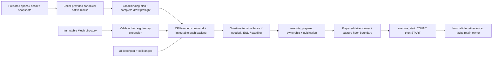

# Explicit GPU API internal core

The approved `gpu_api` root connects resource preparation, recording, submission,
retirement and Display to the CPU V3 storage core. Prepared scene adapters call
`gpu_scene_*` and `gpu_ui_grid`; capture calls the separate explicit-record C
implementation. The retired renderer is available only in explicit test-owned fixtures; no production
loader or boot project selects it.
Native commands, vertex arithmetic and hardware precision are unchanged.

## Configuration and public recording resources

`CommandMemory` and `GpuConfig` are pure public values in `gpu_api_values`, outside
the private helper domain. This also places generated `Option<CommandMemory>`
constructors in a public value module. The module contains no device access or
mutable driver state. `gpu_config` remains a private helper of the approved
`gpu_api` root; its raw initialization/take/drop functions are not application APIs.
The System `compile_explicit_gpu_program_checked` host entry selects only this
root and the fixed column layout. It reads the canonical shared source directory
directly, retaining actual file origins, dependency tracking, capture validation
and the rustc check. Local overrides gain no approved-library identity. Legacy renderer entry points
still approve only `gpu_pipeline`; approving both requires loading both domains
and is incompatible with their distinct resource definitions.

Initialization accepts a nonzero arena capacity, a multiple of 32 bytes up to
8 KiB, one command/push pair and an optional second pair. Each extent holds
1..512 sectors; all configured command/push extents are mutually disjoint.
Validation precedes driver/arena mutation. Initialization checks GPU idle and
does not read Display, wait for work, or recover from an active/faulted context.
Normal reinitialization requires the caller to finish prior use and drop all
old owners while their old context is still valid.

`Gpu::command_buffer` hands out each configured slot once, in A/B order. Drop or
completion does not make it an unissued slot. A CPU-owned CB Drop disables its
record without submitting or waiting. `Gpu` Drop does not release driver-owned
work. These identities use existing execution metadata words 6 and 7 for the
configured count and issued mask, with no second queue or allocator.

`ColorBuffer` and `DepthBuffer` use 16-word arena descriptors. Their registered
extent must be 64-KiB aligned and contain at least the 1,600-sector physical
plane. Descriptor Drop returns only its arena slot; it does not release pixels.
`CommandBuffer::pass` borrows those descriptors only for the call and copies
their target addresses into immutable push storage. The returned `Pass` retains
the exclusive CB parent. Pass Drop records the already-reserved closing fence.
Descriptor reuse therefore cannot change an earlier recording. Reset clears
CPU cursors/cache metadata and leaves external backing bytes untouched. An enabled
immutable draw group additionally preserves its private metadata and push prefix.

`Mesh::from_native`, `subset` and `meshlet_count` wrap the trusted directory
descriptor core in small arena slots of kind5. A subset is an independent
descriptor, without a retained parent borrow or copied package bytes. Dropping
and reusing the parent descriptor does not change its subsets. Construction
checks the directory's shape/range only; it does not traverse native metadata,
vertices or indices. Public draw consumption uses the prepared scene adapters below.

`ColorLoad` and `DepthLoad` carry `LoadOp` and a scalar clear value. The target
`Rgb565` value has one named `raw: u16` field and `from_raw`, rather than tuple
struct syntax. `Display` wraps the independent presentation protocol below;
`set_next_swap` copies the color address and does not retain its descriptor.
Its caller still owns the external pixel-allocation lifetime.

### Prepared command parts

`CommandBuffer::enable_prepared_group()` partitions an existing nonzero,
32-KiB-aligned 64-KiB command reservation. The first16KiB holds sixteen1KiB
command templates; the next16KiB is the active stream, in the same physical
DSEG3 page. The upper32KiB holds private metadata and remains GPU-unfetched.
Ordinary CBs retain their configured capacities. An enabled CB also requires
64KiB push backing: part0 owns its first16KiB, parts1..15 own2KiB each, and
ordinary immediate recording uses the remaining18KiB. No external allocation
or larger CPU record is required. The explicit
`enable_prepared_parts(PreparedPartsLayout::SplitWide)` alternative divides the
original wide area into two8KiB partitions: part0 at push words[0,4096), part15
at[4096,8192). Parts1..14 retain their original2KiB partitions. The old part15
area remains unused; the46KiB fixed prefix and18KiB transient tail do not move.
`SingleWide` and the no-argument entry retain the original layout. Layout is
chosen before recording, persists across reset/clear and does not change leases.

Inside a Pass, install camera/state, call `begin_prepared_part(part)`, record
mesh draws and their camera/state choices, then call `end_prepared_group()`.
Part IDs are0..15; the no-argument group methods select part0. UI and texture
invalidation are rejected while a part is open; Pass close rejects unfinished
parts. Begin saves the transient cursor/capacity and selects that part's fixed
push partition. Rebuilding a part cannot overwrite another part's snapshots.
A referenced-part mask prevents replacement after that part has been copied or
recorded into the current stream. Reset clears this mask after normal ownership
has returned to the CPU.

Begin invalidates native bindings so the first mesh draw emits complete Global
and Render bindings. A NOP pads this initial prefix to32bytes. Later draws use
ordinary canonical-state deduplication and meshlet ping-pong commands. Legal
NOPs align template boundaries to32bytes; templates contain no Target or END.
End copies command lines into the selected template, saves canonical entry/exit
Global/Render states and Mesh/Texture allocation facts, and restores the
transient push cursor/capacity. Separate draws retain separate immutable
Instances even when one temporary Model is reused. Source descriptors need not
survive, but referenced resource backing must remain valid and stable.

`prepared_part_ready(part)` tests the valid mask. `append_prepared_part(part)`
preflights command/fact capacity, aligns the cursor and LCOPYs the template.
When both current Global/Render states equal the entire saved entry state,
append skips the initial32-byte binding prefix. It then restores the saved
canonical exit state for subsequent binding comparisons. Both append and end
invalidate Instance, desired camera/state and scene identities; callers reinstall
camera/state before the next part or immediate draw. This retains only proved
native bindings and avoids redundant render drains. Single-scene patch bindings
reject part-bearing streams. No mutable Instance patch API is exposed.

`reset()` retains all valid parts and restores the transient cursor to the fixed
46-KiB prefix end. `invalidate_prepared_part(part)` clears one valid bit between
recordings, retaining all other templates and snapshots. `clear_prepared_group()`
clears the bank and resets the CB, retaining the reserved partitions. Reset/clear
advance the ordinary binding generation, invalidating old TargetBinding and
SceneBinding values. Slot/context ownership, scalar publication, capture leases,
submit and wait remain unchanged. Templates, metadata and push snapshots cannot
change while the GPU owns the CB.

Metadata begins256sectors after the original command base. Each part uses384
16-bit words: header0..7, entry Global/Render48 at16, exit48 at64, and up to64
four-word Mesh/Texture facts at128. Header words0..3 contain executable words,
fact count, native-state flag and actual private push end; words4..7 are zero.
The table occupies12KiB of the upper32KiB. End/append reuse existing native
scratch for transfer and fact merging; old surface facts are excluded. Each
1KiB template and the active16KiB stream include their own padding; the active
stream also includes ordinary commands and terminal/fetch reservations. Bounds
reject overflows before append writes; partial transport failures poison the CB.

The private same-page copy helper rejects misalignment, overlap and window overflow
before remapping. It saves/restores DSEG3 and waits around LCOPY and mapping changes,
reads the newest dirty source line, and discards obsolete dirty destination aliases.
It does not remap stack/global segments. Submit still publishes scalar writes.
GPU commands, capture decoding and replay ABI are unchanged: only command-stream
start and valid length differ.

### Color and depth plane copies

`CommandBuffer::copy_color(&source, &destination)` records the existing native
MEMCPY between two `ColorBuffer` allocations, only between Passes. It copies
exactly the 1,600-sector physical 400x256 RGB565 plane, including the 16 padded
rows, without copying allocation tails. Source and destination keep the surface
alignment/capacity contract above; their registered allocations must not overlap.
Neither copied span may overlap this CB's command or push storage. Invalid
phase, range or capacity is rejected before record/fact/backing mutation.

`CommandBuffer::copy_depth(&source, &destination)` accepts two `DepthBuffer`
descriptors and copies the same physical extent without converting stored depth
values. Both typed calls share the allocation preflight and native plane-copy
encoder. Depth copies declare Depth source-read/destination-write facts; color
copies declare Color facts. A depth allocation is never cast to a color surface.
Callers retain completed, compatible source contents until the recorded reads
retire. Copying does not create an implicit clear or a separate validity owner.

The CB retains a source-read and destination-write allocation fact. The normal
prepare/submit publication, Display write protection and retirement pins apply;
the call neither submits nor releases ownership. The source must remain stable
until retirement. Native WAIT/FLUSH precedes the source read, then DMA_LOCAL,
transfer wait and MEMCPY use one shared descriptor encoder with the raw native
interface. The next Pass or CB seal supplies the completion fence. A partial
backing transport failure poisons the CB under the existing append contract.
Texture invalidation remains explicit when a copied destination is sampled.

For background restoration, copy into the actual chosen Back or offscreen color,
then begin its Pass with `ColorLoad::load()` and an independent depth clear.
Both alternating Back allocations require their own copy. Copy-bearing CBs
reject scene binding and patching, including a binding obtained before the copy;
the separate target-only binding below changes a single color copy and its
target together. Multiple copies, or a depth copy aimed at the depth target,
remain outside that binding's contract; callers can reset and record a short
restoration CB instead.
Reset clears this restriction along with the record metadata. Native encoding,
capture MEMCPY dependency discovery and replay formats are unchanged.

### Target-only replay binding

`target_binding()` seals one target block independently of Camera, Model and
Material identity. It accepts immutable draw groups and at most one leading
full-plane color copy, but no UI commands. `retarget_target(binding, color, depth)`
changes Target32 and that copy's destination together; its source remains fixed.
`SceneBinding` / `patch_scene` retain their single-group, no-copy contract.

The binding stores the slot and full generation. Only a CPU-owned Ready/Sealed
CB accepts it; reset/reissue, an active execution owner, invalid payload spans,
multiple copies or a copy aimed at another target reject. Color/depth allocation
extents must match their recorded facts. Existing target alignment, depth-format
provenance, plane/command/push/read-source alias guards apply. Display observation
rejects a pending/torn/faulted swap or a new plane overlapping Front; it neither
waits nor retires Display. Callers explicitly complete presentation first.

All logical guards run before external stores. Target32 and optional MEMCPY
payload are written before committing their color/depth allocation facts and
record addresses. A transport failure can leave partial bytes and poisons the CB;
it never commits replacement facts or permits submission. Camera/model/material
payloads, command words and native opcodes stay fixed. Ordinary submission still
publishes stores and validates capture leases.

The original 208-word fields retain their offsets. Non-UI streams use inactive UI-cache
words128..131 for copy payload offset-plus-one, source, destination and count.
Camera revision retains words16..19. Recording UI makes target-only binding
ineligible; reset clears both caches. No command, capture or replay ABI changes:
parsers consume the same published Target32/MEMCPY bytes and updated facts.

## Public prepared scene adapters

Camera occupies one 48-word slot; Model owns two 48-word slots (source and derived).
Material, RenderState, Texture,
TextureView, UiAtlas and UiGrid occupy 16-word slots. Their kinds are 1, 2, 3,
4, 6, 7, 10 and 11 respectively; Model derived data uses private kind 12.
Model Drop releases both owned slots; other descriptor Drops release their slot.
Projection construction uses B's six-word temporary, bool validation and value
getter. Shininess's two public convenience methods live in the approved root;
raw conversion helpers remain private. Named matrix rows and the numerical
contracts are specified in [scene values](/systems/cpu-v3-tang-nano-20k/docs/gpu-api-scene-values.md).

Pass set_camera/set_state copy prepared values into the CB desired snapshot.
Later source-object changes do not alter that snapshot. A nonempty draw validates current light/material/render fields and obtains the
Model-owned derived matrices for that Camera snapshot, computing them only while
dirty. It writes the one shared native scratch, then uses the existing whole-Mesh
preflight and canonical binding emitter. The Model cache is specified in
[scene values](/systems/cpu-v3-tang-nano-20k/docs/gpu-api-scene-values.md#model-owned-derived-matrices).
Colored draw reads no View. Texture/View and Grid/Atlas descriptions are copied
by value; descriptor Drop/reuse does not rewrite recorded descriptions or retain
external allocations. Applications still own external-memory lifetime and ordering.

UiGrid fill/write alter persistent external bytes through the existing window
helpers. Pass draw_ui emits the descriptor and range, without copying the grid.
Empty draw/UI operations return before conversion, external reads or fact commit.

## Arena

The fixed low-memory reservation is 8,192 bytes plus at most 30 bytes of alignment
slack. Initialization selects a nonzero multiple of 32 bytes within that limit.
Small slots occupy 16 CPU words and grow upward; large slots occupy 48 words and
grow downward from the fixed effective-capacity boundary. A handle is its word
offset plus one. Zero is an internal allocation-failure/free-list sentinel.

Each class reuses its own free list before growing its high-water mark. A freed
payload's first word holds the link; there is no live payload header. Free space
does not merge between classes and high-water marks do not shrink. Allocation
does not initialize payloads: their producers fill defined fields and padding.
The `gpu_debug` profile adds one type/live word per minimum slot; release removes
that 256-word registry. Public adapters own allocation and Drop;
scene helpers receive only a temporary payload span.

## External word transfers

`gpu_window_read_words(sector, offset, destination, count)` and
`gpu_window_write_words(sector, offset, source, count)` are the only new chunk
entry points. Sector units are 128 bytes; offset/count units are 16-bit words.
Offsets may cross sector and DSEG page boundaries. A nonzero count is at most 64.
Zero succeeds without inspecting pointers, accessing memory or changing DSEG3.

The caller supplies a valid stable low-memory array. The helper rejects a span
reaching logical word `0xc000`, or an external span past 8 MiB, before copying.
It saves DSEG3, waits for prior CPU copies before remapping, splits at each
32-KiB page boundary, waits for completion, and restores the original mapping.
No pointer into the window escapes.

Within each page, a complete 16-word span whose two pointers are 32-byte aligned
uses dual-address `LCOPY`. Both pointers use their own DSEG translation; the
source is the newest cache value and the destination is DRAM. The helper waits
before further use or remapping. Scalar operations handle partial or differently
aligned spans, preserving adjacent words. A completed line copy does not replace
the final submission publication for the remaining scalar stores.

These helpers operate on CPU-owned storage. They do not acquire GPU-written
data, wait for GPU retirement, invalidate GPU caches, or publish each chunk.
Explicit ownership/cache ordering precedes reads of GPU output; submission is
the publication boundary for CPU stores.

## Command records

### Persistent scene binding

`CommandBuffer::scene_binding` seals a CPU-owned recording and returns an opaque,
copyable three-word `SceneBinding` (slot and a two-word generation). This minimal
mode accepts one Target, Global and Instance allocation, no UI, and one shared
Camera/Model/Material identity during recording. Distinct resources with equal
native bytes do not establish a shared group. Dropping/reusing those descriptors
before seal invalidates the group; after seal the recording retains snapshots,
not descriptor references. Retirement preserves the binding. Reset and context
reuse invalidate it. A non-resetting two-word counter rejects exhaustion instead
of reissuing an old generation; it adds four static bytes without arena objects.

`cb.patch_scene(binding, &camera, &model, &color, &depth)` updates that whole
group while the CPU owns the CB. It rejects stale/foreign bindings, fixed
projection changes, invalid spans, overlapping target allocations and any
driver-held owner, including prepared, running and fault-retained states.
The target allocations must retain the recorded sizes and remain disjoint
from both command/push pairs and other registered asset extents. Display
retirement and choosing the current Back remain the application's responsibility.

The update preserves commands, mesh packets, Render blocks, word counts,
END/padding and Instance words42..63. It replaces Target's16-word push block,
recomputes Global view-light with the existing numerical order, and writes the
42 position/normal coefficients using the Model-owned dependency cache. All
preflight and light validation precede external writes. Successful writes commit
Camera/revision, Global/Instance shadows and replace the existing color/depth
fact addresses. It neither adds stale target facts nor submits work. The normal
submission publication remains required for scalar stores.

Preflight rejection leaves backing unchanged. A backing-helper failure after a
partial copy poisons the CB and commits no record shadows or target facts; the
computed Model cache may remain updated. Partial physical writes are not rolled
back. Original draw-header initialization and alias behavior are unchanged.

### Record layout

There are two independent 224-word records and one sequential 256-word native
scratch. Its private backing reserves 271 words; `gpu_native_scratch` rounds the
backing address upward to a 16-word boundary. The full logical span remains
inside that backing for any static layout, using at most 15 words of slack.
Global, Render, Target, Instance, directory and code staging retain their existing
offsets. Their complete aligned lines can use the existing owned-transfer path;
partial spans still use scalar transfers. This alignment does not publish a CB
or permit mutation of GPU-owned storage. Each record has control words 0..31 (including the four-word Camera snapshot
revision at 16..19), Camera 32..63, State 64..79,

last Global 80..111, last Render 112..127, last UI 128..143 and last Instance
144..207. The last values are CPU snapshots, not persistent object references.
Words208..223 are private group management, adding 64 bytes across both CBs.
Canonical CPU copies and comparisons advance bounded pointers eight words at
a time, with a scalar tail. Copies keep forward store order; comparisons retain
every native word, including padding. This reduces scalar address/control work
without changing push bytes, binding decisions or the command ABI.
The scratch is not a binding cache. Prepared scene helpers write the canonical
Global, Render and Instance spans before the recorder compares and appends them.

The implemented control words are:

| Word | Meaning |
| --- | --- |
| 0 | Disabled=0, recordable=1, open Pass=2, sealed=3, poisoned=4 |
| 1 / 2 | Command first sector / word capacity |
| 3 / 4 | Push first sector / word capacity |
| 5 / 6 | Command / push words used |
| 7 | Padded command fetch words, valid after seal |
| 8 | Valid bits: Global1, Render2, Instance4, Camera8, State16, resident UI32 |
| 9 / 10 | Current Pass color / depth first sector |
| 11 | Last immutable Instance push word offset plus one |
| 12 / 13 | UI-clean proof / last immutable UI descriptor push offset plus one |
| 14 | Known completed terminal render fence in the recorded stream |
| 15 | Recorded allocation-fact count, 0..64 |
| 16..19 | Camera view/focal revision captured by public set_camera |
| 20 / 21 | Binding generation low / high word |
| 22 / 23 | Target / Global push word offset plus one |
| 24..26 | Target / Global / Instance allocation counts |
| 27 / 28 | Color / depth fact index plus one after binding |
| 29..31 | Recording Model / Material / Camera identity; 65535 rejects a mixed/reused group |
| 208 | Template first sector, zero when disabled |
| 209 / 210 | Valid-part bit mask / most recently used aligned fragment words |
| 211 / 212 | Fixed persistent push end / most recent part Mesh/Texture fact count |
| 213 / 214 | Open part ID plus one / active command start while recording |
| 215 / 216 | Saved transient push cursor / capacity while recording a part |
| 217 / 218 | First part Global / Render push offset plus one |
| 219 | Prepared push layout:0 original single-wide,1 split-wide |
| 219 | Reserved, zero |
| 220 | Parts already referenced by the current recording |
| 221..223 | Reserved, zero |

Each configured extent has 1..512 sectors, fits physical memory, and is disjoint
from the other extent in that record. Configuration is init-time only; Gpu's
configuration layer remains responsible for cross-record/asset overlap and
external lifetime. The record phase is not evidence of GPU retirement.

`gpu_record_preflight(slot, command_words, final_push_words)` checks the entire
planned operation before its first store. Its caller accounts for all payload
alignment gaps. The final push cursor cannot move backward or exceed capacity.
An open Pass reserves four words for `WAIT(all), FLUSH`; an outside-Pass stream
without a known terminal fence reserves the same four words. Every recording
also reserves two for END and rounds the resulting span to 128-byte fetch
alignment. Word counts represent the full 64-KiB capacity without truncation.

Individual append batches contain at most 64 command words and 64 push words.
Nonempty payload alignment is 16, 32 or 64 words. Append first checks capacity,
then writes push, then commands, and commits both cursors only after success.
Capacity rejection writes nothing. A transport failure may already have written
part of backing; it poisons the record, which cannot seal or reset. This is
fail-stop storage protection, not rollback or recovery.

Closing a Pass appends native halfwords `[3, 0x4000, 0, 0x7000]` and returns to
recordable state. Target and load commands belong to the future public Pass
adapter; opening this internal scope alone does not construct a valid GPU Pass.
First seal rejects an empty/open record. A closed Pass already provides its
terminal fence; a maintenance-only stream instead gets the missing WAIT/FLUSH
at seal. Seal then writes native END `[0, 0xf000]` and zero fetch padding and
preserves valid/padded counts. A tail straddling fetch sectors uses at most two
64-word-bounded stores. Repeated seal performs no backing stores.
Reset clears metadata, desired values and cache snapshots, retaining configured
extents; it does not clear external command/push storage.

`GPU_CB_CAPTURE_FACTS` holds two separate 64-entry directories, 256 words per
CB and 1,024 bytes total. Each four-word fact is `{first_sector,
allocation_sectors, kind, access}`. Kind1..7 means Mesh, Texture, Atlas, Grid,
Color, Depth, Buffer; access bit0 declares reads and bit1 declares writes.
These are allocation provenance, not wire capture flags or immutable evidence.
Equal base/count/kind entries merge access. Group preflight counts both existing
and intra-group duplicates before checking capacity; it performs no writes.
After successful native emission, CPU-only commit cannot allocate or fail.
Pass construction records the full color/depth allocation, including distinct
1,600/2,048-sector capacities, rather than retaining live descriptor references.
Native rejection leaves facts unchanged; transport failure still poisons the
record. Reset clears only the directory count. Seal, wait and replay retain it.
Nonempty public draw records Mesh storage and, for textured draw, the copied
TextureView extent. Nonempty UI draw records the Grid and Atlas extents. Fact
capacity is checked before native emission and committed only after success.
Empty mesh subsets and empty UI rectangles record no facts or commands.

C reads these facts as bounds and decodes the ordered native stream for actual
accesses and every Target/Load/Clear. The last target pair is not the complete
target set. Allocation tails are read/preimage data, never framebuffer writes
or full-clear regions. The final capture range directory has its own capacity.

The device layer and affine public ownership must prevent access while a record
is held for submission or execution. This CPU core does not SEND, publish, poll
completion, or transfer public ownership.

## Device4 execution handoff

`gpu_execute` owns one 16-word driver record. Its first six words are phase,
owned slot plus one, prepared first sector, prepared instruction count minus
one, expected restored DSEG3 mapping, and first error code. Phases are idle=1,
held=2, prepared=3, running=4 and fault=5. Zero means uninitialized. The owner
field independently represents slot zero correctly.
Words6/7 hold configuration handout state. Words8..13 snapshot command capacity,
padded words, push base/capacity/used words and fact count for the prepared lease.

Prepare takes ownership before sealing or publishing. It seals the record,
checks the restored window and Device4 idle/error status, and blocks on CPU
cache publication. Success leaves the driver prepared without starting GPU
execution. The capture-owned hook attaches after this boundary and before
start; the module does not implement a second hook or import the old driver.

Start checks the same prepared slot/base/count, sealed capacities, padding,
push bounds, fact count and window mapping.
Diagnostic resume may request another publication. The driver marks running
before sending COUNT then START, exactly once. There is no ACK/token protocol.
Poll keeps ownership while busy; an error wins even with busy clear. Only a
normal running-to-idle transition returns slot plus one and clears ownership.
Later polls return zero. Internal fault returns 65535 and retains the owner;
these status sentinels are not public API return values. First error is sticky.
Initialization is an explicit caller-owned context boundary, not recovery from
an in-flight/faulted context or an implicit wait.

The public `Gpu::try_wait` wraps normal retirement in `Option<CommandBuffer>`;
no current owner or unfinished work yields None, while an actual fault fail-stops
rather than masquerading as None. `Gpu::wait` rejects a nonrunning context and
otherwise polls until the same sole CB retires. Both submission entries move
and disarm the application owner and use the same prepare/seal/publication,
START and retirement driver. `Gpu::submit` is ordinary: it never builds capture
source/ranges, enters a gate, or consumes a pending request.

`Gpu::submit_capturable` behaves identically while unarmed. `request_snapshot`
arms one pending request when capture is configured. `poll_snapshot`, ordinary
submission and wait polling also collect the existing debounced pause-button
edge. The first poll after context initialization establishes a held-button
baseline; a held input does not arm repeatedly. Only an armed eligible submission
consumes the request, after preparation, then snapshots source12 and enters C's
begin/gate before either target SEND. An explicit diagnostic request uses the
same path without a physical press. On entry the default runtime consumes the
already-recorded pause request and resets its input baseline, so a held pause
or old resume edge cannot resume the frozen lease. Resume requires a fresh
debounced edge and republishes before the same START. These polls are not
interrupts and cannot observe a press entirely between polls.

One pending-request word replaces no execution owner or scheduler. The existing
two-word submission counter advances once after every successful real START,
including ordinary and unarmed eligible submissions. A capture header contains
the prospective next value; lease finalization clears only lease/cache state
and never overwrites that counter from an old header. A failed begin/gate retains
the driver owner and capture error lease, emits no SEND and fail-stops.

`Display::try_wait_swap` performs one coherent presentation poll. Pending or a
torn observation returns false; stable idle or an applied swap whose old reads
have retired returns true. A wrong target/format or hardware fault fail-stops
through the same path as `wait_vblank`. It adds no owner or scheduling state.
With no queued swap it reports idle immediately, rather than waiting for a new
frame edge. The existing blocking `wait_vblank` semantics remain unchanged.

The blocking wait sleeps through the existing Device0 change watch instead of
busy-polling a stable Display value. Pending waits arm only for an actual
CONTROL value of 1 and revalidate the complete snapshot after waking, including
target, format and old-read retirement. A no-pending wait watches FrameIndex;
changes before arm are observed without requiring another vblank. This adds no
GPU wait and does not turn a frame-counter change alone into swap completion.

The explicit loader selects `gpu_capture_access` as three read-only exports from
`gpu_api`. The legacy loader retains its original `gpu_pipeline` access. No
application-string test or dependency-closure trust chooses between them.
Capture-off uses C's actual disabled behavior, not another submission path.
The capture parser consumes ordered maintenance, Target, Clear/Load, Draw, UI
and native MEMCPY operations. It derives dynamic reads and preimages within the
recorded allocation facts; malformed or unsupported dependencies fail before SEND.
The capture format and short-atlas certification are defined in [GPU capture](/systems/cpu-v3-tang-nano-20k/docs/gpu-capture.md).

`gpu_execute_capture_source(slot, out)` succeeds only for a healthy prepared
owner. Its twelve words are version1, slot0/1, command sector/capacity/valid/
padded words, push sector/capacity/used words, fact count, native ABI4 and layout
ABI2. All lengths are CPU words; a full64-KiB extent is 32,768 words. Failure
does not write the output. `gpu_record_capture_facts(slot)` provides the stable
read-only `fact_count*4` span. Consumers copy temporary source fields instead of
keeping a stack pointer and retain no A directory pointer after submitted.
`gpu_execute_capture_health(slot)` returns0 for the same prepared identity and
idle/error-free GPU, nonzero otherwise, without state mutation or retirement.

## Display handoff

`gpu_present` has eight words: ready, owned-pending, requested sector,
first error, selected format and three spare words. It uses Device3 only.
`Display::open()` selects ordinary RGB565/code0. The explicit
`Display::open_with_format(DisplayFormat::LinearRgb565)` selects linear-light
RGB565/code1; `DisplayFormat::Rgb565` selects code0. Open accepts either existing
front format, saves the requested interpretation in the same owner, and leaves
hardware unchanged until presentation. Every request stages that selection and
retirement checks the actual active format against the saved selection. A color
base is a 64-KiB-aligned sector address whose 1,600-sector effective span fits
physical memory. Allocation/lifetime and GPU producer completion remain the
application's explicit responsibility.

Snapshots read pending before and after active base/format. A transition retries;
invalid status/address/format fails. With no pending request, set stages low/high
word-address base and format, then NEXT_SWAP. A second pending request is rejected.
For an owned request, wait confirms stable hardware pending clear and the actual
requested active address/format. Pending clearing is the hardware's old-read
retirement guarantee. A frame-counter change alone does not complete this path.
Without an owned request, wait observes the next frame-index change, including
16-bit wrap, and a stable nonpending snapshot. Display does not inspect Device4,
wait for GPU, reserve a color pool, or make a buffer writable automatically.
Failures retain local pending information for fail-stop diagnostics.

`gpu_present_capture_state(out4)` only observes: 0 means not opened and does not
access Device3 or the output;1 means retry;2 writes a stable `{pending,
active_word_low, active_word_high, format}`;65535 reports an existing driver or
hardware error. It does not open, wait, clear errors or infer completion from a
frame index. The address pair is in physical CPU words, not bytes.

## Native Target and Load prefix

`gpu_packet_begin(slot, color, depth, clear_mask, color_value, depth_value)`
assembles a native ABI4 Pass prefix. Mask bits zero/one independently select
color/depth Clear; an unset bit means Load and emits no CLEAR for that plane.
It validates aligned/disjoint complete physical planes, overlap with this CB's
command/push extents, and the whole prefix/payload plus close/END/padding budget
before entering the Pass or writing backing. Cross-allocation lifetime still
belongs to the registered external-memory contract.

Target32 occupies the existing scratch Target gap and is pushed once. Its first
two halfwords are `(color >> 2) | (depth << 12)` and `depth >> 4`; the rest are
zero. Commands are `WAIT(all), FLUSH, DMA_LOCAL(Target32 to slot69), WAIT(data),
SET_TARGET(69)`, then the independently requested CLEAR commands. There is no
automatic texture invalidation. Close/seal append the existing terminal sequence.
This assembler takes physical values from adapters; it neither creates public
resources nor executes those commands itself.

## Canonical binding and snapshots

`gpu_bind_desired` copies a Camera's first 32 words or all 16 State words into
that CB's desired storage. It retains no arena pointer. Changing or dropping
the producer descriptor cannot change the saved values. Desired flags and
last-bound flags are independent: updating desired values does not blindly
invalidate equal final encodings.

`gpu_bind_plan` compares all canonical Global32/Render16/Instance64 halfwords
against that CB's saved values. Its six-word caller-local plan contains changes,
three push offsets, final push words, and command words. It is consumed in the
same synchronous operation before another append; it is not a persistent
reservation or an asynchronous grant. Alignments are 32/16/64 CPU words. A draw
preflights this plan plus its complete meshlet command count before emitting.

Global and Render changes share one `WAIT(all)` and each receive an aligned
DMA, `WAIT(data)` and SET. Their local slots are 66 and 68. Instance changes
do not add a render drain. Equal Instance values reuse the existing immutable
push block; every draw still DMA-loads that block into uniform slot80/local
qword320 and waits for data. CPU equality is not treated as input-page residency.
Only complete group success updates canonical snapshots and the cached address.

## Trusted Mesh directory expansion

`MeshDesc` is a value containing directory sector/word/count and `GpuMemory`.
Initialization checks directory bounds and the representable count, writes the
five prepared fields and zero tail, and never scans vertex/index payloads.
Subset creates another description without copying payload. An empty subset
keeps a representable in-allocation directory pointer, including at 8 MiB.

This CPU wrapper follows the existing uniform20 native-package profile and
local320 binding contract. Package metadata must select uniform_base20. Native
hardware supports additional uniform blocks, but this wrapper neither infers
those choices from unscanned headers nor loads all four blocks unnecessarily.
Counts/indices/metadata content remain the trusted producer's responsibility.

A nonempty draw plans all bindings and `6 * meshlet_count` command words,
including the normal terminal reservation. It validates the entire immutable
directory before writing: each record plus 1..8 payload sectors must fit storage
and avoid its directory. Then it streams eight entries at a time through existing
native scratch words144..159 and emits at most48 command words through160..207.
No persistent directory or command buffer is added. The schedule is
`DMA(next), DRAW(previous), WAIT(data)`, with an initial data wait and final DRAW.
Transport failure after emission starts poisons the partial recording; it does
not promise rollback. An empty mesh emits no bindings or commands. The directory
is needed only during recording; recorded metadata/payload addresses keep their
external lifetime contract.

## UI descriptor and range recording

`gpu_ui_packet_draw` accepts B's canonical16-word descriptor and rectangle
fields. It validates cell bounds once; an empty rectangle emits nothing.
Full-width adjacent rows coalesce into one interval; other rectangles emit one
interval per row. All required fence, descriptor and range words are preflighted
as a group before any backing store.

The descriptor uses slot69, shared with Target staging. A new Target invalidates
its resident bit. Global66, Render68, Instance80 and meshlet-page traffic do not
overwrite it. Equal descriptors reuse immutable push data even when a Target
change requires reloading slot69. A changed descriptor gets one new 32-byte
snapshot; no grid bytes are copied into the CB.

The first UI transition needs `WAIT(all), FLUSH`; actual DRAW makes that proof
invalid again. An empty mesh or binding without DRAW does not dirty it.
Consecutive UI calls therefore contain only range commands, or descriptor
DMA/data wait when the description changes. A 3D draw followed by the same UI
description restores the fence without redundantly reloading the descriptor.
Each hardware UI call reads its live external grid, and Global/Render/uniform
bindings survive UI. The caller owns grid/atlas mutation and retirement ordering.

Explicit texture invalidation appends `WAIT(all), TEX_INVALIDATE`; it does not
alter binding snapshots or automatically invalidate on a texture switch.
A maintenance-only CB receives its separate terminal fence at seal as described
above; normal Pass closure is not duplicated.

These are implemented private entry points; the public resource facade and
capture adaptation are not connected by this diagram.

## Extent values and first fault

The shared schema defines one ordinary `GpuMemory` value with two u16 fields,
`first_sector` and `sector_count`, and read-only getters. A's internal
`gpu_memory_extent_valid` accepts a nonempty extent ending within 8 MiB; individual
resource semantics impose their own alignment/shape requirements. The public
`GpuMemory::from_sectors` unsafe method lives in `gpu_api`; its checked call
requires an unsafe block and validates that extent once. Descriptors do not
own allocation or establish physical alias/lifetime safety. The current target
frontend still accepts an application literal naming ordinary-value private
fields, so this root has not qualified the intended registration boundary.
An explicit required regression exposes that bypass rather than treating
ordinary-field privacy as enforced.

`gpu_api_fault` reserves 16 low-memory words independently of the arena. Its
first snapshot is magic `0xfa17`, site, code, two detail words, DSEG3, and ten
reserved zero words. It emits exactly those 16 words, low byte first, waiting
for UART readiness before every byte and for the final stop bit before halting
with `0xe001`. An existing first snapshot is retained. It does not allocate,
unwind, release an active CB or attempt recovery. This is an internal CPU API
fault packet, not executable command data or a capture-envelope ABI change.

## Verification boundary

`host/gpu_api_g0.rs` exercises the actual arena and window modules. The required
public associated-factory test is a separate gate and is not replaced by the
internal tests. `host/gpu_api_record.rs` runs the actual record core in both
profiles, including interleaved records, alignment, whole-operation capacity,
no-store rejection, exact 64-KiB cursor arithmetic, Pass tail reservation,
seal/replay/reset behavior, partial-transport poisoning and physical memory
contents. The near-capacity case injects a synthetic cursor; it does not claim
to render a 64-KiB command stream. All CPU execution loops have explicit bounds.
The static layout test includes actual execution/presentation/fault metadata;
the record-core budget fixture retains a conservative C reservation, while the
public combination tests use actual C storage and actual allocation facts.
`host/gpu_api_execute.rs` checks publication/SEND order, replay, single retirement
and fault-held ownership against a controlled Device4/cache peer.
`host/gpu_api_present.rs` advances frame index before old-read retirement, checks
actual swap confirmation and error retention, and traps every Device4 access.
These peers validate software handoff behavior, not rendering or new RTL timing.
`host/gpu_api_packet.rs` compares stored commands/Target32 to an independent ABI4
u32 oracle for all four color/depth Load/Clear combinations. It verifies command
bytes, not executed pixels. `host/gpu_api_fault.rs` tests the internal validator
and first-fault path with an offline backpressured UART peer in both profiles;
the actual public constructors have separate approved-root tests.
`host/gpu_api_bind.rs` covers per-CB snapshots, equal values from distinct spans,
state drain coalescing, immutable Instance reuse and group preflight.
`host/gpu_api_mesh.rs` checks directory/subset, cross-page/batch expansion and
late-entry rejection against an independent command oracle. Its directory-only
fixture does not render metadata or payload pixels.
`host/gpu_api_ui_packet.rs` checks rectangle commands, consecutive UI and actual
staging overlaps across bindings, DRAW and Target changes.
`host/gpu_api_maintenance.rs` covers maintenance-only EOF, fetch-sector crossing
and unchanged closed-Pass tails. `host/gpu_api_projection_boundary.rs` is only
an A/B language-boundary probe for thin cross-module forwarding through six
temporary words, not a production Projection-math oracle.
`host/gpu_api_config.rs` validates configurations before initialization and
one-time CB handout. `host/gpu_api_resources.rs` runs actual approved-root
factories, recording, descriptor Drop/reuse and Display retirement in both
profiles. It verifies public UART failure before any GPU SEND, rejects raw
resource/helper access, missing unsafe calls and private-extent-field
construction. The checked field-privacy gate is included in the ordinary suite.

`host/gpu_api_capture_source.rs` executes A allocation-fact preflight/commit,
source12/health and optional Display observation without a C shim. Its bounded
peers verify unchanged failure output, group deduplication/capacity, reset
isolation and initial/resume publication counts. Approved-root target tests
separately verify every recorded allocation after descriptor Drop/reuse. These
are A producer qualifications. `gpu_api_integration` additionally runs the real
A+C public submission/replay chain, normal and paused/resumed publication counts,
and a real gate-health failure retaining both owners before SEND. `gpu_api_pixels`
is a bounded, explicitly invoked native RTL test: public API code produces the
submission, the production GPU executes Clear, actual RTL pixels are imported,
and only then may CPU wait retire. It checks the physical color plane, allocation
tail and unchanged Load depth. It is not a board, MC-throughput or full scene
qualification. `gpu_api_scene` records actual public B objects, Mesh/texture/UI
consumption and facts; its separate unsupported-opcode case preserves exact sealed
A/B inputs for further C parser work.

## Concrete application

`examples/gpu_renderer/rcc/main.rs` is an actual explicit-API caller. It manages
one reusable CB, two Back/Front color allocations, shared depth, immutable native
assets, prepared scene objects and two external UI grids. Input/time/OBS are
application responsibilities. It waits for old-Front retirement before reuse,
records and submits, takes the CB back exactly once, and explicitly requests the
next swap. Texture invalidation after initial asset upload is explicit. Finite
host execution enters through main so RCC static byte initialization remains
active; only the stop policy is redirected. The implementation and build contract
are described in the [example](/systems/cpu-v3-tang-nano-20k/examples/gpu_renderer/README.md).
