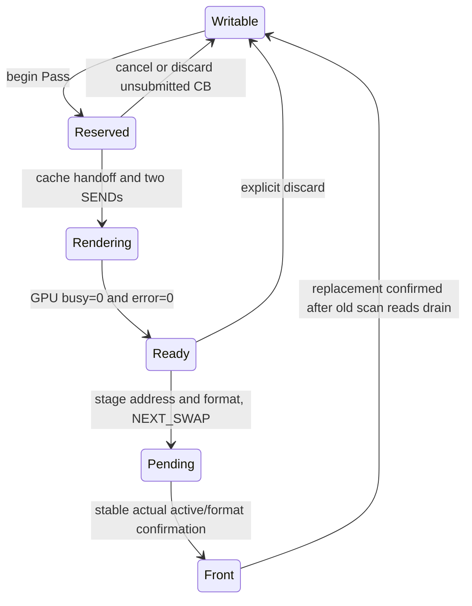
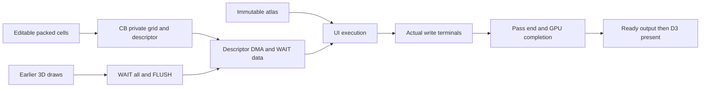

# RCC GPU driver

The application interface is `rcc/gpu.rs`. It manages one command buffer and a
single Clear/Store Pass with ordered Mesh/Instance and UI draws and fixed A/B/Depth
allocations. Initialization reads actual Display active/pending/format; it can
adopt either A or B as Front and chooses the other plane for rendering. The
driver presents through one serialized entry point. Runtime recovery is separate. The default CPU
Display diagnostic remains selected in the boot config.

## Application calls

| Call | Result and ownership |
|---|---|
| `gpu_init()` | Initialize once from actual GPU/Display state; Pending for an unknown in-flight owner or unstable snapshot, Fault for invalid active/format/health. Repeated init is rejected without forgetting work. |
| `gpu_init_with_format(format)` | Explicit output encoding: DISPLAY_RGB565=0 or DISPLAY_LINEAR_RGB565=1. Linear mode can adopt a valid raw or linear Front and stages linear encoding with the next actual swap; unsupported values reject before initialization. |
| `gpu_cb_begin()` | Return an opaque nonzero identity, or zero when recording/reuse is unavailable. Only a new or explicitly completed CB can begin. |
| `gpu_pass_clear(cb, rgb565, d16)` | Record the complete pass. False preserves cursors/state on validation or capacity failure. No raw command, address, length or DMA/window pointer is an application argument. |
| `gpu_pass_begin(cb, rgb565, d16)` | Reserve the confirmed Writable non-Front color, begin the sole Pass, and clear it and Depth. Return an opaque identity or zero. |
| `gpu_pass_set_global(pass, global)` | Encode/snapshot native Global64; identical encoded values consume no commands or object space. |
| `gpu_pass_set_render(pass, texture, render)` | Bind an immutable Texture handle and snapshot the remaining Render fields. Texture address/dimensions come from the handle. |
| `gpu_pass_draw_mesh(pass, mesh, matrix, rgba_low, rgba_high)` | Snapshot the native 21-u32 Instance matrix prefix and RGBA; expand the immutable compact directory in original order. |
| `gpu_pass_draw_ui_grid(pass, atlas, cells)` | Snapshot the packed cell table and private descriptor into the current Pass. Uses its reserved color and leaves Depth unchanged. |
| `gpu_ui_fill(cells, id)` / `gpu_ui_set_cell(cells, x, y, id)` | Edit the application's packed table; reject coordinates/IDs outside the fixed grid without modifying it. |
| `gpu_pass_end(pass)` / `gpu_cb_finish(cb)` | Drain/store the Pass, then append END and zero fetch padding and seal Ready. Each transition occurs once. |
| `gpu_submit_idle(cb)` | Pending after successful cache handoff and both SENDs; Rejected if ownership/state prevents acceptance. A callable cache-error path returns CacheError and sends neither GPU command; a physical memory error is unrecoverable and may halt/fault instead. |
| `gpu_poll(cb)` | Idle, Pending, Completed, Fault or Rejected. Completed transfers the CB back exactly once; later polls return Idle. |
| `gpu_wait(cb, limit)` | At most `limit` polls; Timeout retains ownership and permits later observation. A zero limit performs no poll. |
| `gpu_cb_cancel(cb)` | Cancel only an unstarted Building CB, including an open/ended Pass; release its reservation after a healthy ownership check. |
| `gpu_discard_ready(cb)` | Explicitly discard an unsubmitted Ready CB or a completed Ready output. Never release InFlight, Pending or Front. |
| `gpu_present(cb)` | Accept only the completed Ready output, with no Pending; stage base/format then NEXT_SWAP and return Pending. |
| `gpu_present_poll()` / `gpu_present_wait(limit)` | Observe Display separately from GPU completion; Completed means stable actual active/format and old-request drain are confirmed. Timeout preserves Pending. |

Status values are Idle=0, Pending=1, Completed=2, Fault=3, Timeout=4,
Rejected=5, CacheError=6, NotInitialized=7. Handles are identities of the one
fixed CB, not physical addresses or allocation tokens. Begin cannot discard
Ready/InFlight work, repeated pass recording cannot overwrite Ready work, and
repeated Completed polling cannot reclaim storage twice. Fixed targets/assets
change usage ownership; they are not deleted, relocated or reconstructed.
GPU completion leaves its color Ready: beginning another CB cannot implicitly
discard that output. The application must present it or explicitly discard it.

The module loader flattens RCC names. Internal `gpu_*` implementation modules
and raw/native encoders are not an application API or a memory-security boundary.
Applications use the calls above, serialize the single driver and do not write
Device4 or internal state directly. Native encoding tests may use internal entry
points; they are not a second submission interface.

## Fixed storage and units

The sole configuration is `rcc/gpu_layout.rs`, also consumed by host layout and
boot packing. Addresses below are physical **bytes**, with exclusive ends.

| Range | Owner |
|---|---|
| 0x400000..0x430000 | Fixed Color A, boot's initial Front |
| 0x430000..0x460000 | Fixed Color B, alternating output/Front |
| 0x460000..0x490000 | Fixed Depth |
| 0x490000..0x4a0000 | Driver command allocation, 64 KiB |
| 0x4a0000..0x4b0000 | Driver object allocation, 64 KiB |
| 0x4b0000..0x800000 | Fixed GPU asset allocations |

The entire high 4 MiB domain is Shared in `TangNano20kMemoryLayout`, never Main.
Boot's mandatory framebuffer ZERO remains legal, while optional COPY/ZERO
resources cannot occupy the command/object allocation. No hardware decoder,
PLL, CL3 memory timing, ordinary heap or FPGA image configuration is changed.

Internal physical bases use 128-byte sectors. CPU pointers and arena cursors
are **16-bit words**. Commands are low16 then high16; valid count can be 32768
words, exactly 65536 bytes, producing count-minus-one 16383. Padding through
the final 128-byte fetch sector belongs to the command allocation and is zero.
Objects remain separate from END and the valid command stream. No offset,
length or address conversion silently masks an invalid input.

The software state/CB descriptor and small encoding staging buffers stay in
ordinary CPU memory. They do not share cache lines with the GPU input arena.
There is no dynamic allocator, compaction, pingpong scheduler or second CB.
Completed-buffer reuse resets the command/object used lengths to zero while
retaining both 64-KiB allocations and their ownership. It does not zero or free
the capacity. The builder appends commands again; it does not retain/replay a
previous frame's encoded scene.

## Scoped DSEG3 access

`read_dseg_page(index)` and unsafe `write_dseg_page(index,page)` lower to the
existing single-entry MFSR/MTSR instructions. The selector is a compile-time
constant 0..3. Invalid constant physical pages are rejected; dynamic raw writes
have the documented eight-bit precondition. A write is retained as a compiler
memory/control barrier. No legacy bulk `mtsr_dseg` occurs in the GPU driver.

The generic window helper validates its fixed allocation, word range and low-memory staging
extent before touching memory. A bounded copy splits at 16384-word page
boundaries. For each chunk it saves DSEG3, completes blocking full
clean+invalidate, installs the checked physical page, verifies readback, copies,
completes another clean+invalidate, and restores/verifies the saved page.
Only logical 0xc000..0xffff is remapped; stack growth from 0xc000 stays below
the window, and DSEG0..2 remain unchanged. No window pointer escapes a call.
The copy kernel handles four 16-bit words at a time with constant offsets and
a scalar tail. Direction is selected outside that kernel. Bounds are checked
for the complete transfer before entering a mapping scope; expansion never
reads or writes beyond the requested words.

The D-cache is physically tagged, and accepted scalar stores retain physical
addresses. Remapping alone therefore does not alias an old cached page to a
new page. The generic window helper nevertheless retains its conservative
entry/exit clean+invalidate contract. These fences also publish writes and
discard stale data for external owners; GPU/CPU are not cache coherent.
The final submission barrier remains mandatory. A window is a bounded access
mechanism, not a persistently mapped arena or an implicit ownership transfer.

Ordinary CPU stores, accepted old responses and early-release FST tails drain
through the existing CPU maintenance barrier. On a maintenance or mapping
failure the driver restores the old page if it installed a new one, records a
sticky software memory fault and permits no GPU submission when execution can
return normally. Physical memory errors are fail-stop: dirty CPU stack data may
be lost, and callers must not rely on recovery, retry or a returned status.
Whole-system reset is required. Completed chunks
may already be visible after an I/O failure: cursors are not published, the
resource stays held and the driver does not claim a byte rollback or visibility
success. Validation/capacity failures occur before destination writes.

An architectural CPU load/store/instruction fault stops execution rather than
returning an error to RCC. Software cannot restore a mapping after that stop;
coordinated reset is required. Scoped restoration covers reported maintenance
status and mapping-readback failure, not resumable CPU exception handling.

## Encoding and execution

`gpu_encode.rs` implements current u32 commands and native Global64, Render32,
Target32 and Instance128 with explicit pairs of 16-bit values. The canonical
format remains [GPU commands](/ip/gpu-v2/docs/commands.md) and
[native objects](/ip/gpu-v2/docs/formats.md#native-command-objects).
Global checks F16 far, modes/intensities, ray range and the exact integer
unit-light squared-length tolerance. Render validates complete texture
allocation, mip chain, filtering, depth flags, RGB specular and signed F4 bias.
Instance records all 21 matrix words, mandatory word21=65536, word22=RGBA and
zero padding. Recording snapshots source values before returning; subsequent
source mutation does not change previous objects. The raw native matrix entry
remains available alongside the affine helpers below.

The Clear pass records WAIT(all), FLUSH, DMA Target32, WAIT(data), SET_TARGET,
CLEAR(color), CLEAR(depth), WAIT(all), FLUSH, END. Before launch the sole driver
again blocks on full clean+invalidate and checks the result, then rechecks GPU
status. It saves in-flight ownership before serial count/start SENDs. Only
busy=0 **and** error=0 completes. Error is checked first, even when busy is zero;
sticky transport or software memory fault retains resources and stops new work.
Timeout does not clear busy, ACK, reset, cancel, present or release an allocation.

## Color ownership and Display completion

One private record holds Front, Pending, Ready, Reserved and Rendering identities.
Targets come only from this record; application Pass/present calls take no raw
target address. Depth is owned by the sole GPU execution. All plane allocations
are disjoint and cache-line aligned; an adjacent/misaligned identity is rejected.

GPU and Display completion are distinct. `gpu_poll` can report Idle while
Display remains Pending; that does not make either color Writable. The driver
never infers swap completion from frame_index, GPU idle or the NEXT_SWAP write.
Other driver calls may also advance a confirmed Display transition while
checking ownership; Completed is an observation result, not a hardware ticket.

A Display observation reads status, active low/high, format, then status again.
Changing status yields Pending and retries within the caller's bound. A stable
pending=0 snapshot must match the expected A/B target and its expected tiled format.
Default `gpu_init()` retains strict raw RGB565 behavior. Explicit linear initialization
tracks the old Front encoding separately from the requested encoding: Pending must
retain the old format, and actual swap completion must expose the requested one.
Linear RGB565 uses Display's existing linear-to-screen conversion; it does not
change GPU color data or lighting. The desired format is staged with the address
before NEXT_SWAP and becomes Front's format only after actual confirmation.
While an owned swap is still pending the active address must remain the old
Front. Only one software writer may stage/submit Display; unknown pending after
initialization, unexpected active changes, partial staging, invalid address,
underflow, memory error or incompatible format fault the owner and retain all
protected resources. A transport error wins even if GPU busy is zero; unexplained
GPU busy after the driver was idle likewise stops ownership changes.

At startup unknown GPU busy and unknown Display pending are observed without
inventing a completed CB. Both colors stay unavailable until actual Display
pending clears into a valid active/format and the old GPU owner becomes idle.
No local ACK/reset or driver reinitialization can erase retained ownership.

The existing Display RTL applies pending only on a synchronized frame event
with `frame_complete`. That bit follows the final successful response of the
last old-frame segment. No further old external reads are issued before the
switch. Private line-buffer pixels can finish after the boundary without owning
the old external plane. Stable readback of this transition is what releases the
old Front. Frame-count wrap and pending across multiple events require no special
case. Timeout is an observation limit and later polling may still complete.

Before launching GPU writes, the existing blocking clean+invalidate drains dirty
CPU input and old output aliases. Cleaning after GPU writes cannot repair a
dirty old output alias: it would overwrite the new image. CPU must not access
Front, Pending or Rendering planes or their cache lines, and must not mutate
in-flight inputs. The trusted library provides no raw plane upload API; unsafe
pointer/device access outside this contract is not prevented by hardware.
Present needs no post-render CPU clean: successful GPU FLUSH already published
the frame. Software faults hold resources until coordinated recovery.

## Static assets and ordered recording

`GpuMesh` is a trusted boot/packer root: `first_sector/sectors` owns its full
allocation, and `directory_sector/directory_word/count` identifies its compact
table. Each entry is two little-endian u16 words: record byte-address/128 and
payload sector count (1..8). The record contains the current 32-byte metadata,
96-byte prefix padding and complete padded payload. The directory is software
data, not a GPU header or a new meshlet ABI. Empty Meshes emit no commands.

The generator validates native metadata, indices, decoded positions, uniform20,
padding and numerical assumptions once. The driver validates the root, complete
directory extent and every entry's range/non-aliasing before recording a draw;
it does not decode all vertices each frame or safely import arbitrary bytes.
The checked directory is immutable through completion. Up to 32 entries remain
in a fixed 64-word buffer after preflight and are reused for recording. Larger
meshes use a second bounded read after complete preflight. Batches contain at
most 16 entries, including when crossing 128-byte or
32-KiB boundaries. `GpuTexture` holds a fixed base/allocation and POT/mip fields.
Render encoding checks the complete allocation. Assets stay resident across CBs;
binding a Texture neither uploads it nor invalidates its physically tagged cache.

The high-memory Pass builder writes commands and encoded objects directly at
their final addresses, as specified below. Its legacy low-memory path retains
128-word command staging and bounded encoding scratch. Raw native snapshot
helpers are compatibility entry points, not the application Pass recording path.
Capacity preflight includes alignment, Pass drain, END and final 128-byte padding.
Rejected operations leave the previous command/object cursors and staged prefix
unchanged. An I/O failure holds the CB under the sticky memory-fault rule above.

Dedicated local staging is Global qwords264..271, Render272..275 and Target276..279;
Instance is uniform block20 (qwords320..335). Each changed Global/Render emits
WAIT(all), DMA_LOCAL, WAIT(data), SET. Deduplication compares the actual encoded
object, including physical immutable texture identity, not the source pointer.
Each CB reinstalls its own state; a nonempty draw needs both bindings.

Each draw first DMA-copies its Instance and waits for data, then loads meshlet0
into page0 and waits. For each current page, the next record is prefetched into
the other page before DRAW; WAIT(data) precedes consuming that next page. DRAW
retirement establishes V/T completion, allowing page/uniform reuse while the
previous R/I/backend continues. Global/Render changes still require full render
drain. No cross-Mesh prefetch or transparent draw reordering occurs.
Clear-only wraps this same begin/end/finish Builder.

## Direct high-memory recording

The fixed high-memory command/object allocations retain their capacity across
reuse; reset clears lengths and state, not the complete allocations. A command
append batch maps its final page once, keeps a local word cursor and writes
native command halves at that cursor. Meshlet DMA/DRAW/WAIT combinations are
written as one directory batch; only a 32-KiB crossing falls back to per-command
page transition. The complete draw is capacity/entry validated first, and its
original prefetch/WAIT/DRAW ordering is preserved.

Target, Global, Render and Instance encode directly at their aligned object
positions, including every reserved zero word. No intermediate packet upload
occurs. Global and Render semantic identity caches preserve encoded deduplication;
Render allocation slack is validated but is not part of encoded identity.
Global parameters and Instance matrix inputs remain below logical 0xc000, outside
the remapped window. Every builder entry restores/verifies the incoming DSEG3.
END is followed by directly zeroed fetch padding up to the next 128-byte boundary;
old frame contents are overwritten even when the allocation is reused.

Only CPU-owned input arenas and immutable assets use internal mapping scopes
without entry/exit maintenance. Cache tags, pending scalar stores and FST tails
carry physical addresses, so these scopes can change mapping without aliasing
old data. GPU output surfaces are excluded. Final submission still drains old
CPU/FST work and performs blocking clean+invalidate before either Device4 SEND.
No CPU/GPU cache coherence, extra hardware or second in-flight CB is introduced.

## Packed UI snapshots

`GpuUiAtlas { sector, sectors }` describes a trusted immutable native atlas in
GPU asset space. Its base is 64-KiB aligned and its allocation includes all
65536 bytes, including unused slot255. It cannot overlap the CB, objects or
output planes. The native format and bank order are defined by
[GPU UI](/ip/gpu-v2/docs/ui.md); a UI atlas is separate from a filtered RGB565
Texture. Pixel data stays immutable until GPU completion.

Applications allocate `Buf<u16,375>` for 750 row-major IDs. Low byte is the
first cell, high byte the next; each 50-cell row uses 25 words. IDs0..254 draw
and255 skips. `gpu_ui_fill` accepts an ID0..255; `gpu_ui_set_cell` accepts
x0..49/y0..14 and preserves the other byte. Like other RCC Array views, the
argument must refer to the declared allocated storage: Array carries no runtime
allocation length. Helpers and recording check the full 375-word source span
stays below the DSEG3 window. They do not interpret a CPU pointer as physical.

Recording copies the caller's 375 packed words directly to a private 128-byte
aligned object position. It then writes nine FFFF padding words and a zero-padded
16-word descriptor using a 25-word temporary. There is no second full-grid CPU
buffer or per-cell window switch. For high-memory recording, the grid and tail
are two source spans of one contiguous upload: each physical page is mapped
once under the CPU-owned-input scope, even when it contains the end of the grid and the descriptor.
Both low source extents and the entire high destination are checked first.
Transfers still split at 32-KiB boundaries and restore the mapping. The final
submission barrier drains old stores/FST and publishes the completed snapshot. The caller
can edit its table and atlas root fields after a successful record; those edits
do not alter the recorded snapshot or descriptor. Actual atlas pixel storage
remains in-flight read-only.

One UI call reserves 400 object words (800 bytes), plus0..63 words of initial
alignment. It preflights atlas extents, source span, both complete arenas and
five commands with the existing Pass drain/END/padding allowance before any
writes. Invalid arguments or insufficient capacity leave CB cursors, staging
and prior recording unchanged. A reported transfer failure can leave partial
private bytes; the sticky memory fault retains the CB and prevents submission,
cancel/discard and presentation rather than claiming rollback.

The ordered commands are WAIT(all), FLUSH, DMA of the descriptor into the old
Target staging slot, WAIT(data), then UI_GRID. The installed target survives
staging reuse. UI completion includes its actual write terminals. Global/Render
bindings remain cached; no texture invalidation is inserted. UI invalidates both
meshlet input pages, but each subsequent `gpu_pass_draw_mesh` already reloads its
Instance and first page and prefetches all later pages, so no duplicate page
validity state is needed. Pass end still emits WAIT(all)/FLUSH before END.

UI uses only the Pass's reserved color, with the normal Front/Pending/Rendering
protection and failed-handoff retention. FF and alpha0 preserve existing pixels;
UI does not clear its background. A later 3D draw can overwrite UI, so a final
text overlay belongs after the scene. UI does not independently present or
change the Display completion boundary.

## Affine and Camera helpers

`gpu_transform.rs` uses existing fix32, vec3/4, fdot, frcp and fsincos operations.
All matrices are row-major signed Q16.16. A Pose is 18 u16 words containing
translation XYZ, Euler XYZ and scale XYZ as low/high pairs; `gpu_pose_set`
accepts vec3 values. Angles are radians, rotation is Rz*Ry*Rx. Translation is
bounded to +/-64, angles to +/-4, positive per-axis scale to [0.5,2].
`gpu_affine_identity/trs/compose` produce twelve matrix coefficients in 24 words;
compose supports aliased output via bounded scratch. Coefficients are bounded
to +/-4 and translations to +/-64; invalid output leaves the destination intact.

`gpu_camera_view` accepts a rigid unit-scale Pose and forms its transpose rotation
and negative rotated translation. `gpu_instance_trs` forms Camera*Model position
and CameraRotation*ModelRotation*inverse(ModelScale) normal matrices in 42 words.
It handles nonuniform positive scale analytically; it does not compute a general
4x4 inverse. Special-function approximation remains that of the CPU FPU.

Camera axes are +X right, +Y down, +Z forward. The GPU's fixed projection uses
pixel-center rays `(2*x-399,2*y-239,512)`, or screen `(199.5+256*X/Z,
119.5+256*Y/Z)`. There is no configurable perspective matrix or near-plane fan
clipping. `gpu_bounds_set` creates a 13-word AABB/scale_s descriptor;
`gpu_instance_bounds` checks its eight corners after the actual signed scale_s
shift, requiring every component in [-131071,131071] and forward Z positive.
Bounds inputs are limited to +/-64. This conservative helper is optional for the
native matrix path: the asset/caller must still establish its corresponding
scale_s, normal-quantization and source bounds. It does not alter metadata or
guarantee precision for an arbitrary imported asset. Shifting by scale_s loses
that many raw position bits; depth compensation remains the existing GPU rule.

## Validation boundary

Bounded compiled-CPU tests compare command/object bytes against the host GPU
encoding, exercise legal/illegal boundaries and failed-operation atomicity,
snapshot mutation, full-capacity tails, DSEG3 crossing/restoration and fault
ownership. Control-only peers inject busy, maintenance failure and transport
error; these tests do not execute rendering.

The native RTL fixture executes the compiled application through real CPU,
D-cache, SystemControl and the production Device4 GPU command composition.
It builds high-memory inputs, performs two consecutive Clear submissions,
checks true write terminal completion and compares both planes, Front, padding
and neighboring memory. It includes held CPU response, FST, GPU CE and memory
backpressure; a real cache writeback error must prevent all GPU starts and
restore DSEG3. No Display scanner runs in that controlled fixture.

The drawing fixture records two Passes on the real CPU, using immutable RGB/UV
records and a fixed texture, multiple Instances, changed lighting/Render and a
transparent final overlay. It compares materialized Color with an independent
integer ray/edge and Q6-blend reference; planar Z is checked within one D16 code
of the independent value. Front, full plane padding, command padding and nearby
memory remain protected. A diagnostic second object-arena starting cursor places
Target at the first DSEG page tail and subsequent snapshots in the second page;
that placement is not an application API. Separate compiled tests cover directory
crossing and rejection without modifying the existing recording. These compact
fixtures do not qualify arbitrary interpolants, lighting or full-scene capacity.

The Display ownership fixture connects actual RCC/CPU/cache/SystemControl, GPU,
FramebufferHdmi and the production seven-client memory arbiter to one retained
64-bit memory service. It renders compact RGB and UV geometry into B then A,
presents both, and compares every visible RGB sample of the complete 800x480
scanouts with independent expected 400x240 surfaces. GPU writes are checked both
at acceptance and true write terminal against active Front and any outstanding
old Display read. Dirty old output aliases and an FST tail precede handoff;
they must be visible before GPU start, and cannot be cleaned over a new image.
The companion real-maintenance-error case must launch neither GPU nor present.

The scan fixture compresses cold blank startup, then uses pixel clock twice the
logic clock to stress the memory-port protocol within a bounded simulation.
Production timing constants, complete source-frame fetches and Display CDC remain
in the RTL; no internal frame or ownership state is forced. Icarus bypasses the
serializer as in the existing Display tests. This is not the board's PLL ratio,
TMDS/SDRAM pin timing or physical visual qualification. Control-only peers cover
initial takeover, unstable snapshots, pending deferral, wrap, faults and timeout;
they do not replace the real scan/arbiter fixture.

The UI scan fixture records actual 3D/UI/3D/UI sequences on the real CPU and
presents two frames through the production arbiter and Display. It modifies the
application table after each recording, includes all-FF and alpha0 cells, left/
right edge IDs0/254, verifies later DRAW reloads and crosses a DSEG3 page with
the second frame's private grid. Full Color and independent Depth expectations,
atlas/asset guards, write terminals and visible RGB samples are checked. Its
companion injects a real UI-grid maintenance writeback error and requires
restoration, retained resources and no GPU/present. Software controls cover
packed setters, command/object capacity and recording lifecycle rejections.

Its memory peer models the 64-bit shared-port contract, not SDRAM pins. The
required legacy system co-simulation remains separate from this native GPU
chain; neither establishes CL3 pin timing, full boot or physical board qualification.
Pure software changes do not create a new fitted-area or timing measurement.
