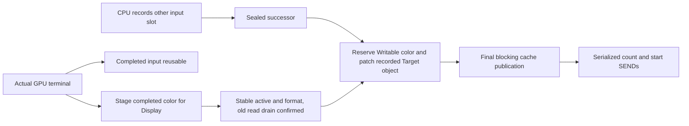
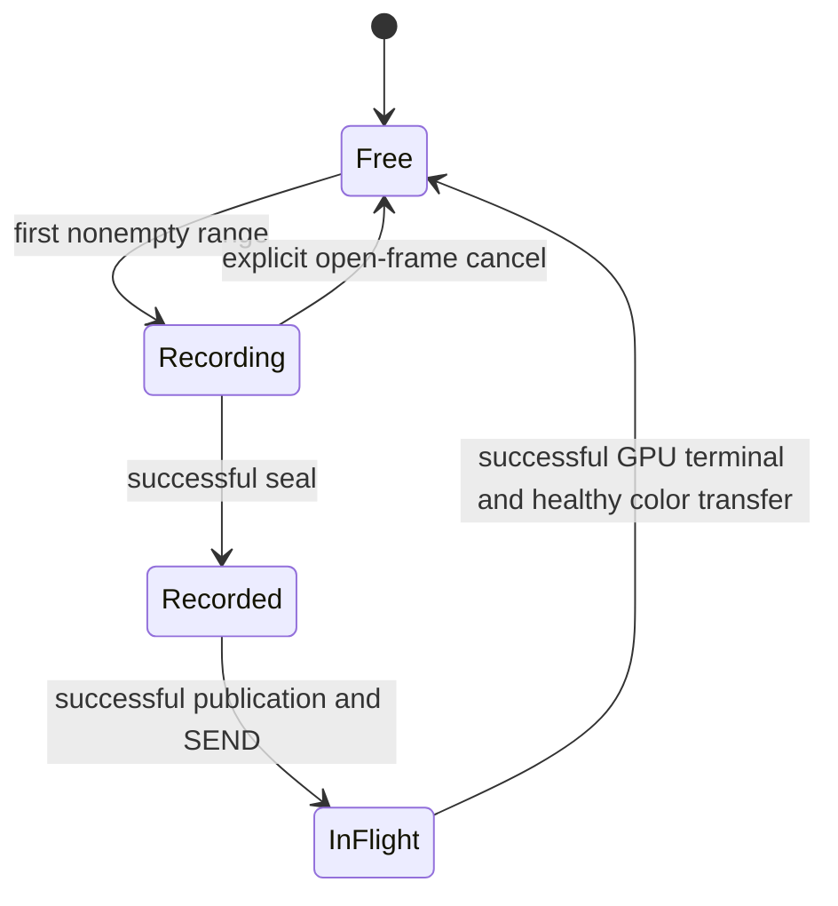

# Internal GPU input pipeline

The internal RCC module gpu_pipeline implements a two-input scheduler using the
existing builder, single GPU driver and Display ownership record. It is a
diagnostic/internal interface, not a public resource or RAII API. The legacy
gpu frontend and demo still use slot0. These frontends must not be mixed: slot
initialization permanently associates each arena with its one descriptor.

## Storage and lifetimes

The sole layout authority is rcc/gpu_layout.rs, shared with host boot packing.
The renderer and controller-UI asset producers read it through
tools/gpu_layout.py and reject
allocations outside its asset interval. Existing A/B/Depth, slot0 and asset
starts retain their addresses. The two extra 64-KiB input arenas are
0x7e0000..0x7f0000 and 0x7f0000..0x800000. The preceding two 1-KiB pages at
0x7df800..0x7e0000 hold persistent UI pages, one per input slot. Optional boot
COPY/ZERO cannot occupy any input or UI page.

One CPU recorder, at most one sealed successor and one running GPU are allowed.
An open recorder and a sealed successor are mutually exclusive. Each slot has
a separate GpuBuffer, command/object lengths and builder-generated Target object
word. Encoders and builder scratch are shared only by the serialized recorder.
No input payload is copied between the slots, zeroed on reuse or dynamically
allocated. The old ownership record, cache handoff and single in-flight Device4
rule are retained.

| Data | Last use and reuse boundary |
|---|---|
| Command/object arena | Actual successful GPU terminal; reset lengths on its next recording |
| Open recorder | Explicit cancel resets its lengths and relocation; no submit or Display operation |
| Sealed successor | Held until actual Writable target is available and its submission succeeds |
| Persistent UI page | Recording owns updates; Recorded/InFlight contents stay immutable; successful GPU terminal releases its reference |
| Color/Depth | Existing Display Front/Pending/Rendering/Ready rules and single GPU execution |

## Recording, target binding and progress

Begin records a private placeholder Target without reserving a color plane.
The builder records the actual aligned Target object word, including when
objects were already allocated. This metadata replaces any dependency on fixed
demo offsets. Seal appends the ordinary pass drain, END and zero fetch padding.
The sealed stream is still CPU-owned input, not a GPU publication.

Advance first observes the current work; it submits only when no GPU is running
and a successor exists. It reserves the confirmed Writable color, replaces the
private Target using the native encoder and restores DSEG3, then calls the
existing driver's final cache barrier before either SEND. Relocation uses the
existing private CPU-input mapping scope without extra entry/exit maintenance;
physical cache tags and latched scalar/FST addresses remain the prerequisite.
It may not modify InFlight inputs. A reported final maintenance failure sends
neither count nor start.

Poll never submits a successor. A successful GPU terminal marks that input
Completed and automatically requests present; its color may still be Pending.
Display frame count, GPU idle and NEXT_SWAP are not substitutes for stable
active/format and old-read retirement. Recording can proceed during that
Pending interval, but advance cannot write either occupied color.

The first frame is recorded and advanced to prime the pipe. During its GPU
execution the other slot is recorded and sealed. After GPU terminal and Display
retirement, advance submits the successor and the first input slot can record
again. After sealing or canceling the open recorder, draining repeatedly
advances/observes until there is no sealed input,
GPU work or Display Pending; the caller owns its polling bound. Cancel affects
only an open, unsubmitted recorder. There is no hidden wait in cancel or seal.

## Persistent UI canvas

The internal gpu_ui_persistent helper owns one 50x15 desired canvas (375 packed
u16 words, low byte first), a 375-bit dirty mask per physical page, a dirty-word
count, content version and initialized flag per page. The last bitmap word uses
only seven bits. Canvas metadata stores registration, desired version and the
immutable atlas sector/extent. These records occupy 435 low-memory words in
total; no heap or change log is used. Existing glyph FF transparency and the
8x16 atlas format are unchanged.

Registration validates the atlas extent/alignment, fills desired with FF and
marks both pages dirty, without writing high memory. Re-registering exactly
the same atlas is idempotent; replacement is rejected. Initial registration
requires no open, queued or executing input. Atlas bytes stay in the existing
asset pool and are never copied into a UI page.

Set updates one byte while preserving its neighbor, and marks the corresponding
word dirty in both page histories only when desired changes. A field replaces
its complete declared width, padding a shorter value or hidden field with FF.
Geometry, low-memory source extent and all visible IDs are preflighted before
any edit; hidden fields do not read their source. A content-version increment
records each changed cell, not a frame or submit. Versions wrap at 16 bits;
dirty masks remain authoritative even when an old page version compares equal.

Each physical page uses the following fixed layout:

| Word offset | Contents |
|---|---|
| 0..374 | Packed desired glyph cells |
| 375..383 | FF fetch padding, initialized once |
| 384..399 | Native 32-byte descriptor pointing to this page and the registered atlas, initialized once |
| 400..511 | Unused; never written by the canvas |

gpu_pipeline_ui_range records a half-open cell interval. The first nonempty
range pins that input's page, emits the ordinary ROP drain, descriptor DMA and
data wait; later ranges reuse that descriptor. Complete command capacity,
including final END/fetch padding, is checked before emission or pinning. An
empty valid range is a no-op. The UI descriptor and cells consume no command
buffer object space; Target relocation remains independent. UI data persists,
but a cleared framebuffer still needs the required nonempty UI draw ranges.

Seal selects the frame's content: while the page is Recording, it maps DSEG3
once and writes only its dirty words. First use also initializes padding and
the descriptor, totaling 400 word stores. A clean initialized page returns
without a mapping or store. Successful restoration retires only that page's
dirty history and records the desired version. No cache-maintenance command
is added; the existing final submission fence publishes the page together
with command/object inputs. All ranges, including those recorded before a
desired edit, see the same final sealed version. Post-seal edits affect desired
and dirty masks for future frames, never the sealed physical page.

Display Pending may remain after UI release: Display reads the color surface,
not the UI input page. Cancel releases only an open Recording reference and
keeps desired plus dirty/version history, even if the page was already prepared.
It cannot release Recorded/InFlight input. Faults freeze the remaining references
without retry or automatic reclamation. No public resource ownership or raw
helper isolation is implied by this internal state machine.

## Fault and verification boundaries

The first observed transport, Display, memory, relocation or handoff failure
freezes the scheduler and retains all its records. A fixed five-word record
holds code, submission sequence, implicated slot, valid command length and
sampled GPU status. It is diagnostic state, not a recovery protocol. No reset,
retry, allocation or implicit release occurs; a dead memory bus can prevent the
record itself from becoming externally readable.

Fault codes are 1/2/3 for Display/driver/slot initialization, 4 for an existing
memory fault, 5 for GPU observation, 6 for completed-color/present transfer,
7 for Display observation, 8/9 for begin/seal memory failures, 10 for target
reservation, 11 for relocation/render ownership and 12 for final publication.
Codes 13/14/15 identify UI preparation, reference transitions and retirement.

Compiled RCC/CPU tests check slot0/slot1/slot0 reuse, exact native command and
Target bytes at a nonzero relocation offset, recording while a controlled GPU
peer remains busy, delayed Display retirement, cancellation and fault freezing.
A legacy slot1 UI snapshot crosses a 32-KiB window and preserves the running
input. Persistent UI tests execute seven alternating frames, compare commands
and descriptors with native encoders, and journal every scalar CPU store to
prove dirty-only updates, immutable referenced pages and untouched tails.
They cover short-field erase/hide, neighboring bytes, both-page convergence,
version wrap, capacity preflight, cancellation, failed publication and terminal
GPU/Display faults. The tests also cover the last word before 8 MiB and
the reduced asset limit. GPU/Display peers certify software sequencing only;
these tests do not establish real GPU concurrency, raster output, scanout,
public compile-time ownership or board qualification.
