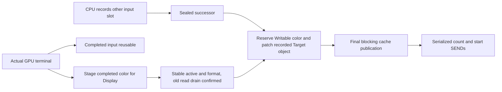

# Internal GPU input pipeline

The internal RCC module gpu_pipeline implements a two-input scheduler using the
existing builder, single GPU driver and Display ownership record. It is a
diagnostic/internal interface, not a public resource or RAII API. The legacy
gpu frontend and demo still use slot0. These frontends must not be mixed: slot
initialization permanently associates each arena with its one descriptor.

## Storage and lifetimes

The sole layout authority is rcc/gpu_layout.rs, shared with host boot packing.
The renderer and controller-UI asset producers read it through
tools/gpu_layout.py and reject
allocations outside its asset interval. Existing A/B/Depth, slot0 and asset
starts retain their addresses. The two extra 64-KiB input arenas are
0x7e0000..0x7f0000 and 0x7f0000..0x800000. The preceding two 1-KiB pages at
0x7df800..0x7e0000 are reserved; this stage does not initialize or manage
persistent UI pages. Optional boot COPY/ZERO cannot occupy any input or UI page.

One CPU recorder, at most one sealed successor and one running GPU are allowed.
An open recorder and a sealed successor are mutually exclusive. Each slot has
a separate GpuBuffer, command/object lengths and builder-generated Target object
word. Encoders and builder scratch are shared only by the serialized recorder.
No input payload is copied between the slots, zeroed on reuse or dynamically
allocated. The old ownership record, cache handoff and single in-flight Device4
rule are retained.

| Data | Last use and reuse boundary |
|---|---|
| Command/object arena | Actual successful GPU terminal; reset lengths on its next recording |
| Open recorder | Explicit cancel resets its lengths and relocation; no submit or Display operation |
| Sealed successor | Held until actual Writable target is available and its submission succeeds |
| Color/Depth | Existing Display Front/Pending/Rendering/Ready rules and single GPU execution |

## Recording, target binding and progress

Begin records a private placeholder Target without reserving a color plane.
The builder records the actual aligned Target object word, including when
objects were already allocated. This metadata replaces any dependency on fixed
demo offsets. Seal appends the ordinary pass drain, END and zero fetch padding.
The sealed stream is still CPU-owned input, not a GPU publication.

Advance first observes the current work; it submits only when no GPU is running
and a successor exists. It reserves the confirmed Writable color, replaces the
private Target using the native encoder and restores DSEG3, then calls the
existing driver's final cache barrier before either SEND. Relocation uses the
existing private CPU-input mapping scope without extra entry/exit maintenance;
physical cache tags and latched scalar/FST addresses remain the prerequisite.
It may not modify InFlight inputs. A reported final maintenance failure sends
neither count nor start.

Poll never submits a successor. A successful GPU terminal marks that input
Completed and automatically requests present; its color may still be Pending.
Display frame count, GPU idle and NEXT_SWAP are not substitutes for stable
active/format and old-read retirement. Recording can proceed during that
Pending interval, but advance cannot write either occupied color.

The first frame is recorded and advanced to prime the pipe. During its GPU
execution the other slot is recorded and sealed. After GPU terminal and Display
retirement, advance submits the successor and the first input slot can record
again. After sealing or canceling the open recorder, draining repeatedly
advances/observes until there is no sealed input,
GPU work or Display Pending; the caller owns its polling bound. Cancel affects
only an open, unsubmitted recorder. There is no hidden wait in cancel or seal.

## Fault and verification boundaries

The first observed transport, Display, memory, relocation or handoff failure
freezes the scheduler and retains all its records. A fixed five-word record
holds code, submission sequence, implicated slot, valid command length and
sampled GPU status. It is diagnostic state, not a recovery protocol. No reset,
retry, allocation or implicit release occurs; a dead memory bus can prevent the
record itself from becoming externally readable.

Fault codes are 1/2/3 for Display/driver/slot initialization, 4 for an existing
memory fault, 5 for GPU observation, 6 for completed-color/present transfer,
7 for Display observation, 8/9 for begin/seal memory failures, 10 for target
reservation, 11 for relocation/render ownership and 12 for final publication.

Compiled RCC/CPU tests check slot0/slot1/slot0 reuse, exact native command and
Target bytes at a nonzero relocation offset, recording while a controlled GPU
peer remains busy, delayed Display retirement, cancellation and fault freezing.
A slot1 UI snapshot crosses a 32-KiB window and preserves the running input;
this is not persistent UI. The tests also cover the last word before 8 MiB and
the reduced asset limit. GPU/Display peers certify software sequencing only;
these tests do not establish real GPU concurrency, raster output, scanout,
public compile-time ownership or board qualification.
