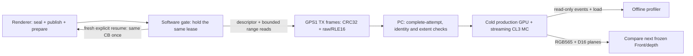

# GPU profiling sessions

The system-owned profiler combines a software-only published-input snapshot,
bounded cold replay, passive simulation observer, correlator and offline viewer.
Its [tool README](/systems/cpu-v3-tang-nano-20k/tools/gpu_profiler/README.md)
owns usage and verification commands. It changes no synthesized logic or Device4
ABI. A render frame, a CPU recording interval and a GPU submission are distinct.

## Identity and time

`profile.json` has `schema: "digitaldesign.gpu-profile"` and `version: 2`.
All timestamps are nonnegative integer cycles relative to `origin`; `clock_hz`
converts them to display units. Integers must fit JavaScript's exact integer
range. Intervals are half-open `[start,end)`. Session `start/end` enclose all
recorded work, including CPU recording for later submissions.

| Collection | Identity and binding |
| --- | --- |
| `submissions` | Increasing `id`, accepted `start`, drained `end`, byte `base/bytes`, optional logical `frame_id/name` |
| `commands` | Unique occurrence `id`, owning `submission`, display-only byte `pc`, `word/opcode`, fetch `start`, `execute`, release `end` |
| `jobs` | Session-wide DMA `id`, owning `command/submission`, source/slot and true completion `end` |
| `dma_transactions` | Session-wide `id`, `submission`, logical `job` or zero for CB prefetch, request-to-real-LAST interval |
| `meshlets` | Session-wide `id`, owning `command/submission`, associated DMA job, VT and R/I/P intervals |
| `cpu` | Unique span `id`, logical `frame_id`, label `name`, independent `start/end` and optional cropped `partial` |

CB address or PC reuse does not reuse identity. A/B/A buffers may all contain PC
zero; selecting CB3/PC0 cannot select CB1/PC0. Physical triangle/pool/context slots
carry independent observer generation ownership; their reuse is not a meshlet ID.
No frame is inferred from a CB address. The current hardware runs one CB at a time;
CPU preparation may overlap its execution.

## Published-input snapshot and transport

The [capture bridge](/systems/cpu-v3-tang-nano-20k/docs/gpu-capture.md) defines
the unique 64-u16 descriptor and eight-u16 range entries. The renderer freezes
after publication and prior completion, before either COUNT or START. The
consumer reads that lease; it does not own a second GPU scheduler. Arbitrary
in-flight pipeline state is outside this interface.

The PC storage decoder accepts layout ABI1 (row macrotiles,192000-byte planes)
and ABI2 (column macrotiles with padded height16,204800-byte planes), both at
400x240. Build declaration v1 retains implicit row storage; v2 binds the exact
layout/profile, memory map and typed asset catalog. Wire/header/range versions
do not change. The reader preserves old row descriptors and input identities.
Supported combinations are `(layout,command)=(1,1)` and `(2,1)`; v2 build identity
includes top-level `command_abi:1`. The paused RTT `(2,2)` combination is refused.

ABI2 has96000 logical pixels and6400 additional physical padding words. Its
262144-byte reserved allocation is distinct from the204800-byte physical plane;
the57344-byte tail is not initialized by CLEAR. Physical preimages are required.
Allocation-tail capture is explicit, and referenced bytes must be present.
Native replay rejects uncaptured reads and writes outside the captured writable
extent. Color/depth comparison reports logical, padding and guard differences
separately, with an explicit compared guard size. A whole-plane match includes
the physical padding, not just visible pixels.

The private diagnostic can consume a hash-bound CPU-produced column asset
catalog, retaining ordinary POT mip packing and unchanged UI data. It does not
implement the formal renderer's producer/profile selector. A synthetic capture
or frozen-export replay therefore cannot qualify the actual CPU capture hook,
physical buttons, board timing or a newly compiled bitstream.

Wire integers are little-endian. Every frame has a 24-byte envelope followed by
its payload and a u32 CRC32 of envelope+payload:

| Field | Width | Meaning |
| --- | --- | --- |
| Magic | 4 bytes | ASCII `GPS1` |
| Version, kind | u8, u8 | Version1; kind below |
| Flags | u16 | Zero |
| Snapshot, attempt | u32, u32 | Prepared token; nonzero transfer-attempt identity |
| Sequence, payload bytes | u32, u32 | Strictly increasing from0; at most4096 bytes |

| Kind | Payload |
| --- | --- |
| BEGIN1 | Exact driver descriptor, 128 bytes |
| RANGE2 | u16 sequential index + exact eight-u16 range |
| DATA3 | u16 range, u16 codec, u32 byte offset, u32 decoded bytes, encoded body |
| RANGE_END4 | u16 range, u16 zero, u32 decoded bytes, u32 decoded CRC32 |
| END5 | u32 range count, bytes, chunks, canonical CRC32, board dump milliseconds |
| ERROR6 | Diagnostic failure bytes; never a complete snapshot |

All RANGE records precede DATA. DATA is contiguous within sequential ranges;
one decoded chunk is even, nonzero and at most1024 bytes. Firmware uses at
most512 bytes. Codec0 is raw; codec1 is RLE16: token bit15 selects repeat, low15
plus1 is its word count. A repeat carries one u16, a literal carries that many.
Raw is selected whenever compression is not shorter. Decoding is bounded before
expansion. Canonical CRC32 covers descriptor bytes, RANGE payloads in table order,
then decoded DATA in range order. No missing-END or partially closed range is
accepted, and attempts cannot donate data to each other.

Physical addresses and lengths are bytes; the driver reader's offset is a u32
count of **u16 words**. Input SHA256 includes the descriptor, exact range entries
and decoded bytes. Attempt/time/host file locations do not change that input
identity. Per-file hashes and alias consistency are checked again on reload.
Immutable catalog checks and initialized-read guards supplement framing integrity.

Cold replay clears internal GPU/MC state and seeds captured DRAM bytes. It uses
production streaming RTL at related54/108MHz clocks with an accelerated startup
delay outside the measured submission. The functional pin model uses CL3,
RCD3/RP3, tAC6ns/tOH2ns and an explicit fixed4ns return delay; these are replay
assumptions, not measured PCB/PVT limits. CPU/Display traffic and warm caches are
not recreated. A matching result therefore establishes exact output for these
frozen inputs, without certifying board timing or reproducing every contention
case.

## Observer records

The event stream starts `FORMAT 2`. Subsequent numeric records retain decimal
cycles and IDs; instruction words in `CMD_EXEC/CMD_END` are hexadecimal.

| Record | Fields after the tag |
| --- | --- |
| `SUBMIT` | cycle, submission ID, CB byte base, valid byte length |
| `DONE` | cycle, submission ID, cumulative allocated/published/retired/cache-committed/empty-skipped quad counts |
| `CMD_EXEC` | cycle, PC bytes, instruction word |
| `CMD_END` | release cycle, PC bytes, fetch cycle, execute cycle, state, word |
| `DMA_JOB / DMA_DONE` | accepted cycle/job/PC/mesh/slot/source/size; completion cycle/job |
| `DMA_REQUEST / DMA_RETURN` | cycle/transaction/job/address/count; completion cycle/transaction/job |
| `DRAW / VT_END` | cycle/meshlet/PC/input slot/DMA job; completion cycle/meshlet |
| `Q_ALLOC / Q_PUBLISH / Q_RETIRE` | cycle/quad/meshlet/slot; cycle/quad/meshlet/mask; completion cycle/quad/meshlet/empty |
| `ROP_BEGIN / Q_COMMIT / FINAL` | cycle/quad/meshlet; completion cycle/quad/meshlet; cycle/quad/meshlet/lane |
| `STATE` | cycle, PC, CP state, render idle, work busy, DMA idle, memory busy, flush complete, waits done, CE |
| `CPU_BEGIN / CPU_END` | cycle/span/logical frame/remaining-line label; cycle/span |
| `CAPTURE_END / BOUNDED_STOP` | cycle at explicit successful scope end or incomplete watchdog stop |

Additional prepare/raster/interpolator transition records accompany the per-cycle
`load.csv`. Samples describe `[cycle,cycle+1)`. End events for an accepted edge
use the following cycle. SEND acceptance is a wall-clock event even during CE0.
Old completion is recorded before accepting a successor on the same edge.
The observer remains open across DONE, until the requested scope is drained.

The correlator binds commands by `(submission,PC)`, then assigns unique occurrence
IDs. DMA/meshlet IDs follow their accepted submission; quad ownership follows
T slots, R/I context, pool generation and independent ROP context. Pool retirement
precedes final cache commit. P is the union of published-quad lifetimes through
commit or ordered empty skip, including dependency waits. It is not ALU occupancy.
DONE requires empty T/pool/ROP state and cumulative quad/token conservation.

## Completion, evidence and compatibility

Normal builds require CAPTURE_END, completed submissions/jobs/transactions,
ordered retirement and quad conservation. Watchdog or truncated captures need
explicit `--allow-partial` and retain a visible incomplete status. An open CPU
annotation at a successful GPU scope boundary is cropped and marked individually;
it does not fabricate completion of CPU work.

`provenance` retains capture configuration and hashes of sources, injected
observer/testbench and initialization inputs. Correlation rechecks the copied
source/input hashes. This binds simulation evidence, without claiming rendered
image correctness, board correctness or equivalence to another RTL revision.

The v1 importer maps its sole submission and PC references into occurrence IDs,
preserves source timestamps and verification metadata, and uses a null CB base
when it was not recorded. If its CPU endpoint extends beyond the old container,
the session extent expands to enclose it; the original extent is retained in
provenance. Scene-specific names survive import; new captures use metadata labels
or generic meshlet names. Unsupported format versions are rejected.

## Derived display

RLE tracks retain exact sampled state; event-rate tracks retain accepted events.
Time-bin occupancy and queues are time-weighted. Event bins count accepted events
and display their rate per 1024 cycles. Backend overview activity is the per-cycle
OR of `r_busy`, `i_busy`, `quad_total > 0` and `rop_contexts > 0`, then aggregated.
It covers the pool-release/cache-commit tail and includes waits; later FLUSH
maintenance remains separate. Types filter command rows/picker/command marks only;
physical load, occupancy overview and all-alive inspection are not filtered.

The viewer embeds validated JSON safely, has no CDN or server dependency and
formats all time using `clock_hz`. CSVs preserve submission IDs and command IDs
alongside PC. Raw capture, generated HTML/CSV and large replay data belong in
`target`; the small synthetic regression fixture lives beside the tool tests.
