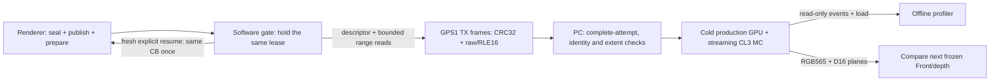

# GPU profiling sessions

The system-owned profiler combines a software-only published-input snapshot,
bounded cold replay, passive simulation observer, correlator and offline viewer.
Its [tool README](/systems/cpu-v3-tang-nano-20k/tools/gpu_profiler/README.md)
owns usage and verification commands. It changes no synthesized logic or Device4
ABI. A render frame, a CPU recording interval and a GPU submission are distinct.

## Compiled-program system capture

`profiling_capture::capture_flash` runs an already compiled CB06 application and
its COPY/ZERO resources in `CpuV3SystemSim`. `CapturePoint::from_program` obtains
the unique `profiler_gate` function entry and capture header/range globals from
that exact compilation's debug metadata. The host stops before executing the
gate, after the driver's Prepared publication has finished and before either
GPU SEND is consumed. Polling the header PUBLISHED bit alone is insufficient:
the driver writes it while constructing the descriptor.

The host accepts both the published-only v1 lease and the explicit v2 lease.
Version 2 requires PUBLISHED and permits only the declared TARGET/FRONT/UI flags;
unknown bits and missing publication are rejected. Both versions require the
64-word envelope, self-contained binding, current range-table shape/version,
an idle GPU descriptor, and a bounded nonempty range table. Every physical range
must have known flags, read/write access, compatible immutable access, even
nonempty extents and an in-memory span; the aggregate ABI byte limit also applies.
Full command, layout and memory-consistency checks remain in the shared decoder.

The input recipe binds the CB06 SHA-256, compilation metadata addresses,
explicit initial memory seed, a positive backend-specific work budget and a
wall-time limit. Optional `cpu_mode` defaults to `instruction`, using `max_steps`
and the original fast CPU without modeled cache or MC timing. Explicit `native`
uses `max_cycles` for CPU logic edges, runs the existing CPU/FPU/cache/gear/MC
composition, and reports logic/native clocks separately from CPU steps. A budget
for the other mode is rejected. Both advance functional vblank only when needed;
neither adds GPU/Display bus competition or models SPI-loader elapsed time.
The default reject-prefix entry freezes the first reached compiled gate and
refuses an earlier GPU submission. The explicit
`capture_flash_with_functional_prefix` entry (recipe `prefix_gpu: "functional"`,
dump CLI `--prefix-gpu functional`) instead executes preceding submissions through
the existing synchronous functional GPU against the same physical memory. Their
writes are retained before the target gate; any GPU execution error stops capture,
including errors after partial writes. No simulated GPU bus traffic or latency is
introduced. The default `reject` mode and legacy recipes remain unchanged.

Both modes stop at the first arrival at the supplied compiled gate PC. They do
not bypass gates, fabricate gate returns, or select the Nth invocation. Earlier
gates requiring unavailable UART/input still stop at the CPU/wall-time bound.
A later consumer can be bound to an existing compiled gate it naturally reaches;
`CapturePoint::from_program` continues to bind the unique `profiler_gate` entry.
This does not introduce a second renderer submission API.

In capture output, `gpu_consumed:false` refers to the frozen target.
`source.json` records `cpu_mode`; native origin has `cpu_steps:null`,
`cpu_logic_cycles` and `native_cycles`. Only producer Header/table use the native
read-only CPU-private view; every GPU payload stays physical. Native raw export
also preserves `physical.bin` without that metadata overlay. The same GPS1/v2
range decoder and replay backends consume both modes. Budget, prefix, missing
payload, unknown mode and stale-frontend provenance errors cannot publish a
complete snapshot. The raw display CLI ordinal pause remains a separate contract.

Functional-prefix `source.json` also retains `prefix_gpu:"functional"`. A selected prefix
mode mismatch is rejected before snapshot publication. Full physical memory uses
the recipe's explicit initial seed; this is not the captured replay's known-byte
mask. Existing GPU page/encoding errors remain errors, and the shared snapshot
decoder still rejects missing captured payload bytes.

`system_dump.py` converts the frozen descriptor, range table and actual physical
payload bytes through the same GPS1 encoder/decoder used by the UART path. The
canonical snapshot retains the same descriptor/range/payload contract. Its
`source.json` binds the input digest to the compiled-program and recipe digests,
gate boundary, step count, memory seed and functional vblank count. Board dump
duration is null for this source. Missing, short or rejected data never becomes
a complete snapshot.

With `--build`, `replay.py` takes exactly one of a verified board `--receipt` or a
`--simulation-source`. Both paths validate build/layout/ABI, static resource
extents and the bound RTL export, then use the same cold GPU+MC backend and
dynamic initialized-read guard. Simulation provenance is not a programming
receipt or board qualification. A failed or bounded backend run writes
`replay.json` with `complete: false`; completion still requires the real GPU
drain and complete output planes.

Without `--build`, the same backend can replay complete explicit frozen bytes.
It still checks descriptor/layout/ABI, preimages and every initialized physical
read, but marks firmware/bitstream identity unverified in metadata and the viewer.
An optional simulation source must still match the compiled-program/input hashes.
Providing a build selects strict qualification; failures never fall back to the
input-only route. A receipt without its build is rejected. Ordinary default hooks
use this route with their zero manifest ID, or can bind a formal build manifest.

`snapshot_cli.py receive` starts the existing BL616 capture helper with live raw
recording. Only a marker written after route selection and raw-file opening
produces the operator's ready notice. Failed/expired startup never announces
readiness; transport completion precedes decoding. Optional `--rtl` sends each
complete attempt through `replay.run`, with explicit cycle/wall bounds. Invalid
or incomplete attempts retain their receive report and cannot be replayed.

## Identity and time

`profile.json` has `schema: "digitaldesign.gpu-profile"` and `version: 2`.
All timestamps are nonnegative integer cycles relative to `origin`; `clock_hz`
converts them to display units. Integers must fit JavaScript's exact integer
range. Intervals are half-open `[start,end)`. Session `start/end` enclose all
recorded work, including CPU recording for later submissions.

| Collection | Identity and binding |
| --- | --- |
| `submissions` | Increasing `id`, accepted `start`, drained `end`, byte `base/bytes`, optional logical `frame_id/name` |
| `commands` | Unique occurrence `id`, owning `submission`, display-only byte `pc`, `word/opcode`, fetch `start`, `execute`, release `end` |
| `jobs` | Session-wide DMA `id`, owning `command/submission`, source/slot and true completion `end` |
| `dma_transactions` | Session-wide `id`, `submission`, logical `job` or zero for CB prefetch, request-to-real-LAST interval |
| `meshlets` | Session-wide `id`, owning `command/submission`, associated DMA job, VT and R/I/P intervals |
| `cpu` | Unique span `id`, logical `frame_id`, label `name`, independent `start/end` and optional cropped `partial` |

CB address or PC reuse does not reuse identity. A/B/A buffers may all contain PC
zero; selecting CB3/PC0 cannot select CB1/PC0. Physical triangle/pool/context slots
carry independent observer generation ownership; their reuse is not a meshlet ID.
No frame is inferred from a CB address. The current hardware runs one CB at a time;
CPU preparation may overlap its execution.

## Published-input snapshot and transport

The [capture bridge](/systems/cpu-v3-tang-nano-20k/docs/gpu-capture.md) defines
the unique 64-u16 descriptor and eight-u16 range entries. The renderer freezes
after publication and prior completion, before either COUNT or START. The
consumer reads that lease; it does not own a second GPU scheduler. Arbitrary
in-flight pipeline state is outside this interface.

The PC storage decoder accepts only explicit column layout ABI2 and the
framebuffer-view command ABI from`GPU_CAPTURE_RTT400_COMMAND_ABI` (currently4).
Build declaration v2 binds the exact production layout, memory map and typed
asset catalog. Wire/header/range versions remain1. Old row, missing-layout and
old command captures are rejected, with no repacking or reinterpretation.
POT repeat/mip and fixed400x240 signed18 clamp/base-only sampling share physical
column decoding while retaining their distinct coordinate/filtering semantics.

Both replay preparation and execution reject commands outside the snapshot's
declared ABI before running RTL; a newer export cannot enable MEMCPY in ABI1.

Raw buffers use range tag10 with the existing READ/WRITE/PREIMAGE flags. A capture
must include the complete source inputs and declared mutable destinations; capture
publication remains the driver's responsibility. The low-level MEMCPY encoders do
not automatically add those ranges. Cold replay dumps writable raw buffers as well
as color/depth, preserves write-to-later-read lineage, and checks native memory
permissions. The mathematical scene oracle supports raw/cleared/UI pixel copies;
it explicitly rejects copies involving framebuffer planes after approximate DRAW
evaluation. Exact cold replay and retirement comparison remain available instead
of silently omitting those pixels.

ABI2 has96000 logical pixels and6400 additional physical padding words. Its
262144-byte reserved allocation is distinct from the204800-byte physical plane;
the57344-byte tail is not initialized by CLEAR. Physical preimages are required.
Allocation-tail capture is explicit, and referenced bytes must be present.
Native replay rejects uncaptured reads and writes outside the captured writable
extent. Color/depth comparison reports logical, padding and guard differences
separately, with an explicit compared guard size. A whole-plane match includes
the physical padding, not just visible pixels.

The private diagnostic can consume a hash-bound CPU-produced column asset
catalog, retaining ordinary POT mip packing and unchanged UI data. It does not
implement the formal renderer's producer/profile selector. A synthetic capture
or frozen-export replay therefore cannot qualify the actual CPU capture hook,
physical buttons, board timing or a newly compiled bitstream.

Wire integers are little-endian. Every frame has a 24-byte envelope followed by
its payload and a u32 CRC32 of envelope+payload:

| Field | Width | Meaning |
| --- | --- | --- |
| Magic | 4 bytes | ASCII `GPS1` |
| Version, kind | u8, u8 | Version1; kind below |
| Flags | u16 | Zero |
| Snapshot, attempt | u32, u32 | Prepared token; nonzero transfer-attempt identity |
| Sequence, payload bytes | u32, u32 | Strictly increasing from0; at most4096 bytes |

| Kind | Payload |
| --- | --- |
| BEGIN1 | Exact driver descriptor, 128 bytes |
| RANGE2 | u16 sequential index + exact eight-u16 range |
| DATA3 | u16 range, u16 codec, u32 byte offset, u32 decoded bytes, encoded body |
| RANGE_END4 | u16 range, u16 zero, u32 decoded bytes, u32 decoded CRC32 |
| END5 | u32 range count, bytes, chunks, canonical CRC32, board dump milliseconds |
| ERROR6 | Diagnostic failure bytes; never a complete snapshot |

All RANGE records precede DATA. DATA is contiguous within sequential ranges;
one decoded chunk is even, nonzero and at most1024 bytes. Firmware uses at
most512 bytes. Codec0 is raw; codec1 is RLE16: token bit15 selects repeat, low15
plus1 is its word count. A repeat carries one u16, a literal carries that many.
Raw is selected whenever compression is not shorter. Decoding is bounded before
expansion. Canonical CRC32 covers descriptor bytes, RANGE payloads in table order,
then decoded DATA in range order. No missing-END or partially closed range is
accepted, and attempts cannot donate data to each other.

Physical addresses and lengths are bytes; the driver reader's offset is a u32
count of **u16 words**. Input SHA256 includes the descriptor, exact range entries
and decoded bytes. Attempt/time/host file locations do not change that input
identity. Per-file hashes and alias consistency are checked again on reload.
Immutable catalog checks and initialized-read guards supplement framing integrity.

Cold replay clears internal GPU/MC state and seeds captured DRAM bytes. It uses
production streaming RTL at related54/108MHz clocks with an accelerated startup
delay outside the measured submission. The functional pin model uses CL3,
RCD3/RP3, tAC6ns/tOH2ns and an explicit fixed4ns return delay; these are replay
assumptions, not measured PCB/PVT limits. CPU/Display traffic and warm caches are
not recreated. A matching result therefore establishes exact output for these
frozen inputs, without certifying board timing or reproducing every contention
case.

## Observer records

The event stream starts `FORMAT 2`. Subsequent numeric records retain decimal
cycles and IDs; instruction words in `CMD_EXEC/CMD_END` are hexadecimal.

| Record | Fields after the tag |
| --- | --- |
| `SUBMIT` | cycle, submission ID, CB byte base, valid byte length |
| `DONE` | cycle, submission ID, cumulative allocated/published/retired/cache-committed/empty-skipped quad counts |
| `CMD_EXEC` | cycle, PC bytes, instruction word |
| `CMD_END` | release cycle, PC bytes, fetch cycle, execute cycle, state, word |
| `DMA_JOB / DMA_DONE` | accepted cycle/job/PC/mesh/slot/source/size; completion cycle/job |
| `DMA_REQUEST / DMA_RETURN` | cycle/transaction/job/address/count; completion cycle/transaction/job |
| `DRAW / VT_END` | cycle/meshlet/PC/input slot/DMA job; completion cycle/meshlet |
| `Q_ALLOC / Q_PUBLISH / Q_RETIRE` | cycle/quad/meshlet/slot; cycle/quad/meshlet/mask; completion cycle/quad/meshlet/empty |
| `ROP_BEGIN / Q_COMMIT / FINAL` | cycle/quad/meshlet; completion cycle/quad/meshlet; cycle/quad/meshlet/lane |
| `STATE` | cycle, PC, CP state, render idle, work busy, DMA idle, memory busy, flush complete, waits done, CE |
| `CPU_BEGIN / CPU_END` | cycle/span/logical frame/remaining-line label; cycle/span |
| `CAPTURE_END / BOUNDED_STOP` | cycle at explicit successful scope end or incomplete watchdog stop |

Additional prepare/raster/interpolator transition records accompany the per-cycle
`load.csv`. Samples describe `[cycle,cycle+1)`. End events for an accepted edge
use the following cycle. SEND acceptance is a wall-clock event even during CE0.
Old completion is recorded before accepting a successor on the same edge.
The observer remains open across DONE, until the requested scope is drained.

The correlator binds commands by `(submission,PC)`, then assigns unique occurrence
IDs. DMA/meshlet IDs follow their accepted submission; quad ownership follows
T slots, R/I context, pool generation and independent ROP context. Pool retirement
precedes final cache commit. P is the union of published-quad lifetimes through
commit or ordered empty skip, including dependency waits. It is not ALU occupancy.
DONE requires empty T/pool/ROP state and cumulative quad/token conservation.

## Completion, evidence and compatibility

Normal builds require CAPTURE_END, completed submissions/jobs/transactions,
ordered retirement and quad conservation. Watchdog or truncated captures need
explicit `--allow-partial` and retain a visible incomplete status. An open CPU
annotation at a successful GPU scope boundary is cropped and marked individually;
it does not fabricate completion of CPU work.

`provenance` retains capture configuration and hashes of sources, injected
observer/testbench and initialization inputs. Correlation rechecks the copied
source/input hashes. This binds simulation evidence, without claiming rendered
image correctness, board correctness or equivalence to another RTL revision.

The v1 importer maps its sole submission and PC references into occurrence IDs,
preserves source timestamps and verification metadata, and uses a null CB base
when it was not recorded. If its CPU endpoint extends beyond the old container,
the session extent expands to enclose it; the original extent is retained in
provenance. Scene-specific names survive import; new captures use metadata labels
or generic meshlet names. Unsupported format versions are rejected.

## Derived display

The cold replay exports `images/final.png`, one `command-<id>.png` for each command except DRAWs with zero own published quads, and `images/index.json`. Each entry binds the command occurrence,
`complete_cycle`, byte target bases, target epoch, color interpretation and plane/
PNG digests. The report embeds these PNGs, so the offline page remains portable.
A DRAW with zero own published quads has no completion screenshot. Its early
front-end completion can precede older in-flight pixel work, so the viewer hides
its preview even when reading an older report that contains such an image. No
hardware wait or drain is inserted. Nonempty DRAW images retain their own final
quad/cache-commit completion and historical owner filtering; they cannot include
younger writes or be replaced by a later empty DRAW's partial picture.
It starts with the final output thumbnail; hover enlarges it and selecting a
command switches the same preview to that command's completion image. Right-click
inside instruction flow clears selection, highlights and time selection and
restores the final output. Other regions retain native context menus; middle or
Shift-left drag pans the charts.

The observer journals actual BSRAM A writes, valid/tag transitions, SET_TARGET
generations and accepted framebuffer write payloads. Reconstruction combines
physical word history with the latest eligible versions in valid resident cache
slots. Slot replacement/invalidation discards resident deltas. Writeback archives
each word's older cache owners before committing its latest physical value;
otherwise a younger overwrite followed by eviction could erase an older DRAW's
completion image. Snapshots exclude younger command owners even when they have
already written overlapping pixels. Direct CLEAR, serial UI and MEMCPY payloads
retain their own command identity rather than stealing the current DRAW owner.

Same-cycle cache writes precede accepted writeback, directory lifecycle updates
and the completion projection. A writeback victim remains owned through its real
terminal response, so the valid-cache layer covers payload still in flight to
memory. Stale target epochs and invalid lines cannot overlay a different target.
Unexplained writeback or missing preimage fails reconstruction. Commands before
the first target binding explicitly show the capture-declared output preimage.
The pixel decoder is shared with the existing final RGB565/column preview. No
extra flush, wait or GPU serialization is introduced.

Borrowed render-target allocation tails are READ/PREIMAGE ranges. Only the
204800-byte physical plane is writable/FULL_CLEAR; allocation capacity does not
grant permission to overwrite guards.

The passive observer samples RO, framebuffer-read and framebuffer-write master
interfaces in the GPU logic clock domain. An accepted request counts as issued;
each read response and write-data-ready strobe counts one actual 64-bit payload
slot; LAST/error counts a completed transaction. The request count encodes
32-byte lines minus one (legal values 0, 1 and 3). Request volume is not reported
as completed payload. Current links have no byte-enable field: each slot carries
eight bytes. Failed read payload contributes no effective bytes.

`profile.json.memory` and `memory-transactions.csv` preserve transaction identity,
source, halfword address, expected/actual beats and real terminal time. Reports
include issued/completed/error counts, wire/effective bytes, total/read/write
average rates and a 256-cycle sliding-window peak. Shorter selections have no
full-window peak. Link utilization uses eight bytes per logic cycle; aggregate
utilization sums the capacity of three independent links. These are RTL interface
measurements, with no physical SDRAM pin-utilization or board-timing claim, and
no downstream transfer is counted again.

Sources follow the actual RO arbiter owner and DMA job kind, or the direct CLEAR
mux. Shared framebuffer-cache traffic retains its component identity; it is not
guessed to belong to whichever DRAW/UI/COPY command currently executes. Unknown
sources remain unknown. The right inspector has four native, initially open
collapsible groups: Inspect Instruction plus detail, Legend plus its two notes,
Bin cycles, and GPU memory summary. The frame preview is above these groups and
explains missing saved images or zero-own-quad DRAWs. Redraw updates group bodies,
retaining native keyboard operation and each group's collapsed state.

Bin cycles and the memory summary share one active time range. A selected DRAW
uses `bounds(c)`: command start or earlier associated DMA through proven command/
job completion and last-quad completion. Viewport focus padding and subsequent
pan/zoom do not expand DRAW statistics. An explicit overview range takes
precedence; clearing restores the full frame. Non-DRAW selection uses the time
range. View range start/duration round to integer cycles; DRAW bounds round
outward to preserve the complete lifetime. Hover tooltips keep the original chart bin
semantics and do not replace inspector range statistics. Read/write totals query
raw saved event timestamps with half-open boundaries. Average read/write/combined
rates use that interval's duration and clock. Peak combined throughput uses a
complete 256-cycle sliding window within the selected range; shorter windows
have no peak. Partial coverage labels known counts and unknown full-range rates;
empty ranges have zero bytes and no rate. Old captures without exact memory events
cannot supply selected-range estimates. Full-capture totals remain a separately
labelled reference.

Each accepted payload beat contributes eight bytes once; requests and terminal
acknowledgements contribute no bytes. CPU/Display traffic is excluded. Masked/error
beats still occupy wire bytes, not useful bytes or physical SDRAM utilization.
Backpressure, outstanding-without-data and write-terminal waits count link-cycles
and may overlap; unavailable sample coverage remains explicit. Histograms and wait
rows stay in the existing GPU pane on its shared axis, with no separate Memory
panel. On narrow screens the inspector stacks below the plots.

Saved display previews default to the same 64-entry `LINEAR6_TO_SRGB8` table as
`display.rs` and Display1 RTL. Red/blue 5-bit values first replicate to 6 bits;
green 6-bit values index directly. Gamma is applied once before PNG compression
and an sRGB tag identifies the encoded result; the viewer directly embeds it.
Image metadata keeps the captured `format`, raw `plane_sha256`, and separately
records preview encoding, display-format override and LUT/source identities.
Presentation policy is separate from captured format. The CLI defaults to
`--preview display1 --capture-format unknown`; an unspecified stored zero remains
unknown. Explicit diagnostic `raw` bypasses the LUT, and `capture` uses it only
when the caller declares the field known and its value is 1. Raw color/depth
buffers remain authoritative and unchanged.

The shared reporting backend serves `profiler.py build/capture` and RTL replay.
Replay saves its frozen snapshot and automatically produces command PNGs and a
self-contained HTML report. Offline `build --snapshot GPS1_DIRECTORY` regenerates
history from original trace bytes: it verifies snapshot identity, reproduces and
compares all four seed files with the production generator, checks the command
stream and binds separate raw outputs to the identical trace/source capture.
Historical final color and depth hashes must match the same-run raw outputs.
`report-inputs.json` records dependency hashes, preview policy and LUT identity;
`--binding` checks that record on repeat builds.
The record names external dependencies; rebuilding requires those files.
Explicit capture, `--snapshot` and `--raw` paths can relocate them while the
original `--binding` continues checking their content hashes.
`render` validates and exports
the embedded PNG bytes directly, with no second conversion. Timing-only captures
remain supported with explicit images-unavailable reasons; `--require-images`
rejects incomplete image reports. SIM remains final-result-only.

New/empty report outputs are the default. `build` and profiling `render` accept
`--replace-report` for a stable generated report entry. A verified sibling stage
is published only after the prior directory has been archived and its hashes
checked. The new `report-replacement.json` maps original paths to the archive and
records previous file hashes. Unknown content, reparse points and mismatched
generated HTML/profile data refuse replacement. Failed staging preserves the
published entry; old archives and external historical image folders remain.
The preview wrapper has an explicit author hidden rule, and no-image/empty-DRAW
transitions remove both image sources while keeping their explanations visible.

`commands[].complete_cycle` includes every associated meshlet stage and ROP
commit, plus owned DMA completion. `end` retains control release. Partial
captures have no proven command completion time. CSV asynchronous ends and the
inspector use this distinction rather than stopping DRAW at instruction release.

RLE tracks retain exact sampled state; event-rate tracks retain accepted events.
Time-bin occupancy and queues are time-weighted. Event bins count accepted events
and display their rate per 1024 cycles. Backend overview activity is the per-cycle
OR of `r_busy`, `i_busy`, `quad_total > 0` and `rop_contexts > 0`, then aggregated.
It covers the pool-release/cache-commit tail and includes waits; later FLUSH
maintenance remains separate. Types filter command rows/picker/command marks only;
physical load, occupancy overview and all-alive inspection are not filtered.

The viewer embeds validated JSON safely, has no CDN or server dependency and
formats all time using `clock_hz`. CSVs preserve submission IDs and command IDs
alongside PC. Raw capture, generated HTML/CSV and large replay data belong in
`target`; the small synthetic regression fixture lives beside the tool tests.

### Optional exact transfer timeline

Profile v2 may contain `memory.timeline` version1. `available:true` includes its
half-open `start/end`, sparse `data` rows `[cycle,read_wire_bytes,write_wire_bytes]`,
and RLE `states.outstanding`, `states.waiting`, `states.terminal_wait`. Rows merge
concurrent master slots: reads0/8/16B and writes0/8B, with each64-bit
GPU-master payload slot counted once. Timeline bytes must equal existing summary totals;
state integrals must equal captured request/link-cycle totals. No byte-enable
field or physical SDRAM pin measurement is introduced.

`backpressure` has independent availability, start/end and an RLE `track`, because
valid/not-ready is observed by load samples rather than request acceptance events.
Missing samples remain unknown, including uncovered beginning/end fragments.
Outstanding means accepted/uncompleted request inventory; waiting means the
number of live links without a data slot during a sample. Terminal write wait
covers complete data delivery until acknowledgement. None is inferred from zero
throughput, and these waits may overlap.

The same activity canvas adds actual read/write bytes/bin and request/wait rows.
All use the shared time coordinate and adaptive bins. Hover distinguishes nominal
accepted-request bytes from transferred bytes; a binary cycle detail still shows
the common memory bin. Selection/zoom sums exact timestamped bytes in `[a,b)`;
RLE states integrate overlap of `[cycle,cycle+1)` and may have fractional covered
cycles. Partial bins display known bytes/state means and mark unknown coverage,
rather than discarding a bucket or filling missing samples with zero. Legacy
profiles without the optional timeline still load with temporal rows unavailable;
their valid full-capture totals are retained. Saved MEM events can reconstruct
this optional data without a new hardware run. Provenance and cold/warm labels
are preserved, and no second Memory panel or frontend is created.
