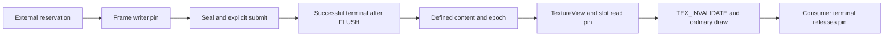

# Borrowed render buffers and framebuffer views

The renderer borrows caller-reserved physical storage for fixed400x240 RGB565/D16
rendering. It owns four registry entries and submission references, not an
allocator. It never frees, moves or converts the planes. Keep the external
reservation alive until release is explicitly permitted; arbitrary heap/far
pointer lifetimes are not proven by this API.

## Storage and calls

RenderBufferMemory has eight public u16 fields: color/depth byte base and byte
capacity, each split low/high16. Bases are64KiB aligned; capacities are128-byte
aligned. The selected layout sets the minimum capacity. In the column RTT
profile each plane reserves262144 bytes /2048 sectors:192000 logical pixel bytes,
12800 macro padding bytes and57344 allocation tail bytes. CLEAR writes the204800
physical bytes, including macro padding, and leaves the allocation tail intact.

Registration validates the complete declared capacities against each other,
other registrations, fixed Display/depth, both command/object arenas, UI pages
and known Mesh/Texture/Atlas allocations. Storage must fit the GPU asset interval.
A physical address is never inferred from a CPU pointer. The8-word CPU descriptor
must stay below the DSEG3 window.

| Member | Effect |
| --- | --- |
| `Renderer.render_buffer(&mut self, Array<RenderBufferMemory>) -> RenderBuffer` | Borrow exclusive allocations; own metadata only |
| `Renderer.frame_to(&mut self, &mut RenderBuffer, clear:u16) -> Frame` | Reserve a writer for an ordinary Frame |
| `RenderBuffer.texture(&mut self, linear:bool) -> TextureView` | Borrow defined RGB565 color; false=nearest, true=bilinear |
| `Pass.draw_texture(&mut self, &mut Mesh, &mut Model, &mut Material, &mut TextureView)` | Record a native snapshot and pin its source for that slot |
| `TextureView.close(self)` | End CPU borrowing; keep submission pins |
| `RenderBuffer.close(self) -> bool` | True permits external release; false consumes the handle and retains protected storage |

The corresponding free functions remain: renderer_render_buffer,
renderer_frame_to, render_buffer_texture, pass_draw_texture, texture_view_close
and render_buffer_close. Legacy render_buffer_wait has a poll-count budget;
zero cannot manufacture completion. Frame remains a lexical child of Renderer;
TextureView is a child of RenderBuffer. Runtime pins cover asynchronous lifetime.

## Publication and retirement

Pass.finish ends a Pass; Frame.finish only seals. Renderer.submit authorizes the
page and performs the existing CPU cache publication before COUNT/START.
Renderer.wait(WAIT_GPU) observes successful GPU terminal, including WAIT(all),
FLUSH and real writeback completion, before content becomes defined. Offscreen
completion never presents or changes Display ownership.

Each buffer tracks owner, defined state, writer slot, two reader-slot bits,
one CPU view and a32-bit epoch. The existing two input slots hold their writer
and source set. Repeated draws pin once per slot. Successful terminal publishes
a fresh epoch and releases that slot. Epochs do not restart on base reuse or wrap.
Healthy unsubmitted cancellation releases the actual recorded slot and restores
prior defined state without changing its epoch. Live views/readers prevent
rewriting; feedback and overlapping allocations are rejected.

CPU view cleanup never releases GPU references. Faults/timeouts freeze rather
than manufacture completion. Busy/faulted close cannot authorize freeing storage;
a successful explicit Renderer close can drain submitted users. Destructors do
not submit or wait. Offscreen work may overlap Display Pending because storage
is disjoint; capture still requires stable Front before leasing inputs.

## Profile and capture

RendererCaptureConfiguration::rtt400x240() pins Column16 storage and command ABI2
through the existing checked loader. Local module/config replacements cannot
select it. Native/default configuration remains command ABI1. Version2 capture
manifests allow ABI2 only with the matching column layout and resource catalog.
The hardware profile is explicitly CPU_V3_GPU_PROFILE=rtt400x240-column16.

The [GPU view contract](/ip/gpu-v2/docs/framebuffer-texture-view.md) defines bit23,
exponent9, base-only nearest/bilinear and clamp. A view is not a512-square POT
allocation. D16 views, other sizes, programmable stride and feedback are absent.
Ordinary textures reuse the column asset producer and minimum512-byte levels;
there is no second repacker or CPU conversion of rendered pixels.

RTT CBs start WAIT(all), FLUSH, TEX_INVALIDATE, then Target/CLEAR. This also
discards ordinary POT residency at that boundary. Default streams are unchanged.
Render-state caching includes view kind to preserve otherwise identical switches.

Capture retains the64-word header and8-word ranges: column layout ABI2 is
independent of command ABI1/2. Immutable roots are manifest-checked. Dynamic
sources come from pinned registrations, include full declared capacity and epoch,
and use READ|PREIMAGE without IMMUTABLE. Target physical spans have FULL_CLEAR;
untouched allocation tails have separate preimages without that flag.

The [two demos](/systems/cpu-v3-tang-nano-20k/examples/gpu_renderer_rtt/README.md)
use ordinary rendering. CPU peers prove ownership/emitted bytes; RTL replays
check rendering separately. Backend, memory peer and physical qualification
boundaries are explicit in each receipt.
