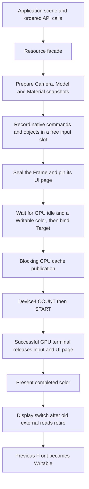
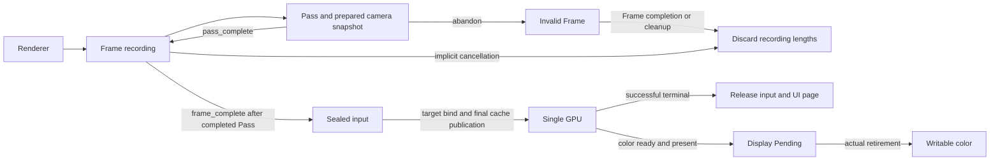

# Resource renderer API

The system RCC root `gpu_pipeline.rs` exposes lexical Renderer, Frame, Pass,
Camera, Model, Mesh, Material and TextField resources over the
[existing two-input scheduler](/systems/cpu-v3-tang-nano-20k/docs/gpu-input-pipeline.md).
It retains one recording, one sealed successor and one running GPU; there is no
second production scheduler. The native single-slot `gpu` facade remains a
separate compilation mode and cannot be mixed with this root.

## Application flow

Applications describe a scene and its ordered draws. The library prepares the
native matrices/state, records command/object bytes, schedules the two input
slots, publishes CPU writes and presents completed colors. Neither an input
slot nor a command-buffer address is an application handle.

The following is the inner loop used by the
[minimal runnable application](/systems/cpu-v3-tang-nano-20k/examples/gpu_renderer/rcc/main.rs).
Camera, Mesh, Model, Material and TextField are created once before the loop:

```rust
let mut frame = renderer_frame(&mut renderer, 0x1111);
let input = frame_input(&mut frame);
let elapsed = frame_elapsed_seconds(&mut frame);
// Update game state and persistent Camera/Model/Material values here.
let mut pass = frame_pass(&mut frame, &mut camera);
pass_draw(&mut pass, &mut mesh, &mut model, &mut material);
pass_observed_time(&mut pass, &mut stats);
pass_complete(pass);
frame_complete(frame);
```

`frame_complete` seals and advances; it does not promise that this Frame has
already rendered or reached Display. CPU recording can overlap the preceding
GPU execution. When closing the application, `renderer_close(renderer)` drains
sealed inputs, GPU work and Display Pending within its fixed polling bound.



The arrows after sealing are ownership/completion boundaries, not equal-duration
pipeline stages. Input reuse follows GPU completion; color reuse follows Display
retirement. This distinction allows recording during Display Pending without
allowing either protected color to be overwritten.

## Compile and ownership boundary

### Explicit member calls

The same resources also expose the following restricted inherent methods.
All identity fields remain private one-word handles; callers do not receive
physical command addresses or an additional execution queue.

| Method | Ownership and effect |
| --- | --- |
| `Renderer.frame(&mut self, color: u16) -> Frame` | Borrow Renderer; begin a recording with an RGB565 clear color |
| `Frame.pass(&mut self, camera: &mut Camera) -> Pass` | Borrow Frame and snapshot Camera through the existing prepare path |
| `Pass.draw(&mut self, mesh: &mut Mesh, model: &mut Model, material: &mut Material)` | Reborrow metadata and record an independent native snapshot; repeated calls retain draw order |
| `Pass.finish(self)` | Consume Pass and mark it complete; no seal or SEND |
| `Frame.finish(self)` | Consume Frame and seal a completed recording; no cache publication or SEND; an unfinished/abandoned Pass cancels instead |
| `Renderer.submit(&mut self) -> u16` | Authorize exactly one sealed page and advance the existing scheduler; reject when there is no unsubmitted page |
| `Renderer.wait(&mut self, flags: u16) -> u16` | Bounded retirement of previously submitted work, as described below |
| `Renderer.close(self)` | Cancel any unsubmitted page, then explicitly drain previously submitted GPU/Display work |

```rust
let mut frame = renderer.frame(0x1111);
let mut pass = frame.pass(&mut camera);
pass.draw(&mut mesh, &mut model, &mut material);
pass.draw(&mut mesh, &mut model, &mut material);
pass.finish();
frame.finish();
if renderer.submit() != RENDERER_PENDING { halt(0xbad); }
if renderer.wait(WAIT_ALL) != RENDERER_COMPLETED { halt(0xbad); }
```

The [member demo](/systems/cpu-v3-tang-nano-20k/examples/gpu_renderer/rcc/members.rs)
contains the complete caller, factories, two transform snapshots and explicit
close. Its `renderer_member_three_frames` entry uses the same frame body with a
bounded stop; `main` repeats continuously. Build it with
`examples/gpu_renderer/build.ps1 -Members`. This selects
`CPU_V3_BOOT_EXAMPLE=gpu_renderer_members`, checks the actual approved library
bodies with rustc, and materializes the normal generated boot assets. This member
demo uses explicit column16 assets/layout matching the current fitted system;
the offline caller test also executes the row profile. The checked host entry
takes the existing `RendererCaptureConfiguration` selection and materializes
the selected trusted RCC root before using the shared loader.
The legacy free functions retain their original behavior: `frame_complete` seals and
advances, while member `Frame.finish` seals without scheduling.

`WAIT_GPU=1` waits for the submitted input/UI references to retire after the
driver's successful GPU terminal. `WAIT_DISPLAY=2` waits for the corresponding
present and old external Display reads to retire; it includes any outstanding
submitted GPU work needed to produce that present. `WAIT_ALL=3` requires both.
Flags zero return `RENDERER_COMPLETED` immediately without polling; unknown bits
return `RENDERER_REJECTED`. Flags are not the lower driver's polling limit:
its existing `gpu_driver_wait(cb, 0)` still reports Timeout. The member wrapper
uses the existing pipeline/driver/Display polls with a fixed 60000-poll budget;
this is a software poll budget, not milliseconds or a hardware sleep opcode.

Public status constants preserve the native values: Pending1, Completed2,
Fault3, Timeout4 and Rejected5, with the `RENDERER_` prefix. Pending from submit
can mean that an authorized successor still awaits GPU/Display availability;
its later start is part of that submission. Duplicate submit is rejected.
Wait never authorizes a sealed page. It may retire old submitted work while a
new page remains sealed, and cannot issue that page's COUNT/START. Busy-zero
alone is insufficient: sticky faults, in-flight owner and actual Display
retirement remain checked by the existing poll chain. Timeout does not return
protected references or perform recovery; a hardware fault retains its frozen
ownership policy.

The existing Renderer phase distinguishes sealed/unsubmitted from authorized
work; no additional pending register or mirrored queue is allocated. Dropping
or closing Renderer cancels an unsubmitted page and its recorded UI reference
without submitting or waiting for that page. Cancellation accepts only CPU-owned
Building/Ready state, never an in-flight/prepared page. If older submitted work
is still live, Drop retains/freezes those references; only explicit close/wait
can drain them. Desired UI content survives cancellation. Consumed Pass/Frame
values do not execute cleanup again. Reverse-order early-return cleanup still
cancels an abandoned recording, with no implicit submission or destructor wait.

`compile_renderer_program_checked` uses the same canonical source loader,
capture configuration and target ownership lowering as the ordinary renderer
entry, with an explicit `RustcCheck` gate. It preserves library origin approval
and private-domain checks. The
[RCC subset](/compiler/rcc/src/frontend/spec.md#151-restricted-inherent-resource-methods)
defines receiver/reborrow, lifetime and Drop lowering. General Rust references,
async, arbitrary impls and allocator behavior are not added by this API.

A format2 boot project may contain the standalone line `renderer`. The build
then uses `compile_renderer_program`, always approving the actual shared
`rcc/gpu_pipeline.rs` canonical path. Omitting the root is an error. The root
names thirteen direct helpers, including private `gpu_scene` and `gpu_capture`; application imports
cannot expose their raw state/functions or construct/disarm resource identities.
The source loader reports the selected file's actual canonical origin. Local
root/helper overrides fail approval; they never inherit a shared identity.
Generated `boot_resources` has no filesystem origin or library authority.
`device_abi` remains an ordinary shared module, but renderer compilation pins it
to the system source, so an application-local override cannot redirect devices.
Native diagnostics retain the String loader. Approval is an explicit host mode,
not inferred from source text or recovered by falling back to native compilation.

`renderer_open` constructs the sole owner after initialization. A second open
halts/faults before another owner is constructed. `renderer_frame` borrows it;
`frame_pass` snapshots a Camera and borrows the Frame. The resource compiler
prevents parent use while a child is live, fabrication, copying, escaped handles,
post-consumption use and raw helper access. Forwarding borrowed resources uses
ordinary explicit mutable reborrows.



`pass_complete` ends the Pass; it does not submit. The same Frame may then open
another 3D or UI Pass. All Passes share that Frame's target and the fixed viewport;
color/depth are cleared once at Frame begin. A new 3D Pass snapshots its current
Camera; it cannot rewrite earlier draw/Pass data. An abandoned Pass invalidates
the whole Frame, including previously completed Passes. No later Pass may reopen
it; explicit Frame completion or cleanup cancels the recording. The next Frame
starts with a fresh Pass status. `frame_complete` then either cancels an unfinished Frame or seals and
transfers a completed one to the scheduler before advancing. A failed transfer
consumes the Frame and freezes referenced state, with no cleanup retry.
Frame cleanup only cancels its recording and retains desired UI. Renderer cleanup
never submits/waits; outstanding work freezes instead of releasing live inputs.
Only explicit `renderer_close` performs a bounded drain. Waits capture controller
input but do not consume frame edges. There is no implicit wait in a destructor.

## Scene resources and snapshots

Camera, Model, Mesh, Material and TextField are independent CPU metadata owners;
long-lived objects do not keep Renderer borrowed. Each registry has four slots,
with no heap or public integer identities. Releasing a handle releases metadata
only; immutable boot assets and already copied GPU input remain owned separately.
`renderer_mesh` registers the generated package's one mesh; its directory/extents
are checked once. The private known-mesh draw path retains capacity, mapping,
range, snapshot and final-publication checks without repeatedly validating the
whole immutable directory.

| API | Inputs and effect |
| --- | --- |
| `renderer_camera` / `camera_pose` | Source-world eye and Euler radians; zero camera looks -Z; native basis below |
| `camera_projection` | Focal 144..256, far strictly between0 and200 |
| `camera_light` | Nonzero world-space light, normalized and quantized once per relevant change |
| `renderer_model` / `model_pose` | Translation, Euler radians, scale per component0.5..2 |
| `renderer_material` | RGB0..255 and lit/unlit |
| `material_color` | RGBA0..255; alpha selects native blending/depth-write behavior |
| `material_lighting` | Ambient/directional0..256, shininess0..16 |
| `material_specular` | RGB0..255 |
| `pass_draw` | Copies prepared native Global/Render/Instance data into the open input |

Eye/translation components are bounded to +/-100, angles to +/-4 radians, and
asset AABB components to +/-100. Eight transformed AABB corners must fit signed
26-bit/F16 `[-512,512)`. Negative/mixed camera Z is admitted; the legacy
all-positive-Z helper is not used. Euler rotation is Rz*Ry*Rx. Position is
`K * V_pos * M`; normals are `V_normal * R_model`, with rotation only. Model
scale and projection never enter the normal transform.

For the source-world Camera rotation `R_camera`, native view basis is
`B = diag(-1,1,1) * transpose(R_camera)`. Position uses
`diag(focal/256,-focal/256,-1) * B * (world_position-eye)`;
normals use `B * R_model`, and world-space light uses `B * normalize(light)`.
The source-world +X direction projects left for the zero-angle Camera. This
matches the canonical look-at assets, native triangle determinant/culling and
Lighting's view rays. The reflection belongs to the shared prepared basis;
changing only position or asset winding would leave normal/light inconsistent.
`camera_light` accepts world-space light, not an already transformed native
light. This resource Camera conversion is separate from the legacy generic
`gpu_camera_view`/`gpu_instance_trs` helpers; do not apply it twice.

Controlled setters compare actual values. Camera rotation/translation,
projection rays and normalized light have separate dependencies. Each Pass
captures the prepared view; later camera edits do not rewrite that snapshot.
Model angle/affine and final position/normal caches invalidate independently.
The shared Pass view is compared by values rather than wrapping revision tags,
so camera-slot reuse cannot falsely match an old model cache. Default focal200
produces native rays(-8192,-4915,8192); reciprocal is taken after scaling focal
by256 to retain Q16 precision. Light components are first scaled by powers of two
until the largest magnitude is in[0.5,1], avoiding squared-length underflow and
coarse reciprocal-square-root precision at large magnitudes. Quantized light is repaired within a bounded
iteration count against the existing exact unit-vector predicate.

## Text and frame observations

`renderer_text(renderer,column,row,width)` owns one nonoverlapping single-row
field in the50x15 canvas. Width is1..50 and must fit its row. The application sees
neither packed glyph words, GPU addresses nor dirty/version flags. Each of four
fields caches up to50 logical glyphs; the metadata/glyph buffers use224 low words.
`frame_number` replaces a field and erases its short tail. `text_visible` hides or
restores cached text; hidden edits retain logical text without touching desired
pixels. Identical writes do not invalidate the canvas. `pass_text` records a
visible range, while `pass_observed_time` formats/draws `OBS --.-` or tenths of a
millisecond. Field cleanup does not erase desired UI or mutate recorded/inflight
pages. Snapshot and page-reference retirement remain the scheduler's responsibility.

`frame_input`, `frame_tick_ms`, `frame_elapsed_ms`, `frame_elapsed_seconds` and
`frame_previous` return stable observations for that Frame. Input is captured and
consumed once at its beginning; further queries do not read hardware. Held motion
remains available without a new packet and is integrated each game tick.
Do not mix direct gamepad consumption into a renderer application.

`FrameStats` contains ready/sequence, prepare_valid/prepare_us,
observed_valid/submit_to_observed_done_us, queue_ms, span_ms and debug_paused. It identifies the
last successfully observed GPU/color transfer, potentially older than n-1 while
another submission runs. `submit_to_observed_done_us` includes final publication
and CPU observer delay, not pure GPU time or Display/vblank. No extra polls are
added for measurements. In ordinary operation the shared microsecond counter is cleared only at open
and healthy observation after an open recording has sealed/cancelled. Every
microsecond interval requires matching clear epochs, ordered endpoints and
neither endpoint saturated at65535. Finalized preparation survives later clears;
fields are never combined across different sequences. Millisecond differences
wrap modulo65536 and require a true interval below65536ms.

An optional [capture gate](/systems/cpu-v3-tang-nano-20k/docs/gpu-capture.md)
holds published input before either SEND. After explicit resume, debug_paused
marks submit/queue/span as invalid (zero), and time/input baselines are reset.
The next uninterrupted submission restores ordinary observations.

## Immutable logical mesh batches

`renderer_mesh_batch(&mut Renderer, first, count)` creates a Mesh from a logical
meshlet range in the single trusted boot package. It rejects empty, overflowing
or out-of-package ranges before reading any entries. The facade derives the
native directory sector/word, preserving sector crossings, and validates that
subset once at construction. The returned Mesh has the same ownership and draw
contract as `renderer_mesh`, which still selects the complete package. No native
addresses or slots are supplied by the game. Each subset retains the immutable
allocation and the package's conservative bounds; per-subset tighter bounds are
not implied. Four simultaneous Mesh resources are supported.

The build host may supply explicit ordinary module fallback directories, searched
after local and shared files only on NotFound. Their actual canonical origins
are retained; I/O/UTF-8 errors do not fall through. They gain no approved library
identity, and shared Device ABI selection stays pinned. The Bloxorz-shaped
[caller](/systems/cpu-v3-tang-nano-20k/examples/gpu_renderer_bloxorz/README.md)
uses this to read the existing pure rules without copying or modifying them.

## Verification boundary

Bounded host execution covers real source origins, library isolation, concrete
ownership misuse, duplicate open, transfer failure, cancellation/drain/freeze,
text visibility/tails, timestamp epochs/saturation/wrap, delayed observation,
held input and Camera/Model cache dependencies. Independent float references and
native byte oracles check prepared position/rotation/rays/light and commands.
The [minimal application](/systems/cpu-v3-tang-nano-20k/examples/gpu_renderer/README.md)
uses the actual producer and only semantic public calls; its generated OUT_DIR
boot image matches an independent repack. Controlled GPU/Display peers establish
software ownership/bytes, not rasterization, scanout, real cache contention or
physical board qualification.

## Actual changing caller and CPU cost fixture

The `gpu_renderer` example's `changes.rs` records one Mesh through two persistent
Models, opaque/translucent Materials and separate 3D/UI Passes. Its eleven-frame
entry covers steady state, Camera translation/rotation/projection/world light,
Model pose/scale, Material color/lighting/specular setters, and text hide/edit/show
with shorter numbers. Camera edits made inside a live Pass affect its next Pass;
a Model/Material edit affects only subsequent draws. Calls retain their order,
including transparent draws between opaque draws. No sorting or per-draw game
objects are introduced.

The bounded host case interprets actual native DMA/bind/draw/UI commands and
checks each captured Global/Render/Instance against independent floating transforms
and exact encoding predicates. It checks full-render waits before binding changes,
the earlier input snapshots, both UI page histories and unchanged-scene counters.
Completed sequential Passes and whole-Frame cancellation after a later abandoned
Pass use actual public callers. Private probes do not replace this application.

A second case executes the same compiled caller on the production CPU/FPU core
emulator. It supplies a separate instruction ROM and one-cycle word-data/control
peers; actual core store handshakes must target the Recording UI page, never a
Recorded/InFlight page, including stores from FPU instructions. CPU cycle/retired
word/store counts are recorded between model-only SIGNAL markers: recording after
Frame acquisition to before completion, then seal/advance through its return.
The marker overhead is included. Frame acquisition, input capture and waiting
precede this window. There is no cache, fetch queue, SDRAM, real GPU/Display timing
or board-frequency extrapolation. The Device0 time peer is fixed, not derived from
RECV counts. These measurements compare actual generated CPU work; they are not
end-to-end or real concurrent-system performance.

Reports remain temporary worktree artifacts. A matched steady frame after Camera
translation has the same final scene/UI/materials, avoiding comparisons between
different draw counts. Multi-view/material-change frames do more draws/bindings
and are reported separately. Hidden-text edits retain logical glyphs; showing them
adds a desired-field update. A dirty UI page still pays mapping/publication overhead
even for one changed word. Once both pages converge, subsequent unchanged frames
issue zero UI stores and preserve prepared scene data. The explicit publication
fence, ordering and fault checks remain in this cost.

## Game-shaped caller and cancellation

The Bloxorz fixture holds a fixed Camera and changes the block Model from integer
rules and a rolling pivot. Static floor and conditional bridge batches reuse a
half-scale Model; level/reset selects another immutable floor batch. Input/time
comes from one stable Frame observation. A no-new-packet tick retains held input
without synthesizing a new edge; reconnect starts from the accepted input library
contract. Moves and connection fields are the only UI.

Its finish helper takes ownership of a Frame after completed 3D Passes. Returning
on disconnect invokes Frame cleanup and cancels every recorded Pass. Only an
explicit successful completion publishes; later Frames can reuse the canceled
input slot. Two cancellations interleaved with continuous A/B submissions are
checked using actual generated native commands and immutable earlier snapshots.
This is a usage fixture, not full gameplay or legacy-demo migration.

The shared fixed-port CPU cost runner also guards every scalar/FPU store to
Recorded/InFlight command/object inputs. The sole permitted Recorded write is
the builder-generated 16-word Target relocation, with no old GPU or Display
pending, before the final publication fence. UI pages never have this exception.
The game fixture separates acquisition/input, rule update, pose setter, UI edits,
geometry preparation/recording, UI recording and seal/advance/cancel windows.
Changed and steady frames are compared only at identical floor/bridge/block
workload. Reports include cache comparison, temporary/spill and object-copy CPU
work and model SIGNAL overhead. Host event time is independent of status reads.
All previous peer and real-concurrency limitations apply.
