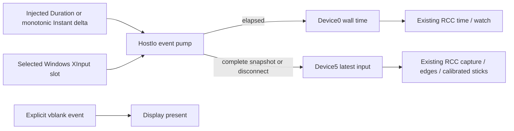

# Host time and controller input

`CpuV3SystemSim` combines functional CPU/GPU results with explicit host events.
It installs Device0, Display3, GPU4 and the latest-only input Device5. CPU steps,
device reads, watch probes, state queries and vblank do not advance Device0 time.
This simulator supplies software results, not RTL cycles or cache timing.

Arrows are host calls and software reads. A complete input replaces the latest
sample atomically at its publication call; neither a read nor begin-read starts
acquisition. Vblank remains a separate Display publication boundary.

## Explicit time

`advance_host_time(Duration)` carries fractional microseconds between calls,
advances the wrapping 16-bit millisecond timestamp and saturates the microsecond
interval at 65535. Long durations are reduced by the millisecond counter period
without a large loop or a narrowing overflow. Device0 SEND11 bit0 still clears
the interval alone. Time is quantized to microseconds; this is not a main-clock
prescaler model or an instruction-to-time conversion.

`HostIo::advance` accepts a deterministic elapsed event and focus state.
`RealtimeHostIo::pump` obtains elapsed time from `Instant`, including time while
the CPU is waiting. Resetting a debugger reconstructs its devices and rebases
the host clock. The debugger's legacy JSON `cycles` field contains functional
step calls; its UI labels them steps, not measured hardware cycles.

The debugger enables the real-time pump at startup. CPU execution services it
while running, including bounded library stepping. The independent
`POST /api/host?focused=0|1` heartbeat services elapsed/input events while paused
or waiting, without executing CPU work. Browser focus/visibility events report
loss and regain. State/framebuffer GETs remain observations. Host events are
serialized with debugger commands; focus loss takes effect when its event is
serviced. Vblank-only rAF scheduling cannot drive this pump.

## Latest input and Windows source

`publish_input(Some(ControllerSnapshot))` atomically replaces eight bytes, sets
valid and sticky changed, even for an identical publication. `None` invalidates
a valid sample and sets changed. Repeated disconnected observations do not
invent new publications. Payload reads select the current latest sample; SEND
does not latch a private old copy. A publication during a multi-read attempt
leaves changed set, so the existing bounded RCC reader discards that attempt
and reads the latest sample on its next call. Multiple publications cannot
cancel changed. RCC retains ownership of button edges and digital neutral axes.

The functional model retains Device5's ordinary channel layout and high-SEND
begin-read aliases. Channels 9..12 return zero as explicitly unmodeled background
and wire diagnostics. They provide no serial slot, phase, DAT, ATT or failed-wire
evidence. No serial polling, pressure tail, vibration or pin state is simulated.

XInput is opt-in with `--xinput-slot 0..3`; it is not queried by default.
Windows uses the official `XInputGetState` binding. Other platforms can build
and use deterministic time/snapshot injection, and reject the XInput option
explicitly. A connected focused source is sampled on host events at intervals
of at least 16 ms; disconnected slots are retried after 1 s. Focus loss invalidates
input; regain retries immediately. No automatic switch to another slot occurs.

| XInput | Existing input meaning |
| --- | --- |
| Back / Start | Select / Start |
| Left/right thumb click | L3 / R3 |
| D-pad | Same four directions |
| Left/right shoulder | L1 / R1 |
| Left/right trigger greater than 30 | L2 / R2 button bits independently |
| A / B / X / Y | Cross / Circle / Square / Triangle |

The mapped semantic button mask is inverted into active-low bytes. Reserved
XInput button bits are ignored. Each signed 16-bit stick axis maps to an unsigned 8-bit
axis with zero centered at 128. X increases right; Y is inverted before
quantization so up produces a smaller raw Y. Endpoint arithmetic widens before
negating `i16::MIN`. The adapter adds no second stick deadzone: the existing RCC
calibration/radial processing remains authoritative. The software sample uses
analog ID `0x73` and marker `0x5a`; these identify the existing format, not a serial reply.
See Microsoft's [field contract](https://learn.microsoft.com/en-us/windows/win32/api/xinput/ns-xinput-xinput_gamepad).

## Display runner

`cpu-v3-display-sim` defaults to deterministic host events:
`--host-tick-us 16667` advances that duration at each explicit display sample.
`--frames` and `--max-cpu-steps` bound the host schedule and CPU work separately;
the work budget is not converted into physical cycles. `--realtime`, `--window`
or an explicit XInput slot selects real elapsed time, serviced during CPU work
as well as at display samples. A window reports its actual focus; explicitly
enabled headless input has no window-focus gate. Display samples are explicit
events, not a claim of fitted HDMI refresh timing. A halt stops further CPU step
calls while the bounded host display loop can show the final image.
