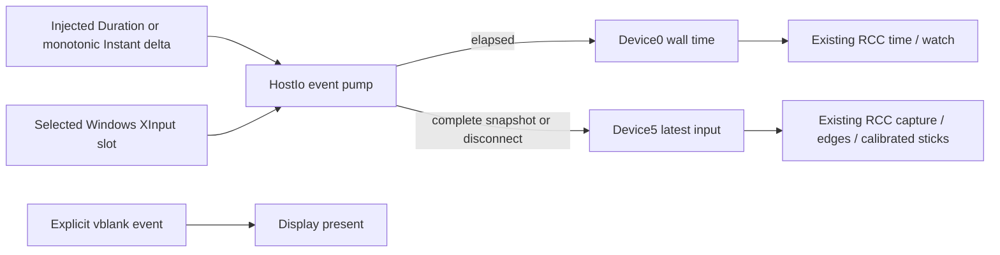
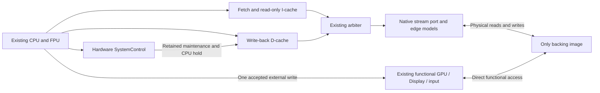

# Host time and controller input

`CpuV3SystemSim` combines functional CPU/GPU results with explicit host events.
It installs Device0, Display3, GPU4, latest-only input Device5 and an observation-only Device7. CPU steps,
device reads, watch probes, state queries and vblank do not advance Device0 time.
This simulator supplies software results, not RTL cycles or cache timing.



Arrows are host calls and software reads. A complete input replaces the latest
sample atomically at its publication call; neither a read nor begin-read starts
acquisition. Vblank remains a separate Display publication boundary.

## Explicit time

`advance_host_time(Duration)` carries fractional microseconds between calls,
advances the wrapping 16-bit millisecond timestamp and saturates the microsecond
interval at 65535. Long durations are reduced by the millisecond counter period
without a large loop or a narrowing overflow. Device0 SEND11 bit0 still clears
the interval alone. Time is quantized to microseconds; this is not a main-clock
prescaler model or an instruction-to-time conversion.

`HostIo::advance` accepts a deterministic elapsed event and focus state.
`RealtimeHostIo::pump` obtains elapsed time from `Instant`, including time while
the CPU is waiting. Resetting a debugger reconstructs its devices and rebases
the host clock. The debugger's legacy JSON `cycles` field contains functional
step calls; its UI labels them steps, not measured hardware cycles.

The debugger enables the real-time pump at startup. CPU execution services it
while running, including bounded library stepping. The independent
`POST /api/host?focused=0|1` heartbeat services elapsed/input events while paused
or waiting, without executing CPU work. Browser focus/visibility events report
loss and regain. State/framebuffer GETs remain observations. Host events are
serialized with debugger commands; focus loss takes effect when its event is
serviced. Vblank-only rAF scheduling cannot drive this pump.

## Latest input and Windows source

`publish_input(Some(ControllerSnapshot))` atomically replaces eight bytes, sets
valid and sticky changed, even for an identical publication. `None` invalidates
a valid sample and sets changed. Repeated disconnected observations do not
invent new publications. Payload reads select the current latest sample; SEND
does not latch a private old copy. A publication during a multi-read attempt
leaves changed set, so the existing bounded RCC reader discards that attempt
and reads the latest sample on its next call. Multiple publications cannot
cancel changed. RCC retains ownership of button edges and digital neutral axes.

The functional model retains Device5's ordinary channel layout and high-SEND
begin-read aliases. Channels 9..12 return zero as explicitly unmodeled background
and wire diagnostics. They provide no serial slot, phase, DAT, ATT or failed-wire
evidence. No serial polling, pressure tail, vibration or pin state is simulated.

XInput is opt-in with `--xinput-slot 0..3`; it is not queried by default.
Windows uses the official `XInputGetState` binding. Other platforms can build
and use deterministic time/snapshot injection, and reject the XInput option
explicitly. A connected focused source is sampled on host events at intervals
of at least 16 ms; disconnected slots are retried after 1 s. Focus loss invalidates
input; regain retries immediately. No automatic switch to another slot occurs.

| XInput | Existing input meaning |
| --- | --- |
| Back / Start | Select / Start |
| Left/right thumb click | L3 / R3 |
| D-pad | Same four directions |
| Left/right shoulder | L1 / R1 |
| Left/right trigger greater than 30 | L2 / R2 button bits independently |
| A / B / X / Y | Cross / Circle / Square / Triangle |

The mapped semantic button mask is inverted into active-low bytes. Reserved
XInput button bits are ignored. The software sample uses analog ID `0x73` and
marker `0x5a`; these identify the existing format, not a serial reply.

### Circular source to shared DS2 geometry

The adapter expands circular stick travel into the square domain expected by the
existing RCC `stick_read`; UI, gamepad and demo camera keep that same DS2 code.
Application source and Device5 ABI remain common to physical DS2 and XInput.
For `u=(X,-Y)/32768` in RCC's right/down convention, let `r=length(u)` and
`m=max(abs(u.x),abs(u.y))`. The adapter applies:

```text
v = 0                         when m=0
v = u * min(r,1) / m          otherwise
```

The shared forward square-ray geometry maps `v` back to the original direction
and radius `min(r,1)`, before application dead zones. Out-of-circle source points
saturate radius at 1 without changing direction. This is a geometry inverse, not
an inverse of dead-zone suppression or outer saturation.

Expansion precedes the original signed 16-bit-to-byte offset/truncation. X increases
right; Y is inverted before quantization so up produces a smaller raw Y. Zero
maps to 128, negative and positive endpoints remain 0 and 255, and every cardinal
axis value retains its original byte conversion. Endpoint arithmetic widens
before negating `i16::MIN`. For example, `(23170,23170)` becomes DS2 bytes
`(255,0)`; default RCC processing gives approximately `(0.707,-0.707)`.

The default per-axis calibration is 0/128/255. Byte quantization, asymmetric
positive/negative ranges and native FPU arithmetic prevent a lossless integer
round trip. The adapter does not inspect or undo application center/min/max
changes. Application inner/outer thresholds remain authoritative: with default
`inner=24/256` and `outer=1`, the final strength remains
`clamp((min(r,1)-24/256)/(1-24/256),0,1)`, subject to quantization. Suppressed
positions are not expanded back out of the dead zone; small source jitter stays
subject to it. Physical DS2 input, snapshot publication and button edges are
unchanged. See Microsoft's [field contract](https://learn.microsoft.com/en-us/windows/win32/api/xinput/ns-xinput-xinput_gamepad).

## Display runner

`cpu-v3-display-sim` defaults to `--cpu-mode instruction`, the existing fast
architectural interpreter. `--max-cpu-steps` bounds its step calls; there are no
caches, memory-controller delays or instruction-to-clock conversion. Explicit
`--cpu-mode native` selects the composed core/cache/native-memory model and uses
`--max-cpu-cycles` instead. Both default bounds are 5000000; a bound for the wrong
mode is rejected. `--package PATH` selects an exact CB06 package; otherwise the
runner uses its build-generated package. Both backends use the same installer,
functional devices, event loop and Display1 RGB565/linear-RGB565 renderer.

The deterministic default `--host-tick-us 16667` supplies an elapsed event at each
explicit display sample. Instruction mode advances its functional Device0 timer;
native mode uses that event only for input polling. Native Device0 time advances
with actual logic edges, including hardware initialization and CPU holds.
`--frames` bounds display events independently of the CPU work budget. Events
are not fitted HDMI timing. `--realtime`, `--window` or `--xinput-slot` polls
monotonic host time/input during work; native timers still use modeled clocks.
A window supplies focus; explicitly enabled headless input has no focus gate.
The default does not query XInput. Halt stops further CPU work while remaining
bounded host samples can show the image.

`--stop-after-present N` stops after N actual pending swaps become active fronts,
not after N host samples. `--ppm` writes the current HDMI-sized Display1-converted
`frame-final.ppm` under `--out-dir` (default `target/display-sim`). `summary-*`
receipts distinguish steps from available clock counts, actual accepted GPU
submissions, valid front, applied swaps, GPU error/busy and stop reason. Internal
host wall time starts after package loading/construction and includes execution,
functional GPU work, host samples, rendering and requested output writes. It is
not hardware elapsed time. A caller measuring process spawn-to-exit also includes
package loading, construction and process overhead.

### Exact pre-submit observation

`--freeze-submit N` pauses before the Nth CPU Device4 START is consumed. Earlier
START writes execute the same functional GPU exactly once; the target does not
execute. It is mutually exclusive with `--stop-after-present`. The same observer
is available through `CpuV3Sim::step_observing`, `CpuV3SystemSim::step_observing`
and `CpuV3SystemEmu::step_observing`. A false callback returns `None`; no pending
write retires and no native clock advances. Repeating the pause then resuming
executes the write once. For the interpreter, the hook precedes PC advancement,
prefix/test expiration and device execution. Device holds remain the existing
step behavior. For native, combinational settle/read sampling precede the write
hook; committed CPU/FPU/cache and memory state stays live in the same instance.

The runner writes `physical-pre-submit.bin` as the complete raw little-endian
physical DRAM image, `application.cb06`, and `pre-submit.json` containing the
observed COUNT/START descriptor and backend-specific counters. Instruction clock
counts are null. `cpu-architecture.json` records diagnostic registers. These files
are a GPU preimage, not a resumable CPU/cache checkpoint. Dirty CPU lines, stale
cache copies, native responses in flight and device ownership are not serialized
or cleaned. No output transform is applied to memory; only PPM uses Display1's
color conversion. Existing Prepared-gate capture remains separate and keeps its
original driver ABI/gate, without bypassing UART or application control flow.

### Prepared gate on native CPU

`profiling_capture::capture_native_flash_with_functional_prefix` runs the existing
native CPU composition to the compiled `CapturePoint`. It stops when the first
scalar instruction of that function is awaiting its execute edge. It uses the
core's executing instruction address, not the next/prefetched program counter;
a preceding return cannot falsely trigger the gate. All earlier CBs execute on
the same functional GPU and backing. The gate body, UART exchange and target GPU
START are not executed or bypassed. The caller supplies a positive cycle bound.
Ordinary submission versus eligible request selection remains firmware behavior;
a raw `--freeze-submit` ordinal is not evidence of that policy.

Capture header/table are producer-owned ordinary scalar metadata. Their read-only
view checks the core's latest pending scalar store, resident D-cache line, then
physical memory on a cache miss. It neither issues a CPU load nor changes cache
replacement, dirty flags, memory, clocks or native responses. This limited view
is not a general architectural read transaction or FPU-store checkpoint API.
GPU command/object/resource/target payloads always read physical memory directly,
even if a CPU cache line contains an older GPU output. Header/table observation
never overlays CPU cache data into the GPU image or implicitly publishes metadata.

`NativeFrozenInputs` carries the validated `FrozenData`, raw physical image,
functional Display state and logic/native/vblank counters. Its raw Header can
legitimately lag its separate CPU-private Header. The existing architectural
Prepared capture keeps its API and descriptor/physical-payload semantics. Both
backends use one shared range/envelope validation and extraction function; no
command ABI or application synchronization rule changes.

Device7 records the last value and write count for each diagnostic channel.
CPU reads return zero, matching the old unattached interpreter behavior. It
creates no memory requests or CPU delay. Native uninstalled devices still return
an explicit unsupported-device error; this does not make every unknown device
silently succeed.

## Native-edge CPU composition

`system_emu::CpuV3SystemEmu` runs the existing core/FPU, fetch, read-only I-cache,
D-cache, memory arbiter and hardware SystemControl emulators against the fitted
Gowin native stream/gear/controller/pin models. Construction consumes one 4M-word
physical `Vec<u16>`. `new` accepts a preloaded reset PC/CSEG0 image;
`from_single_flash` installs the generated CB06 application and configures the
existing core's fitted initial CSEG7. This preload is not SPI boot time. Both
cache clients, physical pin commits and functional device callbacks borrow that same backing; there is no architectural CPU executor,
private DRAM copy, implicit clean or synthetic memory-delay mode.



`step` settles the combinational interfaces with a bounded convergence check,
then commits all logic owners once and advances two native clocks. Initial
reset occupies two logic cycles; native initialization and valid-array sweep
hold the core while memory and device clocks continue. Device0 timers count
logic edges. Maintenance follows the actual core drain, retained command,
acceptance and done/error handshake. `physical_memory` observes DRAM directly,
including stale words while newer CPU data remains dirty in D-cache.
I-cache invalidate, core halt and core fault also flush fetch/BTC, using the
same frontend predicate as the fitted top. Already accepted lower responses
retain their provenance and drain without reaching the new instruction stream.

External Device3/4/5/7 accesses and hardware watch probes use their existing
functional devices. A device read is sampled once, and a write executes once
after pure convergence, before the logic edge commits. Functional GPU errors
retain partial writes, effects and actual status. GPU/Display add no simulated
memory requests, competition or invented wait time; native counters qualify only
CPU memory traffic without that competition. Renderers borrow read-only physical
slices and preserve the existing tile layout, active format and Display1 LUT.
Vblank publication and input replacement remain explicit host events.

`CpuV3CoreState::with_initial_code_segment` mirrors the existing RTL parameter;
generic default remains0. Reset retains RTL's unreset instruction/instruction-PC
and halt-signal latches while restarting the configured segment and clear phase.
The focused parameter replay does not qualify arbitrary interrupted warm reset,
FPU recovery or a whole-board reset workflow. Native errors terminate the run;
modeled edges and host wall time do not establish fitted-board performance.

The bounded `native_system_emu` test executes scalar FLD/ADD/FST and dependent
integer load through the real caches. Without a clean, the CPU sees 3.0 while
physical destination words retain their seed. An adjacent Device0 clean must
drain FST halves, execute once, finish through native memory and expose the
correct physical words before CPU halt. No post-halt cleanup is added.
