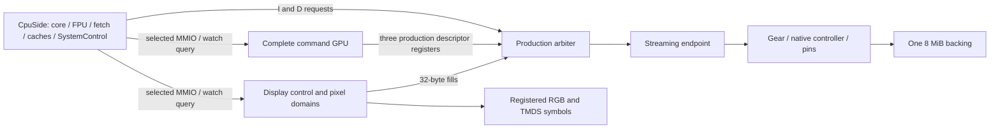

# Full-system cycle composition

`system_cycle_emu::System` combines the production request-side CPU/FPU/fetch/
I-cache/D-cache/SystemControl models, the complete command GPU, Display through
registered pixels and TMDS symbols, and one physical SDRAM service. It executes
CPU MMIO and GPU command fetches against that service. Device access never runs
a functional GPU or edits the physical backing.



Arrows to the arbiter are offers, accepted only on that edge's ready handshake.
Read beats, write payload credits and terminal responses return to the original
owner. Descriptor acceptance does not update the backing. The physical model
writes at native SDRAM falling edges. The three GPU registers hold descriptors
only; their payload and response owners remain inside the GPU. An occupied
register cannot lend its downstream acceptance as same-edge upstream credit.

## Clock and commit boundary

The scheduler reads 54 MHz logic and 108 MHz native-controller rates from the
production profile and the exact 33,300,000 Hz pixel rate from the active Display
configuration. Its integer calendar has a 7,992,000,000 Hz quantum: logic rises
are 148 ticks apart, native half edges 37, and pixel rises 240. It visits edge
instants without rounding frame periods or iterating through unused quanta.

At a coincident instant the root samples all old-state outputs, settles the
CPU/device and arbiter/endpoint feedback with finite bounds, and freezes those
inputs. Each logic owner commits once. Display receives both edge bits together
and keeps its existing old-Q RAM/CDC behavior. Native memory consumes the frozen
drive at the scheduled half edge; a pixel-only event advances no MC state. Rust
call order therefore cannot expose another owner's newly committed state.

The memory chain class follows the actual production grant: GPU RO, GPU FBW,
GPU FBR or CPU data write, otherwise zero. DMA is inactive in this entry.
The root preserves the production watch query mux. SystemControl still receives
the original CPU bus; external writes are suppressed during watch reads. Watch
holds while the selected value equals its configured expected value.

## CPU boundary and old modes

`cpu_subsystem::CpuSide` owns one persistent request-side circuit. Its
`settle(&Input)` has no edge, backing mutation or device callback; `clock(&Input)`
returns that edge's pre-commit output and commits one logic edge. Physical I/D
responses retain all 64 bits. The existing core, cache and SystemControl output
types expose requests, MMIO, maintenance, fault/halt and retired words.

The compatibility path `system_emu::wiring` re-exports the public CPU boundary.
The full-system and old native roots import the neutral owner directly. Its
error type describes only CPU-side combinational convergence, without an MC
dependency. The old native root reuses the same wiring helper inside its original circuit,
retaining its existing arbiter and `MemoryExternal`. The architectural
instruction simulator remains separate. Neither old execution mode embeds this
new system or changes its device semantics.

## Explicit startup entry

`System::from_preloaded_cold(package, seed)` is a **synthetic preloaded
configuration-state entry**. The shared CB06 parser installs COPY/ZERO bytes
before clocks, with the declared seed elsewhere. No runtime owner can obtain a
mutable reference to the backing. This entry runs real MC initialization, cache
sweep, monotonic cold/video crossing guards, virtual black groups, the Display
frame origin and started acknowledgement before releasing the CPU.

The actual loader contract is defined by `hardware/single_boot/single_boot.v`:
each COPY/ZERO word requires a real accepted request and terminal response;
the final COPY also waits for Flash completion. A valid END sets `load_done`
and enters DISPLAY. Only Display acknowledgement and cache readiness advance
DISPLAY to FINISHED. Errors win over the final write, END and acknowledgement.
The loader holds the CPU throughout and has no application-instruction side
effects. The preload entry supplies the same validated application bytes and
uses the real Display/cache completion condition, while skipping that loader
transaction history.

| State | Preloaded entry and application ABI | Actual loader distinction |
| --- | --- | --- |
| CPU | CSEG7, PC0, DSEG `[0,1,2,3]`, no retired words during hold | SP and static initializers execute from RCC startup; they are never patched by the host |
| Image | Code at word `0x70000`; allocated statics ZERO; resources COPY/ZERO | Flash/SPI activity and loader DMA traffic are omitted |
| Caches | Real configuration sweep while CPU is held; empty application frontend | No imported warm cache, pending miss or maintenance transaction |
| SystemControl | Real elapsed logic clocks throughout startup; no timestamp reset at release | Elapsed loader time is absent; timer values are not a real-board checkpoint |
| MC / backing | One real initialized native service, declared image seed | Bank/refresh/phase history from actual loader writes is absent |
| GPU / slots | Real cold guard; idle GPU and empty descriptor slots at release | No arbitrary in-flight GPU state restoration |
| Display | Real black-group/CDC/origin/ack prefix, no pre-present SDRAM fill | Loader-specific startup phase and timing are not imported |

`Release` records the first unheld CPU edge, integer time, all three clock
counts and unmodified SystemControl timestamps. The MC/cache startup prefix and
post-release application work are separate statistical boundaries. A successful
cold-prefix test does not establish real bootloader-state equivalence.

The production root holds the core until boot completion and cache sweep, while
the loader uses the scalar DMA port alone. Thus no application instruction,
dirty CPU line, pending application miss, GPU descriptor or GPU transaction is
required at the boundary. Loader `in_flight` clears on the last real response
before END; the remaining Display/cache wait introduces no loader request.
Invalid cache payload bits need no host reconstruction. MC initialization is
required, but controller recovery/refresh and pin phase can still differ after
the loader's final response. The declared preloaded entry constructs an empty
application owner set and runs the actual cold preparation without importing or
rewriting these phase-dependent states. The qualified application has no missing
handoff state that requires a separate loader-cycle implementation.

## External peers and observations

Device0 uses the real SystemControl, with the board's two-stage raw-button
crossing. Device3 and Device4 are the clocked Display and GPU. Device5 is a fixed,
latest-snapshot peer: eight bytes, valid/changed status and acknowledgement; it
does not claim DS2 acquisition or serial timing. Device7 records observation
writes and reads as zero. Other device accesses return an explicit unsupported
device error. External PLL lock is declared stable from the initial instant.
TMDS symbols/disparity are modeled; serializer, electrical pins and physical
PLL/CDC timing are outside this model.

`step_observing` exposes the old-state instant, CPU/GPU outputs, selected bus,
arbiter/endpoint response pins and Display outputs. This passive surface does not
advance time or replay captured CBs. The separate passive collector consumes
this surface for unified profiling; the root owns no recorder. Host elapsed time
is reported separately from simulated clocks.

Counter arrays use Display, instruction, data, inactive boot DMA, GPU RO,
GPU FBR and GPU FBW order. Accepts count physical descriptor handshakes and
terminals count accepted endpoint LAST routed to that owner. `response_beats`
includes write acknowledgements; it is not read bandwidth. `write_beats` counts
64-bit payload credits. Simultaneous pending offers and wait cycles describe
contention separately from descriptor/terminal conservation. CPU state, GPU,
Display and the clock are owned privately; host callers can observe them and
publish snapshots/buttons without clocking a child independently.

`Scanout` collects complete rasters only from registered Display pixels, checks
knownness/collisions and raster completeness, and retains the real effective
source count. Screenshots therefore consume scanout rather than decoding the
backing with a functional renderer.

## Command-line entry

```powershell
cargo run --release -p cpu-v3-tang-nano-20k --bin cpu-v3-system-emu -- `
  application.cpu-v3-boot --entry preloaded-post-boot --max-logic-cycles 3000000 `
  --presents 2 --fixed-input analog --frame-ppm scanout.ppm --memory-out physical.bin
```

The cycle bound is mandatory. A separate host watchdog defaults to 600 seconds.
`preloaded-post-boot` first advances the declared cold preparation, bounded by
one million logic edges and the same host deadline, stopping before the first
unheld CPU edge. It retains that live CPU/cache/MC/Display/clock composition and
starts the application cycle budget there. `cold-preloaded` includes preparation
in the requested cycle budget. Both modes retain the explicit synthetic-state
differences above. Setup, prefix, stepping and export host costs are separate.
`--fixed-input digital|analog|pressure` supplies a neutral fixed snapshot;
without it Device5 is disconnected.
Without `--presents`, HALT is the success boundary; with it, the runner waits for
that many observed pending-to-complete presents and a subsequent complete real
source raster. Present counters cover the qualified sequential presentation
protocol; overlapping same-edge replacement of NEXT_SWAP is not a new qualified
profiling boundary. A logic/host bound returns exit code 2, errors return 1, and
the requested completion returns 0. The memory dump is the physical little-endian
image, without an implicit cache clean. The PPM is the latest complete 800x480
registered raster.

## Passive full-system profiling

New recorder output shares the RTL collector's `capture.json`/`events.jsonl`
version2 protocol, point catalog, parser and report path described by the
[common profiling contract](/systems/cpu-v3-tang-nano-20k/docs/gpu-profiler.md#common-collector-protocol).
Native times are exact rational logic-quantum values. Original legacy captures
remain readable without adding unobserved points. The collector remains passive;
trace-disabled and trace-enabled clocks must produce identical modeled state.

`--profile-out DIR` records this same live composition into a new directory.
`--profile-max-events N` defaults to 2,000,000 and permits 1..10,000,000;
`--profile-max-frames N` defaults to two and permits 0..1024. Capture starts at
the selected entry's execution boundary, after preparation for
`preloaded-post-boot`. It never clocks a second model, bypasses CPU execution,
replays a decoded CB, cleans a cache or writes physical memory. Blocking file
I/O consumes host time only. Event overflow stops recording, marks incomplete
coverage, and leaves the original simulation/present/cycle limits in effect.
Simulation failure retains diagnostic files without publishing a successful
capture manifest. A bounded run can be explicitly imported as a partial report.

The manifest binds the exact preserved program and running executable through
the report input hashes. It records the entry, seed, fixed input, synthetic
startup boundary, stop reason, coverage and separate host setup/preparation/
capture setup/stepping/export costs. CPU retirement counters, actual hold flags,
GPU CP phase and producer/backend activity are passive old-state observations.
The observed GPU clock returns committed command edges and passive connected
signals through `Step.gpu_commands` and `Step.gpu_trace`; ordinary stepping keeps
the original clock path. The recorder correlates real latch/issue/release and
DMA/VT/T/quad/ROP owners without adding model state, memory reads or clocks.
The immutable RAM-latched instruction and mutable CLEAR/MEMCPY control progress
are distinct fields. Abort/reset close the protocol busy interval with a stop
reason, leaving uncompleted semantic owners open. Legacy captures without these
capabilities keep their detailed lineage unavailable.
Accepted GPU master descriptors are recorded before the real board request
slots. Shared-service descriptors are recorded after those slots at arbiter
acceptance. Their times can differ; the report verifies per-port FIFO and exact
fields rather than assigning an asynchronous response to the current CP.

Before the first observed edge or GPU submission/present, `initialize_memory`
copies one read-only 8MiB backing preimage to `initial-memory.bin`. Subsequent
native physical writes record actual byte address, 32-bit data and four unmasked
byte lanes; GPU cache/tag writes and target invalidation provide the remaining
native history inputs. No command-boundary full-memory copy, MC service,
implicit flush or second GPU execution occurs. The two-target native history
budget is independent of the registered-raster budget and event limit. Event
overflow preserves a partial prefix with open owners and explicit image
unavailability at an unclosed final edge.

There are two independent memory boundaries:

| Boundary | Actual event and accounting |
| --- | --- |
| Client64 | Display, CPU instruction/data and GPU RO/FB links at arbiter acceptance, payload handshake and real terminal response. Each transferred 64-bit slot is 8B. A write terminal acknowledgement transfers no additional payload. Descriptor counts, requested bytes, pending requests and valid/not-ready states remain separate. DMA is disabled in this composition. |
| Native model32 | Each native rising-edge old controller `read_valid` contributes one 4B return. Each actual Pins write branch contributes one 4B write slot plus its independently counted 0..4 DQM-unmasked bytes. Held DQ and the opposite half-edge contribute no additional transfer. |

These are client service and native model measurements, not board pin bandwidth,
electrical utilization, PHY turnaround or refresh occupancy. Native slots are
observed directly; client 8B slots are never divided into synthetic native beats.
Transactions retain distinct accepted identities through lookahead and terminal
completion; write payload can belong to a following accepted write while an older
response is still pending. No attribution to an unobserved native client owner
is invented.

`scanout-*.rgb` contains only saved complete 800x480 registered RGB rasters.
The report converts those exact RGB bytes to PNG without another LUT/gamma pass.
Raster start/end ticks, front register at start, effective source pixels and
applied-present counts accompany each image. Submission, completion, present
request and applied-present counters are separate identities. A raster does not
claim an unproven one-to-one present association. Image limits select a bounded
subset; absent images and incomplete timing coverage remain explicit.
The default two-raster budget can include startup black frames; requesting two
application presentation reports therefore requires sufficient saved rasters.
Native command history is separately 400x240 RGB565/D16 with hash-bound raw
planes, never a resized registered raster. The profiler owns its target selection,
cache overlay, completed-prefix policy and image identity validation.

The existing profiler's `build`/`render` commands and single offline viewer
consume this source. The [profiler contract](/systems/cpu-v3-tang-nano-20k/docs/gpu-profiler.md#full-system-cycle-source)
owns the report extension. Physical/loader/device qualification remains limited
as above even when a profile is complete.

### Passive application-runner helpers

`system_cycle_emu::runner` provides a bounded 8 MiB host worker, named physical
RAM inspection, actual Execute-edge MMIO events and first-unheld-Execute arrival
deduplication. Inspection selects pending scalar-store data, resident D-cache
data, then physical RAM, without requests, cache replacement or clocks.
Observation exposes the old-state scalar Execute address, already-selected CPU
device read mux and all sixteen architectural GPRs before the scheduler edge.
Application code owns the meaning of those registers.

Device enables identify actual unheld MMIO; watches are separate. Execute arrival
does not require retirement: prefixes and cache-miss LOADs may not retire on that
edge, while a later MemoryWait retirement is not a new Execute arrival. Non-logic
observations preserve deduplication. Applications that perform actions at gates
must separately require same-edge retirement.

The ordinary level-29 selection, input script, wait ABI and verification launcher
belong to the [Bloxorz application](/systems/cpu-v3-tang-nano-20k/applications/bloxorz/docs/profiling.md).
There is no generic scenario interpreter. The ordinary sidecar's published v1
format remains readable through its application-owned codec; the common profiler
owns collection, registered images and interval activity accounting.
