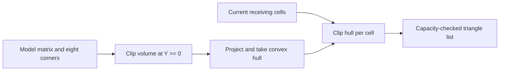

# Host scene geometry

`geometry.rs` implements host-side geometry preparation and reference math.
It consumes world-space boxes and receiver cells and produces affine matrices or
triangle lists. It does not issue GPU commands, use the RCC driver, quantize
native vertices, or select a boot application.

## Camera and rolling poses

World coordinates follow the game: X right, Y up, Z toward the viewer. The board
is centered before the camera transform. The camera retains the reference's
20-degree vertical lens, 15-degree horizontal yaw, target Y=0.6, corner-fit
distance and 3% fit margin at 400×240. The fit includes heights zero and two.

The GPU projection has focal length 256. The matrix scales view X/Y by
`(120 / tan(10 degrees)) / 256`, flips view Y and points forward Z into the scene.
Z retains world units. Pixel-index coordinates are
`(199.5 + 256*x/z, 119.5 + 256*y/z)`; the half-pixel offset converts Three.js
viewport coordinates to pixel-center indices. Position and normal transforms
must remain separate when this lens scaling is eventually encoded.

`roll` handles the three whole-block orientations and four movement directions.
Its fraction is the angular fraction of a quarter turn, not elapsed seconds or
an easing curve. The caller owns time, easing and state transitions. The matrix
rotates about the correct bottom edge, preserving initial block dimensions.
A separate vertical `drop` offset exercises floor intersections; it is not an
implementation of the reference's full falling animation.

## Ground shadow

`shadow_matrix` composes the model with the affine projection
`(x,y,z) -> (x-y/2, 0.006, z-y/2)`. This is a singular **position** transform.
It never requests an inverse transpose or generates a normal matrix.

`floor_shadow` transforms eight corners of the rendered 0.98-sized box, clips
the volume at Y=0 using its twelve edges, projects surviving points and takes
their convex hull. There are at most 20 candidate points before the hull.
Fully underground boxes produce no shadow. `receiver_shadow` clips the hull
to caller-supplied unit receiver cells, then triangulates each clipped convex
polygon. Holes and inactive bridges are omitted from that list. Duplicate cells
are rejected to prevent double blending. Degenerate fan triangles are skipped.

The API accepts at most 256 receiver cells and an explicit triangle capacity.
On overflow it returns an error without publishing a partial triangle list.
The host reference uses vectors and scans the supplied receiver list; this is
not a measured or adopted RCC allocation/iteration strategy.

The output uses the clipped silhouette. A separate test checks the matrix-only
candidate: projecting all six closed-box faces covers interior samples twice,
while selecting outward faces with `normal dot light > 0` covers once, using at
most three faces. That candidate alone does not handle holes or underground
portions. It is not selected as a runtime fast path. Two independent casters may
overlap, matching the original game's behavior.

## Independent evidence and limits

`tools/import-geometry.mjs` reads the original camera/state/shadow helpers and
Three.js from an explicitly supplied reference directory. It writes expected
matrices, pixel positions, silhouettes and clipped-cell areas into
`assets/geometry-reference.txt`, with source identities in
`assets/geometry-provenance.json`. Ordinary Rust tests use these inputs and do
not need the original directory or Node.

The fixture covers 180 whole-block poses: all orientations/directions, angular
fractions 0, 1/8, 1/2, 7/8 and 1, and three drop heights. Three camera sizes cover
small and 15×10 boards. Polygon support/area tolerances account for the original
helper's Float32 corner storage. Additional tests check hole clipping, duplicate
receivers, capacity failure, singular projection and single-layer coverage.

These checks establish continuous host geometry. They do not establish GPU
fixed-point matrix/vertex range, D16 separation, culling/winding, top-left shared
edge coverage, alpha quantization, render timing or firmware CPU cost. In
particular, Y=0.006 preserves the reference value without claiming that it is
sufficient for every native depth configuration.
