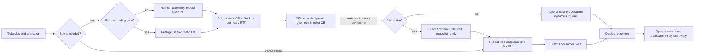

# Game animation and cached RTT veil

The example owns all33 imported stages, integer rules, animation and input. The shared `bloxorz_core` remains timer-free. The reference is the Web 400×240 pixel mode:20-degree vertical field of view,5:3 aspect,512×512 low atlas and MSAA off. Its corner-fit Camera targets(0,.6,0) and fits each stage independently. A local view-axis adapter accounts for the existing native renderer reflection. Native material/lighting and RGB565 quantization remain visible differences from Web PBR.

Animation and transition use independent clocks and independent one-word enums.
The animation number sent through the diagnostic signal retains its original
value. The rule engine keeps the packed tile and status codes; named kinds
identify their values where the game reads or writes these words.

The application owns a `PadCache` value for the lifetime of the run. It contains
separate entry/goal keys and opening values, three part masks, the goal carrier
mesh index, and keys for the last recorded draw. The cache is borrowed during
preparation. Its part masks remain bitfields because several parts may be
visible or dirty at once.

Restart can begin the veil while a roll continues. A released block keeps its pose, tangent velocity, spin and gravity throughout fade-out. Goal closing runs visibly for200ms after the landed pause; fade-out starts only after the aperture is closed. Rendering completion, rather than a stale animation callback, authorizes level replacement.

The application keeps a sealed static geometry CB with floor, fixed well walls
and visible fragile cells. It copies the selected immutable dither background
or clears the solid color, clears work depth, then draws those meshes. Level,
background, per-level camera and fragile visibility changes invalidate recording.
Source geometry is refreshed only after both preceding CBs retire. Dynamic
bridges, switches, opening strips/hatches, goal carrier, shadow and players remain
outside this static recording.

Each scene frame reuses the same static command bytes. A public `TargetBinding`
updates Target32 and the optional leading background copy's destination together,
selecting Back or the boundary RTT snapshot. World/material/View payloads remain
unchanged. Static color/depth cache planes are absent; the former512KiB at
0x500000..0x580000 is no longer reserved. Static triangles and pixels execute on
every scene frame, trading GPU work for memory and simpler CPU preparation.

Submission transfers the static CB to the driver while the CPU records dynamic
3D in the other exclusively owned CB. Static completion returns that owner
before the dynamic CB is submitted. Load dependencies are checked at submission,
after the producer finishes. Resume/input recovery stays immediately after waits;
input sampled while waiting is consumed by a subsequent application tick.

Ordinary frames use two submissions, including frames that rebuild recording;
3D/HUD target Back directly. A boundary capture uses three: static, dynamic into
RTT, then veil/HUD into Back. Later fading frames use one consumer submission.
Opaque presentation retires before level reset. The new generation records its
static geometry and captures one incoming closed-entry snapshot, reused during
Hold/In. The RTT snapshot is never Display Front and remains immutable between
captures; textures invalidate only after a new snapshot write. Tint changes only
with alpha.

Rules and outgoing animation clocks still advance, while fade visuals deliberately
freeze at those two boundaries. Ordinary entry/goal/fall animation remains live.
Only completed RTT snapshots call `BloxorzSession::captured`. Every consumer retains
scene depth without writing it; the HUD is drawn separately on Back. Final GPU
wait, Display retirement and fault-held ownership preserve their existing roles.

## State ownership

[`BloxorzSession`](/systems/cpu-v3-tang-nano-20k/examples/game_bloxorz/rcc/session.rs)
owns one persistent game instance. `begin`, `tick`, `try_move`, `undo`,
`reset_level`, `captured`, `presented` and `end` borrow that instance; none
copies the whole state to the stack. Rendering reads named level, rules,
motion, animation and transition fields. `BlockOrientations` belongs to the
same session and owns its once-allocated rotation history between `begin`
and `end`; undo restores both logical state and actor orientation.

| Owner | Target storage | Contents |
| --- | --- | --- |
| `BloxorzSession` | 907 static words | Level, rules, packed undo, motion, clocks, fall pose and orientation metadata |
| `PresentationState` in main | 12 static words | HUD, background selection, resting-model key and bridge cache |
| `DrawStatistics` | 3 static words | Draw count and the last completed render interval with validity |
| `ShadowWorkspace` | 436 static words | Cache key, statistics, reusable polygon scratch and aligned batch pointer |

The timer-free `bloxorz_core` still uses a compact word ABI. `LevelState`
has eight header words followed by 300 cell words; `RuleState` has ten words
in the rules engine's order. Both are `repr(C)`. Only `level_words` and
`rule_words` expose that representation for rules calls and fixture setup.
The six-word rule snapshot and two-word-per-entry undo ring remain encoded
buffers inside the session. These formats and the native geometry packages
are arrays by design; application phase/cache fields use named members.

## Rules and animation

An accepted move commits its future integer state immediately and retains its original pose. Bridges, tiles, glyphs and shadow receivers share a visual mask delayed 154ms from roll start. That delay continues across an early release. D-pad holds repeat after animation settlement; the newest still-held direction wins. START restarts; TRIANGLE/R1 select the next stage and L1 the previous stage, wrapping across33; Square undoes; Cross swaps the active split cube. Swap counts as one accepted move and is undoable. An instantaneous swap still evaluates its resulting support. If a soft switch removes the other cube's bridge, the unsupported cube falls vertically from its stationary pose while the supported cube stays in place. This uses the ordinary600ms failure notification and presentation-retired fade/reset; undo before fading restores both cube identities, active selection, bridge mask and move count. These controls clear queued directions. Fade completion discards locked-period edges and retains a held-D-pad lock until release. Disconnection clears active directions while autonomous presentation continues. SELECT toggles the original dither background and solid #2c2620 while input is unlocked.

| Animation | Time | Behavior |
| --- | --- | --- |
| Roll | 220ms | Quarter turn about the actual tile edge |
| Entry opening | 200ms | Smoothstep opening; hidden transverse zero-width panels are omitted |
| Entry rise | 380ms | Reverse 2.08-unit drop; width approaches 1 from .9 with the same easing |
| Goal opening | 200ms | Opening .86→.94; hatch remains visible |
| Goal drop | 420ms | Downward 2.08×(.4f+.6f²), width 1→.9 |
| Goal landed | 80ms | Brief pause at the bottom |
| Goal closing | 200ms | Closes before the320ms veil starts; covered block then hides |
| Split arrival | 280ms after roll | First70ms squash the whole block into the pad; two cubes then pop at the target coordinates |
| Fragile cracking | 140ms after roll | Brief tile tremble, then block and marked tile drop without initial velocity/spin |
| Half-supported tip | 360ms | Quadratic quarter turn about the supported cell edge |
| Free fall | 600ms to notification | Preserved release pose, tangent velocity and angular speed; vertical term−16×(t/.6)² continues afterward |

Fully unsupported rolls release at the Web balance threshold, evaluated at the actual discrete tick: 79ms for standing, 169ms for a long-axis lying roll, 124ms for a perpendicular lying roll. Release does not snap to the unsupported destination. Tipping releases at twice its final nominal angular speed. Split cubes roll over220ms and release at124ms when unsupported. Both old cube identities and the active selection survive a move; the idle cube stays in place. Adjacent cubes merge through the shared rule engine after the moving cube lands. Both shadows are recorded before either opaque cube, so one shadow cannot cover the other cube. Fragile tiles are dynamic and stop receiving ground shadow once their drop starts. All updates clamp elapsed time to 50ms, without a catch-up loop. Ratios normalize integer milliseconds by 1/256 before reciprocal; fall ratios remain unclamped so motion continues during the veil.

Switch synchronization updates the shared visual mask. Nine channel ages run for
260ms, with a cubic sink and sine overshoot. The textured soft tile keeps its X/Z
extent and sinks from .04 toward .015 world units. Heavy buttons use a flat
marked tile whose texture changes with the visual mask, without pulse or sink.
The eight reference
palettes cycle for the ninth channel. Multi-channel switch actions remain the
core's keep/XOR rules. Inactive bridge hints use SrcOver alpha60/255, Less and no
depth writes; active bridges remain opaque. Hints are drawn after all opaque
bridges, pads, receiver shadows and both players, before HUD/veil composition.
They test the completed opaque depth, blending over a player behind them and
failing over a player in front; the hints never enter the static recording. Shadow alpha87 and idle-cube alpha255
are independent. [Marker textures](/systems/cpu-v3-tang-nano-20k/examples/game_bloxorz/docs/markers.md)
describes the packed surfaces. Native shading approximates reference materials
and does not reproduce Web PBR emissive response exactly.

The renderer tracks24 exact right-handed signed-axis orientations independently
of the three occupancy modes. Each completed roll composes one world-space
quarter turn. Animated world/normal matrices use the starting orientation;
settled matrices use the accumulated orientation, preserving local faces and UVs.
The orientation postmultiplies the canonical world and normal source matrices;
translation, support pivots and occupied bounds remain canonical. Split cubes
inherit the parent orientation and then track each actor independently; swapping
changes selection only, merging adopts the moving actor's landed orientation.
Undo retains both actor orientations in an additional512-word heap ring, freed
on finite exit; resets restore identity. Resting Model cache keys include this
orientation. Early free fall retains its release orientation without adding an
uncompleted quarter turn.

## Transition arithmetic and lifetime

The veil color is CSS #142238, quantized to encoded RGB565 word 0x1107 (expanded 16,32,57). Source and Display stay in ordinary encoded RGB565 mode; no second gamma transfer is applied. The full-screen quad uses nearest sampling, white uniform RGB, transmittance alpha, SrcOver and no depth write. Its target color is freshly cleared to the veil color; shared scene depth is loaded and preserved. Fading frames sample their completed boundary snapshot; only alpha and the independent Back HUD need recording between captures.

| Transition | Time | Uniform transmittance |
| --- | --- | --- |
| Out | 320ms | 255−floor(51t/64) |
| Hold | 80ms | 0 |
| In | 380ms | floor(51t/76) |

The products fit u16. Native ROP quantizes alpha to Q6 with `(alpha8+2)>>2`, performs half-up/64 blending and rounds to RGB565. At alpha 128 the encoded channels are the half-up average of source and quantized veil. The opaque consumer is a real Frame; only its successful GPU wait and Display retirement reset rules, undo history, level generation and incoming animation. Hold/fade-in keep entry at its closed state. Successful presentation of the final transparent consumer releases the entry animation. Outgoing animation state continues during out behind its frozen snapshot; incoming entry starts afterward.

## Storage and verification

Color A/B/depth remain at 0x400000/0x440000/0x480000, dynamic templates at 0x4c0000..0x4c4000, active commands at 0x4c4000..0x4c8000 and push at 0x4d0000. The second command/push pair occupies 0x7e0000/0x7f0000. Original immutable background is 0x580000 (204800 bytes), the read-only level archive begins at 0x5b2000, offscreen color is 0x600000, and the full 512 atlas mip chain starts at 0x680000. The marker atlas occupies0x740000..0x760000 and four goal-carrier base textures occupy0x760000..0x780000. The asset tool checks disjoint allocations and generates mesh directories and the archive. It copies those assets through the normal CB06 boot-resource path; no instruction/Flash array is maintained separately.

The archive contains all33 compact source levels and precomputed visible floor
faces/cameras, plus the eight channel palettes; all33 stages are selectable. Its four-u16 header is magic0x424c, format1, count33 and record-size16.
Each record uses word-relative offsets: level offset/count at0/1, face offset/count
at2/3, Q16 eye XYZ at4..9, focal at10/11, far at12/13, the planar-carrier applicability flag at14 and the sorted static-face schedule offset at15.
Face words pack X4:0, Z9:5, face12:10 and atlas variant14:13. The five face codes
are top,+X,+Z,-X,-Z. Static-neighbor interior sides are omitted; camera-facing
boundary sides are retained, including boundaries beside dynamic surfaces. Fragile cells use a separate retained batch with reversible index visibility; splitter top faces use the marker atlas while their sides use the original floor texture.
Twenty base native templates cover five faces and four UV variants; four goal-split templates complete the ground table. Their original per-face path remains available for controlled diagnostics; normal static floors use the load-time batches described below. No second baked per-stage floor geometry is retained.
The producer also emits CPU-resident typed level headers, palettes and native
quad templates from the same archive values. Camera code reads `eye`, `focal`
and `far` directly from `BloxLevelHeader`. The complete tables occupy 2,944 bytes.
`blox_asset_read` copies compact level rules into the existing LevelState in one
operation. `level_assets.rs` snapshots the current level's two contiguous face
lists into `LevelGeometryCache`; its producer-sized payload is at most 247 words,
with four metadata words. These lists are CPU recording input, not GPU backing.
The cache is keyed by immutable level identity and reused when restarting it.

Block reads validate source/destination bounds, map DSEG3 once per 16-Kword page,
copy sequentially and restore the incoming mapping once. Destinations remain
below logical 0xc000. Cache tags and issued CPU accesses use physical addresses;
immutable archive reads require no per-word DWAIT or cache invalidation. No
window pointer escapes. Per-face/template/palette/header access uses ordinary
low-memory storage; the driver does not manage game-level caching.

Far is an admission limit, not a D16 precision control. For each level, the tool
projects a conservative animation box into the fixed camera: X/Z extend14 units
beyond each board edge and Y spans[-60,14]. Whole-block release has lever radius
at most sqrt(1.25), angular speed below8.727 and each velocity component below9.76.
A <=50ms tick reaches the600ms fall notification, then the320ms presented veil
resets the level before one second of fall. These bounds cover roll/tip extents,
linear drift, the -16(t/.6)^2 gravity term, entry/goal drops and wells. Far rounds
the maximum camera depth upward and adds four units for fixed-point margin. It
does not tighten to the resting player pose. No shared Projection/depth ABI is
changed.

The undo ring retains256 snapshots in512u16. Each pre-action PLAY state packs
X/Z/other-X/other-Z at five bits each, a three-bit mode (standing/X/Z whole, or
split with active cube0/1), and the nine bridge bits used by the imported stages.
Word0 is X4:0, Z9:5, mode12:10 and mask-low15:13; word1 is mask-high5:0,
other-X10:6 and other-Z15:11. Split states retain both cube identities and the
active selection. The asset producer validates coordinate/channel bounds rather
than truncating unsupported data. The unchanged general core still uses its
six-word public snapshot and twelve-bit bridge-mask representation.

Every accepted core action increments the16-bit move count exactly once and
rejects65535; undo decrements that live count instead of redundantly storing it.
Restart/stage reset clear the ring. The shared engine emits one scratch snapshot,
which the app compacts after an accepted action; undo restores PLAY and cancels
presentation motion. Compact schema2 level data uses308 resident words. The
formal hook-enabled image must fit the8192-word static arena; the boot packer
enforces that limit independently of runtime stack allocation.

## Level and frame HUD

The app always draws `LEVEL` and1..33. Circle toggles `DRAW` and `MS` while
input is unlocked. Simulation and emulation use this same presentation path;
the game has no capture-card input script, UART progress protocol or brightness
freeze/stop mode. Bounded test entries take only a frame limit. Host fixtures
supply input and time and observe the existing frame/submission boundaries.
Statistics describe the previous completed frame and show dashes before one is
available. `DRAW` counts every actual native DRAW plus native UI range: mesh
calls add their public meshlet count, each partial-width UI row adds one, and a
full-width UI range adds one. Copy, clear and maintenance are excluded. A static
static replay contributes its recorded meshlet draw count on every scene frame,
including recording rebuilds. Dynamic source,
optional veil consumer and final UI all contribute. Counts are saved only after
successful GPU completion. They are checked against actual submitted opcodes.

`MS` reports the previous completed render interval in milliseconds with two
decimal digits. The game clears the Device0 channel-11 microsecond timer after
the preceding `Display::wait_vblank` returns and reads it immediately after
this frame's **last** `Gpu::wait` returns. The interval includes input and CPU
preparation and all static/source/consumer GPU waits. The subsequent present
request and vblank wait occur after the read. The independent channel-10
millisecond clock still drives animation.

The completed interval is shown on the next frame; no extra submission is made
for an immediately updated number. Cold F1 has no preceding timer clear.
Cold and saturated (65535 us) intervals display dashes on the following frame.
The next clear starts a fresh interval. Valid readings round to the nearest
0.01 ms, with ties rounded up. Functional simulation advances the device clock
at real GPU submissions and vblank waits to check rounding, saturation and recovery.
The application uses frozen VonwaonBitmap16pxLite1.02 ASCII at native16px,
baseline14 and advance8, rendered as binary8×16 cells without resizing, smoothing
or extra row spacing. Source identity and regeneration are described in the
[asset provenance](/systems/cpu-v3-tang-nano-20k/examples/game_bloxorz/assets/README.md).

Tests use actual instruction CPU, functional GPU and Display pixels. They check
all33 imported headers, all33 actual stage views, split/swap/merge/undo, fragile
crack/drop, navigation wrap, both original solutions, entry/tip/release matrices,
retained-versus-fresh static recording and shadow-cache invalidation. Cached veil
checks preserve all non-HUD pixels and shared depth; the exact64×16 default HUD
region is checked separately. Actual command counts, real Circle edges and an
injected17ms clock verify the HUD. These finite cases do not prove all imported
levels solvable: the reference explicitly leaves stage23 unverified. No new board,
RTL timing, GPU contention or FPS qualification is claimed.

## Closed surfaces and depth limits

The player, raised bases, wells and pad boxes use consistent inward triangle
winding, matching the native positive-determinant front-face contract, with
negative-determinant culling enabled. Normals still point out from the solid
surface. Current application transforms use positive scales and rotations;
left/right roll, entry compression, tip and released fall preserve orientation.
Negative-scale transforms are not generated. Pad boxes use the same six-face
constructor for both axis signs instead of a sign-independent winding template.
Each well uses one meshlet with exactly four side quads: the far -X/-Z interior
walls and the near +X/+Z exterior walls for the fixed game view. There is no
bottom, top cap or runtime camera-dependent variant. Interior width is0.94,
exterior width0.99, top-0.005 and lower edge-2.08 before native quantization.
Opening strips and the planar goal carrier own the aperture boundary. The
ordinary entrance/fallback hatch has its top and all four sides, with local
back-face culling, so its geometry includes either X side without a winding flip.

Opaque geometry retains Less with depth writes. Culling removes invisible back
faces that could otherwise win a low-precision comparison; it is not a substitute
for depth precision. Thin visible rim triangles can still lose against a farther
hatch or floor after native N18/C28 transport rounding. The application does not
hide this remaining numerical limitation with Always or an added depth offset.

`tools/check_pad_surfaces.py <asset-directory>` audits native wall planes,
triangle winding, absence of bottom/top caps and the five-face hatch. The opt-in
`pad_surface_fixed_controls_and_candidate` host diagnostic compares frozen
controls with candidate assets through real entry/goal session actions and
representative marker stages. It saves full Display/color/depth outputs, actual
session clocks and bounded submission inputs. These are offline instruction-CPU
and functional-GPU checks, without a physical visibility or timing claim.

## Planar goal and live aperture

A goal whose eight neighboring tiles are ordinary floor uses a flat material
carrier at Y0. It replaces only those existing floor tops and their internal
sides, retaining the outside boundary sides. A single annulus mesh carries the
stone pattern and red inlay. The center is absent geometry; the visible closed
hatch fills only that aperture, and GOAL_DROP hides the hatch. The well and player
keep real geometry and ordinary Less/depth-write occlusion. There is no alpha
hole, raised plane, depth offset or Always override.

The existing eased opening value selects the nearest of48 read-only native
carrier/hatch meshes, with nominal widths0,.02,...,.94. Native quantization rounds
widths to1/128; the model still uses its normal half scale. Width0 is a full closed
square. PLAY maps to43, midpoint OPEN to45 and DROP/LAND to47. CLOSE follows the
same eased clock back toward0; this is a live, quantized opening/closing sequence,
not three fixed scene assets. Entrance geometry and timing remain unchanged.

Archive header word14 records applicability, derived from the actual surrounding
tile types and board bounds. Levels15 and17 have moving soft/heavy neighboring
tiles and retain the existing raised four-panel goal path, keeping their dynamic
heights/colors. Other imported levels satisfy the ordinary3x3 condition. This
geometry condition does not constitute all-level visual qualification.

Four128x128 RGB565 base-only material phases preserve the neighboring floor's
existing tile-variant sequence. Their32KiB ranges begin at0x760000,0x768000,
0x770000 and0x778000. The stone pattern is resampled and floor lighting is baked
at G232/LODq3=27; the red center material remains unlit. This intentionally trades
the raised shutter silhouette and pixel-identical stone detail for a broad
numerically better-conditioned surface. Thin contact pixels can still select the
wrong surface; such finite residuals are documented rather than hidden. No GPU
speed, hardware-equivalence or perfect-raster claim follows from fewer draws.

## Load-time material batches

Static floor quads are generated into a stable CPU heap allocation when the
selected stage changes. They are grouped in ordinary-floor, split-marker-top
and split-floor-side material order. Atlas variants remain per-vertex UV values;
light response, packed signed normals, winding and triangle topology are copied
from the existing native templates. Only faces already owned by `draw_floor`
are included. Moving bridges, buttons, split player cubes,
wells/hatches, goal/entrance animation, ghosts, shadows and HUD keep their
existing paths and relative ordering.

The33 imported boards are at most15x10. Native positions are unsigned delta10
plus signed F16 origins, not signed10 coordinates. On boards up to15 in both
axes, X/Z source positions are twice the world grid and Y is eight times world
height, with a common Model scale(1/2,1/8,1/2). Both tops and sides then use
quant_shift11: maximum X/Z deltas960/640, and side thickness51 codes. The side
source bottom is-104448/65536, retaining world-51/256 exactly. Sorting material,
then top/side, fills records across the whole board instead of closing a record
at every3x3 boundary. Stage4's54 quads occupy16+12 top and16+10 side quads: four
meshlets, not twelve.

All source normals are signed coordinate axes, checked by the asset producer.
The Model receives the original half-scale normal basis through `set_matrices`:
it is parallel to the inverse transpose on each supported axis, with its
per-axis magnitude normalized back to the original value. This preserves the
original normal18 input range instead of sending an eightfold Y normal into
signed18 transport. Non-axial templates are rejected. The bounded native
Instance test compares the normal matrix against the original half-scale
Model and checks each axial MAC result's range.

Larger coordinate ranges use local3x3 buckets for both top and side quads,
quant_shift9 and the original half scale. Unsupported coordinate/key ranges
halt rather than wrap. Each record contains up to16 independent quads:64
vertices and32 triangles,856 live payload bytes padded to896, plus128 metadata
bytes. Native limits remain64V/96T/1024-byte payload; metadata is additional.

The archive retains its original face list and adds a material/bucket-sorted
face schedule at header word15, plus immutable corner/normal/UV templates.
RCC constructs native positions and packed indices at load time; the asset
producer does not freeze a second native array for each whole level. Independent
wire decoding checks generated world positions and attributes against the old
per-face meshes. Re-factoring source translation into these positions can still
change fixed-point camera rounding at raster boundaries; whole images are not
promised bit-identical between the two recording paths.

`ground_begin` uses the standard heap's8255-word allocation, rounds its payload
up to64-word (128-byte) alignment, and retains16KiB of usable capacity. Sector0
contains the small material/level metadata, sector1 the native directory, and
later sectors the records. The allocator's six control words and two application
control words are distinct from this heap payload. DSEG0..2 retain their normal
identity mapping, so byte address is twice the low CPU word address. The public
`GpuMemory::from_sectors` and `Mesh::from_native` already support these physical
ranges. Normal submit publication cleans the CPU cache before GPU START; there
is no upload API, private-window write or duplicated external mesh store.

The allocation does not move while either CB can reference it. After every
previous GPU wait completes, a stage change resets both retained scene and
dynamic CBs before rebuilding the same bytes and creating fresh Mesh descriptors
and recordings. Current-stage/background re-recording reuses the geometry.
Finite test entry points explicitly drop both CBs after their last completion
and before freeing the heap; the ordinary continuous app retains ownership.
Capture facts/ranges are rebuilt from the new command stream and current native
bytes, not inferred from an old catalog solely by address. The standard allocator
halts on allocation failure; bounds reject excess records rather than truncating
or using the protected static arena.

## Bridge and button command assembly

The application allocates prepared parts from its own external pool using
[GPU API storage](/systems/cpu-v3-tang-nano-20k/docs/gpu-api-storage.md).
Part0 records opaque bridge draws; part15 records alpha60 hints, appended
after both players. Each bridge part requests4096 push words; every part requests
512 command words. Parts1..13 each request1024 push words and record one button, retaining soft-tile sink
and selecting a flat heavy tile by channel/state. Replaying a part
copies aligned commands and keeps its fixed native parameter snapshots; it
skips texture/Mesh descriptor creation, pose/matrix work, material updates and
meshlet expansion. DRAW statistics add the saved actual meshlet count.

After resetting the referencing frame CB, level generation invalidates the parts and rebuilds a compact ascending-cell
button list. Generation also covers camera changes. The delayed visual bridge
mask invalidates both bridge parts0/15. A button key is zero when inactive. An active soft
button uses32768 plus its channel's clamped0..260ms animation age; a flat heavy
button uses32768 independent of age. Only changed keys
re-record their private part; unchanged buttons and bridges remain reusable.
Current stages have at most13 buttons; parts14/15 are reserved. Bounds reject
excess buttons. Empty bridge groups are legal. Camera/state are reinstalled at
each part boundary; native Global/Render equality can omit redundant bindings.
Pads, shadows and players follow the opaque bridges; hints then precede HUD.

The bank uses the existing64KiB command and64KiB push reservations, with fixed
part partitions rather than a growing prefix. No persistent per-button Model or
new GPU command is introduced. A47-word heap allocation holds button count and
up to15 triples of cell index, saved key and actual draw count. Kind and channel
come from the canonical level data; no second descriptor table or cell/channel
bit packing is used. One
additional CPU control word retains its owner. It is allocated once, rebuilt
only on level changes, and freed after both CBs retire/drop at finite exit.
Part replacement is allowed only before that part is referenced in the current
recording. This path does not patch GPU-owned Instances or reuse the whole
dynamic CB.

## Stable pad preparation

Entrance hatch/four strips, goal hatch/carrier/four fallback strips have eleven
independent Model owners. Five immutable role materials and shared texture/views
persist for the run; the carrier view is recreated only on level change. No
resource handles are embedded in ordinary buffers. A 15-word heap allocation
stores generation, normalized entry/goal opening keys, initialized/dirty/visible
masks, selected goal aperture and exact Q16 opening values. It is zeroed once,
retained through the run and freed after both CBs retire/drop at finite exit.

Opening math runs only when its actual geometry key changes. Stable role poses
skip `set_pose`, leaving Camera-revision invalidation to the existing Model cache.
Entrance and goal have separate keys, so entry animation does not dirty a stable
goal. The original draw order, exact easing, hatch scale, quantized carrier
selection and levels15/17 four-strip fallback remain unchanged. Hidden players
skip pose preparation and invalidate their resting key before becoming visible.

The prepared bank uses part14 for the complete entrance/goal dynamic sequence
when the stage has at most13 buttons; otherwise these parts use their immediate
path. The saved entry key, goal key, visibility mask and actual draw count occupy
cache words11..14. Level generation clears the bank. Unchanged keys append the
saved sequence; a changed key re-records all eleven role calls in their original
order. Camera/state are reinstalled after the bank boundary. Carrier texture,
mesh variant and camera changes remain covered by level generation and the
existing goal key. This uses one existing2-KiB push partition and one1-KiB
template; no new resource Model or static record is introduced.
