# Fixed 400x240 RTT transitions

The application keeps integer rules in the existing `bloxorz_core` and owns
presentation in `rcc/session.rs`. The reference behavior comes from
`E:/worktrees/BloxorzClone/src/play-session.js` and `src/render/scene.js`.
There is one application phase machine and the existing renderer scheduler.
No callback can retire a newer animation; completion is an explicit phase edge.

## Captures and ownership

One caller-reserved RGB565/D16 RenderBuffer uses byte addresses 0x600000 and
0x640000, each with 262144 bytes of capacity. Storage follows the
[fixed column contract](/systems/cpu-v3-tang-nano-20k/docs/gpu-render-targets.md).
Assets are packed once into the same column layout and exclude both complete
reservations. CPU code never reads, copies or repacks framebuffer pixels.

```mermaid
flowchart LR
  A[Freeze current pose and HUD] --> B[Render outgoing snapshot]
  B --> C[WAIT_GPU defines source epoch]
  C --> D[Nearest RGB fade out]
  D --> E[WAIT_ALL confirms black Front]
  E --> F[Reset rules and destination]
  F --> G[Render fresh incoming snapshot]
  G --> H[Black hold and RGB fade in]
  H --> I[WAIT_ALL confirms full color]
  I --> J[Live entry animation]
```

Every transition captures its own outgoing pose, including an interrupted roll.
Every reset captures its incoming level again. Only one of those snapshots is
live at a time. Each consumer closes its CPU TextureView after submission and
waits for actual GPU and Display retirement before reuse. The driver retains
submission read pins, performs publication/FLUSH/TEX_INVALIDATE and releases
writer/read references at its existing terminal boundary. A fault halts without
manufacturing completion or resetting game state.

The fully black and fully colored endpoints are submitted as real consumer
Frames. Reset and entry wait for their successful WAIT_ALL. A canceled or failed
black Frame cannot authorize a reset. The first consumer after capture uses the
exact endpoint without charging capture preparation time to the fade.

## Arithmetic and schedule

A fullscreen ordinary UV quad uses nearest sampling, the accepted pixel-center
mapping and a separate screen Camera/Model. Each fragment multiplies its stored
linear RGB by a uniform RGB value, with alpha255 and blend disabled. Fade-out
uses `255-floor(51*t/64)` for t=0..320ms; fade-in uses `floor(51*t/76)` for
t=0..380ms. These products fit u16. HOLD is black for80ms. This is linear RGB
fade-to-black rather than the reference page's colored CSS veil.

| Phase | Duration | Visible work |
| --- | --- | --- |
| Roll | 220ms | Ordinary tile-edge pivot, then integer rule commit |
| Entry opening | 200ms | Four opaque shutter panels contract |
| Entry rising | 380ms | Block rises with `1-(0.4*(1-f)+0.6*(1-f)^2)` |
| Goal opening | 200ms | Goal shutter opens with smoothstep |
| Goal drop | 420ms | Block drops with `0.4*f+0.6*f*f` |
| Goal landed | 80ms | Block remains in the well |
| Goal closing | 200ms | Panels close completely before the fade starts |
| Fall | 600ms | Separate accelerated vertical fall, then frozen snapshot |

Entry/drop use a nominal2.08-unit displacement and a slight width squeeze.
Panels and well walls reuse the ordinary box, one Model and an opaque Material.
The original detailed tipping/release physics is not used. Geometry remains
frozen throughout fade-out/hold/fade-in; goal closing and fade never overlap.
Frame time is clamped to50ms per update, with no catch-up animation loop.

All controls are discarded while fading. Movement is also locked during entry,
roll, goal and fall. Successful presentation of the final fade-in frame discards
edges captured during its GPU/Display wait before entering the live entry phase.
Held-button history is preserved, so only a later release and press creates a new
restart or fixture-selection edge.
START may interrupt those live animations; TRIANGLE selects
the other fixture. Held keys do not become queued presses after transition.
Disconnected input is ignored and the HUD reports zero connection; autonomous
presentation continues. A pending capture cancels the unpublished display Frame
and cannot bypass the black-presentation gate.

## Resource use and verification

The persistent Mesh handles are bridge, block and screen. One temporary floor
handle selects the current level, staying within four slots. Floor, block,
screen and shutter use four Model slots. Scene and screen Cameras are separate.
The shared Model API's positive scale range supports thin walls/panels; subrange
panels are omitted when they contract below it. No hardware slot count changes.

Bounded checked-RCC tests execute restart during a roll, a second independent
transition, ignored/disconnected input and a complete goal sequence.
They decode actual commands, check no blend, source generations/read pins,
source reuse, screen matrices and block poses against independent float geometry.
A separate session test gates rule resets on successful black presentation.
GPU micro-scenes independently check native opaque multiplication at black,
half and full RGB. The full-frame replay consumes an actual recorded half-bright
consumer and checks96000 pixels, padding and untouched allocation tails with an
explicit backend. These are offline qualifications; bounded device peers do not
render pixels or establish physical concurrency, timing or board stability.

The explicit capture-card diagnostic uses the same renderer and session path:
initial PLAY hold, one real rule move, moved PLAY hold, restart capture, then
halt after successful selected-brightness presentation (128 by default,
255 for a full-brightness reference of the same frozen pose). No physical input or profiler
ABI is involved. Its progress records distinguish source completion from
consumer submission, wait and displayed-frame completion.
