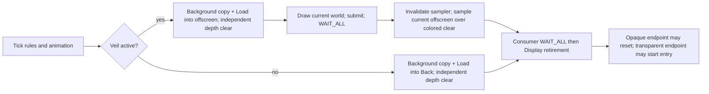

# Game animation and live RTT veil

The example owns the first two original stages, integer rules, animation and input. The shared `bloxorz_core` remains timer-free. The reference is the Web 400×240 pixel mode:20-degree vertical field of view,5:3 aspect,512×512 low atlas and MSAA off. Its corner-fit Camera targets(0,.6,0) and fits each stage independently. A local view-axis adapter accounts for the existing native renderer reflection. Native material/lighting and RGB565 quantization remain visible differences from Web PBR.

Animation and transition use independent clocks. Restart can begin the veil while a roll continues. A released block keeps its pose, tangent velocity, spin and gravity throughout fade-out. Goal closing begins together with fade-out after the landed pause. Rendering completion, rather than a stale animation callback, authorizes level replacement.

Each arrow into a consumer follows the producer completion boundary. Offscreen Color/Depth are application-owned; a TextureView and the normal submission facts pin its reads through consumer completion. The following frame can reuse the source after `gpu.wait`. A fault halts without manufacturing a reset. Color A/B alternate through the ordinary Display API; the source is never a Display Front.

## Rules and animation

An accepted move commits its future integer state immediately and retains its original pose. Bridges, tiles, glyphs and shadow receivers share a visual mask delayed 154ms from roll start. That delay continues across an early release. D-pad holds repeat after animation settlement; the newest still-held direction wins. START restarts; TRIANGLE/L1/R1 select the other of two stages; Square undoes. These controls clear queued directions. Fade completion discards locked-period edges and retains a held-D-pad lock until release. Disconnection clears active directions while autonomous presentation continues. SELECT toggles the original dither background and solid #2c2620 while input is unlocked.

| Animation | Time | Behavior |
| --- | --- | --- |
| Roll | 220ms | Quarter turn about the actual tile edge |
| Entry opening | 200ms | Smoothstep opening; hidden transverse zero-width panels are omitted |
| Entry rise | 380ms | Reverse 2.08-unit drop; width approaches 1 from .9 with the same easing |
| Goal opening | 200ms | Opening .86→.94; hatch remains visible |
| Goal drop | 420ms | Downward 2.08×(.4f+.6f²), width 1→.9 |
| Goal landed | 80ms | Brief pause at the bottom |
| Goal closing | 200ms | Closes while the 320ms veil proceeds; covered block then hides |
| Half-supported tip | 360ms | Quadratic quarter turn about the supported cell edge |
| Free fall | 600ms to notification | Preserved release pose, tangent velocity and angular speed; vertical term−16×(t/.6)² continues afterward |

Fully unsupported rolls release at the Web balance threshold, evaluated at the actual discrete tick: 79ms for standing, 169ms for a long-axis lying roll, 124ms for a perpendicular lying roll. Release does not snap to the unsupported destination. Tipping releases at twice its final nominal angular speed. The first-two-stage subset contains no fragile or split tiles. All updates clamp elapsed time to 50ms, without a catch-up loop. Ratios normalize integer milliseconds by 1/256 before reciprocal; fall ratios remain unclamped so motion continues during the veil.

Switch synchronization updates the shared visual mask. Each of two channel press effects has a 260ms age: cubic sink plus a sine overshoot and scale pulse, then a latched .05-unit sink clamped to a .015-unit glyph center. Heavy base and cap have separate immutable geometry, colors and centers; moving one shared Model publishes a distinct Instance for each. Native shading approximates the reference materials and does not reproduce its PBR emissive response exactly.

## Transition arithmetic and lifetime

The veil color is CSS #142238, quantized to encoded RGB565 word 0x1107 (expanded 16,32,57). Source and Display stay in ordinary encoded RGB565 mode; no second gamma transfer is applied. The full-screen quad uses nearest sampling, white uniform RGB, transmittance alpha, SrcOver and no depth write. Its target is freshly cleared to the veil color and its own depth is cleared independently. Every fading frame redraws the current source before sampling it.

| Transition | Time | Uniform transmittance |
| --- | --- | --- |
| Out | 320ms | 255−floor(51t/64) |
| Hold | 80ms | 0 |
| In | 380ms | floor(51t/76) |

The products fit u16. Native ROP quantizes alpha to Q6 with `(alpha8+2)>>2`, performs half-up/64 blending and rounds to RGB565. At alpha 128 the encoded channels are the half-up average of source and quantized veil. The opaque consumer is a real Frame; only its successful GPU wait and Display retirement reset rules, undo history, level generation and incoming animation. Hold/fade-in keep entry at its closed state. Successful presentation of the final transparent consumer releases the entry animation. Outgoing animation continues during out; incoming entry starts afterward.

## Storage and verification

Color A/B/depth remain at 0x400000/0x440000/0x480000, commands/push at 0x4c0000/0x4d0000. Original immutable background is 0x580000 (204800 bytes), offscreen Color/Depth 0x600000/0x640000, and the full 512 atlas mip chain starts at 0x680000. The asset tool checks disjoint allocations and generates mesh directories, Camera constants and the exact two stage inputs. It copies those assets through the normal CB06 boot-resource path; no instruction/Flash array is maintained separately.

The first-two-stage undo ring retains 256 snapshots in 176u16: each snapshot packs x4/z3/orientation2/bridge-mask2 into 11 bits across word boundaries. Each accepted core move increments the full 16-bit move count exactly once and rejects a count of 65535; undo therefore decrements that live count rather than storing a redundant copy. Restart/stage reset clear the ring. Pre-move states are unsplit PLAY states, so phase and inactive-cube fields are reconstructed. The unchanged general rule engine produces one scratch snapshot; this application compacts it after an accepted move. Asset validation rejects a level outside that representation. Undo restores the pre-move state and cancels presentation motion. A bounded regression crosses word boundaries, the 256-entry ring and the 255-move boundary, and verifies undo after the 65535 move limit. The default hook-enabled image uses 8185 of the 8192 static u16 words, leaving seven words; the boot packer enforces that arena limit.

Tests use actual instruction CPU, functional GPU and Display pixels. Independent Web matrices verify real entry, tip and release paths; both source solutions reach their goals. The live-veil test exercises both Back surfaces, background copy+Load, source and consumer waits, sampler invalidation, independent depth, a changing outgoing roll, all half-veil pixels, opaque color and locked-period input. It starts entry without controller input. These tests establish software/protocol/functional pixel behavior, and do not claim new board, RTL timing, GPU contention or FPS qualification. The scoped native CPU experiment and raw replay evidence are kept with their exact generated inputs outside tracked specifications.
